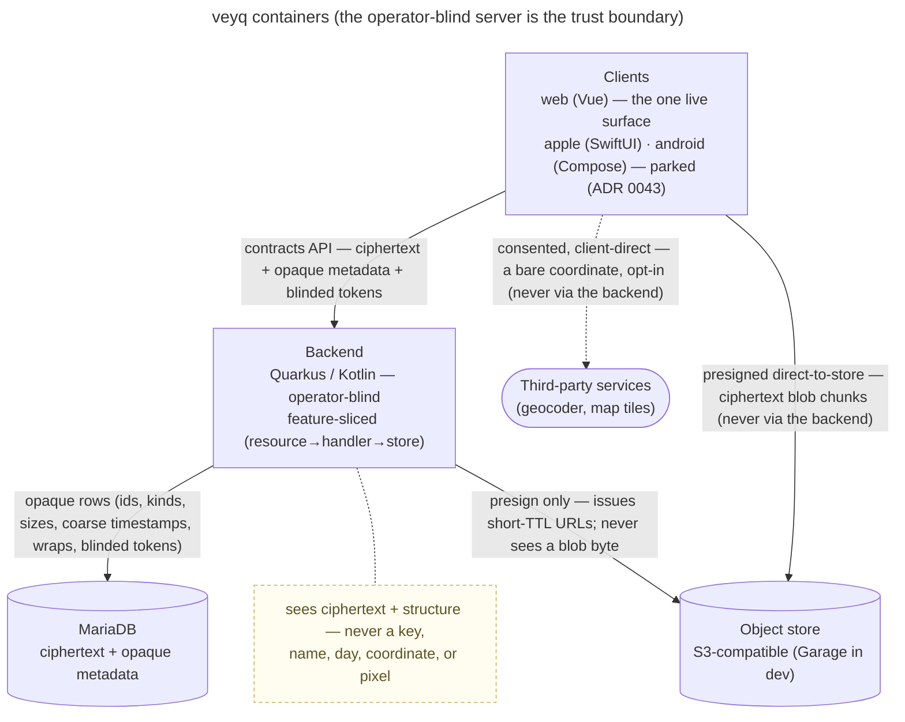
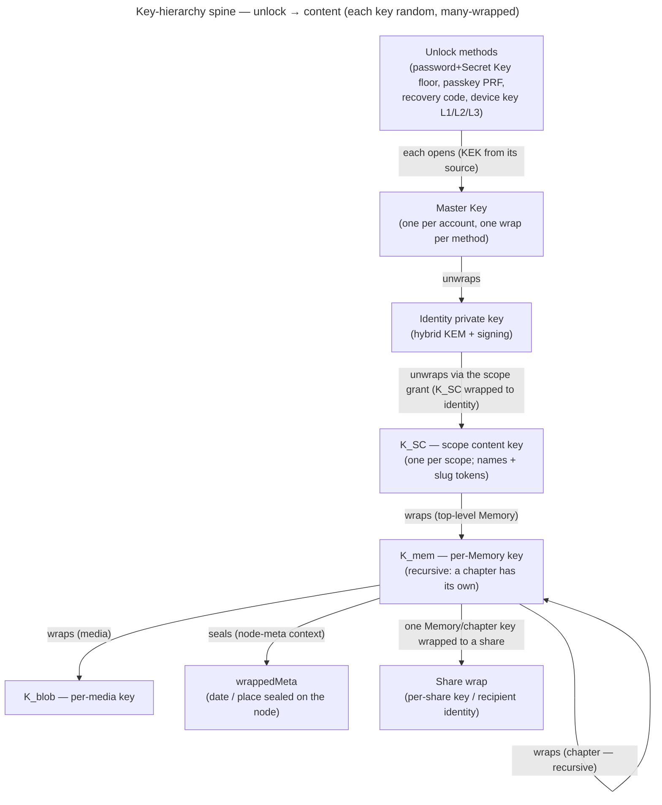
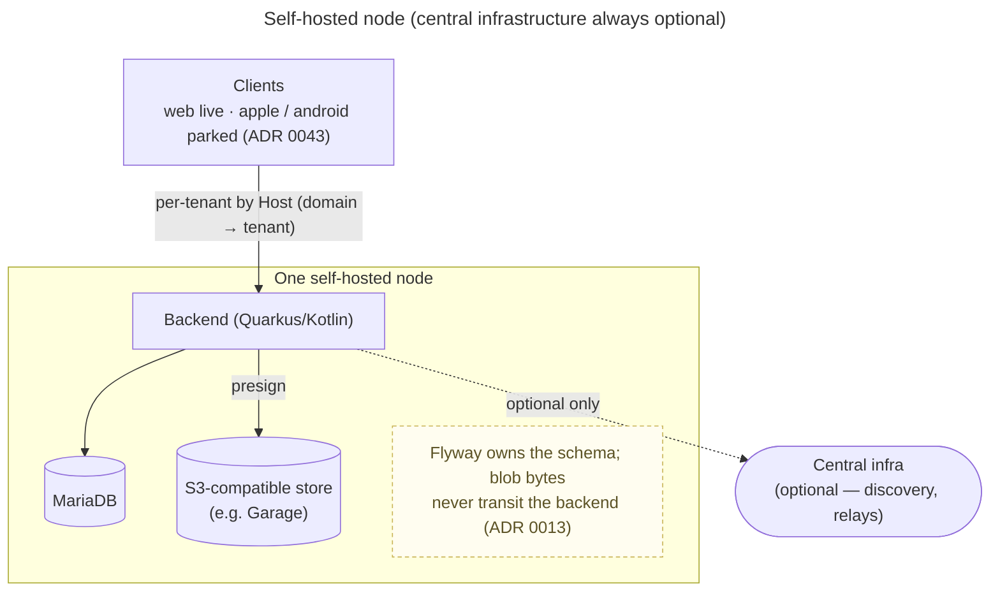

# veyq architecture — the whole-system map

The synthesized, current-state view of **how veyq is built** — the layer *above* the per-feature enablers,
the cross-cutting concerns, and the ADRs. It **stitches together** the views that no single doc owns
(components, the key-hierarchy spine end-to-end, deployment, data-flow) and **indexes** the rest. It
**references, never duplicates** — the detail lives in the linked docs; this page is the map. Its place in the
doc taxonomy: [docs/README](../README.md).

Kept current as work lands; it is a map, not a satisfiable record (no CR `satisfies:` it).

## Containers — who talks to whom

- **All content crypto is client-side.** The backend performs no content crypto and never sees the password
  ([security-model](../crosscutting/security-model.md), [ADR 0003](../decisions/0003-operator-blind-password-auth.md)).
- **API-first.** The contracts (`contracts/` — OpenAPI + crypto vectors) are the source of truth; backend DTOs
  + client SDKs are **generated**, never hand-written. Backend shape: **resource → handler → store** feature
  slices ([ADR 0001](../decisions/0001-backend-http-adapter-vs-application-slicing.md)); central auth/authz at
  the boundary ([ADR 0008](../decisions/0008-centralized-http-auth.md)).
- **Four client surfaces at parity** via shared contracts, not shared code
  ([ADR 0010](../decisions/0010-native-clients-shared-contracts-not-code.md); the ported UI/UX +
  [platform-parity](../crosscutting/platform-parity.md)).
- **Third parties are a separate, consented boundary** — the client may reach a geocoder / tile server
  *directly*, never proxied through veyq, so the veyq operator stays blind
  ([ADR 0016](../decisions/0016-geocoding-provider-neutrality.md); the boundary is in
  [security-model](../crosscutting/security-model.md)).

## The key-hierarchy spine (end-to-end)

The one chain each doc shows only a slice of — from an unlock gesture down to a sealed field. Random keys,
many-wrapped, so every level is an independent sharing grain.

Where each level lives: **unlock + Master Key + identity** →
[en.account.key-model](../features/account/enablers/en.account.key-model.md)
([ADR 0005](../decisions/0005-unlock-methods-and-device-trust.md)); **K_SC / grants** →
[scopes & tenancy](../crosscutting/scopes-and-tenancy.md) ([ADR 0007](../decisions/0007-membership-role-grant-relation.md)); **K_mem / K_blob / recursion / sharing** →
[en.memory.tree](../features/memory/enablers/en.memory.tree.md) +
[en.memory.media](../features/memory/enablers/en.memory.media.md)
([ADR 0012](../decisions/0012-content-key-hierarchy.md)); **wrappedMeta** →
[en.memory.node-meta](../features/memory/enablers/en.memory.node-meta.md); the crypto primitives that realize it
→ [ADR 0017](../decisions/0017-crypto-primitives-and-post-quantum-strategy.md) (vectors:
[ADR 0009](../decisions/0009-native-crypto-per-platform-vectors.md)). The whole-system security argument is
[security-model](../crosscutting/security-model.md).

## Cross-cutting spines (synthesis + where to read)

- **Operator-blind invariant & trust boundaries** — the veyq operator is the adversary; the server sees
  ciphertext + opaque operational metadata, never keys/content; third parties are a separate consented
  boundary. → [security-model](../crosscutting/security-model.md)
  ([ADR 0003](../decisions/0003-operator-blind-password-auth.md),
  [ADR 0015](../decisions/0015-operator-blind-readable-urls.md),
  [ADR 0016](../decisions/0016-geocoding-provider-neutrality.md)).
- **Auth stack (end-to-end)** — password → **auth keypair** (Ed25519, derived, never sent) → challenge-response
  login → **opaque, rotating session tokens** → the HTTP auth boundary. Deliberately **separate** from *unlock*.
  → [ADR 0003](../decisions/0003-operator-blind-password-auth.md) →
  [ADR 0004](../decisions/0004-session-tokens.md) → [ADR 0008](../decisions/0008-centralized-http-auth.md);
  the auth-vs-unlock split is [en.account.key-model](../features/account/enablers/en.account.key-model.md).
- **Passwordless-unlock orchestration** — a prompt-free data layer + a native app-layer secure-element gate,
  identical on every platform. →
  [en.account.passwordless-unlock](../features/account/enablers/en.account.passwordless-unlock.md)
  ([ADR 0011](../decisions/0011-uniform-passwordless-unlock-orchestration.md),
  [ADR 0005](../decisions/0005-unlock-methods-and-device-trust.md)).
- **Scope / tenancy model** — personal / group / tenant scopes; membership = (user, scope, role, grant); a
  tenant scope is born cold; groups are private even from the tenant owner. →
  [scopes & tenancy](../crosscutting/scopes-and-tenancy.md)
  ([ADR 0002](../decisions/0002-personal-scope-per-tenant.md),
  [ADR 0006](../decisions/0006-cold-tenant-scope-birth.md),
  [ADR 0007](../decisions/0007-membership-role-grant-relation.md),
  [ADR 0014](../decisions/0014-group-scopes-and-governance.md)); enablers
  [en.spaces.personal-scope](../features/spaces/enablers/en.spaces.personal-scope.md) /
  [en.spaces.group-scope](../features/spaces/enablers/en.spaces.group-scope.md).
- **Media data-flow** — client generates derivatives + seals each blob under its own `K_blob` (under `K_mem`) →
  uploads the ciphertext chunks **direct-to-store via presigned URLs**, never through the backend →
  `completeMedia` records opaque metadata + the wraps. →
  [en.memory.media](../features/memory/enablers/en.memory.media.md) +
  [en.memory.derivatives](../features/memory/enablers/en.memory.derivatives.md)
  ([ADR 0013](../decisions/0013-blob-storage-presigned-direct-to-store.md)).
- **Readable-but-blind URLs** — the content path rides the URL `#fragment`, resolved client-side; the operator
  never sees a name-derived slug. → [ADR 0015](../decisions/0015-operator-blind-readable-urls.md).

## Deployment — self-hostable by default

- **Self-hostable by default; central infrastructure always optional** (a hard invariant,
  [CLAUDE.md](../../CLAUDE.md)). A common deployment is one node, usually one tenant, self-administered — the
  Server Owner *is* the Tenant Owner ([ADR 0006](../decisions/0006-cold-tenant-scope-birth.md)).
- **S3-compatible, vendor-neutral store** — the backend signs via the AWS S3 SDK, never a vendor-locked client;
  the bundled dev store is a generic OSS S3 (Garage). Ops detail: [infra/README](../../infra/README.md)
  ([ADR 0013](../decisions/0013-blob-storage-presigned-direct-to-store.md)).
- **Host-based tenant routing** — the active tenant resolves from the request Host (port stripped);
  ([scopes & tenancy](../crosscutting/scopes-and-tenancy.md), [uc.admin.setup-server](../features/admin/use-cases/uc.admin.setup-server.md)).

## Decision map (ADRs by theme)

The 17 ADRs grouped — the "why" behind each spine above.

| Theme | ADRs |
|---|---|
| **Backend structure** | [0001](../decisions/0001-backend-http-adapter-vs-application-slicing.md) adapters/slicing · [0008](../decisions/0008-centralized-http-auth.md) central auth/authz |
| **Auth & session** | [0003](../decisions/0003-operator-blind-password-auth.md) password keypair · [0004](../decisions/0004-session-tokens.md) session tokens · [0011](../decisions/0011-uniform-passwordless-unlock-orchestration.md) passwordless orchestration |
| **Keys & crypto** | [0017](../decisions/0017-crypto-primitives-and-post-quantum-strategy.md) primitives + PQ strategy · [0012](../decisions/0012-content-key-hierarchy.md) content-key hierarchy · [0005](../decisions/0005-unlock-methods-and-device-trust.md) unlock methods & device trust · [0009](../decisions/0009-native-crypto-per-platform-vectors.md) per-platform vectors |
| **Scopes & tenancy** | [0002](../decisions/0002-personal-scope-per-tenant.md) personal scope per tenant · [0006](../decisions/0006-cold-tenant-scope-birth.md) cold tenant birth · [0007](../decisions/0007-membership-role-grant-relation.md) membership relation · [0014](../decisions/0014-group-scopes-and-governance.md) group scopes & governance |
| **Storage & URLs** | [0013](../decisions/0013-blob-storage-presigned-direct-to-store.md) S3 direct-to-store · [0015](../decisions/0015-operator-blind-readable-urls.md) blind readable URLs |
| **Clients & third parties** | [0010](../decisions/0010-native-clients-shared-contracts-not-code.md) shared contracts not code · [0016](../decisions/0016-geocoding-provider-neutrality.md) geocoding provider-neutrality |

## Where else to look

- **Doc taxonomy + rules:** [docs/README](../README.md) · **ADR format:** [decisions/README](../decisions/README.md)
- **Enablers (feature foundations):** account
  ([key-model](../features/account/enablers/en.account.key-model.md),
  [passwordless-unlock](../features/account/enablers/en.account.passwordless-unlock.md)), memory
  ([tree](../features/memory/enablers/en.memory.tree.md), [media](../features/memory/enablers/en.memory.media.md),
  [derivatives](../features/memory/enablers/en.memory.derivatives.md),
  [node-meta](../features/memory/enablers/en.memory.node-meta.md),
  [favorites](../features/memory/enablers/en.memory.favorites.md)), spaces
  ([personal-scope](../features/spaces/enablers/en.spaces.personal-scope.md),
  [group-scope](../features/spaces/enablers/en.spaces.group-scope.md))
- **Cross-cutting concerns:** [security-model](../crosscutting/security-model.md),
  [scopes & tenancy](../crosscutting/scopes-and-tenancy.md),
  [authorization](../crosscutting/cc.security.authorization.md),
  [rate-limit](../crosscutting/cc.security.rate-limit.md),
  [platform-parity](../crosscutting/platform-parity.md), the dev + ui styleguides
  ([developer](../crosscutting/developer-styleguide.md))
- **Conventions / working method:** [ai/README](../ai/README.md), root [CLAUDE.md](../../CLAUDE.md)
