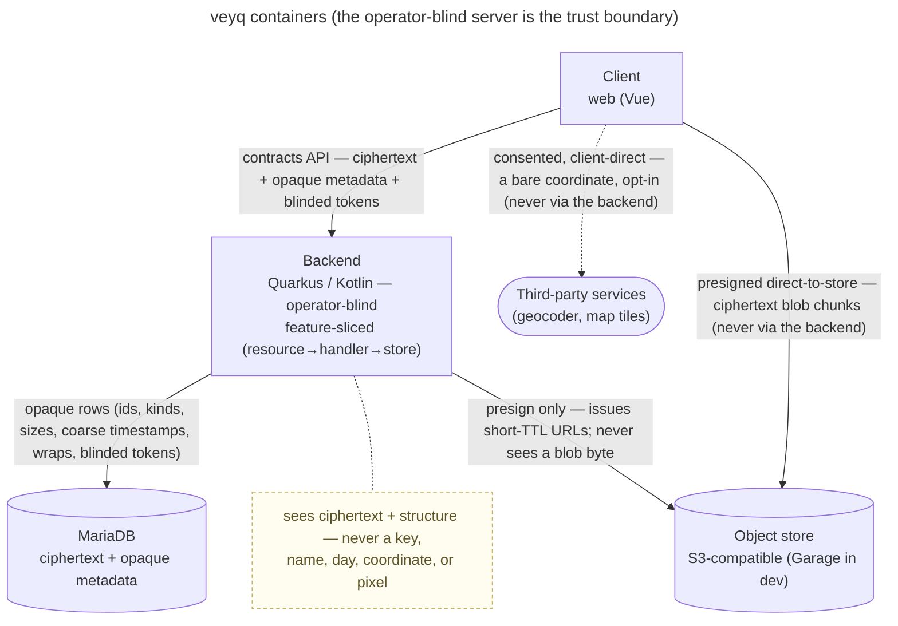
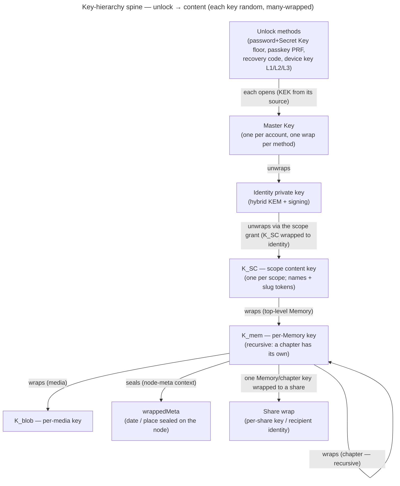
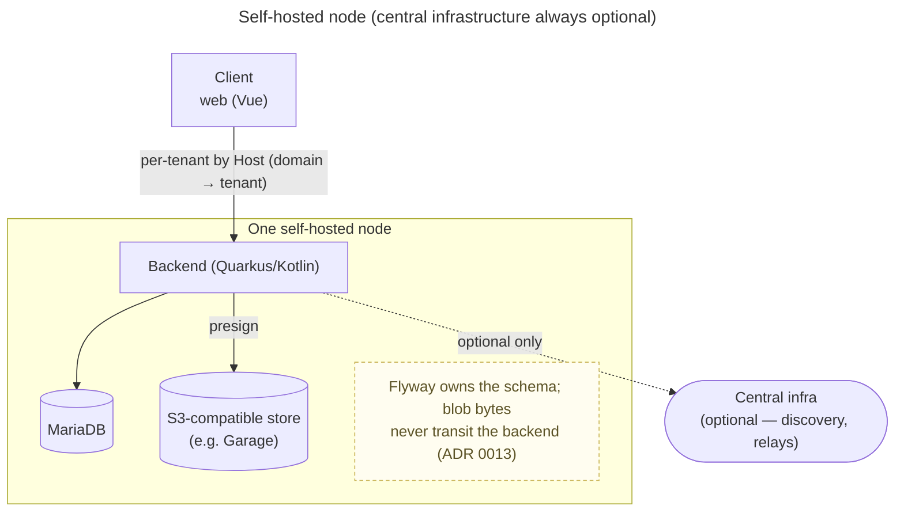

# veyq architecture

The current-state view of **how veyq is built**, in [arc42](https://arc42.org) order — a structure an outside
reader already knows, so they can find what they came for without learning ours first.

**This page is a map, not a compendium.** Every section states the shape and **points** at the doc that owns the
detail; it never restates it. Its place in the taxonomy: [docs/README](../README.md). arc42 is used as its
**markdown** template — it is a section structure, not a file format, and nothing here needs AsciiDoc. Twelve
sections, fixed: that bound is half the reason for adopting it.

Kept current as work lands; a map, not a satisfiable record (no CR `satisfies:` it).

## 1. Introduction and Goals

veyq is a **self-hostable, end-to-end-encrypted memory-sharing app**. The product center is the **Memory**
(nested into **Chapters**); folders only organize. People keep photos, dates, places and journal entries in
private spaces and share them deliberately — with a person, a group, or a link.

The three goals that outrank every other quality, in order:

1. **The operator cannot read your content — including the operator you are.** A user's unshared personal space
   is confidential even from whoever runs the server. This is not a feature; it is the product.
2. **Anyone can run it.** Self-hosting is the default deployment, not a degraded mode — and, since only a client
   the operator cannot alter holds goal 1 against an *active* operator, it is also how goal 1 is *kept*
   ([ADR 0026](../decisions/0026-client-trust-tiers.md)).
3. **The memories outlive the crypto that protects them.** These are decade-lived keepsakes, which makes
   harvest-now-decrypt-later a present threat and crypto-agility non-negotiable: post-quantum key wrapping from
   the start, a versioned suite id on every artifact, and upgrades that never re-encrypt what already exists
   ([ADR 0017](../decisions/0017-crypto-primitives-and-post-quantum-strategy.md)).

Stakeholders: the **person** whose memories these are; the **operator** who runs an instance (often the same
person, and explicitly *not* trusted with content); a **developer or reviewer** judging whether the encryption
claim holds.

## 2. Architecture Constraints

Non-negotiable, and every view below is downstream of them. Stated canonically in
[CLAUDE.md](../../CLAUDE.md) — the list here is the reader's orientation, not a second source of truth:

| Constraint | What it forbids |
|---|---|
| **Operator-blind E2EE everywhere** | any path where the server holds a content key, a password, or plaintext — including "just for a moment", including for the operator's own data |
| **Self-hostable by default** | any required central service; central infrastructure is always optional |
| **API-first** | hand-written DTOs; `contracts/` (OpenAPI + crypto vectors) is what code is generated from |
| **Product language: Memory / Chapter** | Album / Explorer models, APIs or tables |
| **No deprecated or vendor-locked dependencies** | anything EOL, archived, or whose only living successor is commercial — that would break self-hostability |

## 3. Context and Scope

**The trust boundary is the backend, and the adversary is on the inside of it.** What crosses it is ciphertext
plus operational metadata the server needs to route and bill bytes: ids, kinds, sizes, coarse timestamps,
membership, wraps, blinded tokens. What never crosses: a key, a password, a name, a day, a coordinate, a pixel.

**Third parties are a separate, consented boundary.** A client may reach a geocoder or tile server *directly* —
never proxied — so that using one leaks a bare coordinate to *that* party and still nothing to the veyq
operator ([ADR 0016](../decisions/0016-geocoding-provider-neutrality.md); the boundary is drawn in
[security-model](../crosscutting/security-model.md)).

## 4. Solution Strategy

| Goal (§1) | Strategy | Where it is decided |
|---|---|---|
| Operator cannot read content | **All content crypto is client-side.** The backend performs no content crypto and never sees the password: login is challenge-response against a derived public key, so there is no credential to steal. | [ADR 0003](../decisions/0003-operator-blind-password-auth.md), [security-model](../crosscutting/security-model.md) |
| …and cannot read it *later*, in bulk | **Envelope encryption with random per-level keys, many-wrapped** (§6) — every level is an independent sharing grain, so sharing never means re-encrypting content. | [ADR 0012](../decisions/0012-content-key-hierarchy.md) |
| …and cannot see bytes at all | **Blobs go direct-to-store via presigned URLs.** The backend signs; it never touches a blob byte. | [ADR 0013](../decisions/0013-blob-storage-presigned-direct-to-store.md) |
| Anyone can run it — and that *is* the security answer | **One node, no required central service**, a vendor-neutral S3 store, Host-based tenant routing. Self-hosting is what makes confidentiality hold against an *active* operator; on someone else's instance veyq is passive-safe and says so. | [ADR 0013](../decisions/0013-blob-storage-presigned-direct-to-store.md), [ADR 0006](../decisions/0006-cold-tenant-scope-birth.md), [ADR 0026](../decisions/0026-client-trust-tiers.md) |
| The memories outlive their crypto | **Post-quantum key wrapping from the start** (hybrid X25519 + ML-KEM-768 — safe if *either* holds) + a **versioned suite id** on every artifact, so a suite can be upgraded without ever re-encrypting what exists. Conformance vectors pin a suite's bytes, so a refactor cannot silently move them. | [ADR 0017](../decisions/0017-crypto-primitives-and-post-quantum-strategy.md) |

## 5. Building Block View

- **`backend/`** — Quarkus / Kotlin. **Two axes on purpose:** the application layer is **use-case-sliced**
  (`features/<area>/<use-case>/…Handler`) — that is where cohesion and the trust chain live; the HTTP adapter
  layer is **resource-shaped** (one `…Resource` per generated API interface), because one endpoint can serve
  several use-cases. Cross-cutting code lives in `shared/`, which must not depend on a feature.
  → [ADR 0001](../decisions/0001-backend-http-adapter-vs-application-slicing.md),
  [developer-styleguide](../crosscutting/developer-styleguide.md)
- **Authentication and coarse authorization are central**, declared at the resource boundary and default-deny;
  fine-grained content authorization is a small domain guard in the handler — a different layer.
  → [ADR 0008](../decisions/0008-centralized-http-auth.md),
  [cc.security.authorization](../crosscutting/cc.security.authorization.md)
- **`web/`** — Vue 3 + PrimeVue, and **the client surface**. All content crypto runs here.
- **`contracts/`** — OpenAPI + crypto vectors. The source of truth both sides are generated from; never a
  hand-written DTO.

## 6. Runtime View

The one chain each doc shows only a slice of — an unlock gesture down to a sealed field:

Where each level is owned: **unlock + Master Key + identity** →
[en.account.key-model](../features/account/enablers/en.account.key-model.md)
([ADR 0005](../decisions/0005-unlock-methods-and-device-trust.md)) · **K_SC / grants** →
[scopes & tenancy](../crosscutting/scopes-and-tenancy.md)
([ADR 0007](../decisions/0007-membership-role-grant-relation.md)) · **K_mem / K_blob / recursion / sharing** →
[en.memory.tree](../features/memory/enablers/en.memory.tree.md) +
[en.memory.media](../features/memory/enablers/en.memory.media.md)
([ADR 0012](../decisions/0012-content-key-hierarchy.md)) · **wrappedMeta** →
[en.memory.node-meta](../features/memory/enablers/en.memory.node-meta.md) · the primitives that realize it →
[ADR 0017](../decisions/0017-crypto-primitives-and-post-quantum-strategy.md) (which also pins their bytes as
conformance vectors).

**Every other runtime flow is drawn where it belongs** — each use-case doc carries its own sequence diagram
(login, unlock, add media, share, add member, rotate a scope key…). This page does not copy them:
[features/](../features/). The whole-system security argument is
[security-model](../crosscutting/security-model.md).

## 7. Deployment View

- **Self-hostable by default; central infrastructure always optional.** The common deployment is one node,
  usually one tenant, self-administered — the Server Owner *is* the Tenant Owner
  ([ADR 0006](../decisions/0006-cold-tenant-scope-birth.md)).
- **S3-compatible, vendor-neutral store** — the backend signs via the AWS S3 SDK, never a vendor-locked client;
  the bundled dev store is a generic OSS S3 (Garage). Ops detail: [infra/README](../../infra/README.md)
  ([ADR 0013](../decisions/0013-blob-storage-presigned-direct-to-store.md)).
- **Host-based tenant routing** — the active tenant resolves from the request Host (port stripped)
  ([scopes & tenancy](../crosscutting/scopes-and-tenancy.md),
  [uc.admin.setup-server](../features/admin/use-cases/uc.admin.setup-server.md)).

## 8. Cross-cutting Concepts

- **Operator-blind invariant & trust boundaries** — the operator is the adversary; the server sees ciphertext +
  opaque operational metadata, never keys or content; third parties are a separate consented boundary. →
  [security-model](../crosscutting/security-model.md)
  ([ADR 0003](../decisions/0003-operator-blind-password-auth.md),
  [ADR 0015](../decisions/0015-operator-blind-readable-urls.md),
  [ADR 0016](../decisions/0016-geocoding-provider-neutrality.md))
- **Auth ≠ unlock, and the split is deliberate.** Password → auth keypair (Ed25519, derived, never sent) →
  challenge-response login → opaque rotating session tokens → the HTTP auth boundary. A session grants a role
  over *ciphertext*; it never opens content. →
  [ADR 0003](../decisions/0003-operator-blind-password-auth.md) →
  [ADR 0004](../decisions/0004-session-tokens.md) → [ADR 0008](../decisions/0008-centralized-http-auth.md);
  the split itself is [en.account.key-model](../features/account/enablers/en.account.key-model.md).
- **Passwordless unlock** — a device-held key wrap that opens the master key without a password, enrolled per
  device and revocable. →
  [uc.account.remember-this-device](../features/account/use-cases/uc.account.remember-this-device.md)
  ([ADR 0005](../decisions/0005-unlock-methods-and-device-trust.md))
- **Scope / tenancy model** — personal / group / tenant scopes; membership = (user, scope, role, grant); a
  tenant scope is born cold; groups are private even from the tenant owner. →
  [scopes & tenancy](../crosscutting/scopes-and-tenancy.md)
  ([ADR 0002](../decisions/0002-personal-scope-per-tenant.md),
  [ADR 0006](../decisions/0006-cold-tenant-scope-birth.md),
  [ADR 0007](../decisions/0007-membership-role-grant-relation.md),
  [ADR 0014](../decisions/0014-group-scopes-and-governance.md))
- **Media data-flow** — the client generates derivatives and seals each blob under its own `K_blob` (under
  `K_mem`), uploads ciphertext chunks direct-to-store via presigned URLs, then records opaque metadata + the
  wraps. → [en.memory.media](../features/memory/enablers/en.memory.media.md) +
  [en.memory.derivatives](../features/memory/enablers/en.memory.derivatives.md)
  ([ADR 0013](../decisions/0013-blob-storage-presigned-direct-to-store.md))
- **Readable-but-blind URLs** — the content path rides the URL `#fragment`, resolved client-side; the operator
  never sees a name-derived slug. → [ADR 0015](../decisions/0015-operator-blind-readable-urls.md)
- **Forward secrecy per scope** — removing a member rotates the scope key forward an epoch; old content stays
  readable to those who kept access, new content is closed to the removed member. →
  [ADR 0024](../decisions/0024-scope-key-rotation.md), [ADR 0025](../decisions/0025-forward-secrecy-policy-per-scope.md)

## 9. Architecture Decisions

The decisions that shape the views above, by theme. **This is a reader's path in, not the full set** —
[decisions/](../decisions/) is the only complete list, and stating its size here would only be one more number
to keep true.

| Theme | ADRs |
|---|---|
| **Backend structure** | [0001](../decisions/0001-backend-http-adapter-vs-application-slicing.md) adapters/slicing · [0008](../decisions/0008-centralized-http-auth.md) central auth/authz · [0042](../decisions/0042-http-failure-projection.md) single-source failure projection |
| **Auth & session** | [0003](../decisions/0003-operator-blind-password-auth.md) password keypair · [0004](../decisions/0004-session-tokens.md) session tokens |
| **Keys & crypto** | [0017](../decisions/0017-crypto-primitives-and-post-quantum-strategy.md) primitives + PQ strategy + conformance vectors · [0012](../decisions/0012-content-key-hierarchy.md) content-key hierarchy · [0005](../decisions/0005-unlock-methods-and-device-trust.md) unlock methods & device trust |
| **Scopes & tenancy** | [0002](../decisions/0002-personal-scope-per-tenant.md) personal scope per tenant · [0006](../decisions/0006-cold-tenant-scope-birth.md) cold tenant birth · [0007](../decisions/0007-membership-role-grant-relation.md) membership relation · [0014](../decisions/0014-group-scopes-and-governance.md) group scopes & governance · [0024](../decisions/0024-scope-key-rotation.md) key rotation |
| **Storage & URLs** | [0013](../decisions/0013-blob-storage-presigned-direct-to-store.md) S3 direct-to-store · [0015](../decisions/0015-operator-blind-readable-urls.md) blind readable URLs |
| **Provider neutrality** | [0016](../decisions/0016-geocoding-provider-neutrality.md) geocoding · [0018](../decisions/0018-map-tiles-provider-neutrality.md) map tiles |
| **Client integrity** | [0026](../decisions/0026-client-trust-tiers.md) trust tiers — self-hosting is the guarantee |
| **Coverage & process** | [0040](../decisions/0040-coverage-gaps-and-http-not-a-surface.md) what counts as a covered surface |

## 10. Quality Requirements

In priority order. The first one wins every conflict, by construction rather than by discipline — the server
has no key to misuse.

| Quality | The bar | How it is held |
|---|---|---|
| **Confidentiality from the operator** | absolute. Not "hard to abuse" — *impossible without a client key*. A full DB + object-store dump yields ciphertext, public keys and wrapped blobs, and derives nothing. | §4's strategies; argued end-to-end in [security-model](../crosscutting/security-model.md) |
| **Self-hostability** | one `docker compose up` + a JVM; no account with anyone, no phone-home, no required central service | [infra/README](../../infra/README.md) |
| **Forward secrecy on removal** | a removed member cannot read content created after their removal | [ADR 0024](../decisions/0024-scope-key-rotation.md) |

**Deliberately unstated:** there is no latency, throughput or availability target, and inventing one here would
be fiction. veyq's load model is a household, and the expensive paths (crypto, derivatives) run on the client.
If a target is ever needed, it becomes an ADR — not a line in this table.

## 11. Risks and Technical Debt

Known, current, and each with an owner document. This section exists so that debt has *one* address instead of
being scattered across an ADR's prose, a coverage field, and an audit file.

| Risk / debt | Why it matters | State |
|---|---|---|
| **Two use-cases are built but unproven.** `uc.admin.setup-server` on web, `uc.spaces.verify-identity` on backend — code shipped, no test linked. | A coverage claim is only worth the build behind it. These are the only two real gaps in the model. | Tracked as `gaps:` in [coverage/](../coverage/) — the honest kind: a debt on a surface we target. |
| **No CI runs any end-to-end test.** `web`'s `*.e2e.test.ts` are gated on `VEYQ_E2E` and skipped by every run; the `web-e2e` job is `if: false` because its orchestrator (`scripts/run_web_e2e.py`) is gone. | These are the tests that catch what unit tests structurally cannot — real crypto against a real backend and a real store. One of them caught a security-relevant key-zeroing bug that every unit test passed. Today they run only when a human remembers. | Open, and the highest-value item here. The skeleton is recovered into the tree (it does not run as-is: it globs `frontend/`, passes `VEYQ_API_BASE` where the suites read `VEYQ_BASE`, and sets two knobs that never existed) — so this is a **port**, not a rewrite from nothing, then drop the `if: false`. Worked as [`changes/cr-e2e-orchestrator.md`](../../changes/cr-e2e-orchestrator.md). |
| **`uc.spaces.verify-identity` contradicts itself** — `status: planned` while carrying real web coverage. | A file that lies about its own state teaches the next reader the wrong shape. | Open. Not guard-worthy: one file filled in wrong. |
| **Bucket primary-uniqueness is claimed but not enforced.** [ADR 0034](../decisions/0034-media-uploader-buckets.md) §4 wants one primary per `(node_id, owner_key)`; `V35` carries only a plain index, and `ensurePrimaryBucket` is a read-then-write. Two concurrent resolves of a missing primary each create one — measured, reproducible on demand. | An uploader would appear twice in the "Beiträge" tab with their media split across the two rows. No confidentiality impact (opaque `owner_key`s, names stay sealed) and **zero observed cost** — reachability is low: the web upload queue is sequential, and the read path only materializes for pre-cr0113 media. | Open, low priority. The portable fix is the marker-column + plain `UNIQUE` that `veyq_node` already uses for slugs (`ux_node_parent_slug`, V10) — **due when buckets are next touched**, and it needs a dedup of already-doubled primaries before the index will build. |
## 12. Glossary

The words this project uses precisely. Where a term has a tempting synonym, the synonym is **wrong here**.

| Term | Meaning |
|---|---|
| **Memory** | the product's unit of content — a moment with photos, a date, a place, journal text. **Not** an "album". |
| **Chapter** | a Memory nested inside a Memory. Recursive: it has its own content key. **Not** a "sub-album". |
| **Folder** | organizes only; carries no content and no key of its own. |
| **Scope** | the keyed container everything lives in, and the unit of sharing. Three kinds: **personal** (one per user per tenant), **group** (private even from the tenant owner), **tenant** (the root, born cold at activation). |
| **Tenant** | one instance's household/organization, resolved from the request **Host**. One server may host many. |
| **Membership** | the relation `(user, scope, role, grant)` — being *in* a scope. Distinct from holding its key. |
| **Grant** | a scope's current content key (`K_SC`) sealed to a member's identity public key. One wrap = the whole scope. Holding a membership without a grant means you are in the room but cannot read. |
| **Wrap** | any key sealed under another key. The Master Key has one wrap per unlock method; a share has its own. |
| **Master Key** | the account root (32 bytes), in client memory only, opened by any unlock method's KEK. |
| **Secret Key** | the user's high-entropy second factor, combined with the password to derive the unlock KEK. **Never reaches the server.** Lives in the Emergency Kit. |
| **Emergency Kit** | the Secret Key + a recovery code, saved by the user at setup. The only path back after a forgotten password. |
| **Epoch** | a generation of a scope's content key. Removing a member rotates the scope forward one epoch. |
| **K_SC / K_mem / K_blob** | scope content key / per-Memory key / per-media key. Each random, each wrapped by the level above — that is what makes every level an independent sharing grain. |
| **Operator-blind** | the server stores and serves only ciphertext + opaque metadata, and *cannot* do otherwise — it holds no content key. The operator is modelled as the adversary. |
| **Server Owner** | the person who installed the instance. A server role over ciphertext — **not** a reader of content. |
| **Tenant Owner** | governs one tenant (members, groups, terms). In the common self-hosted case, the same person as the Server Owner — and still not a reader. |
| **Surface** | a place veyq's behaviour is built and proven: `backend` and `web`, and that is the whole set. Coverage follows the **build**, never the intention — a test no CI run executes proves nothing, however real it is ([ADR 0040](../decisions/0040-coverage-gaps-and-http-not-a-surface.md)). |

## Where else to look

- **Doc taxonomy + rules:** [docs/README](../README.md) · **ADR format:** [decisions/README](../decisions/README.md)
- **Working method (and who these docs are for):** [ai/README](../ai/README.md) · root [CLAUDE.md](../../CLAUDE.md)
- **Features** (use-cases + enablers, each with its own runtime diagram): [features/](../features/)
- **Cross-cutting concerns:** [crosscutting/](../crosscutting/)
- **What is proven, and where:** [coverage/](../coverage/)
- **The published, plain-language view for end users (EN+DE):** [`wiki/`](../../wiki/)
