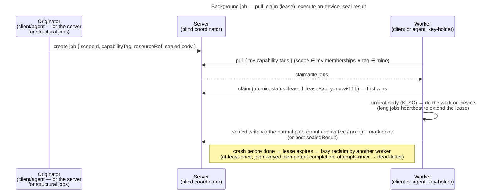

# Background tasks — operator-blind job mechanism

How veyq runs work over content that the **blind server cannot do itself** (deliver a grant, transcode, run
on-device ML): the server coordinates opaque jobs; **keyed workers** do the work on-device. This is the
reference; the decisions + rationale live in [ADR 0021](../decisions/0021-operator-blind-background-tasks.md).

## Model

- **Coordinator = the veyq backend** (a job table). No broker/MQTT, no extra daemon. Discovery is **pull /
  reconcile-on-entry**; a push channel (SSE) is a later seam on the same server.
- **Workers = an equal, self-selecting pool.** Any **interactive client** *or* the headless **agent** is a
  worker on the same protocol. A blind server can't schedule work it can't read, so workers pull and self-select.
- **Eligibility = holding the scope key.** A worker can only act on a job whose `scopeId` it holds a grant for
  (it unseals the body with a `K_SC`-derived key). **Capability = opaque tags** the worker can process.

## The job envelope

| Field | Visibility | Meaning |
|---|---|---|
| `jobId` | cleartext | stable id; keys idempotent completion |
| `scopeId` | cleartext | routing key — the server already knows membership |
| `capabilityTag` | cleartext, **opaque** | which capability the job needs (fixed public registry in `contracts/`; a bare dump sees `0x9f3a`, not `face-recognition`) |
| `resourceRef` | cleartext, opaque id | the resource acted on (e.g. a mediaId) |
| `status` / `leaseHolder` / `leaseExpiry` / `attempts` | cleartext | lease + retry bookkeeping |
| **body** (`type` + params) | **sealed** (under a `K_SC`-derived key, context `job`) | the actual task + parameters — only a scope-key-holder unseals it |
| `sealedResult` (optional) | **sealed**, opaque | a job-specific output when it is not already a normal artifact |

## Lifecycle

- **Claim / lease.** Atomic (`WHERE status='pending'`, MariaDB `SKIP LOCKED`). Cheap idempotent jobs need no
  real lease (first-online-wins); expensive jobs lease with a **TTL** and **heartbeat** to keep it. A crash →
  the lease expires → **lazy reclaim**. `attempts` + a max → **dead-letter**.
- **Result.** Usually a normal **sealed** write via an existing path (a grant onto a membership, a derivative
  blob, a node update) → mark `done`; the originator observes it through that path. Otherwise an optional sealed
  `sealedResult`. No plaintext result store.
- **Origination.** The server may originate only **structural, non-sensitive** jobs it already understands
  (grant-less membership → `grant-delivery`). **Content-processing jobs are client/agent-originated**, so the
  server never picks a content-semantic type.

## What the operator sees (honest)

Content and results are **sealed throughout** — that guarantee holds. But the mechanism's metadata exposure is
**correlation-bounded, not label-bounded**: from blob **sizes**, **timing**, **which worker** acts, run
duration, and the **output artifact** that appears, a correlating operator can infer the *character* of a job
(big blob → job → agent → derivative ≈ a transcode) regardless of the tag scheme. Opaque tags keep gratuitous
plaintext labels out of the DB (defense vs. a bare dump), **not** defeat a correlating/hosted operator — which
is the already-declared, accepted gap ([security-model → key-directory & active-operator](security-model.md);
self-hosted makes it moot). Keyed-per-scope tags remain a seam for future low-footprint, ambiguous types.

## Persistence

The queue/claim/lease machinery is **bought, not built** — but the "buy" here is the **DB's own atomic
primitive**, not a job framework. **Resolved (cr-0076):** the workers are *remote key-holders that pull over
HTTP* (interactive clients + the later agent), so a server-side execution framework (JobRunr, db-scheduler)
does **not** fit — those run jobs *on the server*, which is exactly what a blind veyq server cannot do (it
holds no key). The claim is therefore a thin, portable **compare-and-set on `status`** (read a claimable
candidate → `UPDATE … WHERE id=? AND status=<prior>`; first writer wins, losers retry). It behaves identically
on the **H2 test DB** and **MariaDB**, so `./gradlew check` exercises the real claim path; MariaDB's
`FOR UPDATE SKIP LOCKED` (≥10.6) stays available as a throughput optimisation layered on top if contention ever
warrants it, but is **not** required for correctness. `attempts` is incremented on each (re)claim so a crashed
worker's job is lazily reclaimed and, once it reaches `max_attempts`, dead-lettered. Only the **blind layer**
(envelope, key-eligibility, sealed body/result, the tag registry) is veyq-specific, kept a thin decoupled
module (extraction-ready, not extracted).

## Consumers

- **First:** member-add grant delivery ([uc.spaces.add-member](../features/spaces/use-cases/uc.spaces.add-member.md),
  [ADR 0020](../decisions/0020-grant-distribution-invite-wrap.md)) — trivial blind body, universal tag, no lease;
  validates the core loop.
- **Informing (later):** media derivatives / **transcode** (Uploads — inbox #17),
  **face-recognition / on-device ML** (Agent — inbox #10/#23) — the heavy consumers that
  shaped the lease/tags/result.

## Related

- Decision: [ADR 0021](../decisions/0021-operator-blind-background-tasks.md) (this mechanism),
  [ADR 0020](../decisions/0020-grant-distribution-invite-wrap.md) (grant distribution — the first consumer)
- Concepts: [Security Model](security-model.md) (operator-blind, the accepted gaps),
  [Scopes & Tenancy](scopes-and-tenancy.md) (the scope key a worker must hold)
