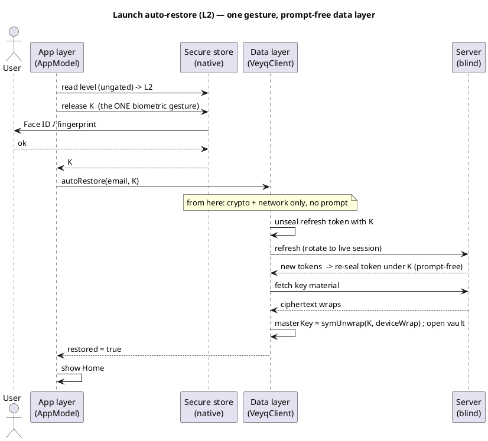

# Passwordless unlock mechanism (L2/L3) — one mechanism, native per platform

> The **single reference** for how a passwordless device (L2 biometric / L3 no-login) resumes its session
> and opens the vault. It is arranged so **every platform implements the same mechanism** with its own
> native APIs — an external reviewer studies *this one document* and then only checks the per-platform
> **native-API mapping** below. Engineering sibling of the [Account & Key Model](account-key-model.md);
> governed by [ADR 0011](../decisions/0011-uniform-passwordless-unlock-orchestration.md) (the layering),
> [ADR 0005](../decisions/0005-unlock-methods-and-device-trust.md) (the levels), and
> [ADR 0010](../decisions/0010-native-clients-shared-contracts-not-code.md) (parity via contracts, not code).
>
> This is the **target model**. What has actually landed per surface is tracked in the
> [parity matrix](platform-parity.md) and [cr-0024](../../changes/cr-0024-unify-passwordless-unlock-mechanism.md).
> Scope note: this is the **native secure-element** path (apple / android, later windows / linux). Web's
> passwordless path is a different mechanism (WebAuthn passkey + PRF) and web persists **no** session, so the
> persisted-session flow here is native-only by design (see *Web* below).

## The one rule: two layers, and where the prompt lives

A passwordless unlock is split into exactly two layers, identically on every platform:

| Layer | Owns | May it prompt the user? | Same on every platform? |
|---|---|---|---|
| **Data layer** (`VeyqClient` etc.) | crypto + network: token (un)sealing, session resume/rotation, wrap unwrap, vault open | **No — never** | **Yes** — identical method set, takes `K` as bytes |
| **App / UI layer** (`AppModel` etc.) | the native secure store + biometric / secure-element gate; releasing `K` | **Yes** — this is the only place a prompt happens | No — **native APIs per platform** |

The data layer is a **pure crypto + network engine**: hand it the already-released device key `K` and it does
the rest, with **no knowledge** of Keychain / Keystore / biometrics. The app layer is the **only** place that
touches the platform secure element and shows a prompt. This is the whole mechanism in one sentence:

> **The app layer releases `K` natively, then calls the prompt-free data layer with `K`.**

## The two-part secure store

Per device, per account, the store holds two parts with **different gates** — so the *level* is always
knowable without a prompt, and only the *secret* costs a gesture:

- **Ungated meta** — `{ level, wrapId, sealedRefreshToken }`. Readable with **no prompt**. The level decides
  which UI to show; the **sealed** refresh token (ciphertext, see below) is updated on every rotation
  **prompt-free**.
- **Gated secret** — `{ K }`, the device-held random key.
  - **L2:** released **only after a live biometric** (Secure-Enclave / Keystore key, biometry-current gate).
  - **L3:** **ungated** (released whenever the device is unlocked — the OS lock screen is the only gate).

`K` *is* the KEK for the passwordless wrap: `device-key wrap = symWrap(K, masterKey, "master-key")`, stored
server-side as a `method=DEVICE` wrap (no contract change; the server cannot tell L2 from L3 — both are the
same ciphertext). The refresh token is **sealed under `K`**: `sealedRefreshToken = symWrap(K, token,
"session-token")` ([cr-0023](../../changes/cr-0023-gate-l2-session-token.md)) — so the store and the data
layer only ever see **ciphertext**, never a usable token at rest.

## The unified sequences

### 1. Launch auto-restore — the single-gesture flow

This is the flow the "exactly one prompt at launch" property lives in. Note the prompt is **entirely** in the
app layer; the data layer's `autoRestore(email, K)` never prompts.

For **L3** the diagram is identical except the "release `K`" step is **ungated** (no gesture). For a dead /
rotated-out token, `autoRestore` returns `false` and the app falls back to the **floor** (L0).

### 2. Enrol — set the level (L2/L3)

Runs at unlock time (the Master Key is already in memory). The app layer creates/stores `K` natively; the
data layer wraps and persists.

1. App layer (native): create the secure-element key / random `K` at the chosen gate (L2 biometric, L3
   ungated); obtain `K`.
2. Data layer `setPasswordlessLevel(email, level, K)`: `device-key wrap = symWrap(K, masterKey)` → add wrap
   server-side → persist `{ level, wrapId, sealedRefreshToken }` (token sealed under `K`). Replaces any prior
   convenience wrap; rolls back the server wrap on a commit failure.

### 3. Mid-session token rotation — prompt-free

Every `refresh()` re-seals the rotated refresh token under the **in-memory** `K` (held since enrol/restore)
and writes it to the ungated meta. Pure AES-GCM — **no** secure-element use, **no** prompt. No-op if `K`
isn't held; a plaintext token is **never** written.

### 4. Fallback to the floor

Any failure of the convenience path — no record, dead token, missing/incompatible server wrap, biometric
cancelled, key invalidated — degrades to the **L0 floor** (password + Secret Key). The client never
self-wipes on a single server response (a blind operator must not be able to force a wipe by withholding the
wrap — [ADR 0005](../decisions/0005-unlock-methods-and-device-trust.md); the device-security use-cases, E1).

## Native-API mapping (the only per-platform part)

| Concern | Apple | Android | Web | Windows (planned) | Linux (planned) |
|---|---|---|---|---|---|
| Ungated meta store | Keychain item (`WhenUnlockedThisDeviceOnly`) | `SharedPreferences` / meta | — (no persisted session) | DPAPI-protected store | Secret Service (unlocked) |
| Gated `K` — L2 | Keychain `.biometryCurrentSet` + Secure Enclave | Keystore key (`setUserAuthenticationRequired`) + `BiometricPrompt` (StrongBox if present) | — (passkey + PRF instead) | Windows Hello (`KeyCredentialManager`) | `fprintd` / TPM-bound key |
| Gated `K` — L3 | Keychain ungated (`WhenUnlockedThisDeviceOnly`) | Keystore key, no auth requirement | — | DPAPI | Secret Service |
| Release gesture | Face ID / Touch ID (OS-driven by the ACL) | `BiometricPrompt` (Activity-bound, async) | — | Windows Hello | `fprintd` |
| Crypto (`symWrap`/`symUnwrap`) | `VeyqCrypto` | `:crypto` | `v1.ts` | BouncyCastle.NET | Rust crypto crate |

All crypto rows are **vector-pinned** identical ([ADR 0009](../decisions/0009-native-crypto-per-platform-vectors.md));
only the **store + gesture** rows are genuinely native. Everything *between* releasing `K` and opening the
vault is the same code path per platform but **the same algorithm everywhere**.

### Web

Web has **no persisted session** (in-memory tokens; the Master Key is worker-cached and dies on real close —
[ADR 0005 §6](../decisions/0005-unlock-methods-and-device-trust.md)), so the *persisted-session* mechanism on
this page is **native-only**. Web's passwordless unlock is the separate **WebAuthn passkey + PRF** method.
The *rule* still holds trivially: web's data layer is already prompt-free. A future "stay signed in on web"
(L3-web) would follow the same two-layer rule.

## What stays invariant at every level

- **Operator-blind.** The server holds only ciphertext wraps + an opaque, **sealed** session token. It never
  sees `K`, the Master Key, the Secret Key, or the password — and cannot distinguish L2 from L3 (same
  ciphertext; the gate is purely local). This is the [hard invariant](../../CLAUDE.md); the layering is a
  client-internal arrangement only.
- **Exactly one prompt at launch.** One gesture releases `K`; `K` opens **both** the sealed token and the
  vault. An app-layer property, uniform across platforms.
- **No password / Secret Key / Master Key at rest.** The wrapping key is a **random**, device-bound `K`, not
  the password — so an extracted key opens **this device's vault only**, never a way to authenticate
  elsewhere (bounded blast radius; [biometric-unlock](../features/account/use-cases/uc.account.biometric-unlock.md)).
- **Token sealed under `K`.** The persisted refresh token is useless without the (gated) `K` — closing
  security finding M2 ([cr-0023](../../changes/cr-0023-gate-l2-session-token.md)).

## What is identical vs. native (reviewer's summary)

- **Identical (read once, verify once):** the two-layer split; the prompt-free data-layer surface
  (`setPasswordlessLevel(email, level, K)`, `resumeSession(email, K)`, `unlockWithKey(email, K)`,
  `autoRestore(email, K)`); the two-part store shape; token sealing/unsealing; the four sequences above; the
  fallback-to-floor rule.
- **Native (verify per platform, against the mapping table):** which secure-element / keystore API stores
  `K`, which gate (`.biometryCurrentSet` / `setUserAuthenticationRequired` / Hello / fprintd) guards it, and
  how the release gesture is invoked.

## Related

- Decisions: [ADR 0011](../decisions/0011-uniform-passwordless-unlock-orchestration.md) (this layering),
  [ADR 0005](../decisions/0005-unlock-methods-and-device-trust.md) (levels),
  [ADR 0010](../decisions/0010-native-clients-shared-contracts-not-code.md) (parity via contracts),
  [ADR 0009](../decisions/0009-native-crypto-per-platform-vectors.md) (vector-pinned crypto),
  [ADR 0003](../decisions/0003-operator-blind-password-auth.md) (auth vs. unlock — why passwordless needs a
  persisted session).
- Concepts: [Account & Key Model](account-key-model.md), [Security Model](security-model.md),
  [Cross-platform parity matrix](platform-parity.md).
- Use-cases: [biometric-unlock (L2)](../features/account/use-cases/uc.account.biometric-unlock.md),
  [auto-unlock (L3)](../features/account/use-cases/uc.account.auto-unlock.md),
  [set-device-security (chooser)](../features/account/use-cases/uc.account.set-device-security.md),
  [trust-device (L1)](../features/account/use-cases/uc.account.trust-device.md),
  [unlock (L0 floor)](../features/account/use-cases/uc.account.unlock.md).
- Work order: [cr-0024](../../changes/cr-0024-unify-passwordless-unlock-mechanism.md).
