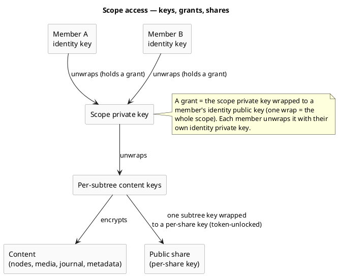
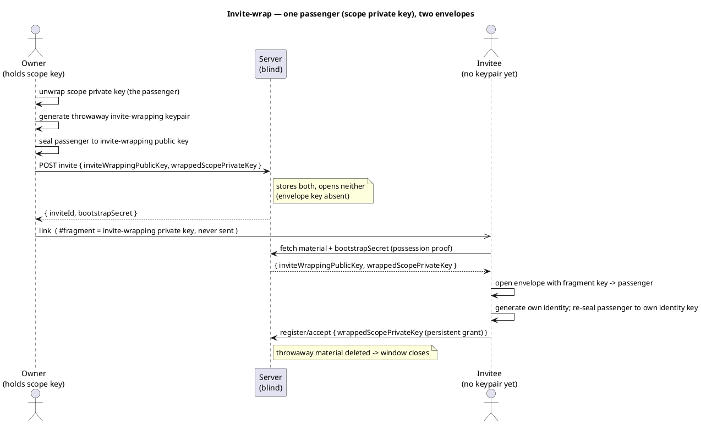

# Scopes & Tenancy

> The structural layer: **where content lives and who may access it.** It defines the scope kinds, the
> organizational structures (tenant / group / personal), how access is granted *cryptographically*
> (scope keys, grants, shares), how a new member is onboarded (the invite-wrap), and the unified
> navigation contract. Engineering sibling to the [Security Model](security-model.md) and the
> [Account & Key Model](account-key-model.md); byte formats live in the crypto wire-format spec.

This is the **target model**; first-build scope is tracked via the inbox and change-requests.

## Scope — the unit content is keyed on

A **scope** is the unit business data is keyed on. It is addressed by an **opaque scope ID (UUID)**,
never by name. Three kinds, one tree model:

- **`PERSONAL`** — the owner's private space; maximum confidentiality, no other key-holder unless the
  owner explicitly shares.
- **`TENANT`** — a domain-scoped organization. One server hosts many tenants.
- **`GROUP`** — a collaborative space, **no nesting**; all members have equal content rights, admins
  manage membership and settings only.

**Users are global to the server** and may belong to multiple tenants and groups. The same navigation
and key rules apply to all three kinds — the kind changes *who holds keys*, not the model.

## How access works — keys, grants, shares

- **Grant = the unit of access.** A member receives the **scope private key wrapped to their identity
  public key** — one wrap grants the whole scope. Membership *is* this cryptographic grant; the server
  stores that a grant exists, not a readable role that confers content.
- **Shares are least-privilege.** A public share gets only the *specific* subtree's content key wrapped
  to a per-share key, unlocked by the share token — never the scope key. (Detail in the sharing feature.)
- **Group/tenant roles** live in membership rows (e.g. group admin, tenant admin) and gate *management*
  actions, not content readability — content readability is purely the grant.

## Authorization vs. confidentiality — two enforcement layers

This separation is the heart of the model:

- **The server enforces *authorization*:** a valid grant + `ACTIVE` membership, checked by small guards
  (e.g. a scope-access guard, a tenant-admin guard) on **opaque IDs**. The server never reads content to
  decide.
- **The client enforces *confidentiality*:** only the grant unwraps the scope key, so a member can read
  a scope **only** if they hold a grant for it. *Visibility is cryptographic*, not a server promise.

## Onboarding a new member — the invite-wrap

A new member has **no identity keypair yet**, so the scope key cannot be wrapped to them in advance.
Access is **always an explicit, informed act by the granting owner** (the only way confidentiality is
lowered). The mental model: **one passenger, two envelopes** — the *passenger* is the scope private key;
a throwaway *invite-wrapping keypair* is the envelope in between.

`bootstrapSecret` only **gates the material fetch** (it is not a key). The server is blind at both ends —
it never holds the invite-wrapping private key (URL-fragment only). Variants (refined with the invites
use-case): **single-use** (default), **shared link** (riskier, explicit opt-in, capped registrations +
TTL + key rotation on close), and a **grant path** that carries no key in any channel and re-wraps on
explicit approval.

## Revocation & rotation

Revoking a member or share is **two-layered** (detail in the [Security Model](security-model.md)):
server-side token/membership invalidation is **instant** (no keys needed); **scope-keypair rotation**
(re-wrap to the remaining members) is the eventual defense-in-depth. Already-read content cannot be
retracted.

## Navigation contract — unified across kinds

One scope-agnostic navigation model serves personal, tenant and group alike — clients never need
separate "personal tree" / "tenant tree" / "group tree" APIs.

- **Server-visible:** scope id + kind; node id, parent id + kind; ordering and timestamps; blinded slug
  tokens; ciphertext/envelope references; grant/membership existence needed to decide visibility.
- **Client-decrypted:** space/folder names, Memory and chapter titles, cover metadata, captions, and the
  canonical path assembled from decrypted names.

Holding a session is **not** sufficient: the client must also hold/unlock the relevant scope keys before
it can decrypt any names or metadata. The operator must not learn private names or paths from navigation.

## Invariants

- Addressed by **opaque IDs only** — never a tenant or scope name in the path.
- **No cross-scope move** — moving across scopes is a copy + re-encrypt, not a tree move.
- No cycles; **no folder inside a Memory**.
- **Slug uniqueness per parent** across folders, Memories and chapters, via blinded slug tokens.
- A personal scope has **no other key-holder** unless the owner explicitly shares.
- The **same rules apply to all scope kinds**.

## Looking ahead — the Subscription layer (SaaS), parked

The SaaS idea (inbox #41) will introduce a **Subscription** as a billing envelope **between the
deployment (veyq.cloud) and scopes** — operating on operational metadata (counts/bytes), so it does not
touch operator-blindness. **"Tenant" stays the domain-scoped scope kind** (it is *not* the deployment or
the billing unit). Not designed here; refined separately when #41 is pulled.

## Related

- Concepts: [Security Model](security-model.md), [Account & Key Model](account-key-model.md).
- Features (refined later): Spaces, Memory, Sharing, Admin (tenant/group invites).
