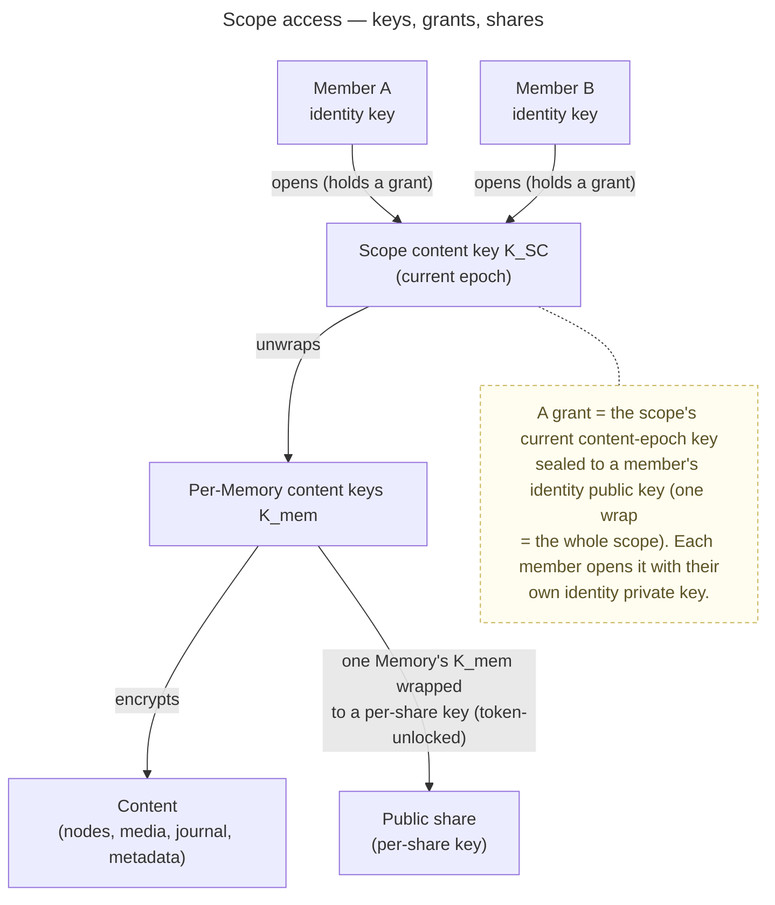
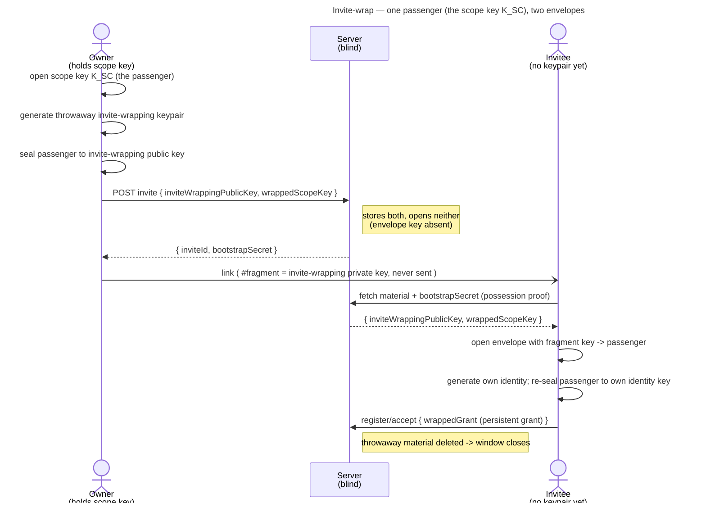

# Scopes & Tenancy

> The structural layer: **where content lives and who may access it.** It defines the scope kinds, the
> organizational structures (tenant / group / personal), how access is granted *cryptographically*
> (scope keys, grants, shares), how a new member is onboarded (the invite-wrap), and the unified
> navigation contract. Engineering sibling to the [Security Model](security-model.md) and the
> [Account & Key Model](../features/account/enablers/en.account.key-model.md); byte formats live in the crypto wire-format spec.

This is the **target model**; first-build scope is tracked via the inbox and change-requests. The general
**scope identity** (opaque `scopeId` + `kind`) and the per-tenant **personal scope** (client-birthed,
operator-blind) are realised by the enabler [en.spaces.personal-scope](../features/spaces/enablers/en.spaces.personal-scope.md);
the tenant root scope is born at tenant activation.

## Scope — the unit content is keyed on

A **scope** is the unit business data is keyed on, addressed by an **opaque scope ID (UUID)**, never by
name. A **tenant** is the top-level container and carries the domain; the other kinds live **within** a
tenant:

- **`TENANT`** — the tenant's shared root scope. One server hosts many tenants, each with its own domain.
- **`GROUP`** — a collaborative space within a tenant, **no nesting**; all members have equal content
  rights, owners manage membership and settings only.
- **`PERSONAL`** — a member's private space **within a tenant** (one per member, per tenant), created
  when the user joins that tenant. Maximum confidentiality; no other key-holder unless the member
  explicitly shares.

**Users are global to the server** and may belong to multiple tenants; a user therefore has a **separate
personal scope per tenant**. Because every scope lives within a tenant, it is reached under that
tenant's host — so sharing a private memory yields a link on the **right** domain (a family memory
shared from your personal scope appears under `family.example.com`, never `friends.example.com`). See
[ADR 0002](../decisions/0002-personal-scope-per-tenant.md). The same navigation and key rules apply to
all kinds — the kind changes *who holds keys*, not the model.

## Tenant resolution — by Host

A tenant carries a **domain**. The reverse proxy forwards the request (with its `Host`), and the
backend resolves **which tenant** is meant from that `Host` (a host → tenant mapping). The tenant
context therefore comes from the domain, not from a tenant id or name in the path; **business data
within the resolved context is still addressed by opaque scope/node IDs**. Tenant↔domain is
server-visible operational metadata, so this does not affect operator-blindness.

Every scope — including personal and group — lives **within** a tenant, so there is no host-less scope:
each is reached under its tenant's host like everything else. This is what keeps share links on the
correct domain (see the scope kinds above and [ADR 0002](../decisions/0002-personal-scope-per-tenant.md)).

## How access works — keys, grants, shares

- **Grant = the unit of access.** A member receives the **scope's current content-epoch key sealed to
  their identity public key** — one wrap grants the whole scope ([ADR 0024](../decisions/0024-scope-key-rotation.md)).
  Membership *is* this cryptographic grant; the server stores that a grant exists, not a readable role that
  confers content.
- **Shares are least-privilege.** A public share gets only the *specific* Memory's content key (`K_mem`)
  wrapped to a per-share key, unlocked by the share token — never the scope key. (Detail in the sharing
  feature.)
- **Group/tenant roles** live in membership rows (`OWNER` / `MEMBER`) and gate *management*
  actions, not content readability — content readability is purely the grant.

## Authorization vs. confidentiality — how the split maps to scopes

The [Security Model](security-model.md#the-one-guarantee) owns the guarantee — *the server enforces
authorization, the client enforces confidentiality with keys it never sees.* Here is how that split lands on
scope architecture:

- **Authorization (server):** the **membership boundary first**, then the key-holder check
  ([ADR 0042](../decisions/0042-http-failure-projection.md)) — checked by small guards (a scope-access guard, a
  tenant-owner guard) on **opaque IDs**, so the server never reads content to decide. The order is the security
  property: a member legitimately knows the scope exists, a stranger must not. Every gate dimension is mapped in
  [cc.security.authorization](cc.security.authorization.md).
- **Confidentiality (client):** only the grant unwraps the scope key, so a member can read a scope **only** if
  they hold one. *Visibility is cryptographic*, not a server promise.

## Membership — the user↔scope relation (role + grant)

Membership is the **relation between a user and a scope**, and it carries **both** axes of the model in
one row: a **management role** (server-enforced) and a **grant** (the scope's current content-epoch key
sealed to the member's identity public key — client-enforced confidentiality). Roles are `OWNER` /
`MEMBER` at **every** level ([ADR 0007](../decisions/0007-membership-role-grant-relation.md)); there is no
third role. The same shape repeats per scope kind:

| Membership | Cardinality | Role values | Grant |
|---|---|---|---|
| **Server** | 1 per user (a user belongs to one server) | `OWNER` · `MEMBER` | optional — only if the operator domain is modelled as a server-scope (parked, see below) |
| **Tenant** | n-m (user × tenant) | `OWNER` · `MEMBER` | grant to the `TENANT` scope key |
| **Group** | n-m (user × group, within one tenant) | `OWNER` · `MEMBER` | grant to the `GROUP` scope key |
| **Personal** | the member alone | — | self-held; no other key-holder unless explicitly shared |

- **Role gates *management*, grant gates *content*.** Promoting a member who already holds a grant is a
  pure role change (no key moves); a role without a grant is a hollow title (can neither read nor invite —
  inviting needs the scope key). See [ADR 0006](../decisions/0006-cold-tenant-scope-birth.md).
- **The first tenant membership is born at activation** — the invited owner's `OWNER` row + its grant come
  into being when they cold-birth the `TENANT` scope (Slice B). Member invites extend the same relation
  later via the invite-wrap.
- **Server role is 1-1, not n-m** — a user has exactly one server role (today `veyq_user.server_role`).
  Multiple `OWNER`s are allowed by the model; a flow to mint a second one is a later use-case.

### Reaching a person — email for outsiders, username within the system

Who you can address depends on whether they already exist on the server:

- **Outsider (no account yet)** — reached by **email** (the only out-of-band channel). This is the tenant
  **owner** invite: the operator types an email, the server sends an invite, the invitee registers. The
  email is **operational metadata** the server must hold to send mail.
- **Existing user (already on the server)** — invited by **username** — a **per-tenant, unique-within-tenant**
  handle on the membership ([ADR 0023](../decisions/0023-per-tenant-member-identity.md)) — fully **in-app** via
  the invite-wrap; no email needed. This is the member / group-invite path and keeps person lookup
  **non-enumerable** (you resolve a username only within scopes you can already see).

**Email visibility is a role rule, not crypto.** The owner email is server-visible operational metadata;
the server returns it **only to roles that need it** (a `SERVER_OWNER`, or the tenant's own
`OWNER`) and omits it for ordinary members. Encrypting such server-visible PII **at rest** (under
an operator-held key, so a stolen DB dump leaks nothing) is a **separate** defense-in-depth concern — it
is *not* operator-blindness (the server must still decrypt to send mail), and it must be decided
crosscutting over **all** server-visible emails (including `veyq_user.email`), not per field.

## Onboarding a new member — the invite-wrap

A new member has **no identity keypair yet**, so the scope key cannot be wrapped to them in advance.
Access is **always an explicit, informed act by the granting owner** (the only way confidentiality is
lowered). The mental model: **one passenger, two envelopes** — the *passenger* is the scope key `K_SC`;
a throwaway *invite-wrapping keypair* is the envelope in between.

`bootstrapSecret` only **gates the material fetch** (it is not a key). The server is blind at both ends —
it never holds the invite-wrapping private key (URL-fragment only). Variants (refined with the invites
use-case): **single-use** (default), **shared link** (riskier, explicit opt-in, capped registrations +
TTL + key rotation on close), and a **grant path** that carries no key in any channel and re-wraps on
explicit approval.

## Revocation & rotation

Revoking a member or share is **two-layered** (detail in the [Security Model](security-model.md)):
server-side token/membership invalidation is **instant** (no keys needed); **rotating `K_SC` forward into
a new epoch** (granted to the remaining members, [ADR 0024](../decisions/0024-scope-key-rotation.md)) is
the eventual defense-in-depth. Already-read content cannot be retracted.

## Navigation contract — unified across kinds

One scope-agnostic navigation model serves personal, tenant and group alike — clients never need
separate "personal tree" / "tenant tree" / "group tree" APIs.

- **Server-visible:** scope id + kind; node id, parent id + kind; ordering and timestamps; blinded slug
  tokens; ciphertext/envelope references; grant/membership existence needed to decide visibility.
- **Client-decrypted:** space/folder names, Memory and chapter titles, cover metadata, captions, and the
  canonical path assembled from decrypted names.

Holding a session is **not** sufficient: the client must also hold/unlock the relevant scope keys before
it can decrypt any names or metadata. The operator must not learn private names or paths from navigation.

## Invariants

- Business data is addressed by **opaque scope/node IDs**; the **tenant context is resolved from the
  request `Host`** (tenant↔domain). No tenant or scope *name* appears in the path.
- **No cross-scope move** — moving across scopes is a copy + re-encrypt, not a tree move.
- No cycles; **no folder inside a Memory**.
- **Slug uniqueness per parent** across folders, Memories and chapters, via blinded slug tokens.
- A personal scope has **no other key-holder** unless the owner explicitly shares.
- The **same rules apply to all scope kinds**.

## Looking ahead — the Subscription layer (SaaS), parked

The SaaS idea (inbox #41) will introduce a **Subscription** as a billing envelope **between the
deployment (veyq.cloud) and scopes** — operating on operational metadata (counts/bytes), so it does not
touch operator-blindness. **"Tenant" stays the domain-scoped scope kind** (it is *not* the deployment or
the billing unit). Not designed here; refined separately when #41 is pulled.

## Related

- Concepts: [Security Model](security-model.md), [Account & Key Model](../features/account/enablers/en.account.key-model.md).
- Features (refined later): Spaces, Memory, Sharing, Admin (tenant/group invites).
