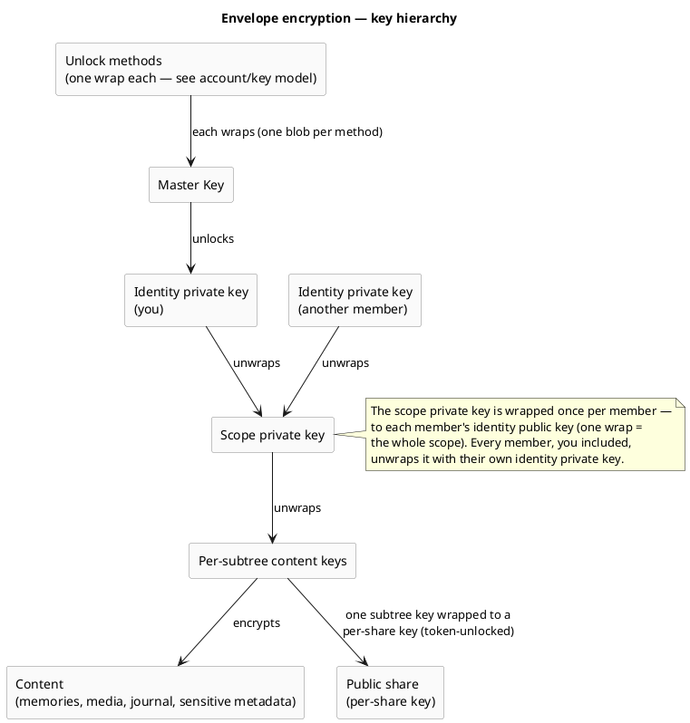

# Security & Encryption Model

> The dominant cross-cutting concept. veyq is **end-to-end encrypted everywhere** — every scope
> (personal, group, tenant). The **server is operator-blind**: it stores ciphertext, opaque
> operational metadata and a blind job queue, and never holds a key that opens content. Every other
> concept — processing, search, sharing, recovery, deletion — is designed around this.
>
> Plain-language companion for end users: [wiki: Is my data safe?](../../wiki/en/is-my-data-safe.md).
> Sibling engineering docs: the [account & key model](../features/account/enablers/en.account.key-model.md), the
> [scopes & tenancy model](scopes-and-tenancy.md), and the crypto wire-format spec (refined separately).

This document is the **target model**. What ships in the first build is tracked via the inbox and
change-requests, not here.

## The one guarantee

A user's **unshared** content is confidential **even from the operator**. The server enforces
*authorization* on opaque identifiers; the client enforces *confidentiality* with keys the server
never sees. Confidentiality is therefore cryptographic, not a server-side access-control promise.

## Threat model & trust boundaries

| We protect against | How |
|---|---|
| Stolen disk / DB dump / subpoena of data at rest | All content E2E-encrypted; the server holds no content keys |
| Passive operator reading the database | Cannot recover content — every blob and sensitive metadata field is encrypted |
| Offline brute-force of a weak password → **content** | **Secret Key (2SKD)**: the content key derivation folds in a high-entropy Secret Key the server never stores, so a cracked password alone unlocks nothing |
| Offline brute-force of a weak password → **server login** | The server stores only an Ed25519 **auth public key** (not a credential); the raw password never reaches the server. Forging a login means brute-forcing the password through Argon2id — yielding a session + operational metadata, **never content** (see [ADR 0003](../decisions/0003-operator-blind-password-auth.md)) |
| **Online** brute-force / credential-stuffing / DoS on the public auth surface | **Per-IP rate limiting** of the public auth endpoints (`@RateLimited` → fixed-window `429`) — defense-in-depth, **honestly limited** (per-instance, resets on restart). Mechanism + verification: [cc.security.rate-limit](cc.security.rate-limit.md) |
| Active operator doing key-substitution during key exchange | **Partly, and honestly limited** — see *Key-directory trust* below |

We do **not** claim immunity to an *actively malicious* operator before key transparency exists; we
state that gap plainly. In a **self-hosted** deployment the operator is the user, so that threat is moot.

### The operator we blind is the *veyq* operator — third-party services are a separate, consented boundary

"Operator-blind" names one adversary: **the veyq server / operator.** It does **not** mean the client never
talks to any external service. A feature may let the client reach a **third party directly** — today the
opt-in **reverse-geocoding** lookup that turns a photo coordinate into a place name
([ADR 0016](../decisions/0016-geocoding-provider-neutrality.md)), tomorrow map tiles for the tenant map. Such a
request is a **different trust boundary** the user consents to, and it is fenced so it can never widen the veyq
operator's view:

- **Client-direct, never proxied through the veyq backend.** Routing it through veyq's server would hand the
  operator the coordinate — so these requests go **straight from the device to the provider**. Proxying is
  explicitly disallowed.
- **No veyq identity, no content context.** The provider receives only what its function needs — a bare
  coordinate (+ the client IP) — never a user id, a Memory id, or any veyq token.
- **Opt-in + transparent — and opt-in is standing consent.** Off by default; enabling it is an explicit choice
  with a plain-language note that a request leaves the device. Once enabled it may run **automatically** (e.g. a
  reverse lookup on the first geotagged media of an auto-location) — enabling it *is* the consent to those
  requests; it **never** fires without opt-in. A blind, request-free alternative stays available (e.g. typing a
  place name).
- **Results are sealed content.** Anything fetched (e.g. a resolved place name) is sealed under `K_mem` like any
  other content — so it is shareable to other members **without their device making a request**, and the veyq
  operator still sees only ciphertext.

So the veyq operator stays blind by construction; the only thing that ever crosses is a consented, identity-free
request the **user** turned on, straight to the chosen provider.

## What is encrypted vs. server-visible

- **Encrypted (server-blind):** media bytes and all derivatives; journal text and embeds; sensitive
  metadata — titles, captions, descriptions, places, people/faces, participant relationships, tags;
  track and playlist details; GPS and capture time (sealed client-side, never read off the file).
- **Server-visible (low-sensitivity operational metadata):** existence and IDs of memories, media and
  shares; scope and membership (who belongs to which tenant/group); coarse timestamps for ordering;
  sizes; MIME type; job-queue and op-log offsets; presence facts; per-parent blinded tokens.

These operational fields are exactly what lets the server **sort, paginate, route, authorize and
bill** without decrypting. It is a conscious trade-off: a stricter "encrypt operational metadata too"
mode is possible at the cost of those capabilities. The server never sees content — only structure.

## Central axis: shared vs. unshared

The deciding property for risk is **whether content is shared**, not which scope it lives in. A
personal memory that is publicly shared becomes "shared" for these purposes.

| State | Meaning |
|---|---|
| **Unshared** | Only the owner's keys. Maximum confidentiality; the one guarantee applies in full. |
| **Shared** (group, tenant, public view, public uploader) | Content keys wrapped to other parties by the owner's explicit, informed action. Confidentiality from the *operator* still holds; from the *recipients* it is intentionally given up. |

## Key hierarchy (envelope encryption)

Content is protected by layered envelopes so grants are cheap and shares are least-privilege. The
byte-level detail lives in the crypto wire-format spec; account-level detail (unlock methods, recovery)
in the account/key model. The shape:

- **Cheap grants, scoped shares.** Adding a member = one wrap of the scope private key. A public share
  = one subtree content key wrapped to a per-share key. **Revoking a member = rotate the scope keypair**
  and re-wrap to the remaining members; already-read content cannot be retroactively pulled back (a
  documented limitation). The concrete per-Memory key model — `K_SC` (scope), `K_mem` (per Memory, the
  random, many-wrapped **share grain**), `K_blob` (per blob) — is pinned in
  [ADR 0012](../decisions/0012-content-key-hierarchy.md).
- The identity private key is protected by the **Master Key**, itself wrapped **separately by each
  unlock method**. Adding or removing a method changes one wrap, never the content.

## Cryptographic stance

Standard, well-reviewed primitives only (no home-grown crypto); **post-quantum from the start** for encryption
(a hybrid KEM, secure if either component holds) because decade-lived memories make harvest-now-decrypt-later
real, while signatures stay classical for now; and **crypto-agility** via a versioned suite id on every
artifact, so upgrades never break old data. The strategy + its rejected alternatives are
[ADR 0017](../decisions/0017-crypto-primitives-and-post-quantum-strategy.md); the concrete per-platform byte
contract is [ADR 0009](../decisions/0009-native-crypto-per-platform-vectors.md).

## Names & blinded tokens

Names (folders, memories, chapters) are encrypted, yet navigation uses human-readable permalinks. Two
server-blind tokens make this work without the server ever seeing content:

- **Slug token** — `HMAC(scopeKey, parentId ‖ slugify(name))`. The server enforces uniqueness per
  parent (`UNIQUE(parentId, slugToken)`) without seeing names. A keyed MAC (not a plain hash), so the
  operator — lacking the scope key — cannot reverse low-entropy slugs. It is a **consistency aid, not an
  authenticity control**: the client computes it; the server cannot recompute it.
- **Dedup token** — a per-scope blinded token over content, so identical bytes within a scope dedup on
  the server without it seeing content or being able to compute tokens itself (no confirmation-of-file
  attack).

## Sharing & share-boundary Trust & Safety

- A **public share** wraps the subtree's content keys to a per-share key. The **share secret lives in
  the URL fragment (`#…`)** and never reaches the server. Anyone with the link decrypts client-side.
- **Trust & Safety operates at the share boundary.** An abuse report includes the full share URL (and
  thus the secret), so the operator **can decrypt a reported public share** to verify, quarantine,
  preserve evidence and act. The same intake serves takedown requests.
- **Consequently:** private (unshared) content is **unscannable** by design; public shares are
  decryptable-on-report — notice-and-takedown works exactly where content is distributed.

## Key-directory trust — the active-operator gap (stated honestly)

Wrapping a content key to "Bob" needs Bob's public key from the server's key directory. A malicious
server could serve an attacker's key instead (key-substitution / MITM) and read future wraps.

- The building block is the **identity fingerprint / safety number** — a deterministic digest of a
  contact's identity public key. Two users compare it out-of-band (read aloud / QR); a mismatch reveals
  a substituted key. **This is manual**, so it protects only those who actually compare.
- **Automatic key-pinning (TOFU)** — clients remember a contact's key and warn on change — and
  **Key Transparency** — an append-only verifiable key log — are the target hardening. Until they exist
  there is **no automatic warning** on a key change.
- **The first-use gap:** even with TOFU, if the operator substitutes Bob's key *before* Alice ever saw
  the real one — and re-wraps content to Bob's genuine key too — nothing looks wrong while the operator
  silently holds a copy. Only Key Transparency (or manual out-of-band verification) makes that detectable.
- **Trust anchors stay client-side:** a client verifies and signs against its own locally-held key,
  never the server's copy.
- **First consumer:** adding a member to a shared scope ([uc.spaces.add-member](../features/spaces/use-cases/uc.spaces.add-member.md),
  [ADR 0020](../decisions/0020-grant-distribution-invite-wrap.md)) is the first flow to wrap a scope key to
  *another* member via this directory. It adopts the stance above as-is — **v1 trusts the returned key** (no
  pin, no gate; self-hosted makes it moot), and leaves the fingerprint/TOFU/KT hardening as an explicit seam.

## Recovery — no escrow

A memories product must not turn "forgot password" into permanent loss, yet there is **no escrow** — the
same property that stops the operator reading data stops it rescuing data. Independent ways back in
(detail in the account/key model):

1. **Another enrolled device** still holds the keys.
2. **Emergency Kit (Secret Key) + master password** on a fresh device.
3. **Recovery code** — high-entropy, system-generated, single-use — independently unwraps the identity
   private key (the only path that survives a forgotten password with no device).

Losing **all** paths is the documented, accepted residual loss.

## Revocation — two layers

1. **Server-side access invalidation — instant, no keys.** The server stops honoring the revoked share
   token / membership and serves no further blobs. This is access control, which the server is allowed
   to do (it reads no content). Effective immediately, no client required.
2. **Content-key rotation — eventual, by a key-holder.** A client rotates the (sub)content key and
   re-wraps to the remaining parties — defense-in-depth against a revoked party who cached ciphertext.
   May be queued until a key-holder is online; not a hole, because layer 1 already blocks new fetches.

**Honest limit:** content the revoked party already downloaded and decrypted cannot be retracted —
rotation protects only future content.

## Deletion & erasure

One mechanism serves both data-loss protection and erasure: **soft-delete → trash → retention window →
scheduled hard-purge**, propagated to backups within a documented rotation window. Deletion is a
**privilege** (not "anyone with access can delete"); blob-level purge handles erasure of an item across
all references; a deletion audit records accountability without retaining the erased data.
