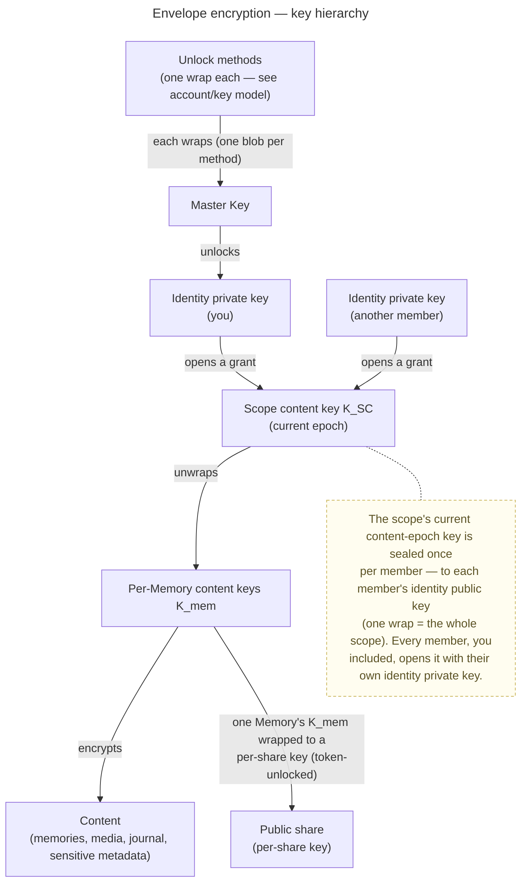

# Security & Encryption Model

> The dominant cross-cutting concept. veyq is **end-to-end encrypted everywhere** — every scope
> (personal, group, tenant). The **server is operator-blind**: it stores ciphertext, opaque
> operational metadata and a blind job queue, and never holds a key that opens content. Every other
> concept — processing, search, sharing, recovery, deletion — is designed around this.
>
> Plain-language companion for end users: [wiki: Is my data safe?](../../wiki/en/is-my-data-safe.md).
> Sibling engineering docs: the [account & key model](../features/account/enablers/en.account.key-model.md), the
> [scopes & tenancy model](scopes-and-tenancy.md), and the crypto wire-format spec (refined separately).

This document is the **target model**. What ships in the first build is tracked via the inbox and
change-requests, not here.

## The one guarantee

A user's **unshared** content is confidential **even from the operator**. The server enforces
*authorization* on opaque identifiers; the client enforces *confidentiality* with keys the server
never sees. Confidentiality is therefore cryptographic, not a server-side access-control promise.

## Threat model & trust boundaries

| We protect against | How |
|---|---|
| Stolen disk / DB dump / subpoena of data at rest | All content E2E-encrypted; the server holds no content keys |
| Passive operator reading the database | Cannot recover content — every blob and sensitive metadata field is encrypted |
| Offline brute-force of a weak password → **content** | **Secret Key (2SKD)**: the content key derivation folds in a high-entropy Secret Key the server never stores, so a cracked password alone unlocks nothing |
| Offline brute-force of a weak password → **server login** | The server stores only an Ed25519 **auth public key** (not a credential); the raw password never reaches the server. Forging a login means brute-forcing the password through Argon2id — yielding a session + operational metadata, **never content** (see [ADR 0003](../decisions/0003-operator-blind-password-auth.md)) |
| **Online** brute-force / credential-stuffing / DoS on the public auth surface | **Per-IP rate limiting** of the public auth endpoints (`@RateLimit(key = IP)` → token-bucket `429`) — defense-in-depth, **honestly limited** (per-instance, resets on restart). Mechanism + verification: [cc.security.rate-limit](cc.security.rate-limit.md) |
| Active operator doing key-substitution during key exchange | **Partly, and honestly limited** — see *Key-directory trust* below |

We do **not** claim immunity to an *actively malicious* operator before key transparency exists; we
state that gap plainly. In a **self-hosted** deployment the operator is the user, so that threat is moot.

### The operator we blind is the *veyq* operator — third-party services are a separate, consented boundary

"Operator-blind" names one adversary: **the veyq server / operator.** It does **not** mean the client never
talks to any external service. A feature may let the client reach a **third party directly** — today the
opt-in **reverse-geocoding** lookup that turns a photo coordinate into a place name
([ADR 0016](../decisions/0016-geocoding-provider-neutrality.md)), tomorrow map tiles for the tenant map. Such a
request is a **different trust boundary** the user consents to, and it is fenced so it can never widen the veyq
operator's view:

- **Client-direct, never proxied through the veyq backend.** Routing it through veyq's server would hand the
  operator the coordinate — so these requests go **straight from the device to the provider**. Proxying is
  explicitly disallowed.
- **No veyq identity, no content context.** The provider receives only what its function needs — a bare
  coordinate (+ the client IP) — never a user id, a Memory id, or any veyq token.
- **Opt-in + transparent — and opt-in is standing consent.** Off by default; enabling it is an explicit choice
  with a plain-language note that a request leaves the device. Once enabled it may run **automatically** (e.g. a
  reverse lookup on the first geotagged media of an auto-location) — enabling it *is* the consent to those
  requests; it **never** fires without opt-in. A blind, request-free alternative stays available (e.g. typing a
  place name).
- **Results are sealed content.** Anything fetched (e.g. a resolved place name) is sealed under `K_mem` like any
  other content — so it is shareable to other members **without their device making a request**, and the veyq
  operator still sees only ciphertext.

So the veyq operator stays blind by construction; the only thing that ever crosses is a consented, identity-free
request the **user** turned on, straight to the chosen provider.

## What is encrypted vs. server-visible

- **Encrypted (server-blind):** media bytes and all derivatives; journal text and embeds; sensitive
  metadata — titles, captions, descriptions, places, people/faces, participant relationships, tags;
  track and playlist details; GPS and capture time (sealed client-side, never read off the file).
- **Server-visible (low-sensitivity operational metadata):** existence and IDs of memories, media and
  shares; scope and membership (who belongs to which tenant/group); a member's **per-tenant username,
  identity public key, and group-add-consent flag** — visible to, and effectively **enumerable by**, any
  fellow tenant member (anyone can create a group to run the member-resolve, [ADR 0014](../decisions/0014-group-scopes-and-governance.md) §5);
  coarse timestamps for ordering; sizes; job-queue and op-log offsets; presence facts; a media
  item's **trash state** (a trashed flag + who trashed it + when, until the scheduled purge); a media item's
  **uploader attribution + bucket structure** (an opaque `owner_key` per medium — `user:{id}` / `share:{id}` —
  plus its `bucket_id` and the bucket rows' shape: node, parentage, `is_primary`, per-bucket counts; the
  bucket/uploader **names stay sealed** under `K_mem`, [ADR 0034](../decisions/0034-media-uploader-buckets.md));
  per-parent blinded tokens; the tenant's **terms text + `terms_version`** (the operator's *public* policy,
  served to everyone incl. pre-auth) and a member's **`accepted_terms_version`** (coarse acceptance metadata, like
  membership — never content, [ADR 0035](../decisions/0035-server-terms-of-service.md)); the **account email**
  (plaintext — the login identifier and the source of the deterministic auth salt,
  [ADR 0003](../decisions/0003-operator-blind-password-auth.md); named here to close a prior inventory gap); a
  tenant's **per-tenant SMTP config** (host/port/from/username/TLS + the owner-authored invite **template text** —
  operator-visible operational config) and the **send-fact** of an invite mail (recipient + coarse timing, once a
  tenant has configured SMTP), while the SMTP **password is a server-held secret sealed at rest** (AES-256-GCM
  under a server-managed KEK — ciphertext + nonce only, [ADR 0050](../decisions/0050-operator-config-secret-encryption.md)
  + amendment: the KEK is a `0600` key **file** generated on first start, plus a non-invertible HKDF **fingerprint**
  of it on the instance singleton so a lost/changed key is detected, never a silent unseal — the fingerprint is a
  hash of a full-entropy key, not the key, so the "no usable secret in a DB dump" property holds); a mail itself
  carries only link + domain + expiry + neutral copy, never sealed metadata
  ([ADR 0049](../decisions/0049-email-delivery-boundary.md)).

These operational fields are exactly what lets the server **sort, paginate, route, authorize and
bill** without decrypting. It is a conscious trade-off: a stricter "encrypt operational metadata too"
mode is possible at the cost of those capabilities. The server never sees content — only structure.

**One access-pattern finer than "coarse timestamps" is knowingly conceded, for range-streamed video playback.**
Every non-streamed read fetches a blob **whole**, so the operator normally learns only *that* a blob was accessed.
Playing a video streams it **range by range** ([ADR 0047](../decisions/0047-inline-video-playback-range-streaming.md)):
the object store then observes **which ciphertext chunks a playing client fetches, and when** — an *intra-media*
access pattern (which parts were watched, re-watched, skipped, seeked to), more granular than the coarse
timestamps or sizes above. The owner accepted this for playback: hiding it would mean either downloading the whole
original first or proxying bytes through the server (breaking operator-blindness). It is scoped to playback and
changes nothing about content, which the server still never reads.

This split is written in *kinds*; the contracts are written in *field names*. [ADR 0044](../decisions/0044-field-visibility-declared-at-the-field.md)
is what connects them: every field in `contracts/api/` declares which of these kinds it is, or the build fails.
This section stays the reason; the ADR carries the mechanism and does not restate it.

## Central axis: shared vs. unshared

The deciding property for risk is **whether content is shared**, not which scope it lives in. A
personal memory that is publicly shared becomes "shared" for these purposes.

| State | Meaning |
|---|---|
| **Unshared** | Only the owner's keys. Maximum confidentiality; the one guarantee applies in full. |
| **Shared** (group, tenant, public view, public uploader) | Content keys wrapped to other parties by the owner's explicit, informed action. Confidentiality from the *operator* still holds; from the *recipients* it is intentionally given up. |

## Key hierarchy (envelope encryption)

Content is protected by layered envelopes so grants are cheap and shares are least-privilege. The
byte-level detail lives in the crypto wire-format spec; account-level detail (unlock methods, recovery)
in the account/key model. The shape:

- **Cheap grants, scoped shares.** Adding a member = one seal of the scope's current content-epoch key to
  their identity. A public share = one Memory's content key wrapped to a per-share key. **Revoking a member
  = rotate `K_SC` forward into a new epoch** granted to the remaining members
  ([ADR 0024](../decisions/0024-scope-key-rotation.md)); already-read content cannot be retroactively pulled
  back (a documented limitation). The concrete per-Memory key model — `K_SC` (scope), `K_mem` (per Memory, the
  random, many-wrapped **share grain**), `K_blob` (per blob) — is pinned in
  [ADR 0012](../decisions/0012-content-key-hierarchy.md).
- The identity private key is protected by the **Master Key**, itself wrapped **separately by each
  unlock method**. Adding or removing a method changes one wrap, never the content.

## Cryptographic stance

Standard, well-reviewed primitives only (no home-grown crypto); **post-quantum from the start** for encryption
(a hybrid KEM, secure if either component holds) because decade-lived memories make harvest-now-decrypt-later
real, while signatures stay classical for now; and **crypto-agility** via a versioned suite id on every
artifact, so upgrades never break old data. The strategy, its rejected alternatives, and the conformance
vectors that pin a suite's bytes are all
[ADR 0017](../decisions/0017-crypto-primitives-and-post-quantum-strategy.md).

## Names & blinded tokens

Names (folders, memories, chapters) are encrypted, yet navigation uses human-readable permalinks. Two
server-blind tokens make this work without the server ever seeing content:

- **Slug token** — `HMAC(scopeKey, parentId ‖ slugify(name))`. The server enforces uniqueness per
  parent (`UNIQUE(parentId, slugToken)`) without seeing names. A keyed MAC (not a plain hash), so the
  operator — lacking the scope key — cannot reverse low-entropy slugs. It is a **consistency aid, not an
  authenticity control**: the client computes it; the server cannot recompute it.
- **Dedup token** — a per-scope blinded token over content, so identical bytes within a scope dedup on
  the server without it seeing content or being able to compute tokens itself (no confirmation-of-file
  attack).

## Sharing & share-boundary Trust & Safety

- A **public share** wraps the subtree's content keys to a per-share key. The **share secret lives in
  the URL fragment (`#…`)** and never reaches the server. Anyone with the link decrypts client-side.
- **Trust & Safety operates at the share boundary.** An abuse report includes the full share URL (and
  thus the secret), so the operator **can decrypt a reported public share** to verify, quarantine,
  preserve evidence and act. The same intake serves takedown requests.
- **Consequently:** private (unshared) content is **unscannable** by design; public shares are
  decryptable-on-report — notice-and-takedown works exactly where content is distributed.
- **Revocation is soft, and independent of scope rotation.** Disabling a share / expiry stops *new* access;
  already-downloaded content is not retractable. A scope key rotation (a member removal) does **not** revoke a
  share — a shared `K_mem` is wrapped independently of `K_SC` — so shares are revoked **separately** (a removed
  member with the link keeps reading until then). The no-install web viewer is operator-served, so it is
  **passive-operator-safe** (the client-integrity tier, [ADR 0026](../decisions/0026-client-trust-tiers.md)), not
  operator-proof against a *foreign* operator; the viewer surfaces this honestly via a footer link here.
- **Full mechanism:** the [Sharing](../features/sharing/_index.md) feature
  ([ADR 0029](../decisions/0029-public-viewer-share.md) — the public viewer share resource + anonymous access path;
  v1 = personal-scope, VIEWER only).
- **An editable curator note (+ private name)** rides the same blind path: an optional **per-locale** message the
  sharer attaches (sealed under `K_share`, rendered on the share page in the viewer's locale) and an optional
  **private name** (sealed under `K_share`, a **management-only** label the viewer never receives). To make them
  editable **in place**, the share also stores `sealed_share_key = symWrap(K_mem, K_share)` — a recoverable copy of
  the per-share key, openable **only with `K_mem`** (which the operator lacks), so `K_share` never enters the
  operator's reach. The conscious consequence: a `K_mem`-holder (a scope member) can now **derive** `K_share` for
  that Memory's shares — harmless (they already read the content, and revoke stays owner-gated), recorded in
  [ADR 0036](../decisions/0036-editable-share-note-recoverable-share-key.md).
- **An optional share password** is an **operator-blind access-control gate**, *not* a cryptographic one
  ([ADR 0037](../decisions/0037-password-protected-shares.md)): the content stays E2EE under the unchanged
  `K_share` fragment, and the password gates **what the server serves** (a locked resolve returns only the
  challenge; no `wrap`/name/note/media without a valid token) — the same shape as the `contributorToken`. The
  server holds only `password_required` (coarse metadata) + `pw_salt` + `pw_verifier` (= `SHA-256` of the
  client-side `Argon2id(pw)` token) + `sealed_password` (one more opaque `K_share`-sealed ciphertext, a
  curator-only reveal copy) — never the raw password. **Honest limit:** it defends a **leaked link against an
  honest operator** (the realistic self-hosted / trusted case), not a malicious one who could bypass the check and
  serve ciphertext to a colluder holding the fragment — the same posture as the passive-operator-safe web viewer
  ([ADR 0026](../decisions/0026-client-trust-tiers.md)). A crypto-gate (fold `Argon2id` into the key) is a
  documented future upgrade.
- **The accountless-visitor terms acceptance is client-only** ([ADR 0035](../decisions/0035-server-terms-of-service.md)
  §3, [uc.sharing.share-accept](../features/sharing/use-cases/uc.sharing.share-accept.md)): before viewing, an
  account-less share visitor accepts the operator's tenant terms, but the acceptance lives in **localStorage** (per
  tenant + version) — the server records **nothing** about the visitor, so opening a share stays anonymous. The
  terms are **public operational content** (no blindness cost), served from the *share* via a guest
  `GET /api/shares/{shareId}/terms` keyed on the non-enumerable `shareId` (no `tenantId` existence oracle). It is an
  **operational gate, not enforcement** — bypassable by an accountless visitor and no legal-non-repudiation record;
  the operator's real remedy for a public share is the **decryptable-on-report** review-and-removal path above, not
  this prompt.

## Key-directory trust — TOFU pinning + out-of-band verification ([ADR 0028](../decisions/0028-identity-authenticity-tofu-verification.md))

Wrapping a content key to "Bob" needs Bob's identity public key, which the operator-blind server relays
from its directory. A malicious server could serve an attacker's key instead (key-substitution / MITM)
and read what is wrapped to it. The defense is **trust-on-first-use pinning + safety-number verification**:

- **Pin on first use (TOFU).** The first time a client wraps to Bob's identity key it **pins** the full
  identity public bundle (`kemX` X25519 + `kemM` ML-KEM-768 + `sign` Ed25519), keyed by `userId`, and
  proceeds (*pinned, unverified*). The **pin store is client-side, synced across the user's devices, and
  sealed under the master key** — the server never sees a pin or the who-trusts-whom graph (operator-blind).
- **A key change is surfaced, split by whether a human is present.** A key ≠ pin is "**attack OR a
  legitimate identity rotation**" (post-compromise recovery), indistinguishable on-wire. In the **UI** it is
  a **notice** (not a lock-out); the user reviews and, on **accept**, re-pins. The **automated grant-delivery
  worker** (no human) **blocks** — it will not wrap `K_SC` to a changed key (delivery is irreversible) — and
  **declines the job** back to the server + flags it for human review.
- **Verification** is the **identity fingerprint / safety number** — a deterministic digest of the identity
  public bundle. Two users compare it out-of-band; the ergonomic form is **QR** (scan the other device's
  fingerprint → the app compares it against the pin → feedback). It elevates *pinned* → *verified* and is how
  a **legitimately rotated** key is accepted.
- **Opt-in strict mode** turns the change-notice into a **hard block** and requires *verified*-before-share;
  the worker then skips unverified members (they stay *awaiting access*) until a human verifies them.
- **The first-use gap (honest, unchanged):** if the operator substitutes Bob's key *before* Alice ever
  pinned the real one — and re-wraps genuine content too — nothing looks wrong until **manual verification**
  or **Key Transparency** (the eventual end-state). TOFU cannot detect a lie told before first sight.
- **First-online-wins is a per-device honesty measure, not a global veto:** a key-holder who pinned the old
  key refuses + flags, but a *different* key-holder who never saw Bob has no conflicting pin and TOFU-accepts.
  Deliberate — the blind server must not adjudicate a crypto claim, and a global quarantine on one worker's
  say-so would be a DoS. The value is raised detection.
- **Trust anchors stay client-side:** a client verifies against its own sealed pin, never the server's copy.
- **First consumer:** adding a member to a shared scope ([uc.spaces.add-member](../features/spaces/use-cases/uc.spaces.add-member.md),
  [ADR 0020](../decisions/0020-grant-distribution-invite-wrap.md)) is the first flow to wrap a scope key to
  *another* member via this directory; it adopts the model above.

## Client integrity & trust tiers — what a malicious operator can do

Confidentiality (Layer 2 below) is enforced by the **client**, so it holds against an *actively* malicious
operator **only on a client whose code the operator cannot silently alter**. This splits by client, and we state
it plainly ([ADR 0026](../decisions/0026-client-trust-tiers.md)):

- **Self-hosted:** operator = user → moot. No adversary serves you your own code. This is veyq's **default
  posture**, and therefore its high-assurance answer — the question dissolves rather than being mitigated.
- **Operator-served web:** the operator serves the code each load → an active operator can serve tampered code
  that captures keys/plaintext. **Protects against a *passive* operator only** (honest serving + at-rest),
  honestly labelled and surfaced in-client — never claimed operator-proof.
- **Trusted central / attested web** (code from an origin the operator does *not* control, reproducibly built —
  SaaS-era): restores the full guarantee in the browser, for the no-install flows (a public-share/upload
  viewer). An **operator-owned** domain is *always* operator-served — it owns its DNS, so it controls delivery.

Constant on every tier: the server can **never** read already-stored content (no keys); it **always** sees
operational metadata, can deny/alter access, and can *attempt* key-substitution on new exchanges (detectable,
above). **The honest boundary: passive operator → protected everywhere; active operator → protected when you
host it yourself, passive-only on someone else's instance.** Stating this precisely is a trust asset, as it is
for Signal and Proton.

**A stronger unlock method does not move this boundary** ([ADR 0026](../decisions/0026-client-trust-tiers.md)
records why): the operator ships the code that consumes whatever the unlock produces. Unlock convenience and
client integrity are orthogonal.

## Recovery — no escrow

A memories product must not turn "forgot password" into permanent loss, yet there is **no escrow** — the
same property that stops the operator reading data stops it rescuing data. Independent ways back in
(detail in the account/key model):

1. **Another enrolled device** still holds the keys.
2. **Emergency Kit (Secret Key) + master password** on a fresh device.
3. **Recovery code** — high-entropy, system-generated, single-use — independently unwraps the identity
   private key (the only path that survives a forgotten password with no device).

Losing **all** paths is the documented, accepted residual loss.

## Revocation — two layers

These are the two general **enforcement layers** ([ADR 0026](../decisions/0026-client-trust-tiers.md) — L1 access
control, honest-operator; L2 crypto, the only real operator boundary), here applied to revocation:

1. **Server-side access invalidation — instant, no keys.** The server stops honoring the revoked share
   token / membership and serves no further blobs. This is access control, which the server is allowed
   to do (it reads no content). Effective immediately, no client required.
2. **Content-key rotation — eventual, by a key-holder.** A client mints a new content-key **epoch** and
   re-wraps it to the remaining parties ([ADR 0024](../decisions/0024-scope-key-rotation.md)) — defense-in-depth
   against a revoked party who cached ciphertext *and* a **malicious operator** who would feed them post-removal
   ciphertext (an honest operator is already stopped by layer 1). May be queued until a key-holder is online; not a
   hole, because layer 1 already blocks new fetches.

**Whether layer 2 fires is a per-scope policy** ([ADR 0025](../decisions/0025-forward-secrecy-policy-per-scope.md)),
because rotation re-grants **every** remaining member (`O(N)`): **groups** rotate automatically on removal (small,
sensitive sharing); the **tenant** (the primary, potentially large content home) uses layer 1 alone by default and
rotates only on an **explicit re-key** for the compromise case; **personal** never rotates. Layer 1 is unconditional
for all three.

**Honest limit:** content the revoked party already downloaded and decrypted cannot be retracted — rotation
protects only future content. Where layer 2 is policy-deferred (the tenant default), a revoked member who **both**
hoarded the key/ciphertext **and** colludes with a malicious operator retains that narrow residual until an explicit
re-key — the same posture 1Password takes for shared vaults.

## Deletion & erasure

One mechanism serves both data-loss protection and erasure: **soft-delete → trash → retention window →
scheduled hard-purge**, propagated to backups within a documented rotation window. The two steps carry
different authority. **Trashing is reversible** — an item moves to a per-scope trash and is restorable for the
retention window — so it may be done by **any member of the scope** (recovery, not destruction), and it is
**audited**: the trashed record carries **who** trashed it and **when**, so the action is accountable rather than
anonymous. **Purging is irreversible** — the blob-level hard-purge that erases an item across all references. It
happens two ways: the **scheduled retention job** (or an explicit erasure request), and — for an item **already in
the trash** — a member may **expedite** its purge by hand (the item was already reversibly removed, so this only
brings the inevitable purge forward, bypassing the retention window). A member cannot purge a **live** item
directly: destruction always goes **trash → purge**, never a one-step "delete forever" of another member's live
content. A deletion audit records accountability without retaining the erased data.
