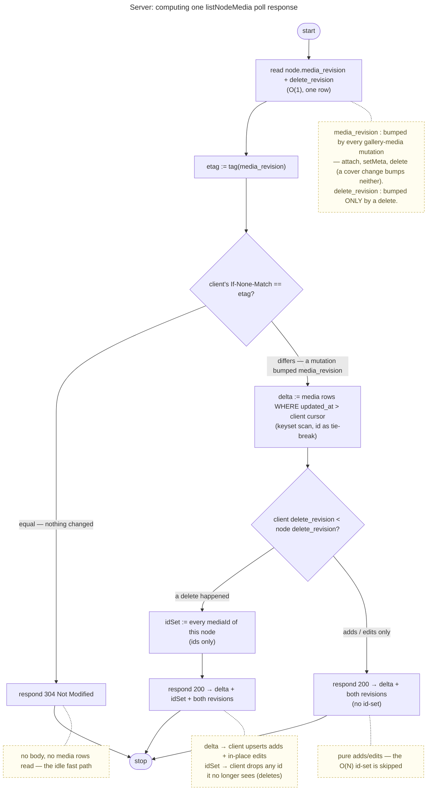

# ADR 0033 — Live media updates: a per-node revision counter + conditional GET + keyset delta, short-polled

- Status: Accepted
- Date: 2026-07-09

## Context

An open Memory gallery should reflect **other members' media changes live** — a contributor's uploads appear,
a removed member's photos disappear — without a manual reload (inbox #48). Two coupled needs: a **cheap
"did it change?"** check (fast opens, no work when idle) and **live insert/remove** of others' changes. The
server is **operator-blind**: it sees opaque `mediaId`s + node membership + coarse timestamps, never content.

The obvious shape — and the one an earlier version of this product shipped — is a **hanging long-poll** carrying
a **keyset cursor** `(updatedAt, id)` for adds/edits **plus a SHA-256 hash over the sorted `mediaId` set** for
deletes (a count would miss a delete+add that nets zero; a set-hash catches it). It works and is real-time, at a
real cost: the server recomputes that **O(N) id-scan + hash on every ~750 ms tick, per open gallery**, and holds
a connection per viewer. We want the same **delete-robustness** without the per-tick O(N) cost, and simpler.

Today the fresh stack has none of the pieces: `listNodeMedia` (`GET /api/scopes/{scopeId}/nodes/{nodeId}/media`)
returns the full `MediaSummary[]` with **no timestamp, no cursor, no conditional**; `veyq_media` has only
`created_at` (no `updated_at`, so an in-place meta edit touches no clock); there is no change signal on the node.

## Decision

**A per-node media-revision counter is the cheap change signal; a conditional GET short-circuits the idle case;
on a change the client pulls a keyset delta + reconciles deletes against the returned id-set. Short-poll v1.**

1. **`node.media_revision` — a per-node counter, the cheap signal.** A monotonic `INT` on `veyq_node`, **bumped
   on every gallery-media mutation**: attach (curator + contributor/uploader upload complete), meta edit
   (`updateMediaMeta`, cr-0068), and delete (share delete-own, cr-0102). **Cover changes are excluded** —
   `commitCover`/`clearCover` write no `veyq_media` row and never list, so a cover swap must not force a re-list.
   Reading it is **O(1)** — this is what replaces the O(N)-per-tick hash. It is opaque operational metadata
   (a number), so it is **operator-blind**.

2. **Conditional GET on `listNodeMedia`.** The response carries an **ETag derived from `media_revision`**; a poll
   sends `If-None-Match`. Unchanged ⇒ **`304 Not Modified`** (tiny, no body, no media query) — the common idle
   case. Changed ⇒ `200` with the delta below. One endpoint covers both #48 sub-ideas (skip-when-unchanged +
   fetch-on-change).

3. **On change, a keyset delta — never a full re-list.** The client sends its cursor `(updatedAt, id)`; the
   server returns **only media with `updated_at > cursor`** (tie-broken by id). This requires a new
   `veyq_media.updated_at` (set `= created_at` at attach, bumped on meta edit). So an **active upload streams the
   handful of new items each poll**, not the whole gallery every interval — the failure mode a full-re-list-on-
   change would have. The client upserts the delta by `mediaId` and advances the cursor.

4. **Delete-reconcile via the current id-set, gated by a second counter.** A keyset delta is add/edit-only — it
   cannot express a removal. So a `200` **may** also carry the node's **current `mediaId` set** (ids only); the
   client **drops any id it no longer sees** — this catches deletes and, because it is the *set* (not a count), a
   **net-zero delete+add** too — the insight worth keeping. But the id-set is **O(N)**, so it must not ride *every*
   change — an active upload would re-send the growing full set each poll. A **second per-node counter,
   `delete_revision`, bumped *only* on a delete** (never on attach/meta-edit — so a delete bumps *both* counters,
   an add/edit only `media_revision`) gates it: the client echoes its last-seen `delete_revision`, and the server
   includes the id-set **only when `client.delete_revision < node.delete_revision`** — i.e. only when a delete
   actually happened since the client last synced. Pure adds/edits stay **delta-only**; the O(N) id-set scan is
   paid solely on real deletes (rare, and self-limiting — one reconcile re-syncs the client). Both counters live on
   the same `veyq_node` row, so a single read returns a **consistent pair** — no torn read can strand a delete.

5. **Short-poll transport for v1.** A client with a Memory open polls on an interval, **gated on tab visibility**
   (mirrors `grantDeliveryPolling` / `scopeRotationPolling`: a `visibilitychange` listener ticks immediately on
   foreground, the interval pauses when hidden — a background poll is pure waste). Stops when the Memory
   closes. With the delta, even an active upload is cheap per poll. A few seconds of latency is fine for a photo
   grid; **long-poll / a push channel** (sub-second, shared later with #6 live journal) is a deferred upgrade.

How the server computes one `listNodeMedia` poll response — the **O(1) revision compare short-circuits the idle
case** (no media query at all), and only a genuine change runs the two queries (keyset delta + current id-set):

`media_revision` is a monotonic count of *mutations* (not of media), so any change moves it — that is what turns
the idle case into an `O(1)` `304`. On a change, adds + in-place meta edits ride the **keyset delta** (keyed by
`mediaId`). The full `mediaId` **set** rides along **only when `delete_revision` advanced** — a real delete — and
the client diffs it to drop removals, catching a **net-zero delete+add** too (a *set*, not a count). A pure
add/edit never carries the O(N) id-set, and nothing does per idle tick.

## Consequences

- **Idle is cheap (O(1) 304), an active upload is cheap (delta only — no id-set until a delete), deletes are robust
  (the id-set, gated by `delete_revision`), and it stays operator-blind** — two counters + opaque ids + coarse
  timestamps, no content, no new operator-visible signal beyond the poll access-pattern the operator already sees
  on reads.
- **`media_revision` is exactly the blind-safe `media_rev` CAS that [uc.memory.date](../features/memory/use-cases/uc.memory.date.md)
  foreshadowed** — a live poll surfacing others' new media into an open grid also **tightens the cr-0067 `auto`-date
  self-heal window** (the reconcile sees new media sooner). One counter, two payoffs.
- **New server state:** a `media_revision INT` + a `delete_revision INT` column on `veyq_node`, an `updated_at
  TIMESTAMP` on `veyq_media` (backfilled `= created_at`); `listNodeMedia` gains a conditional GET (`If-None-Match`
  → `304`), a `since` cursor (keyset delta), and the current-id-set on a `200` **only when the client's
  `delete_revision` lags** (a delete occurred). All opaque/operational — no key, no plaintext.
- **Scope: own-node gallery only.** The gallery lists the open node's own media (chapters open to their own
  galleries), so a **per-node** revision suffices. A Memory+chapters **subtree** aggregation (inbox #16) would
  need a subtree-max revision — **out of scope**, a later slice.
- **A member-visible curator delete is a separate surface.** Today the only media-row deletes are the share
  delete-own (cr-0102) and node-delete; there is no authenticated curator "delete my photo" endpoint. The
  delete-reconcile works for the deletes that exist; a curator delete endpoint is net-new (not in this feature).
- **Rejected — an O(N) set-hash per tick:** correct + delete-robust, but recomputes the whole id-scan +
  SHA-256 every ~750 ms per open gallery; the `media_revision` counter delivers the same robustness at O(1). We
  keep the *set-not-count* insight (via the on-change id-set), drop the per-tick cost.
- **Rejected — full re-list on any change:** re-downloads + re-decrypts the entire gallery every poll during an
  active upload (the primary live case) — the keyset delta exists precisely to avoid this.
- **Rejected — a count-only or `max(updated_at)`-only signal:** a count misses a net-zero delete+add; a max misses
  a delete of a non-newest media. The counter (bumped on *every* mutation) + the id-set reconcile cover both.
- **Rejected (deferred) — WebSocket/SSE push:** lower latency, but more infra and a **held per-viewer connection
  is a stronger presence signal** to the operator than a coarse poll; folded into a later push channel shared with
  #6 (live journal co-edit).
