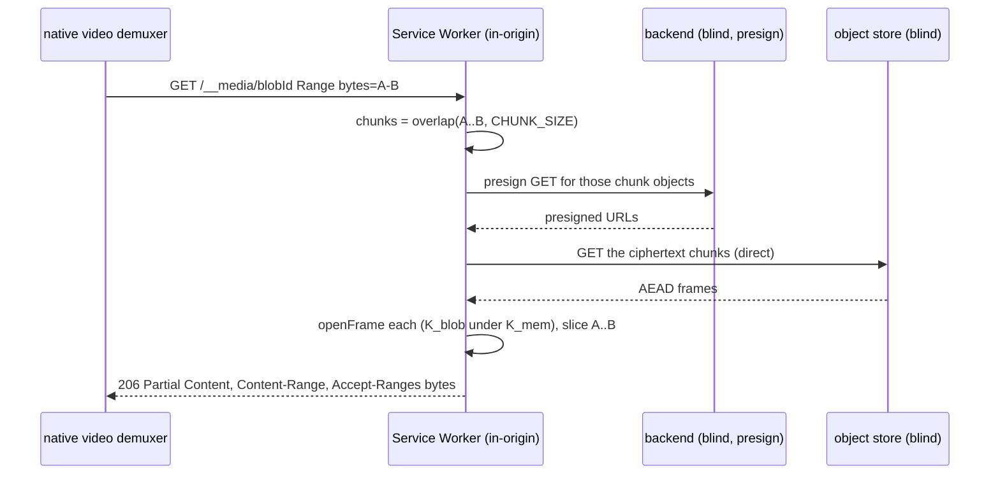

# ADR 0047 — Inline video playback via a Service-Worker range shim

- Status: Accepted
- Date: 2026-07-22

## Context

A video in a Memory is **a still after reload** (inbox #104). The gallery derives one JPEG **first-frame poster**
for both the thumbnail and the preview tier ([en.memory.derivatives](../features/memory/enablers/en.memory.derivatives.md)
— *"a still — no motion preview this pass"*), so the lightbox has only an `` branch. The wish is to **play
the video there**, accepting the **pristine original** as the source: there is no compressed/streamable video
tier, and there will not be one until a transcode enabler exists — building one now is exactly the throwaway
stopgap `CLAUDE.md` forbids (*structured over fast*).

So the question this ADR settles is narrow: **how does the client feed decrypted video bytes to a `<video>`
element while the server stays operator-blind?** Media is stored as **chunked AEAD** — a fresh random `K_blob`
per blob (wrapped under `K_mem`), each chunk `nonce ‖ AEAD(K_blob, nonce, plaintext, aad = index ‖ total)`,
transferred **direct-to-store** via presigned URLs ([en.memory.media](../features/memory/enablers/en.memory.media.md),
[ADR 0013](0013-blob-storage-presigned-direct-to-store.md), [ADR 0012](0012-content-key-hierarchy.md)). Every
existing read path — grid, lightbox, download — fetches a blob **whole**: presign all chunk GETs, fetch every
frame, `openFrame` each, concatenate. That is fine for a poster or an image preview; it is the wrong shape for a
video the user scrubs through.

## Decision

**Play video through a Service Worker that intercepts a synthetic in-origin media URL, translates the native
demuxer's plaintext byte-range requests into the covering ciphertext chunks, decrypts them on-device, and answers
`206 Partial Content`.** The browser's own `<video>` demuxer drives the ranges; there is no MSE and no remux.

Concretely: a `<video src="/__media/<blobId>">` request is caught by the SW. For a `Range: bytes=A-B` request the
SW computes the chunk indices `[⌊A/CHUNK⌋ … ⌊B/CHUNK⌋]` that overlap the plaintext range, fetches exactly those
ciphertext chunks via presigned GET, `openFrame`-decrypts them (the `index ‖ total` AAD check still applies),
slices the requested window out of the decrypted span, and responds with `Content-Range` + `Accept-Ranges:
bytes`. `K_mem`/`K_blob` live only in the client (the page hands the SW the unwrap material); no key and no
plaintext ever leave the device.

### Why not the rejected options

- **(A) Full blob, then play** — fetch + decrypt the entire original into memory, `<video src="blob:…">`. Correct
  and trivial, and it is the honest **Slice-1 interim** (see the CR). Rejected as the **strategy** because it
  scales the wrong way: a long video makes the user wait for the *whole* multi-hundred-MB decrypt before the
  first frame, and holds it all in memory. Acceptable for a phone clip, not as the general answer.
- **(B) MSE + fragmented MP4** — feed the demuxer via Media Source Extensions. Rejected: MSE requires a
  **fragmented, streamable** container, and a pristine user upload is whatever the camera wrote — a progressive
  MP4 with its `moov` atom at the tail, a MOV, an MKV. Making arbitrary uploads MSE-feedable means **remuxing or
  transcoding on device**, i.e. the transcode enabler we deliberately do not have. Without a guaranteed fMP4, MSE
  buys nothing here.
- **(C, chosen)** needs no transcode and no MSE: it plays whatever the browser can already demux, streamed, by
  putting the decrypt in the fetch path the demuxer already speaks (HTTP ranges).

### The accepted seek-leak — stated plainly

Range streaming means the client fetches **only the ciphertext chunks the demuxer currently needs**, as it needs
them. The object store — and therefore the operator — **observes which chunks a playing client fetches, and when.
That is an intra-media access pattern**: which parts of a video were watched, re-watched, skipped, or seeked to.

This is **new, not pre-existing**: every current read path fetches a blob *whole*, so today the operator learns
only that a blob was accessed, never *which parts in which order*. Range streaming is what introduces the
per-chunk-subset pattern. It is also **finer than the metadata the invariant already permits** — `CLAUDE.md`
allows *coarse timestamps* and *sizes*; a position-within-one-medium-over-time trace is more granular than either.

**The owner has decided this is acceptable:** the intra-media access pattern is **not** an exclusion criterion for
video playback. The alternatives were weighed and rejected — hiding the pattern would require either fetching the
whole original first (option A's cost, the thing we rejected) or routing bytes through a decrypting proxy (which
would hand the operator the plaintext and break both operator-blindness and self-hostability). Recording the
decision here keeps the **technical** guarantee and the **communicated** guarantee from drifting: operator-
blindness stays the product's central claim, and where we knowingly narrow it, the narrowing is written down.

Because the leak is accepted, **prefetch is a UX dial, not a privacy control.** The SW may read ahead of the
demuxer, and a seek may jump **straight** to its target range — there is no obligation to fetch sequentially to
mask the pattern. Read-ahead depth trades playback smoothness against bandwidth and is free to tune; it defaults
to modest read-ahead. It is explicitly **not** a security parameter.

### `mediaType` is sealed — an application of ADR 0044, not its own decision

Both the badge (#105) and the `<video>` branch need to know a medium is a video **without** fetching its original.
The full MIME type is sealed inside the existing opaque `wrappedMeta` tier (`MediaMeta`, under `K_mem`), so the
server never sees it. This is not a new decision to record separately — it is
[ADR 0044](0044-field-visibility-declared-at-the-field.md) applied: a **server-visible** `mediaType` would tell
the operator photo-vs-video-vs-PDF for every medium, exactly the plaintext ADR 0044 forces someone to justify.
The mechanics (which field, backfill of pre-field media) belong in the CR, not here. Note the synthetic SW route
keys only on **`blobId`** — already an `id`-class field the server holds — plus range offsets; it exposes nothing
new about *what* a blob is.

## Consequences

- **Slicing.** The SW range layer is substantial on its own — SW registration + lifecycle, the range↔chunk math,
  batched per-range presigning, a chunk cache, the `206` assembly. It is **its own slice**. The field, the
  video-ness detection, the `<video>` element, the play badge, and a naïve full-blob interim playback ship
  **first**, without the SW, so the product moves (inbox #104/#105) before the streaming layer lands.
- **Trust tier is unchanged.** The SW is operator-served code on a non-self-hosted instance, so it sits at the
  same client-integrity tier as the rest of the web client ([ADR 0026](0026-client-trust-tiers.md)) — it does not
  move the active-operator boundary. Confidentiality of already-stored bytes still holds; the operator still
  cannot read content, only observe the (now finer) access pattern above.
- **`security-model.md` gains one honest line** so its *"coarse timestamps"* wording is not read as stronger than
  it now is: the per-chunk fetch pattern of a *playing* medium is observable — an accepted intra-media
  access-pattern leak, scoped to range-streamed playback.
- **No new crypto and no contract change for the field.** Playback reuses `K_blob`/`openFrame` verbatim; the
  `mediaType` rides the already-opaque `wrappedMeta`. The SW slice adds presign plumbing but no new key.
- **Native surfaces.** A Service Worker is a web-only mechanism; a future native client feeds its own player the
  same decrypted ranges through the platform equivalent. This ADR governs the **web** playback path (the current
  V1 priority); it does not bind native to a SW.
