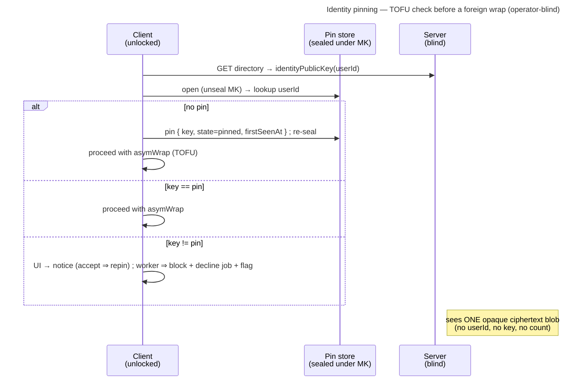

# Enabler: Identity pinning — trust-on-first-use + a sealed pin store

- **ID:** en.account.identity-pinning
- **Type:** **Enabler** — the substrate under
  [ADR 0028](../../../decisions/0028-identity-authenticity-tofu-verification.md); no standalone end-user goal
  ([features/README → use-case vs enabler vs ADR vs change-request](../../README.md#use-case-vs-enabler-vs-adr-vs-change-request)).
- **Provides:** an **operator-blind, cross-device memory of each contact's identity key**, so a **substituted**
  key (an active operator's MITM) is caught on change (TOFU), and out-of-band verification can elevate a contact
  to *verified*. Used by every client that wraps a scope key or invite to **another** member's identity public
  key — the grant authorities, the grant-delivery worker, the invite name-key.
- **Serves (use-cases):** [uc.spaces.verify-identity](../../spaces/use-cases/uc.spaces.verify-identity.md) (the
  human ceremony this sealed pin store + its TOFU change-response backs).
- **Depends on:** [en.account.key-model](en.account.key-model.md) — the Master Key that seals the pin store, so
  the account must be **unlocked** for any of this to run.
- **Postconditions:** after wrapping to a contact for the first time, the client holds a **pin** of that contact's
  identity public key (state *pinned*); a later wrap to a **changed** key is surfaced (UI) or refused (worker),
  never silently trusted. The server saw only an opaque ciphertext — never a `userId`, a pinned key, or the count.

## What it is — the sealed pin store

A single **pin-store blob**, sealed under the Master Key (`symWrap(masterKey, blob, "identity-pins")`) and synced
with the account exactly like the other Master-Key-sealed material — the server stores + relays **one opaque
ciphertext** and never interprets it. The plaintext is a small map:

```
{ version, pins: { <userId>: { key, state, firstSeenAt } } }
```

- **`key`** — the contact's full identity public bundle (`lp(kemX) || lp(kemM) || lp(sign)`, base64), the exact
  bytes a wrap targets. A change is detected by comparing the directory-returned key against this.
- **`state`** — `pinned` (trust-on-first-use, unverified) or `verified` (a human compared the safety-number
  out-of-band, [uc.spaces.verify-identity](../../spaces/use-cases/uc.spaces.verify-identity.md)).
- **`firstSeenAt`** — when this key was first pinned (for the review surface).

**Account-global, keyed by `userId`.** Identity is one keypair per account across all tenants
([ADR 0023](../../../decisions/0023-per-tenant-member-identity.md)), so there is **one pin per contact** — a person
you verified in one space is verified everywhere.

## Main flow — the TOFU check before every foreign wrap

1. A client is about to `asymWrap` to a directory-returned identity key for `userId` (a grant re-wrap, a
   grant-delivery job, or an invite name-key).
2. **Open the pin store** (unseal under the Master Key) and look up `userId`:
   - **No pin** → **pin it** (`state = pinned`, record the key + `firstSeenAt`), then proceed with the wrap
     (trust-on-first-use — the bootstrap; blocking first contact would be a chicken-and-egg).
   - **Pin exists, key matches** → proceed.
   - **Pin exists, key differs** → **change response** (ADR 0028): a **UI notice** (the user reviews; on **accept**
     `key := new`) or, on the **human-less grant-delivery worker**, **block the wrap + decline the job** back to
     the server + raise a human-review flag. A change is *attack or a legitimate identity rotation* — resolved by
     a human, never auto-trusted.
3. **Verification** ([uc.spaces.verify-identity](../../spaces/use-cases/uc.spaces.verify-identity.md)) elevates a
   pin `pinned → verified` and is the path to accept a legitimately rotated key. The pin-store primitives exist on
   web (`markVerified`, `safetyNumber` — cr-0099, unit-tested), and `markVerified` stamps `verified` **only** if the
   pinned key still equals the compared key (else it aborts). But the **proactive verify ceremony is intentionally
   not surfaced in the UI** (cr-0099): a per-member "verified" state is advisory noise for the normal user, and it
   only pays off under a **scope-wide strict mode** (verified-before-share), which is a deferred, still-to-be-designed
   follow-up (cr-0100, ADR 0028 §4 — note that a *per-account* strict toggle can't protect shared-scope content,
   since any co-member can key an unverified identity). Today's UI surfaces only the **change response**: a changed
   key opens a side-by-side review; **accept** re-pins as `pinned` (`acceptKeyChange`), **refuse** leaves it blocked.
   So `verified` is currently reachable only via the data layer, awaiting the strict-mode entry point.



## Sync & merge

The blob carries a monotonic **`version`**. A write is optimistic-concurrency: if the server's stored version
moved since the client opened it, the client **re-opens and union-merges** before re-sealing. Pins are
**append-heavy** (a new contact), so real conflicts are rare; a same-contact conflict resolves to **`verified`
wins**, else the later `firstSeenAt`. A **new device** pulls + opens the blob and inherits every pin — so the
trust state is shared across the account, not re-TOFU'd per device.

## Quality notes

- **Operator-blind.** One Master-Key-sealed ciphertext; the server never learns whom you pinned or verified, nor
  the count. A per-contact-row store keyed by `userId` would leak the trust set; even blinded rows leak the count —
  rejected ([ADR 0028](../../../decisions/0028-identity-authenticity-tofu-verification.md)).
- **The first-use gap (honest).** A pin can only catch a key that *changes* after first sight. If the operator
  substitutes a contact's key **before** this client ever pinned the real one, nothing looks wrong until manual
  verification or Key Transparency (the end-state).
- **First-online-wins is per-device, not a global veto.** The worker block is one honest device refusing; another
  key-holder without a conflicting pin still TOFU-delivers. The value is raised detection, not a hard stop — the
  blind server must not adjudicate a crypto claim (ADR 0028 § Consequences).
- **Tier-consistent ([ADR 0026](../../../decisions/0026-client-trust-tiers.md)).** Crypto-grade on a trusted
  client, honest-operator on operator-served web — a tampered client could ignore its own pin.

> **No end-user section.** As an enabler this has no standalone "what this means for you" story — its value reaches
> the user through the verification use-case + the member-add flows it protects (their bilingual sections carry the
> wiki text).

## Related

- Decisions: [ADR 0028](../../../decisions/0028-identity-authenticity-tofu-verification.md) (the authenticity
  model this realizes), [en.account.key-model](en.account.key-model.md) (the Master Key that seals the store +
  identity rotation, which produces a legitimate key change), [ADR 0023](../../../decisions/0023-per-tenant-member-identity.md)
  (identity is account-global, so pins are too)
- Consumers (the wrap-to-foreign-identity surfaces this gates): grant re-wraps + the grant-delivery worker
  ([ADR 0020](../../../decisions/0020-grant-distribution-invite-wrap.md), [ADR 0021](../../../decisions/0021-operator-blind-background-tasks.md)),
  the group invite name-key ([ADR 0027](../../../decisions/0027-group-invite-name-shared-key.md))
- Use-cases: [uc.spaces.verify-identity](../../spaces/use-cases/uc.spaces.verify-identity.md) (the human ceremony
  that elevates *pinned* → *verified*)
