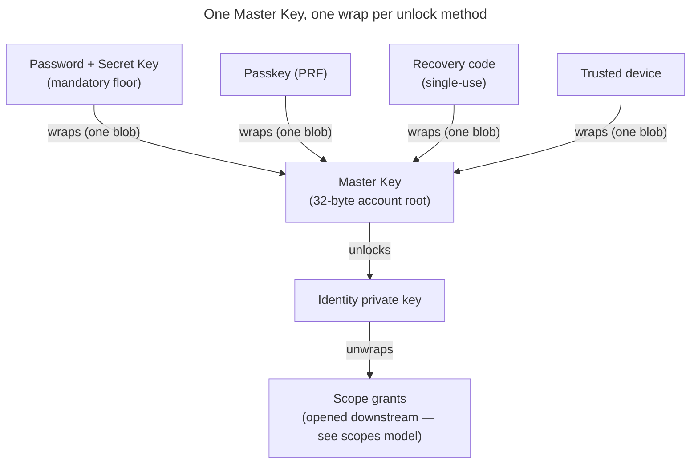

# Enabler: Account keys — identity, Master Key, unlock & recovery

- **ID:** en.account.key-model
- **Type:** **Enabler** — structural foundation, no standalone end-user goal
  ([features/README → use-case vs enabler vs ADR vs change-request](../../README.md#use-case-vs-enabler-vs-adr-vs-change-request)).
- **Provides:** a **single account's** key model — the identity keypair, the one **Master Key** (wrapped once
  per unlock method), the **unlock methods + KEK derivation** that open it, and recovery. It is the **root of
  the key chain** the scope + content keys extend downstream.
- **Serves (use-cases):** [login](../use-cases/uc.account.login.md), [unlock](../use-cases/uc.account.unlock.md),
  [trust-device](../use-cases/uc.account.trust-device.md),
  [remember-this-device](../use-cases/uc.account.remember-this-device.md); and downstream
  [en.spaces.personal-scope](../../spaces/enablers/en.spaces.personal-scope.md) →
  [en.memory.tree](../../memory/enablers/en.memory.tree.md) build their scope/content keys on it.
- **Depends on:** the crypto strategy ([ADR 0017](../../../decisions/0017-crypto-primitives-and-post-quantum-strategy.md))
  + the operator-blind auth/unlock split ([ADR 0003](../../../decisions/0003-operator-blind-password-auth.md),
  [ADR 0005](../../../decisions/0005-unlock-methods-and-device-trust.md)).
- **Out of scope (by design):** **scope, content & share keys** + the invite/onboarding key transfer live in
  [scopes & tenancy](../../../crosscutting/scopes-and-tenancy.md); exact **byte formats** (suite layouts, KEM
  combiner, wrap encodings) in the crypto wire-format spec. Whole-system security concern: the sibling
  [Security Model](../../../crosscutting/security-model.md).

> **No end-user section** (enabler) — its value surfaces through the account use-cases it serves. Plain-language
> companion: [wiki: Account keys & recovery](../../../../wiki/en/account-keys-and-recovery.md). This is the
> **target model**; first-build scope is tracked via the inbox + change-requests.

## Principle: one Master Key, many wraps

There is exactly **one Master Key** per account. It is *wrapped* (locked) **separately by each unlock
method** the user sets up. Any one method opens the **same** Master Key, which unlocks the **identity
private key**, which in turn opens every scope grant the user holds. Adding or removing a method
adds/removes **one wrap** — content is never re-encrypted.

## Account key inventory

Account-level keys only (scope/content/share/invite keys are in the scopes model). A `wrapped*` field is
always ciphertext the server stores but cannot open.

| Name / API field | Kind | Server-visible form | Used for |
|---|---|---|---|
| Account password | Human secret, **never sent to the server** | — (never leaves the device) | Locally derives two domain-separated things: the **auth keypair** (login) and the **unlock KEK** (with the Secret Key, to open a Master Key wrap). |
| Auth keypair (`authPublicKey` / `authPrivateKey`) | Ed25519 signing keypair derived from the password (`seed = Argon2id(password, authSalt)`) | Only the **public** key is stored; the private key is derived on demand, never stored or sent | Login by **challenge-response**: the client signs a server nonce with `authPrivateKey`; the server verifies with `authPublicKey`. Separate from the identity keypair and from content; Ed25519 now, PQ/hybrid later. |
| Secret Key | High-entropy user-held secret (Emergency Kit / enrolled devices) | **Never** stored server-side | Combined with the password for two-secret key derivation (2SKD); protects content unlock after a DB breach. See [Security Model → Secret Key (2SKD)](../../../crosscutting/security-model.md). |
| Master Key | 32-byte symmetric account root | Only as `MasterKeyWrap.wrappedKey`, **one wrap per unlock method** (`PASSWORD`, `PASSKEY`, `RECOVERY`, `DEVICE`) | Opens `wrappedIdentityPrivateKey`. Stable across password changes; changing a method replaces only its wrap. |
| Unlock KEK | Derived in-memory wrapping key | **Never** stored server-side | Opens exactly one Master Key wrap. Derived on the client, then discarded. |
| Identity public key (`identityPublicKey`) | Hybrid KEM public bundle + signing public key | Published in the key directory | Grant address ("mailbox slot"); fingerprint/safety-number input; signature verification for key/device changes. |
| Identity private key (`wrappedIdentityPrivateKey`) | Hybrid KEM private bundle + signing private key | Only wrapped under the Master Key | Opens scope grants wrapped to this user; signs account/key operations. |
| Recovery code | Single-use high-entropy code | Stored only as a verifiable proof, never the code itself | Independently opens a Master Key wrap when no device/password is available. Redeeming reissues a fresh code. |
| Recovery master-key tag (`recoveryMasterKeyTag`) | Master-key commitment/tag, **not** an unlock key | A one-way tag derived from the Master Key | Proves during reset/recovery that the client recovered the **same** Master Key before replacing auth material. Not a login token; decrypts nothing. |

## Auth vs. unlock — two separate layers

These are deliberately distinct (this is the crux of operator-blind sign-in):

- **Auth (server login):** the **password never reaches the server.** The client derives an Ed25519
  **auth keypair** from the password (`seed = Argon2id(password, authSalt)`) and registers only the
  **public** key. Login is **challenge-response**: the server issues a single-use nonce, the client signs
  it with `authPrivateKey`, the server verifies with the stored `authPublicKey` and issues a session.
  This gates a *session and server role* — it **never** unlocks content. A DB dump yields only the public
  key (not a credential): forging a login means breaking Ed25519 (~2¹²⁸) or brute-forcing the password
  through Argon2id, either way buying a session + operational metadata, **never content**. The auth
  keypair is Ed25519 now and moves to a PQ/hybrid signature later (no harvest-now-decrypt-later for
  authentication — see [Security Model](../../../crosscutting/security-model.md) and [ADR 0003](../../../decisions/0003-operator-blind-password-auth.md)).
- **Unlock (client-side):** a **Unlock KEK** derived on the device opens one Master Key wrap. The KEK's
  source (password+Secret Key, passkey PRF, recovery code, device key) is never sent to the server.

Don't confuse the public keys: the **identity public key** grants you *access to content* (others wrap
scope keys to it), while the **auth public key** only *proves your login* (verifies your signed
challenge). Separate keys for separate jobs. (A passkey is an alternative login+unlock method — its
signature authenticates and its **PRF** secret derives an unlock KEK.)

## Unlock methods & KEK derivation

| Method | Unlock KEK source | Notes |
|---|---|---|
| **Password + Secret Key** | `Argon2id(password ‖ secretKey, salt)` | The **mandatory floor** — always present, cannot be removed. The Secret Key (never sent) is what stops a cracked password from opening content. |
| **Passkey (PRF)** | the authenticator's PRF output | Passwordless; one credential covers auth (signature) and unlock (PRF). |
| **Recovery code** | the high-entropy code itself | Single-use; standalone bypass of both password and Secret Key. |
| **Trusted device (`DEVICE`)** | `Argon2id(password ‖ HMAC(deviceKey, "veyq/v1/device-bind"), salt)` | Two factors — the password **+** a device-bound key — swapping the *cold* Secret Key for a device-local one; this device unlocks with the **password alone** (no Secret Key). Still password-gated: a stolen device alone opens nothing. |
| **Passwordless device (`DEVICE_KEY`)** | a device-held **random** key `K` (`wrap = symWrap(K, masterKey)`) | **No password** — the device holds `K` ungated, so a stolen *unlocked* device opens content. Explicit opt-in, never a default: [remember-this-device](../use-cases/uc.account.remember-this-device.md). |

Each KEK is derived **fresh on the device** with a stored salt (so it reproduces identically), used to
open its wrap, then **discarded**. None is ever stored or sent — which is exactly why the server stays
blind.

**Device keys are bound, not stored raw.** The `DEVICE` `deviceKey` is a **non-extractable** HMAC key (its
bytes never exist in the clear — usable to compute the bind, never exfiltratable); the `DEVICE_KEY` `K` is a
random key held by the device. Device trust is **per device**: each trusted/enrolled device writes **its own**
wrap (own key + salt), so a phone and a laptop are two independent wraps on the same Master Key — unlike the
floor methods, `DEVICE`/`DEVICE_KEY`/`PASSKEY` may appear more than once ([ADR 0005](../../../decisions/0005-unlock-methods-and-device-trust.md)).

## Adding / removing unlock methods

Adding a method writes **one new wrap** of the Master Key; removing one deletes that wrap. Content is
never touched. The **password + Secret Key floor cannot be removed** (it guarantees at least one
breach-resistant path always exists).

## Identity rotation

The identity keypair can be replaced without losing access: the client generates a new identity, then
re-wraps every scope grant from the old identity to the new one. The Master Key is unchanged. The exact
flow is an account/keys use-case (refined later); the scope-side re-wrap belongs to the scopes model.

## Recovery — three independent paths, no escrow

A forgotten password must not mean lost memories — yet there is **no escrow**. Everything hangs off the
*Master Key / identity key*, not the password, so recovering the key by **any** route restores **all**
scopes at once:

1. **Another enrolled device** — still holds the keys; set a new password from there.
2. **Emergency Kit (Secret Key) + master password** — sign in on a fresh device.
3. **Recovery code** — single-use standalone unlock; redeeming it **reissues a fresh Emergency Kit**
   (new Secret Key + recovery code), since a used code may have been exposed.

After recovery the user sets a new password (and, via path 3, a new Secret Key); setting a new password
re-derives the auth keypair and re-registers its public key. The Master Key itself is unchanged, so
content stays intact. The `recoveryMasterKeyTag` lets the flow prove the same Master Key
was recovered before any auth material is replaced.

**The one unrecoverable case (stated up front):** losing *every* path — no device, no Emergency Kit, no
recovery code, no password — means the content is gone. The same property that blinds the operator stops
it rescuing data.

## Registration (account creation) — high level

On registration the **device** generates the identity keypair, the **auth keypair** (derived from the
password), and the Master Key, writes one wrap per chosen unlock method, and the user saves the
**Emergency Kit** (Secret Key + recovery code). The server only ever receives ciphertext (`wrapped*`) and
public keys — **never the password**. The **onboarding key transfer** that grants a new member access to
an existing space (the temporary invite-wrap) is a scopes & tenancy concern, refined there.

## Related

- Feature: [Account & auth](../_index.md)
- Decisions: [ADR 0003](../../../decisions/0003-operator-blind-password-auth.md) (the auth keypair — why the
  password never reaches the server), [ADR 0005](../../../decisions/0005-unlock-methods-and-device-trust.md)
  (which unlock methods exist and how a device earns one),
  [ADR 0017](../../../decisions/0017-crypto-primitives-and-post-quantum-strategy.md) (the primitives + the
  conformance vectors that pin their bytes)
- Serves: [login](../use-cases/uc.account.login.md), [unlock](../use-cases/uc.account.unlock.md),
  [trust-device](../use-cases/uc.account.trust-device.md),
  [remember-this-device](../use-cases/uc.account.remember-this-device.md)
- Downstream: [en.spaces.personal-scope](../../spaces/enablers/en.spaces.personal-scope.md) →
  [en.memory.tree](../../memory/enablers/en.memory.tree.md) build their scope/content keys on this root
- Concepts: [security-model](../../../crosscutting/security-model.md) (the whole-system boundary),
  [scopes & tenancy](../../../crosscutting/scopes-and-tenancy.md) (the scope/content keys this root extends)
- End-user view: [wiki: Account keys & recovery](../../../../wiki/en/account-keys-and-recovery.md)
