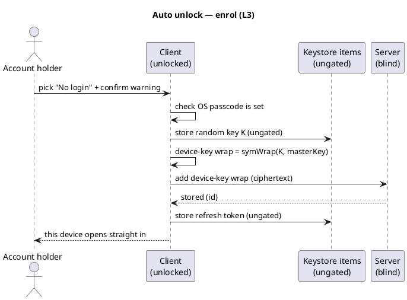

# UC: Auto unlock (L3 — no login, opens straight in)

- **ID:** uc.account.auto-unlock
- **Primary actor:** Account holder, authenticated **and currently unlocked**, who explicitly opts this
  device into the most convenient (and least app-protected) level
- **Goal:** Make this device open **straight to its content** on launch — **no password, no biometric, no
  Secret Key** — by holding both the unlock key **and** the session token **ungated** in the keystore. The
  only remaining gate is the **OS lock screen**. Entirely client-side; the server stores only the new
  ciphertext wrap.
- **Preconditions:** An **authenticated, unlocked** session; the user explicitly picks **L3** in
  [uc.account.set-device-security](uc.account.set-device-security.md) and acknowledges its trade-off; the
  OS device lock (passcode / biometric) **is set** (else the at-rest protection is too weak — see E3).
- **Postconditions (success):** A device-key wrap (ciphertext) exists server-side; this device's keystore
  holds the **ungated** unlock key plus the wrap id **and** an **ungated** copy of the refresh token. The
  app, on next launch, **resumes the session and opens the vault with no user interaction**. The Secret Key
  and the password were **never stored**.

## Same wrap as L2 — only the gate differs

L3 is **cryptographically identical** to L2 ([uc.account.biometric-unlock](uc.account.biometric-unlock.md)):
a **device-held random key** wraps the Master Key (`device-key wrap = symWrap(K, masterKey, "master-key")`)
and the **refresh token** is persisted so the session resumes without the password
([ADR 0005 §11](../../../decisions/0005-unlock-methods-and-device-trust.md)). The **only** difference is the
keystore access policy on `K` and the token:

> **L2:** `K` + token gated by `.biometryCurrentSet` — released only after a **live biometric**.
> **L3:** `K` + token stored **ungated** (`WhenUnlockedThisDeviceOnly` / equivalent) — released **whenever
> the device is unlocked**, with no gesture.

So L3 needs no new crypto over L2 — it is a **local policy choice**, invisible to the server (which cannot
tell L2 from L3; both are the same ciphertext wrap, [uc.account.biometric-unlock](uc.account.biometric-unlock.md)
quality notes).

## Why this is offered at all — and why it is never a default

This is the level where the **app adds nothing beyond the OS lock screen** ([ADR 0005 §13](../../../decisions/0005-unlock-methods-and-device-trust.md)).
It exists because of the **threat-model asymmetry** ([ADR 0005 §12](../../../decisions/0005-unlock-methods-and-device-trust.md)):

- The **server** is an **unknown, global** adversary → operator-blindness is **non-negotiable and
  unaffected**, even here. The server still holds only ciphertext + an opaque token; it never gains the
  KEK, Master Key, Secret Key, or password.
- The user's **own device** is a **smaller, known-circle** risk — the realistic exposure is "I left it
  unlocked / handed it to someone I know." For a memory-sharing app (not a password manager) the user may
  rationally decide that the phone's own lock screen is gate enough.

What L3 **gives up**, stated plainly: a found or borrowed **unlocked** device opens the content with no
further challenge. There is no app-level second factor. That is why L3 is **explicit opt-in only, never
pre-selected** ([ADR 0005 §10, §13](../../../decisions/0005-unlock-methods-and-device-trust.md)), shown
with a clear warning, and gated on a device passcode being set.

## Main flow — enrol ("open straight in on this device")

1. From the level chooser the user picks **L3 — No login** and confirms the warning. The client checks a
   device passcode is set (E3).
2. The client generates a random key `K`, stores it **ungated** in the keystore (`WhenUnlockedThisDeviceOnly`),
   and `device-key wrap = symWrap(K, masterKey, "master-key")`.
3. The client **adds** the device-key wrap (ciphertext) to the server → wrap **id**.
4. The client persists the current **refresh token** in the keystore **ungated**, and records
   `{keyRef, wrapId}` locally.
5. **At L3:** next launch, the client reads the ungated token (resume session) and the ungated `K`
   (`symUnwrap` the Master Key) and lands on the content — **no prompt**.

## Routine "unlock" at L3

On launch there is **no unlock step**: the client reads the ungated refresh token (resumes the session,
no login screen) and the ungated `K` (opens the Master Key) and goes straight to the content. The **floor
stays reachable** for an explicit re-lock / change-level, and L3 falls back to the floor automatically when
its key or token is unusable (E1/E2).

## Lower / change level ("turn off auto-open")

Moving off L3 ([uc.account.set-device-security](uc.account.set-device-security.md)) deletes **this
device's** device-key wrap (by id), **drops `K`** and the **ungated refresh token**. The device falls back
to the floor; other devices are untouched. Removing the level removes **one wrap**; content is never
re-encrypted. (Raising L3 → L2 re-stores the same material under a biometric gate.)

## Alternate / exception flows

- **E1 — key or wrap gone**: degrade to the **floor**; do **not** self-wipe on a single server response
  ([uc.account.trust-device](uc.account.trust-device.md) E1).
- **E2 — refresh token expired / rotated out**: the session can no longer resume silently → the next launch
  lands on the **floor** to mint a fresh session; the user may re-choose L3.
- **E3 — no OS device passcode**: L3 is **blocked / strongly warned** — an ungated keystore item on a
  passcode-less device has weak at-rest protection, defeating the one gate L3 relies on. No silent enrol.
- **E4 — explicit re-lock requested**: the user can re-lock the app manually (drops the in-memory Master
  Key); the next launch re-opens via the stored material (still L3) unless the level was changed.

## Quality notes

- **The only gate is the OS lock screen.** L3's security floor is exactly the device passcode/biometric the
  OS enforces — by design, the app adds nothing on top. This is the explicit trade the user accepted.
- **Operator-blind, identical to L2 server-side.** The relaxation is **purely local** — the server cannot
  distinguish L3 from L2 from L1 beyond a convenience-wrap **count** + coarse timestamps
  ([ADR 0004](../../../decisions/0004-session-tokens.md)). Operator-blindness is **untouched**.
- **No password / Secret Key at rest.** Even at maximum convenience the wrapping key is a **random**
  device-bound key, not the password — so an extracted keystore key opens **this device's vault**, not a
  way to authenticate elsewhere (same bounded blast radius as L2).
- **Bigger local attack surface than L1/L2.** Ungated items are readable whenever the device is unlocked;
  on a jailbroken/rooted or passcode-less device this is materially weaker. L3 presumes the user accepts
  that for *their own* device.
- **Never a default; reversible anytime.** L3 is only reached by an explicit, warned choice and can be
  lowered to any level from the unlocked app at any time.

## Out of scope (separate use-cases / increments)

- The **crypto and enrol mechanics** are shared with [uc.account.biometric-unlock](uc.account.biometric-unlock.md)
  (same device-key wrap); this use-case differs only in **gating + UX + threat trade-off**.
- The **chooser / transitions** are [uc.account.set-device-security](uc.account.set-device-security.md).
- **Cross-device onboarding** and **worker-cached re-lock** — separate, as in the other unlock use-cases.

## What this means for you / Was das für dich bedeutet

**EN —** If you want, you can set a device so the app **just opens** — no password, no FaceID, nothing.
Then the only thing standing between someone and your memories is your phone's own lock screen, so only do
this on a device you control and that has a passcode. The server still only ever sees scrambled data, and
the key that opens your memories never leaves the phone. You can switch this off, or up to FaceID, anytime —
and your password + Secret Key always still work.

**DE —** Wenn du willst, kannst du ein Gerät so einstellen, dass die App **einfach aufgeht** — kein
Passwort, kein FaceID, nichts. Dann steht zwischen jemandem und deinen Erinnerungen nur noch der
Sperrbildschirm deines Handys — mach das also nur auf einem Gerät, das du selbst kontrollierst und das eine
Gerätesperre hat. Der Server sieht weiterhin nur verschlüsselte Daten, und der Schlüssel, der deine
Erinnerungen öffnet, verlässt das Handy nie. Du kannst das jederzeit wieder ausschalten oder auf FaceID
hochstellen — und Passwort + Secret Key funktionieren immer weiter.

## Related

- Feature: [Account & auth](../_index.md)
- Concepts: [Account & Key Model](../../../crosscutting/account-key-model.md) (one Master Key / many wraps),
  [Security Model](../../../crosscutting/security-model.md) (Secret Key / 2SKD, operator-blind),
  [Passwordless unlock mechanism](../../../crosscutting/passwordless-unlock-mechanism.md) (the cross-platform L2/L3 orchestration)
- Decisions: [ADR 0005 §8–13](../../../decisions/0005-unlock-methods-and-device-trust.md) (device unlock
  levels; L3 = no login; operator-blind at every level; never a default)
- Related use-cases: [set-device-security](uc.account.set-device-security.md) (the chooser),
  [biometric-unlock](uc.account.biometric-unlock.md) (L2, same wrap, biometric-gated),
  [trust-device](uc.account.trust-device.md) (L1, keeps the password), [unlock](uc.account.unlock.md)
  (L0 floor — the always-reachable fallback)
