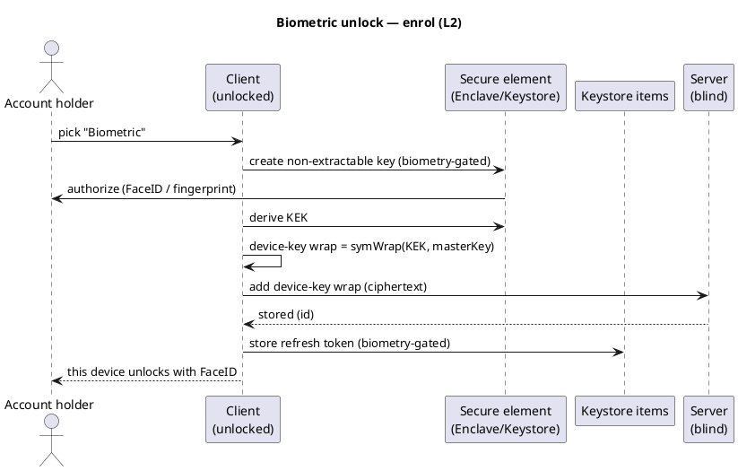

# UC: Biometric unlock (L2 — FaceID / fingerprint, no password)

- **ID:** uc.account.biometric-unlock
- **Primary actor:** Account holder, authenticated **and currently unlocked** on a device with biometric
  hardware (FaceID / TouchID / Android BiometricPrompt)
- **Goal:** Enrol a device-local **biometric wrap** so that future unlocks on *this* device need only a
  **live biometric gesture** — no password, no Secret Key. The wrapping key is a **device-held random key
  released only after a successful biometric**, rooted in the platform secure element. Entirely
  client-side; the server stores only the new ciphertext wrap.
- **Preconditions:** An **authenticated, unlocked** session (the in-memory Master Key can be wrapped); a
  **biometric is enrolled** at the OS level and a hardware secure element is available (Secure Enclave /
  Android Keystore-StrongBox); the user picks **L2** in [uc.account.set-device-security](uc.account.set-device-security.md).
- **Postconditions (success):** A device-key wrap (ciphertext) exists server-side; this device's keystore
  holds a **biometric-gated** secure-element key plus the wrap's id, **and a biometric-gated copy of the
  refresh token** (so the session can resume without the password). Subsequent opens require a **live
  biometric** to release the key and the token. The Secret Key and the password were **never stored**.

## This is the passwordless level — so the session must persist

L1 ([uc.account.trust-device](uc.account.trust-device.md)) keeps the password as a factor, so each sign-in
mints a fresh session. L2 asks for **no password**, and the password is what signs the login challenge
([ADR 0003](../../../decisions/0003-operator-blind-password-auth.md)) — so the client **cannot** mint a
fresh session on its own. L2 therefore **persists the refresh token** in the keystore, **gated by the same
biometric** as the unlock key ([ADR 0005 §11](../../../decisions/0005-unlock-methods-and-device-trust.md)).
On open: one biometric releases **both** the session token (resume the session) **and** the unlock key
(open the vault). When the refresh token finally expires or rotates out, L2 falls back to the **floor**.

## Why this is safe (operator-blind, bounded blast radius)

Two factors, both device-side, one a **liveness** gesture: a **non-extractable secure-element key** released
**only after a live FaceID / fingerprint** produces the wrap KEK — so a stolen *locked* device opens nothing,
and a stolen *unlocked* one still needs the owner's face/finger. The wrapping key is a **random** device key,
**never the account password**: the password is also the *auth* factor, so storing it (even biometric-gated)
would let a biometric-passing local attacker authenticate **from anywhere** — a random key caps the blast
radius to *this* device. The Master Key and Secret Key are **never stored at rest**.

The wrap mechanism itself (`device-key wrap = symWrap(K, masterKey)`, the two-part gated store, the sealed
session token) is the single reference
[en.account.passwordless-unlock](../enablers/en.account.passwordless-unlock.md); the level + the
rejected "store the key at rest" alternative are
[ADR 0005](../../../decisions/0005-unlock-methods-and-device-trust.md).

## Main flow — enrol ("use FaceID on this device")

Enrolment runs **at unlock time**, right after a successful unlock (the chooser of
[uc.account.set-device-security](uc.account.set-device-security.md)), so the in-memory Master Key is in
hand. No password is needed for enrolment itself (the Master Key is already open).

1. From the level chooser the user picks **L2 — Biometric**. The OS prompts for a biometric to authorize
   creating the gated key.
2. The client creates a **non-extractable secure-element key** with a **biometry-current** access control
   (so re-enrolling a face/finger invalidates it — see E4) and derives the wrap **KEK** from it.
3. The client wraps the **in-memory** Master Key: `device-key wrap = symWrap(KEK, masterKey,
   "master-key")`.
4. The client **adds** the device-key wrap (ciphertext) to the server, which appends a wrap row and returns
   its **id**.
5. The client persists the current **refresh token** in the keystore under the **same biometric gate**, and
   records `{keyRef, wrapId}` locally.
6. **At L2:** the server holds the device-key ciphertext; this device holds a biometric-gated secure-element
   key + the gated session token + the wrap id.

## Routine unlock at L2

On open the client requests the biometric **once**; the OS releases the gated session token (resume the
session, no login screen) **and** lets the secure element produce the **KEK**, which `symUnwrap`s the
Master Key — no password, no Secret Key. **Method precedence is client-side**
([ADR 0005 §7](../../../decisions/0005-unlock-methods-and-device-trust.md)): if the biometric is
unavailable or the user cancels, the device offers the **floor** ("unlock another way"); the floor is
always reachable.

## Lower / change level ("stop using FaceID")

Moving off L2 ([uc.account.set-device-security](uc.account.set-device-security.md)) deletes **this
device's** device-key wrap (by id), **destroys the secure-element key**, and **drops the gated refresh
token**. The account falls back to the floor on this device; other devices keep their own wraps. Removing
the level removes **one wrap**; content is never re-encrypted. The delete path whitelists the convenience
wrap, so the PASSWORD floor and RECOVERY methods are out of its reach.

## Alternate / exception flows

- **E1 — key or wrap gone** (keystore cleared, app reinstalled, server wrap missing): the level degrades to
  the **floor**; the client does **not** self-wipe on a single server response (a blind operator could
  otherwise withhold the wrap to force a wipe — [uc.account.trust-device](uc.account.trust-device.md) E1).
- **E2 — refresh token expired / rotated out**: the persisted session can no longer resume → fall back to
  the **floor** (password + Secret Key) to mint a fresh session; the user may re-choose L2 afterwards.
- **E3 — biometric cancelled / failed / locked out**: no KEK is released → unlock does not proceed; the
  client offers the **floor**. No silent bypass.
- **E4 — biometric set changed** (a face/finger added or removed): the **biometry-current** gate
  **invalidates** the secure-element key by design (anti-coercion) → the device-key wrap is unusable here →
  fall back to the **floor**, re-enrol L2 if desired. Stated, not a defect.
- **E5 — no biometric hardware / none enrolled**: L2 is **not offered** on this device
  ([uc.account.set-device-security](uc.account.set-device-security.md) E2); the user stays at L0/L1.
- **E6 — secure element unavailable** (simulator, older Mac without an Enclave): L2 is unsupported; only
  L0/L1 are offered. No software-only fallback that would silently drop the hardware guarantee.

## Quality notes

- **Liveness is the second factor.** Unlike L1 (knowledge: the password), L2's second factor is a **live
  biometric** — possession of the device alone, even unlocked-and-in-hand, is not enough.
- **Hardware-rooted, not just non-extractable.** The key lives in the **secure element** (true hardware
  boundary), stronger than a software non-extractable key; ADR 0005 distinguishes the two.
- **No password at rest — bounded blast radius.** Because the wrapping key is random and device-bound (not
  the password), a biometric-passing local attacker gets **this device's vault only**, not the ability to
  authenticate elsewhere.
- **Operator-blind; L2 is indistinguishable from L3 server-side.** The server holds only the device-key
  **ciphertext** wrap; whether the key/token are biometric-gated (L2) or ungated (L3) is **local** and
  never sent. Metadata exposed: a convenience-wrap **count** + coarse timestamps (as for sessions,
  [ADR 0004](../../../decisions/0004-session-tokens.md)).
- **Secret Key stays cold; password never stored.** Enrolment wraps the already-unlocked Master Key; the
  Secret Key lives only in the Emergency Kit, the password only in the user's head.
- **A password change does not break L2** (its KEK has no password component) — but the persisted refresh
  token may be invalidated by a credential change, degrading to the floor; owned by the change-password
  use-case.

## Out of scope (separate use-cases / increments)

- **Web biometric** is a different mechanism — **WebAuthn passkey + PRF** (the PASSKEY method), its own
  use-case ([ADR 0005 §4](../../../decisions/0005-unlock-methods-and-device-trust.md)). This use-case is
  the **native** secure-element path (apple/android).
- **L3 — no login** ([uc.account.auto-unlock](uc.account.auto-unlock.md)) reuses the same device-key wrap
  **ungated**; the chooser/transitions are [uc.account.set-device-security](uc.account.set-device-security.md).
- **Cross-device onboarding** and **worker-cached re-lock** — separate, as in the other unlock use-cases.

## What this means for you / Was das für dich bedeutet

**EN —** Once you've opened your memories on a device with your password and Secret Key, you can switch
that device to **FaceID / your fingerprint**. After that, opening the app just asks for your face or finger
— no password to type, no Secret Key. The key that opens your memories is locked inside your phone's secure
chip and is only handed out when your phone recognises *you*; a thief with your unlocked phone still can't
get in. The server never sees any of this. If FaceID ever fails, you can always fall back to your password
and Secret Key.

**DE —** Sobald du deine Erinnerungen auf einem Gerät mit Passwort und Secret Key geöffnet hast, kannst du
dieses Gerät auf **FaceID / Fingerabdruck** umstellen. Danach fragt die App beim Öffnen nur noch nach
deinem Gesicht oder Finger — kein Passwort, kein Secret Key. Der Schlüssel, der deine Erinnerungen öffnet,
steckt im Sicherheits-Chip deines Handys und wird nur freigegeben, wenn dich das Handy *erkennt*; ein Dieb
mit deinem entsperrten Handy kommt trotzdem nicht rein. Der Server sieht davon nichts. Falls FaceID einmal
nicht klappt, geht immer der Weg über Passwort und Secret Key.

## Related

- Feature: [Account & auth](../_index.md)
- Concepts: [Account & Key Model](../enablers/en.account.key-model.md) (one Master Key / many wraps),
  [Security Model](../../../crosscutting/security-model.md) (Secret Key / 2SKD, operator-blind),
  [Passwordless unlock mechanism](../enablers/en.account.passwordless-unlock.md) (the cross-platform L2/L3 orchestration)
- Decisions: [ADR 0005 §4, §8–13](../../../decisions/0005-unlock-methods-and-device-trust.md) (biometric =
  secure-element key used directly; device unlock levels), [ADR 0003](../../../decisions/0003-operator-blind-password-auth.md)
  (auth vs. unlock — why passwordless needs a persisted session)
- Related use-cases: [set-device-security](uc.account.set-device-security.md) (the chooser),
  [trust-device](uc.account.trust-device.md) (L1, keeps the password), [auto-unlock](uc.account.auto-unlock.md)
  (L3, same wrap ungated), [unlock](uc.account.unlock.md) (L0 floor — the always-reachable fallback)
