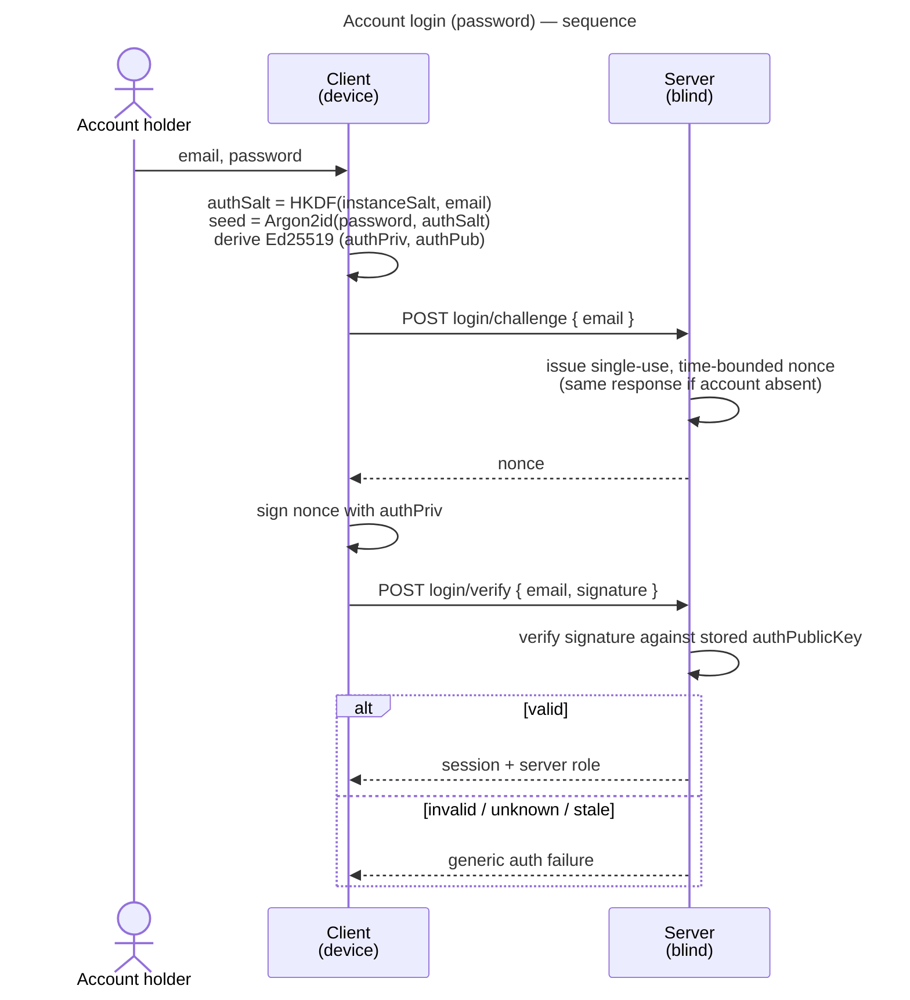
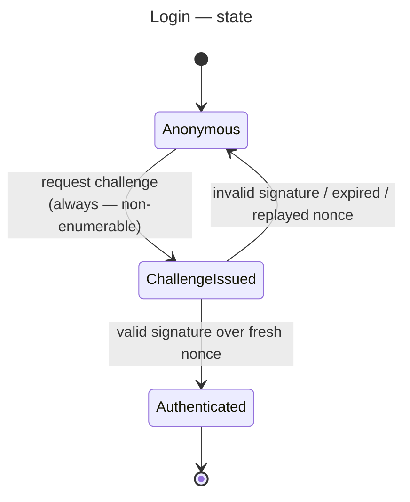

# UC: Account login (password)

- **ID:** uc.account.login
- **Primary actor:** Account holder (a user whose account already exists on the instance)
- **Goal:** Authenticate to the instance using the **password-derived auth keypair** via
  **challenge-response** and obtain a session — without the server ever seeing the password.
- **Preconditions:** The instance is set up; the account exists, i.e. its `authPublicKey` was registered
  at setup ([uc.admin.setup-server](../../admin/use-cases/uc.admin.setup-server.md)) or when joining a
  tenant.
- **Postconditions (success):** The client holds a valid **session** bound to the account and its server
  role; the server has verified a **fresh signed challenge** against the stored `authPublicKey`; no
  password and nothing replayable was transmitted. **No content is unlocked** — opening the Master Key is
  a separate step (see *Related*).

## Main flow

1. The user enters their **email** and **password** (the mandatory auth floor).
2. The client derives, **on device**: `authSalt = HKDF(instanceSalt, normalizedEmail)`, then
   `seed = Argon2id(password, authSalt)`, then the **Ed25519 auth keypair** `(authPriv, authPub)`
   (domain-separated from the unlock KEK). The password never leaves the device.
3. The client requests a **login challenge** for the email; the server issues a **single-use,
   time-bounded nonce**. The server responds **identically** whether or not the account exists
   (non-enumerable).
4. The client **signs the nonce** with `authPriv` and sends the signature (with the email).
5. The server **verifies** the signature against the stored `authPublicKey`. On success it issues a
   **session** (and the account's server role); on failure it returns a **generic auth failure**.

## Alternate / exception flows

- **A1 — passkey (deferred):** a registered passkey is an alternate auth method (its signature
  authenticates); covered by a **separate use-case**, not this flow.
- **E1 — wrong password:** the derived keypair does not match the stored `authPublicKey`; signature
  verification fails → **generic auth failure**, indistinguishable from an unknown account.
- **E2 — unknown account:** the server still issues a nonce and still fails verification identically →
  **non-enumerable**; the response never signals whether the account exists.
- **E3 — expired or replayed nonce:** a nonce is single-use and time-bounded; a stale or reused nonce is
  rejected and the client must request a fresh challenge.

## Login state

## Quality notes

- **Operator-blind auth.** The password is never sent — at login or anywhere. The server stores only
  `authPublicKey`; a DB dump yields a **public key, not a credential**. Forging a login means breaking
  Ed25519 (~2¹²⁸) or brute-forcing the password through Argon2id. See
  [ADR 0003](../../../decisions/0003-operator-blind-password-auth.md).
- **Non-enumerable.** `authSalt` is deterministic from the email, a nonce is **always** issued, and
  failures are **generic**, so the server behaves identically for existing and non-existing accounts —
  it never reveals who holds an account. See [Security Model](../../../crosscutting/security-model.md).
- **Auth ≠ unlock.** Login only gates a **session + server role**; it **never** unlocks content. The
  **Secret Key is not used here** — it belongs to the *unlock* layer (`Argon2id(password + Secret Key)` →
  Unlock KEK), which is a separate use-case. See
  [Account & Key Model → Auth vs. unlock](../enablers/en.account.key-model.md).
- **Replay-resistant.** Authentication is a signature over a fresh single-use nonce, not a transmitted
  bearer secret.
- **Session shape is decided in [ADR 0004](../../../decisions/0004-session-tokens.md).** Opaque,
  server-stored, rotating access + refresh tokens grouped into named session families; this use-case
  issues such a session on success but does not restate the mechanics.
- **PQ posture.** Ed25519 now; migrate to a PQ/hybrid signature (ML-DSA) later via a suite bump. A login
  signature is a one-time live check — there is no harvest-now-decrypt-later for authentication.

## What this means for you / Was das für dich bedeutet

**EN —** When you log in to your veyq instance, your password never leaves your device. Your device uses
it to prove who you are with a **one-time signature**, and the server only ever checks that signature —
it never learns your password and stores nothing it could reuse to impersonate you. Logging in gets you a
**session**; actually opening your encrypted memories is a **separate unlock step** that also needs your
Secret Key. The server can't tell a wrong password apart from an account that doesn't exist, so it never
reveals who has an account.

**DE —** Wenn du dich bei deiner veyq-Instanz anmeldest, verlässt dein Passwort nie dein Gerät. Dein
Gerät beweist mit einer **einmaligen Signatur**, wer du bist, und der Server prüft nur diese Signatur —
er erfährt dein Passwort nie und speichert nichts, womit er sich als du ausgeben könnte. Die Anmeldung
verschafft dir eine **Sitzung**; deine verschlüsselten Erinnerungen tatsächlich zu öffnen ist ein
**separater Entsperr-Schritt**, der zusätzlich deinen Secret Key braucht. Der Server kann ein falsches
Passwort nicht von einem nicht existierenden Konto unterscheiden und verrät so nie, wer ein Konto hat.

## Related

- Feature: [Account & auth](../_index.md)
- Concepts: [Account & Key Model](../enablers/en.account.key-model.md) (auth vs. unlock, auth
  keypair), [Security Model](../../../crosscutting/security-model.md) (operator-blind, non-enumerability)
- Decisions: [ADR 0003](../../../decisions/0003-operator-blind-password-auth.md) (password-derived keypair
  + challenge-response), [ADR 0004](../../../decisions/0004-session-tokens.md) (session token form)
- Related use-cases: [setup-server](../../admin/use-cases/uc.admin.setup-server.md) (registers
  `authPublicKey`); unlock the Master Key — planned; log in with a passkey — planned; change password /
  Secret Key — planned
