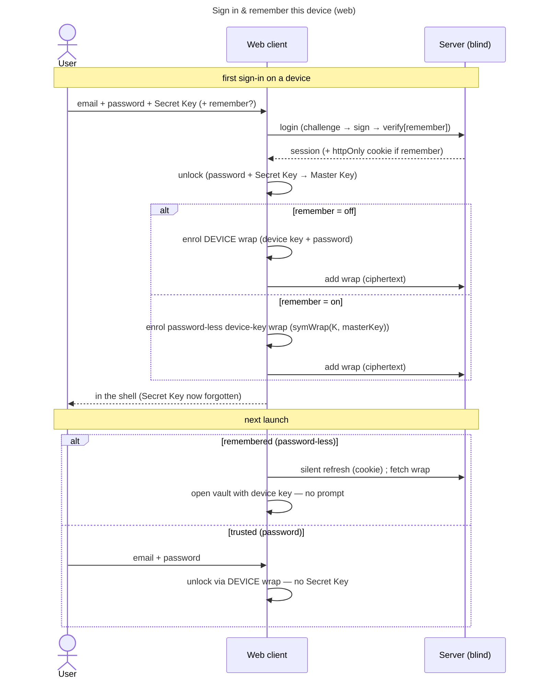

# UC: Sign in & remember this device (one screen, one toggle)

- **ID:** uc.account.remember-this-device
- **Primary actor:** Account holder signing in on a device they control.
- **Goal:** Collapse the web sign-in + unlock into **one adaptive screen** with a single **"remember me"**
  toggle that decides — once — how this device opens next time, and **auto-enrols** the matching convenience
  wrap so the Secret Key is typed **only on the first sign-in per device**.
- **Preconditions:** The instance is set up; the account exists. For the first sign-in on a device the user
  holds their password **and** Secret Key (Emergency Kit). Operator-blind throughout (ADR 0003/0005).
- **Postconditions (success):** The session is established and the Master Key is open in memory. Exactly **one**
  convenience wrap exists for this device (ADR 0005 §9): a **DEVICE** wrap (password-bound) when "remember me"
  is off, or a **password-less device-key** wrap (+ a persisted session cookie) when on. The Secret Key was
  read **once** to create the wrap, then forgotten ([ADR 0005 §3, §17-20](../../../decisions/0005-unlock-methods-and-device-trust.md)).

## Why this exists

cr-0052 shipped the cookie + a local "remember me" cache but surfaced **two overlapping checkboxes** — a login
"remember me" and an unlock "trust this device" — which are two views of the *same* per-device decision and
could be ticked into a contradictory combination. The screens collapse because the mechanism does: the same
password authenticates *and* derives the DEVICE-wrap KEK (ADR 0005 §17), so login and unlock were never two
decisions. One toggle now covers both options — the password-bound DEVICE wrap, or the password-less one
(§18-20).

## Main flow — one adaptive screen

The screen shows only the fields this device still needs:

1. **First time on this device** (no convenience wrap yet): **email + password + Secret Key**, plus the
   **"remember me"** toggle. On submit the client **logs in** (password → auth keypair → session, ADR 0003) and
   **unlocks** (password + Secret Key → Master Key, ADR 0005 §3).
2. On a successful first unlock the client **auto-enrols** the convenience wrap from the *in-memory* Master Key
   (the Secret Key is never stored):
   - **"remember me" off** → a **DEVICE** wrap (`KEK = Argon2id(device-bound key + password)`). Next launch asks
     **email + password only** (the Secret-Key field is hidden); unlock opens the DEVICE wrap.
   - **"remember me" on** → a **password-less device-key** wrap (a fresh random key `K`, `symWrap(K, masterKey)`,
     held ungated on the device) **and** a persisted session (the [ADR 0004](../../../decisions/0004-session-tokens.md)
     httpOnly cookie). Next launch **opens straight in** — no screen.
3. **Returning on a remembered device** (password-less wrap + cookie present): the boot restore opens the vault
   with no prompt.

## Alternate / exception flows

- **E1 — wrong password / Secret Key:** one generic failure; the screen keeps the inputs for a retry (server
  uninvolved).
- **E2 — convenience wrap / cookie unusable** (key cleared, wrap gone, token expired/rotated): the device
  degrades to the **first-sign-in** screen (email + password + Secret Key) — no silent self-wipe on a single
  server response (mirrors [uc.account.trust-device](uc.account.trust-device.md) E1). The Secret-Key floor is
  the always-reachable recovery.
- **E3 — a genuinely untrusted machine:** there is **no** app-level "remember nothing" mode (ADR 0005 §19 —
  "every device is mine"); use the browser's **private / incognito** window (no persisted IndexedDB/cookie).

## Quality notes

- **The Secret Key is typed once per device, never stored.** It only authorizes creating the convenience wrap
  on first unlock, then is forgotten — it lives only in the Emergency Kit (ADR 0005 §3).
- **"Remember me" is the whole per-device choice on web.** It replaces both the old login and unlock checkboxes
  (ADR 0005 §18); a device carries exactly one convenience wrap.
- **A stolen device alone yields nothing without "remember me".** The password DEVICE wrap is password-gated, so
  device theft without the password opens nothing — which is why even "off" can safely auto-enrol it (§19).
- **The remember-me wrap is the device key alone** (no password, no KDF) — its own `MasterKeyWrap.Method`
  (the enum decision is [ADR 0005](../../../decisions/0005-unlock-methods-and-device-trust.md) §20). The server
  stores it as ciphertext like any other wrap and cannot tell it apart beyond a method label + count.
- **Operator-blind, unchanged.** The server holds only ciphertext wraps + an opaque cookie token; no KEK,
  Master Key, Secret Key, or password is ever server-side (ADR 0005 §12). The relaxation is **purely local**.
- **Supersedes cr-0052's local cache.** The remember-me vault is the **server-stored** password-less wrap (+
  the device key held locally), not the cr-0052 IndexedDB Master-Key blob — portable and server-revocable.

## What this means for you / Was das für dich bedeutet

**EN —** When you sign in on the web the first time on a device, you enter your password and your Secret Key
once. Tick "remember me" and that device opens straight to your memories next time; leave it unticked and next
time you just need your password — either way you never retype your Secret Key on that device. The server only
ever sees scrambled data, and the key that opens your memories never leaves your device. On a computer that
isn't yours, use a private/incognito window — nothing is kept.

**DE —** Wenn du dich im Web das erste Mal auf einem Gerät anmeldest, gibst du einmal Passwort und Secret Key
ein. Setzt du das Häkchen „angemeldet bleiben", öffnet dieses Gerät beim nächsten Mal direkt deine
Erinnerungen; ohne Häkchen brauchst du nächstes Mal nur dein Passwort — so oder so tippst du deinen Secret Key
auf diesem Gerät nie wieder. Der Server sieht nur verschlüsselte Daten, und der Schlüssel zu deinen
Erinnerungen verlässt dein Gerät nie. Auf einem fremden Rechner nutze ein privates/Inkognito-Fenster — dann
bleibt nichts zurück.

## Related

- Feature: [Account & auth](../_index.md)
- Enabler: [en.account.key-model](../enablers/en.account.key-model.md) (the Master Key + per-device wraps this
  convenience wrap builds on)
- Decisions: [ADR 0005 §17-20](../../../decisions/0005-unlock-methods-and-device-trust.md) (the web flow:
  one screen, one toggle, auto-enrol, the password-less wrap method, no public-device level),
  [ADR 0004](../../../decisions/0004-session-tokens.md) (the refresh-token cookie), [ADR 0003](../../../decisions/0003-operator-blind-password-auth.md) (Model B auth).
- Related use-cases: [unlock](uc.account.unlock.md) (the floor — the first-sign-in path),
  [trust-device](uc.account.trust-device.md) (the DEVICE wrap).
