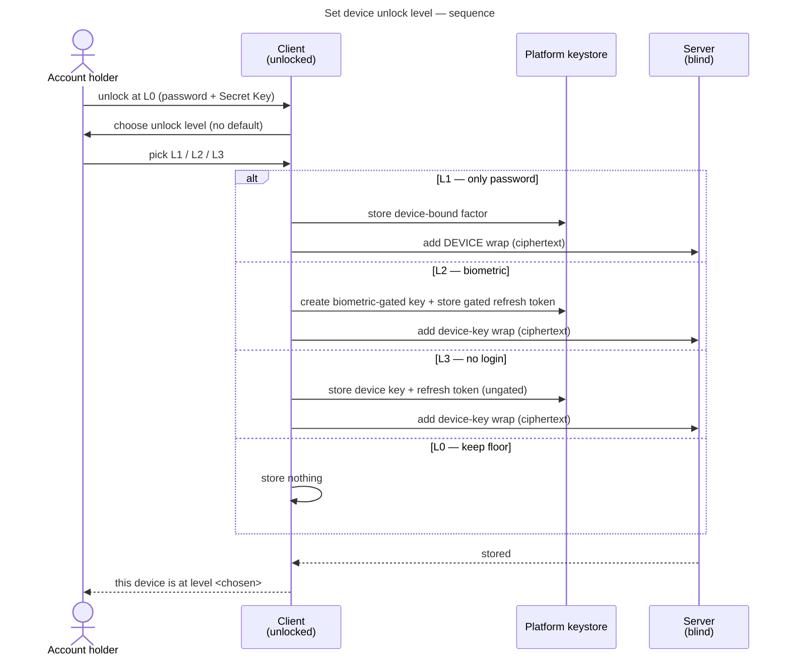
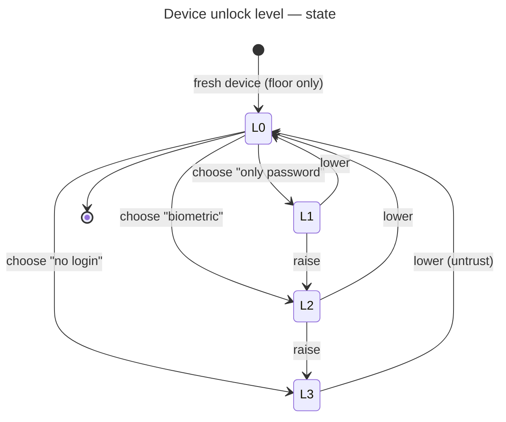

# UC: Set this device's unlock level (the per-device security slider)

- **ID:** uc.account.set-device-security
- **Surfaces:** apple · android — **native by design** ([ADR 0005 §14–21](../../../decisions/0005-unlock-methods-and-device-trust.md)):
  the L0–L3 chooser *is* the native flow. Web deliberately collapses to one screen + one toggle
  ([uc.account.remember-this-device](uc.account.remember-this-device.md)), and the slider needs no backend
  change — it is a client concern over the existing wraps endpoints. Both native surfaces are parked
  ([ADR 0043](../../../decisions/0043-web-first-v1-native-parked.md)), so this owes no live surface today.
- **Primary actor:** Account holder, authenticated **and currently unlocked** on a device (the Master Key
  is in memory)
- **Goal:** Let the user choose — and later change — **how much friction this device asks for** on future
  unlocks, from an ordered, **mutually-exclusive** set of levels. This use-case owns the **choice and the
  transitions**; the per-level mechanics live in the four level use-cases it links.
- **Preconditions:** An **authenticated, unlocked** session (so a chosen level can wrap the in-memory
  Master Key, and the password is still in hand if the chosen level needs it — the choice is offered
  *at unlock time*, see [uc.account.unlock](uc.account.unlock.md)).
- **Postconditions (success):** This device carries **exactly one** convenience wrap matching the chosen
  level (or none, for L0), plus the always-present PASSWORD floor; the server stores only the resulting
  ciphertext. The Secret Key was **never read or stored**.

## The levels (ordered, mutually exclusive)

Per [ADR 0005 §8–13](../../../decisions/0005-unlock-methods-and-device-trust.md), a device sits at exactly
one level at a time. Higher = less friction, less local defense-in-depth; **operator-blindness is identical
at every level** — only *local* device security changes.

| Level | What the user does on open | Second factor | Mechanics |
| --- | --- | --- | --- |
| **L0 — Secret Key each time** | password **+** Secret Key | the cold Secret Key | [uc.account.unlock](uc.account.unlock.md) (the bare floor) |
| **L1 — Only password** | password | the password (device-bound factor is the other) | [uc.account.trust-device](uc.account.trust-device.md) |
| **L2 — Biometric** | a live FaceID / fingerprint | the biometric gesture | [uc.account.biometric-unlock](uc.account.biometric-unlock.md) |
| **L3 — No login** | nothing (opens straight in) | *(none beyond the OS lock screen)* | [uc.account.auto-unlock](uc.account.auto-unlock.md) |

> **This chooser is the *native* flow ([ADR 0005 §14–21](../../../decisions/0005-unlock-methods-and-device-trust.md)).**
> Web does **not** show this slider: it collapses to one adaptive screen + a single "remember me" toggle that
> auto-enrols a password DEVICE wrap (off) or a password-less device-key wrap (on) — its own use-case,
> [uc.account.remember-this-device](uc.account.remember-this-device.md) (§17-21). Native keeps the richer
> choice (password-less **or** biometric — realistic on a phone). The wraps are the same (§9); only the
> presentation differs, and whether native also simplifies is to be worked out. (L0 "Secret Key each time" is
> not a routine pick; passkey auth + QR onboarding are their own use-cases, §16.)

**Why these are the user's call, not ours.** The *server* is an unknown, global adversary — that is why
operator-blindness is non-negotiable and unaffected here. The user's *own device* is a smaller,
known-circle risk (only "handed over / left unlocked"), so how much local friction to trade for
convenience there is legitimately the user's decision ([ADR 0005 §12](../../../decisions/0005-unlock-methods-and-device-trust.md)).

## Main flow — choose a level (first time on this device)

The choice is offered **at unlock time**, reusing the just-typed password (the unlock flow clears it right
after — a later "settings" prompt would have to re-ask).

1. On a fresh device the user always unlocks the first time at **L0** (password + Secret Key); there is no
   device-bound material yet.
2. On success, **before the password is cleared**, the client presents the level chooser — an ordered
   slider with **nothing pre-selected** ([ADR 0005 §10](../../../decisions/0005-unlock-methods-and-device-trust.md):
   *no default — the user must choose*). The client offers only the levels this device can actually
   support (e.g. L2 hidden where no biometric hardware/enrolment exists; L3 discouraged with no OS
   passcode).
3. The user picks a level. The client runs that level's enrolment (links above): L0 stores nothing; L1
   enrols the DEVICE wrap; L2/L3 enrol the device-held-key wrap **and** persist the session token (gated
   for L2, ungated for L3).
4. Until the user picks, the device **stays at L0** — the choice is never made silently.

## Change the level later

From the unlocked app the user can move this device to any level. A change is **swap one wrap, never
re-encrypt content** ([ADR 0005 §9](../../../decisions/0005-unlock-methods-and-device-trust.md)):

- **Down** (e.g. L3 → L0): delete this device's convenience wrap, drop any persisted session token and
  device key; the device falls back to the floor. No re-prompt needed (already unlocked).
- **Up / sideways** (e.g. L1 → L2): the user is unlocked, so the Master Key is in hand — enrol the new
  level's wrap, then delete the old one (replace; never accumulate two convenience wraps on one device).
- Lowering to a level that needs the password (→ L1) when the password is no longer in hand re-prompts for
  it once; raising/lowering between already-enrolled material does not.

Changing level on **this** device never touches **other** devices' wraps (each device is independent).

## State

## Alternate / exception flows

- **E1 — level's KEK source / session unusable** (key cleared, biometric reset, token expired): the level
  silently degrades to the **floor (L0)** on this device; the client does **not** self-wipe its key on a
  single server response ([uc.account.trust-device](uc.account.trust-device.md) E1). The user can re-choose
  a level on the next floor unlock.
- **E2 — hardware/OS can't support the chosen level**: L2 is **hidden** where no biometric is enrolled; L3
  is **warned against / blocked** where the OS has no device passcode (its at-rest protection would be
  weak). No silent downgrade to a weaker-than-asked level.
- **E3 — change without being unlocked**: changing level needs the in-memory Master Key; from a locked
  state the user unlocks first (at whatever level applies), then changes.

## Quality notes

- **One clear answer per device.** The level abstraction deliberately exposes **one** convenience wrap at a
  time even though the crypto permits several ([ADR 0005 §9](../../../decisions/0005-unlock-methods-and-device-trust.md)) —
  so "how does this device unlock?" has a single answer the user set.
- **Floor is unremovable and always reachable.** No level can delete the PASSWORD floor (the untrust/change
  path whitelists the convenience wrap only); every level falls back to it.
- **Secret Key stays cold.** Every enrolment wraps the **already-unlocked** Master Key; the Secret Key is
  never read, derived from, or stored — it lives only in the Emergency Kit.
- **Operator-blind at every level.** The server holds only ciphertext wraps + opaque metadata (a
  convenience-wrap **count** + coarse timestamps, as already accepted for sessions —
  [ADR 0004](../../../decisions/0004-session-tokens.md)). The choice of level is **never** sent as a label;
  the server cannot tell L2 from L3 (same ciphertext wrap; the gating is local).
- **A password change invalidates L1** (and any wrap that mixes the password): each affected device falls
  back to the floor and re-chooses on next use — inherent to a *device + password* wrap, owned by the
  future change-password use-case.

## Out of scope (separate use-cases / increments)

- The **per-level mechanics** — each level's enrolment, unlock, exceptions and crypto — are their own use-
  cases (linked in the table). This use-case is only the **chooser + transitions**.
- **Cross-device onboarding** (QR / push) — bringing a *new* device to any level without re-typing the
  Secret Key — is its own use-case ([ADR 0005 → related/future](../../../decisions/0005-unlock-methods-and-device-trust.md)).
- **Worker-cached re-lock / reload persistence** ([ADR 0005 §6](../../../decisions/0005-unlock-methods-and-device-trust.md)) —
  orthogonal, applies under every level.

## What this means for you / Was das für dich bedeutet

**EN —** After you've opened your memories once on a device with your password and Secret Key, you decide
how that device should unlock next time: **type your password**, use **FaceID / your fingerprint**, or
**open straight in** with nothing. More convenience means this device leans more on your phone's own lock
screen — that's your choice to make, per device, and you can change it anytime. Whatever you pick, the
server still only ever sees scrambled data, and you can always fall back to password + Secret Key.

**DE —** Wenn du deine Erinnerungen auf einem Gerät einmal mit Passwort und Secret Key geöffnet hast,
entscheidest du, wie sich dieses Gerät beim nächsten Mal entsperrt: **Passwort tippen**, **FaceID /
Fingerabdruck**, oder **direkt offen** ganz ohne Eingabe. Mehr Bequemlichkeit heißt, dass dieses Gerät
sich stärker auf den Sperrbildschirm deines Handys verlässt — das ist deine Entscheidung, pro Gerät, und
jederzeit änderbar. Was du auch wählst: Der Server sieht weiterhin nur verschlüsselte Daten, und der Weg
über Passwort + Secret Key steht dir immer offen.

## Related

- Feature: [Account & auth](../_index.md)
- Concepts: [Account & Key Model](../enablers/en.account.key-model.md) (one Master Key / many wraps),
  [Security Model](../../../crosscutting/security-model.md) (Secret Key / 2SKD, operator-blind),
  [Passwordless unlock mechanism](../enablers/en.account.passwordless-unlock.md) (the cross-platform L2/L3 orchestration)
- Decisions: [ADR 0005 §8–13](../../../decisions/0005-unlock-methods-and-device-trust.md) (device unlock
  levels; mutually exclusive; no default; operator-blind at every level)
- Level use-cases: [unlock](uc.account.unlock.md) (L0 floor), [trust-device](uc.account.trust-device.md)
  (L1), [biometric-unlock](uc.account.biometric-unlock.md) (L2), [auto-unlock](uc.account.auto-unlock.md)
  (L3)
