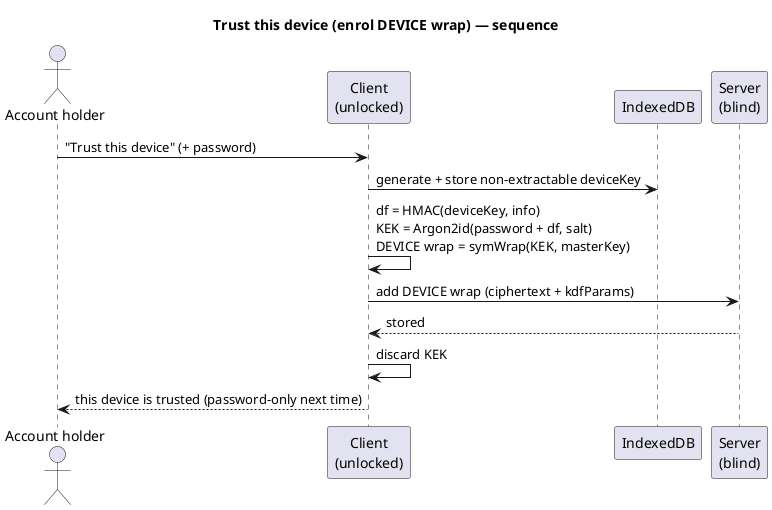
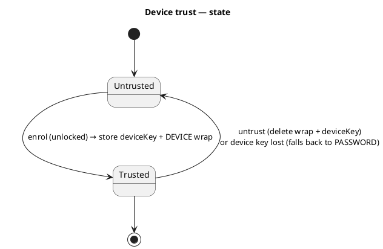

# UC: Trust this device (DEVICE wrap — unlock with only the password)

- **ID:** uc.account.trust-device
- **Primary actor:** Account holder, authenticated **and currently unlocked** on a device (the Master Key
  is in memory)
- **Goal:** Enrol a **device-local DEVICE `MasterKeyWrap`** so that future unlocks on *this* device need only
  the **password** — the high-entropy **Secret Key** is no longer required here. Entirely client-side; the
  server stores only the new ciphertext wrap.
- **Preconditions:** An **authenticated session** exists; the device is being (or has just been)
  **unlocked**, so the in-memory Master Key can be wrapped under a new KEK **and** the account password is
  still in hand (the unlock flow clears it right after — enrolment is offered *at unlock time*, see
  [uc.account.unlock](uc.account.unlock.md)); WebCrypto + IndexedDB are available.
- **Postconditions (success):** A **DEVICE** wrap (ciphertext) exists server-side; this device's IndexedDB
  holds its **non-extractable** device key plus the wrap's **salt** and server **id**; subsequent unlocks on
  this device open the Master Key from **password + device key** (2-factor, no Secret Key). The Secret Key
  was **never read or stored** — enrolment uses the already-unlocked Master Key.

## Many devices, one Master Key

Device trust is **per device**: each trusted device enrols **its own** DEVICE wrap (its own non-extractable
key, its own random salt) — trusting a phone *and* a laptop yields **two** DEVICE wraps on the same Master
Key, not a single shared one. (So "one wrap per method" from
[ADR 0005](../../../decisions/0005-unlock-methods-and-device-trust.md) §1 is the *floor* methods' rule;
DEVICE/PASSKEY are inherently per-device and may appear more than once.) The server stores each as an
independent ciphertext row; a device finds **its own** wrap in the fetched set by the **salt** it kept at
enrolment (`kdfParams`), so the wrong device's wrap is never even attempted (one Argon2id, not one per row).

## Why this preserves 2SKD and operator-blindness

The PASSWORD floor is `KEK = Argon2id(password + Secret Key)` — two **user** secrets. The DEVICE wrap keeps
two factors but swaps the *cold* Secret Key for a *device-bound* one that never leaves the device:

> **`KEK = Argon2id(password + HMAC(deviceKey, "veyq/v1/device-bind"), salt)`**, then
> **DEVICE wrap = `symWrap(KEK, masterKey, "master-key")`** — structurally identical to the PASSWORD wrap,
> only the second factor differs.

`deviceKey` is a **non-extractable HMAC `CryptoKey`** (`crypto.subtle.generateKey({extractable: false})`)
stored in IndexedDB: its bytes **never exist in JS**, so it can be *used* (to compute the HMAC) but not
*exfiltrated* — a stolen DB or an XSS payload cannot carry it off-device for an offline attack. The password
stays a real factor (a stolen device alone cannot unlock), so this is **not** "raw key at rest." Storing the
Secret Key or the raw Master Key in `localStorage`/`sessionStorage` is the **rejected** anti-pattern
([ADR 0005](../../../decisions/0005-unlock-methods-and-device-trust.md)); we do neither.

## Main flow — enrol ("trust this device")

Enrolment happens **at unlock time**, not as a later "settings" action. The unlock flow
([uc.account.unlock](uc.account.unlock.md)) **clears the password immediately after** deriving the KEK, so a
separate post-unlock control would have to re-prompt for it; instead the unlock card offers a **"Trust this
device"** choice and enrolment runs **right after a successful unlock**, reusing the password just entered —
which is **known-correct** (it just opened the floor wrap) and not yet cleared.

1. On the unlock card the user ticks **"Trust this device"** and unlocks normally (this first time with
   password + Secret Key). On success, before the password is cleared, enrolment runs:
2. The client generates a **non-extractable** HMAC `deviceKey` and stores it in **IndexedDB** (this device
   only; it never syncs).
3. The client computes the device factor `df = HMAC(deviceKey, "veyq/v1/device-bind")`, picks a fresh
   `salt`, and derives `KEK = Argon2id(password + df, salt)`.
4. The client wraps the **in-memory** Master Key: `DEVICE wrap = symWrap(KEK, masterKey, "master-key")`.
5. The client **adds** the DEVICE wrap (+ its `kdfParams` = Argon2id params ‖ salt) to the server, which
   appends a new wrap row and returns its **id**. The client stores `{deviceKey, salt, wrapId}` in
   IndexedDB and discards the KEK.
6. **Trusted:** the server holds the DEVICE ciphertext; this device holds its non-extractable key + the salt
   and id it needs to find and remove that wrap later.

## Routine unlock on a trusted device (the DEVICE path of uc.account.unlock)

The actual unlock is [uc.account.unlock](uc.account.unlock.md); trust-device adds the DEVICE method it can
choose: with a device key in IndexedDB, the client finds **its own** DEVICE wrap in the fetched set by the
stored salt, prompts for the **password only**, recomputes `df = HMAC(deviceKey, info)`, derives the same
KEK, and `symUnwrap`s the Master Key — no Secret Key. **Method precedence is client-side** ([ADR 0005](../../../decisions/0005-unlock-methods-and-device-trust.md)):
a trusted device defaults to password-only, and **"unlock another way"** always reaches the PASSWORD floor.

## Untrust ("forget this device")

Delete **this device's** DEVICE wrap server-side (by its stored id) **and** delete the IndexedDB entry. The
account falls back to the PASSWORD floor on this device; other trusted devices keep their own wraps. Removing
a trust removes **one wrap**; content is never re-encrypted. The server **refuses** to delete a PASSWORD wrap
through this path, so the 2SKD floor can never be removed.

## Alternate / exception flows

- **E1 — device key absent** (cleared storage, a different browser/profile): the server's DEVICE wrap is
  unusable here → the client falls back to the **PASSWORD floor** (password + Secret Key). The orphan wrap
  is harmless ciphertext; the user can re-trust to mint a fresh one.
- **E2 — enrol without a successful unlock:** there is no in-memory Master Key (and no in-hand password) to
  wrap → nothing to enrol. "Trust this device" is bound to the unlock action, so it can only succeed when the
  unlock it rides on succeeds.
- **E3 — wrong password at unlock:** the KEK fails to open the wrap (AEAD tag mismatch) → **generic unlock
  failure**, identical to the PASSWORD path; the server is uninvolved.
- **E4 — WebCrypto / IndexedDB unavailable** (private mode, locked-down browser): trust-device is
  **unsupported** on this device → only the PASSWORD floor is offered. No silent downgrade.

## Trust state

## Quality notes

- **Secret Key stays cold.** Enrolment wraps the **already-unlocked** Master Key; it never reads, derives
  from, or stores the Secret Key. The Secret Key lives only in the Emergency Kit.
- **Non-extractable ≈ HSM *interface*, not *grade*.** A non-extractable WebCrypto key is a **software**
  boundary (browser-enforced) that beats XSS *exfiltration*; a true hardware root (passkey / Enclave) is the
  separate **PASSKEY** method.
- **Device-local, no sync.** A DEVICE wrap is usable only where its key is present; each device enrols its
  own. Wraps are **combinable** on one Master Key (DEVICE + PASSWORD + future PASSKEY/RECOVERY).
- **Operator-blind.** The server holds only the DEVICE **ciphertext** wrap + opaque metadata — never the
  KEK, the device key, or the Master Key. The add/remove-wrap endpoints are **authenticated** and act only
  on the **caller's own** wraps.
- **Metadata exposed: a trusted-device count.** Because each trusted device is its own persistent wrap row,
  the operator can see *how many* devices an account trusts and their coarse creation times — the same
  device-*count* visibility already accepted for sessions ([ADR 0004](../../../decisions/0004-session-tokens.md)).
  No per-login unlinkability dance (fresh nonces) is needed here: a DEVICE wrap is inherently per-device and
  long-lived, not a re-uploaded blob, so there is nothing to correlate that the count doesn't already imply.
- **A password change invalidates every DEVICE wrap.** Since `KEK = Argon2id(deviceFactor + password)`,
  changing the account password makes every DEVICE wrap un-openable — and the password-change client can
  **not** re-wrap them (it lacks the other devices' `deviceFactor`). So after a password change each trusted
  device falls back to the PASSWORD floor and **re-trusts** on next use. This is inherent to a *device +
  password* wrap (a stolen device alone must not unlock) and is ADR-0005-consistent; the future
  **change-password** use-case must state it and re-offer "trust this device" afterwards.
- **Reuse only the affordance, not the legacy data layer.** The legacy "remember login" stored the Secret
  Key and the raw Master Key in browser storage — exactly the [ADR 0005](../../../decisions/0005-unlock-methods-and-device-trust.md)
  rejected pattern; this use-case reuses only the *idea* of a "trust this device" control, with a new
  ADR-0005 data layer.

## Out of scope (separate increments)

- **Worker-cached re-lock / reload persistence** ([ADR 0005](../../../decisions/0005-unlock-methods-and-device-trust.md) §6):
  caching the unlocked Master Key in a worker so a reload doesn't re-prompt is orthogonal (it applies to
  *every* method) and is its own slice.
- **Biometric / passkey unlock** (PASSKEY method, WebAuthn PRF) and **cross-device onboarding** (QR / push)
  are their own use-cases.

## What this means for you / Was das für dich bedeutet

**EN —** The first time you open your memories on a new device you use your **password** and your **Secret
Key** (from your Emergency Kit). After that you can **trust this device** so next time you only need your
**password** — your Secret Key goes back in the drawer. Trusting works by locking a key *inside this browser*
that can't be copied out; opening still needs your password too, so a stolen laptop alone isn't enough. The
server never sees any of this — only scrambled data. You can **untrust** a device whenever you want, and on a
device you haven't trusted you can always fall back to password + Secret Key.

**DE —** Wenn du deine Erinnerungen das erste Mal auf einem neuen Gerät öffnest, brauchst du dein **Passwort**
und deinen **Secret Key** (aus dem Notfall-Kit). Danach kannst du **diesem Gerät vertrauen**, sodass beim
nächsten Mal nur noch dein **Passwort** nötig ist — der Secret Key wandert zurück in die Schublade. Das
Vertrauen funktioniert über einen Schlüssel, der *in diesem Browser* eingeschlossen ist und nicht
herauskopiert werden kann; zum Öffnen braucht es trotzdem dein Passwort, ein gestohlener Laptop allein
genügt also nicht. Der Server sieht davon nichts — nur verschlüsselte Daten. Du kannst einem Gerät jederzeit
das Vertrauen **entziehen**, und auf einem nicht vertrauten Gerät geht immer der Weg über Passwort + Secret
Key.

## Related

- Feature: [Account & auth](../_index.md)
- Concepts: [Account & Key Model](../../../crosscutting/account-key-model.md) (one Master Key / many wraps),
  [Security Model](../../../crosscutting/security-model.md) (Secret Key / 2SKD, operator-blind)
- Decisions: [ADR 0005](../../../decisions/0005-unlock-methods-and-device-trust.md) (DEVICE wrap = device
  key + password; non-extractable backing; re-lock; method precedence), [ADR 0003](../../../decisions/0003-operator-blind-password-auth.md)
  (auth vs. unlock)
- Related use-cases: [unlock](uc.account.unlock.md) (the DEVICE wrap is one of its unlock paths; PASSWORD is
  the floor); passkey — planned (biometric / WebAuthn PRF); onboard device — planned (QR / push); manage
  sessions — planned
