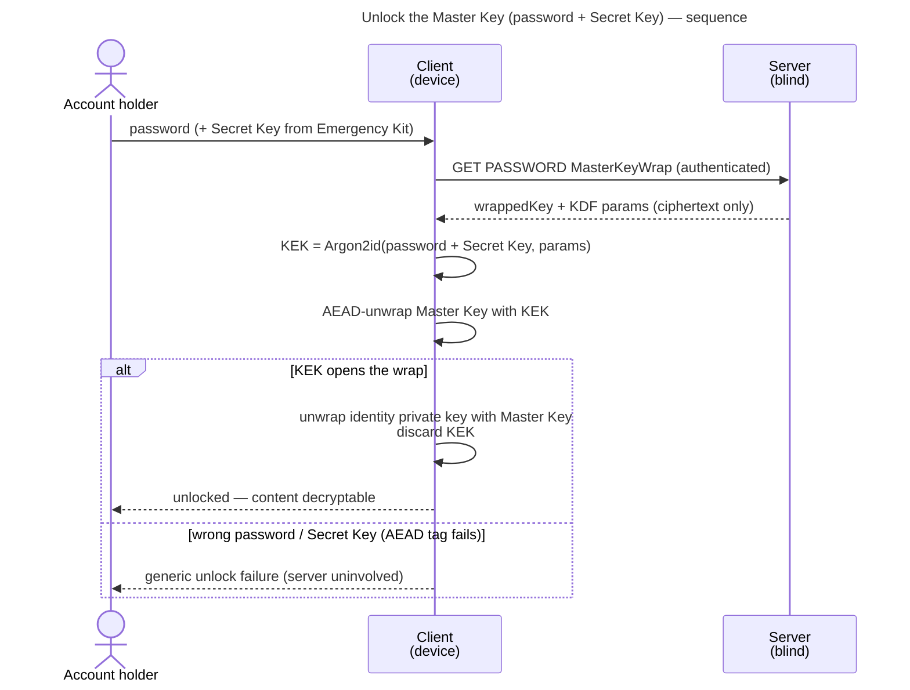

# UC: Unlock the Master Key (password + Secret Key)

- **ID:** uc.account.unlock
- **Primary actor:** Account holder, authenticated, on a device whose account is currently **locked**
- **Goal:** Open the account's **Master Key** on the device from the **PASSWORD wrap** using **password +
  Secret Key** (two-secret key derivation), making content decryptable — entirely client-side; the server
  learns nothing.
- **Preconditions:** An **authenticated session** exists (so the client can retrieve its wraps; see
  [uc.account.login](uc.account.login.md)); the account is **locked** (no Master Key in memory); a
  **PASSWORD** `MasterKeyWrap` exists (created at setup/join).
- **Postconditions (success):** The **Master Key** and the **identity private key** are held **in client
  memory**; scope grants and content can now be decrypted; the **Unlock KEK is discarded**; no password,
  Secret Key, KEK, or unwrapped key material ever left the device.

## Main flow

1. From an **authenticated-but-locked** state, the client obtains the **password** (reused from a login
   that just happened, or re-prompted on a fresh app session) and the **Secret Key** (from the Emergency
   Kit, or already held by an enrolled device). The Secret Key may be **typed/pasted** or **imported from the
   Emergency Kit** — uploading the kit file or scanning its QR code, both decoded **on-device** (the kit's
   machine-readable token never leaves the device).
2. The client retrieves its **PASSWORD `MasterKeyWrap`** (the wrapped key + its KDF parameters/salt) from
   the server.
3. The client derives the **Unlock KEK** `= Argon2id(password + Secret Key, wrap KDF params)` — **domain-
   separated** from the auth-keypair derivation, so the same password yields unrelated values for the two
   jobs.
4. The client **unwraps** (AEAD-decrypts) the **Master Key** with the KEK.
5. The client uses the Master Key to unwrap the **identity private key** (`wrappedIdentityPrivateKey`).
6. **Unlocked:** the Master Key + identity private key are in memory; the KEK is discarded. Content and
   scope grants are now openable.

## Alternate / exception flows

- **A1 — other unlock methods (deferred):** a **passkey** (PRF-derived KEK), a **recovery code**, or a
  **trusted device** (DEVICE wrap) each open the **same** Master Key via their own wrap — separate
  use-cases, not this flow.
- **E1 — wrong password or Secret Key:** the KEK fails to open the wrap (AEAD tag mismatch) → **generic
  unlock failure**; the server is **uninvolved** and learns nothing; the user retries locally.
- **E2 — no PASSWORD wrap / not authenticated:** the wrap cannot be fetched or does not exist; the user
  must (re-)login or use a recovery/alternate method.

## Unlock state

```mermaid
---
title: Unlock — state
---
stateDiagram-v2
  [*] --> Locked
  Locked --> Unlocking : password + Secret Key<br>+ fetch PASSWORD wrap
  Unlocking --> Unlocked : KEK opens wrap;<br>identity key unwrapped
  Unlocking --> Locked : wrong password / Secret Key (AEAD fail)
  Unlocked --> Locked : app restart / sign-out / timeout<br>(Master Key is in-memory only)
  Unlocked --> [*]
```

## Quality notes

- **Two-secret key derivation (2SKD).** Content needs the password **and** the Secret Key. A server/DB
  breach yields only ciphertext + `authPublicKey` + wrapped blobs — none of which derive the Master Key
  without the Secret Key, which **never reaches the server**. See
  [Security Model](../../../crosscutting/security-model.md).
- **Operator-blind, fully client-side.** The server serves only the wrapped blob; the KEK, the Master Key
  and the identity private key exist **only in client memory**.
- **Auth ≠ unlock.** A valid session does **not** imply unlocked — the Master Key is opened only here. The
  counterpart [uc.account.login](uc.account.login.md) gates a session but never unlocks content.
- **Ephemeral by default.** This flow holds the Master Key in memory for the working session only; it does
  **not** persist it. Routine re-unlock without re-entering the high-entropy Secret Key (a DEVICE wrap /
  biometric) is the **"Trust this device"** use-case — so this floor path is typically the *first* unlock
  on a device.
- **Unlocks the E2EE layer.** Once unlocked, the account key is available — this is what lets the client
  decrypt **E2EE session names** (planned — `uc.account.sessions` is reserved in ADR 0004, not yet written) and all content.

## What this means for you / Was das für dich bedeutet

**EN —** Logging in proves *who you are*; unlocking is what actually **opens your encrypted memories**. To
unlock, your device needs two things only you have: your **password** and your **Secret Key** (from your
Emergency Kit). They are combined **on your device** to open your account's master key — the server never
sees either and never holds the key that decrypts your content. That is why even the server operator
cannot read your memories. Because your Secret Key is long and high-entropy, you typically enter it once
per device; afterwards you can set the device up to unlock with just your password (or biometrics).

**DE —** Die Anmeldung beweist, *wer du bist*; das Entsperren **öffnet erst deine verschlüsselten
Erinnerungen**. Zum Entsperren braucht dein Gerät zwei Dinge, die nur du hast: dein **Passwort** und
deinen **Secret Key** (aus deinem Notfall-Kit). Beide werden **auf deinem Gerät** kombiniert, um den
Hauptschlüssel deines Kontos zu öffnen — der Server sieht keines von beiden und besitzt nie den Schlüssel,
der deine Inhalte entschlüsselt. Deshalb kann selbst der Server-Betreiber deine Erinnerungen nicht lesen.
Weil dein Secret Key lang und zufällig ist, gibst du ihn meist einmal pro Gerät ein; danach kannst du das
Gerät so einrichten, dass es sich nur mit deinem Passwort (oder Biometrie) entsperrt.

## Related

- Feature: [Account & auth](../_index.md)
- Concepts: [Account & Key Model](../enablers/en.account.key-model.md) (one Master Key / many
  wraps, the Unlock KEK, 2SKD), [Security Model](../../../crosscutting/security-model.md) (Secret Key /
  2SKD, operator-blind)
- Decisions: [ADR 0003](../../../decisions/0003-operator-blind-password-auth.md) (the auth-vs-unlock
  split), [ADR 0005](../../../decisions/0005-unlock-methods-and-device-trust.md) (wrap methods, device
  trust, re-lock & precedence — this PASSWORD path is the floor of that spectrum)
- Related use-cases: [login](uc.account.login.md) (gates the session that lets you fetch the wrap); trust
  this device — planned (DEVICE wrap for routine re-unlock); recover access — planned (RECOVERY wrap);
  manage active sessions — planned (its E2EE names need this unlock)
