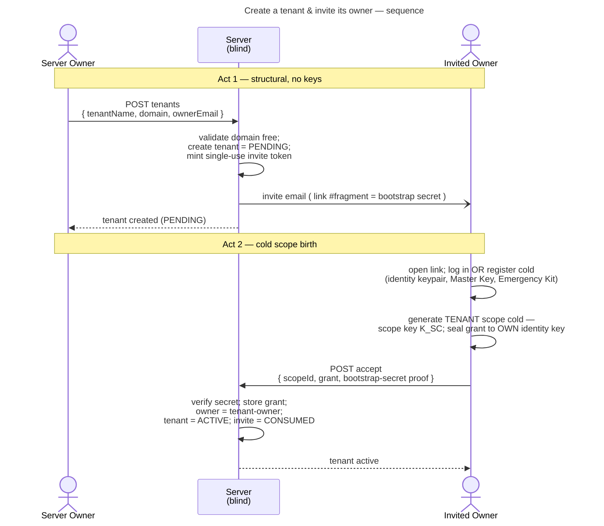
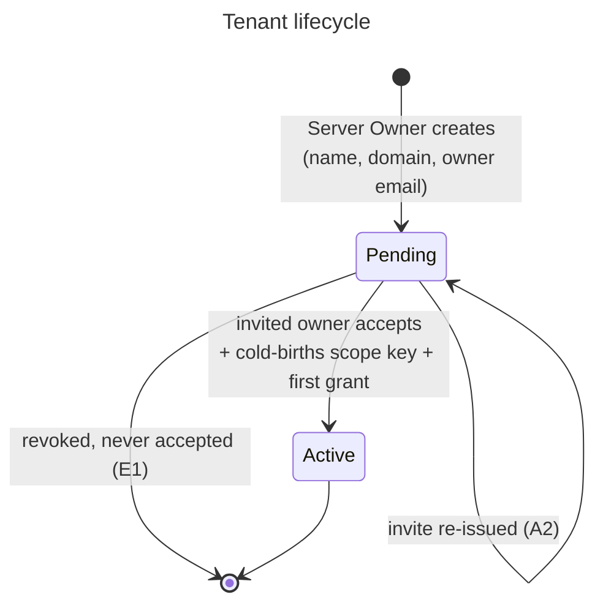

# UC: Create a tenant & invite its owner

- **ID:** uc.admin.create-tenant
- **Primary actors:** **Server Owner** (creates the tenant) and the **invited Tenant Owner** (activates
  it). Two parties, handed off asynchronously by an invite email.
- **Goal:** Provision a new tenant — a domain-scoped container reached by its `Host` — and hand its
  **content ownership** to an invited owner, **without the Server Owner ever holding a content key**.
- **Preconditions:** The instance is set up; the actor is a **Server Owner** (global role); the chosen
  domain is not already mapped to a tenant.
- **Postconditions (success):** The tenant exists and is **`ACTIVE`** with a domain↔tenant mapping; the
  invited owner has an account and holds the **first grant** to the tenant's cold-born scope key; the
  Server Owner holds **no** content keys.

## Main flow

The flow has two acts with a mailbox in between: the Server Owner's act is **purely structural** (no
keys); the invited owner's act is where the tenant's cryptographic root is **born cold**.

### Act 1 — Server Owner creates the tenant (structural, no keys)

1. The Server Owner opens the create-tenant form and enters **tenant name**, **domain**, and the
   **owner's email**.
2. On confirm, the server validates the **domain is free and well-formed**, creates the tenant in
   **`PENDING`** (not yet active — no content is possible yet), stores name + domain + owner email as
   **operational cleartext**, mints a **single-use, time-limited invite token** (a *bootstrap secret*,
   not a key) **bound to the owner email**, and returns it to the Server Owner. Delivery is by email **if a
   mailer is configured**, or by the Server Owner **copying the invite link** (the bootstrap secret in the URL
   fragment) — so tenant onboarding works with no SMTP, self-hostable by default. The server holds **no keys**.

### Act 2 — Invited owner activates the tenant (cold scope birth)

3. The recipient opens the invite link (the bootstrap secret travels in the URL **fragment**, never sent
   to the server until acceptance).
4. **Identity (bound to the invited email):** the accepting account must **own the invited email** — an
   existing user **logs in** as that account; a new user **registers cold** with that email (identity
   keypair, Master Key + wraps, Emergency Kit — see the account model). The owner may **change their
   email later**; the binding is a one-time gate at acceptance, not a permanent constraint.
5. On acceptance the client generates the **`TENANT` scope cold**: a fresh **scope key `K_SC`**, then seals
   it as the **first grant** to the owner's **own identity public key**, and uploads
   `{ scopeId, grant, possession-proof of the bootstrap secret }`.
6. The server verifies the bootstrap secret, stores the grant, marks the owner a **member with
   the tenant-owner role**, flips the tenant to **`ACTIVE`**, and marks the invite **`CONSUMED`**
   (soft-invalidated, **not** deleted — see the invite-lifecycle note).

## Alternate / exception flows

- **A1 — domain taken or invalid:** rejected at creation; nothing is created, no email sent.
- **A2 — invite expired or already used:** acceptance is rejected; the Server Owner can re-issue a fresh
  invite for the still-`PENDING` tenant (see *Server Owner management* below).
- **A3 — owner email is an existing user:** the acceptance path uses **login** instead of cold
  registration; the cold **scope** birth in step 5 is unchanged (a new tenant always gets a new scope).
- **A4 — accepting account's email ≠ invited email:** rejected — the invite is bound to one email. The
  Server Owner can **reassign the invite to the correct email** rather than the user changing their
  account.
- **E1 — owner never accepts:** the tenant stays `PENDING`, **no scope key is ever born**, no content is
  possible; the Server Owner may revoke the pending tenant.

## Server Owner management of pending tenants

The Server Owner can **list all tenants** (active and pending) and, for a **`PENDING`** tenant whose
owner has not yet accepted: **resend** the invite email, **reassign** the owner email (re-binding the
invite — this is what keeps the strict email-binding above painless), or **revoke** the pending tenant.
These are operational actions on cleartext metadata; they touch **no keys**. Acting on an **`ACTIVE`**
tenant (blocking its owner, forcing an owner handoff) is a **separate, future** use-case — see the
operator-boundary quality note.

## Tenant lifecycle — state

## Quality notes

- **Server Owner stays operator-blind.** The Server Owner is **not** a member and holds **no** scope or
  content key. Tenant content ownership is **cryptographically the invited owner's** from the very first
  grant — the operator only ever sees domain↔tenant mapping and membership existence.
- **Cold scope birth, not the invite-wrap.** The documented [invite-wrap](../../../crosscutting/scopes-and-tenancy.md)
  presupposes an **existing key-holder** who reseals the scope key to the invitee. Here **no one** holds
  the key beforehand, so the invited owner is the **cryptographic root** of the tenant scope — they
  generate it cold, exactly like the first account in `setup-server` but for a *scope*. This distinct
  path is recorded in [ADR 0006](../../../decisions/0006-cold-tenant-scope-birth.md).
- **The invite token is a bootstrap secret, not a key.** It only **gates acceptance** (proves the
  recipient holds the emailed link); it transports **no content key**. The server may therefore hold it
  without breaking operator-blindness — content access exists only once the owner has cold-born the
  scope.
- **Invite lifecycle mirrors the session refresh-token model** ([ADR 0004](../../../decisions/0004-session-tokens.md),
  `V5`): the server stores only the **SHA-256 hash**, never the token; each invite carries a **`status`**
  (`ACTIVE` → `SUPERSEDED` on resend/reassign, → `CONSUMED` on acceptance, → `EXPIRED` past its TTL).
  Transitions are **soft** — nothing is hard-deleted on re-mint or on redemption, so a replayed
  `SUPERSEDED`/`CONSUMED`/`EXPIRED` token is **recognised** (distinct from "unknown") and rejected +
  logged (**reuse detection**, as with sessions). A **scheduled purge** physically removes terminal-state
  invites past a retention window (config) — the instance's first such cleanup job.
- **Domain & name are operational cleartext.** Host-based routing requires the domain to be
  server-visible; DNS/TLS expose it anyway, so it is no confidentiality leak. The tenant **name** is
  likewise cleartext — at creation **no key exists** under which it could be encrypted, and the domain
  already identifies the tenant. (Consistent with dropping the server-wide instance name in cr-0006.)
- **`PENDING` ≠ usable.** A tenant cannot hold content until its owner has cold-born the scope key; until
  then it is a reserved domain mapping and an outstanding invite.
- **One tenant = one domain (for now).** The schema leaves room for more, but multi-domain and
  tenant self-service are SaaS concerns (inbox #41), not part of this use-case.
- **The operator controls availability, never confidentiality.** A Server Owner can deactivate a tenant or
  block its owner (an unavoidable operator power), but never read its content.
- **On-premise collapses the operator/owner split.** In the common self-hosted case (one server, usually one
  tenant, self-administered) the Server Owner *is* the Tenant Owner — they enter their own email and accept
  their own invite; the single flow already covers it, no special-case path.

> The **governance model** behind these — role vs. grant (an owner title is hollow without a key), why the
> operator can never select a successor, the single-key-holder cliff (`solo owner gone == content gone`,
> escrow forbidden, succession deferred to SaaS) — is the decision record
> [ADR 0006](../../../decisions/0006-cold-tenant-scope-birth.md) (Consequences), not restated here.

## Proposed CR cut (decided separately)

Two natural slices, in dependency order — the **structural** act carries no crypto, the **activation**
act is where the scope key work lands:

- **Slice A — structural (`cr-0009`, ✅ built):** create `PENDING` tenant + domain mapping + single-use
  invite + email + Server Owner management (list / resend / reassign / revoke). No client crypto.
  Delivered on contracts → backend → http → web (coverage:
  [uc.admin.create-tenant.yaml](../../../coverage/features/admin/use-cases/uc.admin.create-tenant.yaml)).
- **Slice B — activation (`cr-0010`, ✅ built):** invite acceptance (register-and-accept for a new owner,
  or sign-in accept for an existing one), **cold `TENANT` scope birth + first OWNER membership/grant**,
  flip to `ACTIVE`, invite `CONSUMED` (with reuse-detection). The first scope-key / grant / membership +
  the first invite-gated account registration in the codebase. Delivered on contracts → backend → http →
  web (the `PENDING → ACTIVE` lifecycle is now real).

## What this means for you / Was das für dich bedeutet

**EN —** As the operator of a veyq server, you can set up a separate, isolated space — a *tenant* — for
a family, a group of friends, or a club, each on its own web address. You don't become a member of it
and you can't read what's inside: you just enter a name, the web address, and the email of the person
who should own it. They get an invite, sign in (or create their account), and from that moment **they**
hold the keys to that space — not you. A space only comes alive once its owner has accepted; until then
it's just a reserved address.

**DE —** Als Betreiber eines veyq-Servers kannst du einen eigenen, abgeschotteten Bereich — einen
*Tenant* — für eine Familie, einen Freundeskreis oder einen Verein anlegen, jeweils unter einer eigenen
Web-Adresse. Du wirst **nicht** Mitglied und kannst die Inhalte nicht lesen: Du gibst nur einen Namen,
die Web-Adresse und die E-Mail der Person ein, der der Bereich gehören soll. Diese Person bekommt eine
Einladung, meldet sich an (oder legt ihr Konto an) — und ab dann hält **sie** die Schlüssel zu diesem
Bereich, nicht du. Ein Bereich wird erst lebendig, wenn sein Owner angenommen hat; bis dahin ist es nur
eine reservierte Adresse.

## Related

- Feature: [Administration & Operations](../_index.md)
- Concepts: [Scopes & Tenancy](../../../crosscutting/scopes-and-tenancy.md) (scope kinds, grants,
  host-based routing), [Account & Key Model](../../account/enablers/en.account.key-model.md) (cold key
  birth, identity keys), [Security Model](../../../crosscutting/security-model.md) (operator-blind).
- Decisions: [ADR 0002](../../../decisions/0002-personal-scope-per-tenant.md) (tenant-bound scopes),
  [ADR 0006](../../../decisions/0006-cold-tenant-scope-birth.md) (cold tenant-scope birth by the invited owner).
- Related use-cases: [setup-server](uc.admin.setup-server.md), [login](../../account/use-cases/uc.account.login.md);
  member invites & the personal-scope bootstrap on join (planned).
