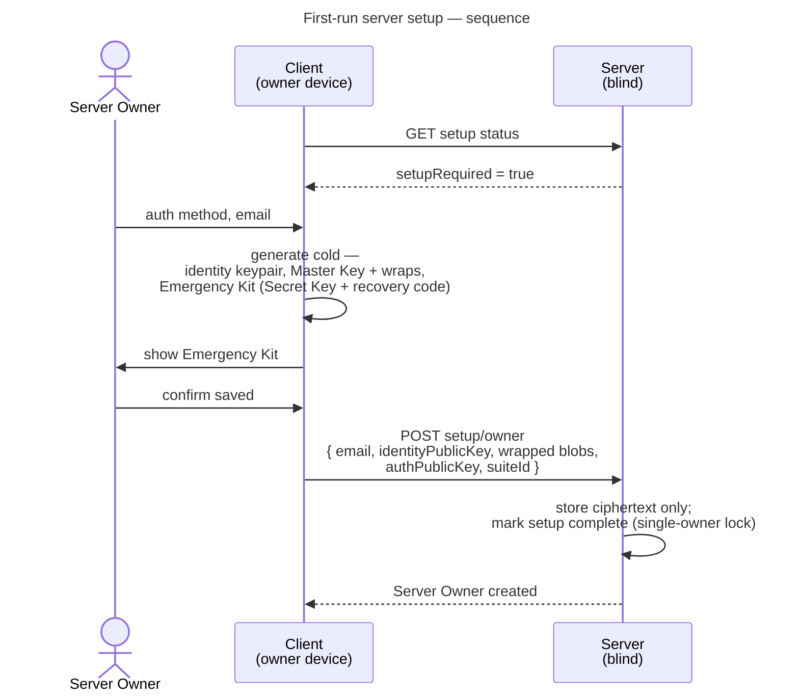
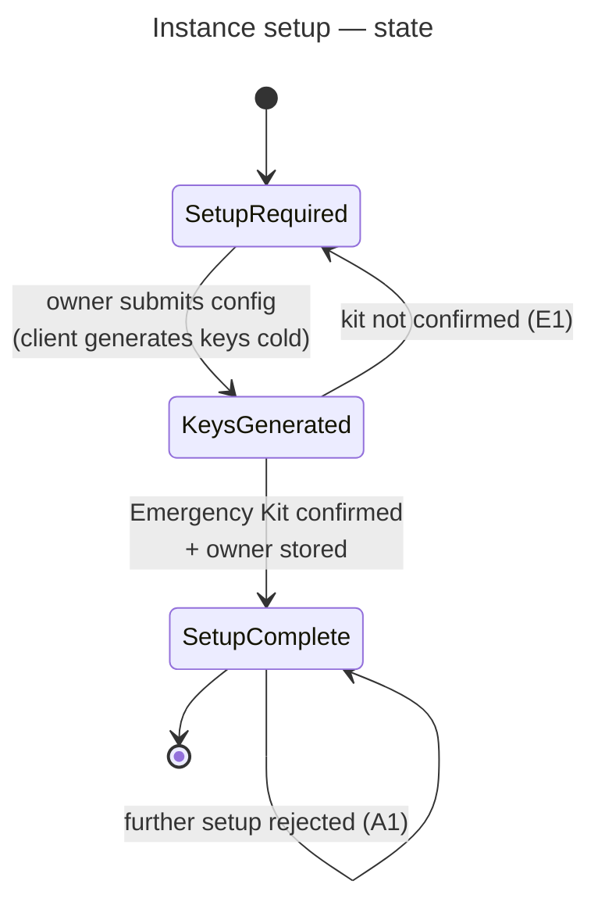

# UC: First-run server setup

- **ID:** uc.admin.setup-server
- **Bootstrap happens in the browser**, while the operator is at the machine they are installing the server
  on — a one-time act, at the point of installation.
- **Primary actor:** Server Owner (the person installing the instance)
- **Goal:** Bootstrap a fresh instance — create the first account (Server Owner) as an end-to-end
  encrypted account and mark the instance set up.
- **Preconditions:** A freshly installed instance with setup **not yet completed**.
- **Postconditions (success):** The Server Owner account exists with its own identity keys, Master Key
  wraps and a saved Emergency Kit; the instance is marked set up; the operator holds **no** content keys.

## Main flow

1. On first run the client checks setup status; the setup flow is reachable **only** while setup is
   incomplete.
2. The Server Owner chooses an auth method — **password + Secret Key** (the mandatory floor) and optionally
   a **passkey** — and enters their **email**. (No display name is collected: the account carries only email +
   keys; a name/handle is a **per-tenant** concern set when joining a tenant — [ADR 0023](../../../decisions/0023-per-tenant-member-identity.md).
   No instance name either: the instance is identified by its host — see Quality notes.)
3. The client generates, **cold** (no invite, no temp-wrap — this is the root of the owner's own key
   tree): the **identity keypair**, the **Master Key** with one wrap per chosen unlock method, and the
   **Emergency Kit** (Secret Key + recovery code), then forces the owner to confirm they saved the kit.
4. The client uploads the **identity public key + wrapped blobs + a password-derived auth *public* key**
   (operator-blind password auth, [ADR 0003](../../../decisions/0003-operator-blind-password-auth.md):
   the server never sees the password and stores no credential/verifier — login is challenge-response);
   the server stores ciphertext + the public key only and **marks setup complete** (single-owner lock).

## Alternate / exception flows

- **A1 — already set up:** after setup completes, the setup endpoint is **closed**; there is no second
  bootstrap.
- **E1 — kit not confirmed:** if the Emergency Kit backup is not confirmed, setup is **not finalized**.

## Setup state

## Quality notes

- **Operator-blind from account #1.** Even the Server Owner's content is E2E-encrypted; the server never
  holds content keys. See [Security Model](../../../crosscutting/security-model.md).
- **Cold key birth.** Unlike invitation-based registration there is no temp-wrap to import — the first
  user is the root of their own key tree. See [Account & Key Model](../../account/enablers/en.account.key-model.md).
- **Tenant routing is Host-based.** The reverse proxy forwards the request and the backend resolves the
  active tenant from the `Host` (tenant↔domain) — see
  [Scopes & Tenancy](../../../crosscutting/scopes-and-tenancy.md). At first-run there is no tenant yet
  (tenant creation is a separate use-case); setup establishes the Server Owner only. **No instance name is
  collected** — a single operator-set, cleartext, server-wide name is the wrong altitude when one server
  hosts many tenants (each resolved by its `Host`/domain) added over time; the host already identifies the
  instance, and any human label belongs to a **tenant** (keyed to its domain) or an E2EE space name, never
  to server setup (cr-0006).
- **Tenant creation is separate** — it is its own use-case, not part of bootstrap.
- **No personal scope at first-run.** Personal scopes are **per-tenant**, created when a user joins a
  tenant (see [ADR 0002](../../../decisions/0002-personal-scope-per-tenant.md)); at first-run no tenant
  exists, so the owner has no personal scope until they create or join one.

## What this means for you / Was das für dich bedeutet

**EN —** When you set up your own veyq server, the very first account — yours — is created with
end-to-end encryption from the start. Your keys are generated **on your device**, never on the server,
and during setup you save an **Emergency Kit** (your Secret Key + a recovery code). From that first
moment, content can only be read with your keys — not by the server, not even by you acting as the
operator. Setup runs **once**: after your account exists, the setup page closes for good.

**DE —** Wenn du deinen eigenen veyq-Server einrichtest, wird der allererste Account — deiner — von
Anfang an Ende-zu-Ende-verschlüsselt angelegt. Deine Schlüssel entstehen **auf deinem Gerät**, nie auf
dem Server, und beim Einrichten sicherst du ein **Notfall-Kit** (deinen Secret Key + einen
Wiederherstellungscode). Ab diesem Moment lassen sich Inhalte nur mit deinen Schlüsseln lesen — nicht
durch den Server und auch nicht durch dich als Betreiber. Die Einrichtung läuft **einmal**: Sobald dein
Account existiert, schließt sich die Setup-Seite endgültig.

## Related

- Feature: [Administration & Operations](../_index.md)
- Concepts: [Security Model](../../../crosscutting/security-model.md) (key hierarchy, operator-blind),
  [Account & Key Model](../../account/enablers/en.account.key-model.md) (cold key birth, Emergency Kit),
  [Scopes & Tenancy](../../../crosscutting/scopes-and-tenancy.md) (tenant routing, scopes)
- Related use-cases (planned): account login, create-tenant-invite-owner
