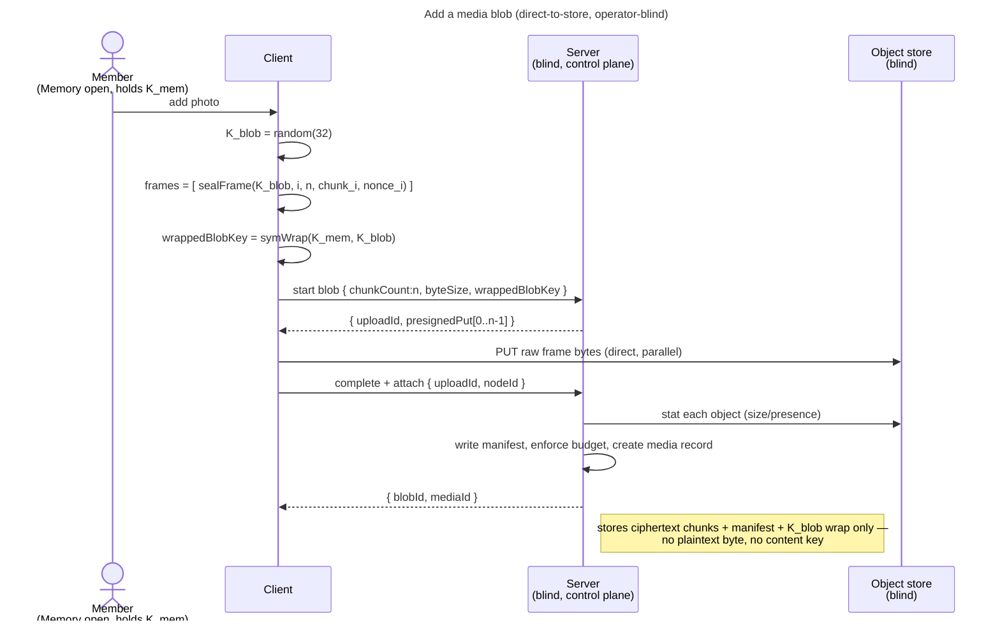

# Enabler: Media blobs in a Memory (`K_blob` + chunked AEAD, direct-to-store)

- **ID:** en.memory.media
- **Type:** **Enabler** — structural foundation, no standalone end-user goal
  ([features/README → use-case vs enabler vs ADR vs change-request](../../README.md#use-case-vs-enabler-vs-adr-vs-change-request)).
- **Provides:** the **encrypted media data layer** for a Memory — a media **blob** sealed client-side as
  **chunked AEAD** under a fresh random **`K_blob`** (wrapped under the Memory's `K_mem`), transferred
  **direct-to-store** via presigned URLs ([ADR 0013](../../../decisions/0013-blob-storage-presigned-direct-to-store.md)),
  and **attached** to a node (a Memory or one of its Chapters). Bytes only — the *curation* of media into a
  gallery (covers, ordering, captions, the UI) is the use-case on top.
- **Serves (use-cases):** [uc.memory.upload](../use-cases/uc.memory.upload.md) (add media — the value-bearing
  flow + UI) and [uc.memory.gallery](../use-cases/uc.memory.gallery.md) (reads the blobs back), plus later
  *journal attachments* / *places & tracks* media. Storing one encrypted blob is not itself a user goal; it is
  the substrate those carry.
- **Depends on:** [en.memory.tree](en.memory.tree.md) (a **Memory** exists and owns a `K_mem`) → through it
  [en.spaces.personal-scope](../../spaces/enablers/en.spaces.personal-scope.md) and `uc.account.unlock`
  (identity → scope key → `K_SC` → `K_mem`).
- **Preconditions:** an **unlocked** vault; an **open Memory** whose `K_mem` is unwrapped (the blob keys wrap
  under it); a configured object store — a **hard instance requirement** (`%dev`/`%prod` fail loud without one,
  [ADR 0013](../../../decisions/0013-blob-storage-presigned-direct-to-store.md)), so a running instance always has
  a byte path.
- **Postconditions (success):** the blob's **ciphertext chunks** live in the object store; the server holds the
  blob's **metadata + chunk manifest + the `K_blob` wrap** and a **media** record linking the blob to a node.
  The server learned **no bytes of plaintext** and holds **no content key**.

## Key & blob model (ADR 0012 + ADR 0013)

- **`K_blob`** — a fresh **random 32-byte key per blob**, wrapped under the Memory's **`K_mem`**
  (`symWrap(K_mem, K_blob)`). It encrypts that blob's chunk frames and nothing else. **No dedup** — identical
  content yields a different `K_blob` and a different ciphertext ([ADR 0013 §5](../../../decisions/0013-blob-storage-presigned-direct-to-store.md#5-no-content-dedup);
  operator-blind trade-off).
- **`chunk_frame`** (vector-pinned, `v1.json`) — each chunk is `nonce(12) ‖ AEAD(K_blob, nonce, plaintext,
  aad = u32be(index) ‖ u32be(total))`. The **AAD binds each frame to its position**, so the server cannot
  reorder, drop, or splice chunks without detection on `openFrame`. Small media = one frame; large media =
  many.
- **blob** — the unit of stored bytes: an id, `chunkCount`, `byteSize`, the chunk manifest (per-chunk size),
  and the `K_blob` wrap. Lives in a scope.
- **media** — the link record attaching a blob to a **node** (a Memory or a Chapter), carrying any per-use
  metadata (e.g. an encrypted original filename / capture time under `K_mem`, later slices). One blob can be
  attached by more than one media record (e.g. cover + in-body) **within the owner circle** — that is a
  metadata reference the members already see, not content dedup. Each media record also carries its **bucket
  linkage** — a **`bucket_id`** (nullable; `null` = the uploader's primary) and a denormalized **`created_by`** =
  the uploader's opaque **`owner_key`** (`user:{id}` / `share:{id}`), the operator-visible attribution the
  [buckets](../use-cases/uc.memory.buckets.md) grouping reads. The bucket data model + the `K_mem`-sealed names
  live in [en.memory.buckets](en.memory.buckets.md)
  ([ADR 0034](../../../decisions/0034-media-uploader-buckets.md)).

## Main flow — add a media blob to a Memory (operator-blind)

> The control-plane endpoints are **batch-shaped** (each takes a list + returns a per-item result, [ADR 0013](../../../decisions/0013-blob-storage-presigned-direct-to-store.md));
> this enabler describes a **single** blob for clarity, and the first slice sends length-1 lists. A
> gallery later sends longer lists — same shape, no contract change.

1. The client has the Memory open: `K_mem` is unwrapped (via `K_SC`, en.memory.tree).
2. **Seal:** generate a random **`K_blob`**; split the plaintext into chunks; `sealFrame(K_blob, index, total,
   chunk, nonce)` each. Wrap `K_blob` under `K_mem` (`symWrap(K_mem, K_blob)`).
3. **Start:** POST a blob-start declaring `chunkCount` + `byteSize` (+ the `K_blob` wrap); the server opens an
   upload session and returns a **presigned `PUT` URL per chunk**.
4. **Transfer:** the client `PUT`s the **raw sealed frame bytes** straight to the object store (no base64) —
   in parallel — bypassing the backend.
5. **Complete + attach:** POST complete-and-attach `{ uploadId, nodeId }`; the server **stats** each object to
   confirm presence + size, writes the chunk manifest, enforces the byte budget, promotes the staged objects
   to a blob, and creates the **media** record linking it to the node. Returns the blob/media ids.
6. **Read back:** to display, the client asks for **presigned `GET` URLs**, fetches the raw frames directly,
   unwraps `K_blob` (via `K_mem`), and `openFrame`s each (the AAD position check verifies order/count).

## Alternate / exception flows

- **E1 — no object store configured:** a byte path is a **hard requirement**, so this is a **fail-loud startup
  error** in `%dev`/`%prod` (not a runtime "unavailable" state a client soft-gates on — there is no
  `directTransport` flag). Only the `%test` slice profile runs the in-memory stub (metadata only, no transport)
  ([ADR 0013](../../../decisions/0013-blob-storage-presigned-direct-to-store.md)).
- **E2 — declared budget exceeded** (or actual object sizes exceed it at complete): the server rejects and
  **purges** the staged objects (declare-then-verify, ADR 0013 §3).
- **E3 — abandoned upload:** an OPEN session never completed → reclaimed by GC (stale sessions + unreferenced
  -blob sweep).
- **E4 — vault locked / Memory not open:** without `K_mem` the client can neither key nor read a blob → the
  action is unavailable until unlock + the Memory is opened.
- **E5 — chunk tampered / reordered:** `openFrame` fails the AAD position check → the frame is rejected (the
  server cannot forge a valid frame without `K_blob`).

## Quality notes

- **Operator-blind.** Server + object store only ever hold AEAD ciphertext chunks + opaque metadata (ids,
  sizes, manifest, the `K_blob` wrap, the node link). Never a plaintext byte, never a content key, never a
  filename in clear.
- **No content dedup — by decision.** Duplicate media is stored once per blob; the operator never learns
  blob-equality. The savings dedup would buy aren't worth the scope-internal equality leak on an operator-blind,
  self-hostable app ([ADR 0013 §5](../../../decisions/0013-blob-storage-presigned-direct-to-store.md#5-no-content-dedup)).
- **Backend is never a byte bottleneck.** It signs short-TTL, single-object, single-method capabilities; the
  bytes go client↔store. Credentials never reach the client.
- **Position-bound chunks.** The `chunk_frame` AAD (`index ‖ total`) makes reorder/drop/splice detectable —
  integrity of a multi-chunk blob without trusting the store.
- **Scope of this slice.** The **batch-shaped** control plane (start → direct PUT → complete+attach → direct
  GET → open, all list-valued) with clients sending length-1 lists. **Resumable uploads, public-share mirrors,
  and the gallery/curation UI** are their own later slices
  ([ADR 0013](../../../decisions/0013-blob-storage-presigned-direct-to-store.md) defers them); the
  **thumbnail / preview / original tiers** land in [en.memory.derivatives](en.memory.derivatives.md) (which
  reuses this transport verbatim — a derivative is just another blob).

> **No end-user section.** As an enabler this has no standalone "what this means for you" story — its end-user
> value surfaces through the use-case it *serves* ([add media to a Memory](../_index.md)), whose bilingual
> section carries the wiki text.

## Related

- Feature: [Memory](../_index.md)
- Decisions: [ADR 0013](../../../decisions/0013-blob-storage-presigned-direct-to-store.md) (S3-only, presigned
  direct-to-store, no dedup), [ADR 0012](../../../decisions/0012-content-key-hierarchy.md) (`K_blob` under
  `K_mem`), [ADR 0017](../../../decisions/0017-crypto-primitives-and-post-quantum-strategy.md) (`chunk_frame` vector)
- Concepts: [Security Model](../../../crosscutting/security-model.md) (key hierarchy),
  [Account & Key Model](../../account/enablers/en.account.key-model.md)
- Related enablers: [en.memory.tree](en.memory.tree.md) (the Memory + `K_mem` this attaches media to),
  [en.memory.derivatives](en.memory.derivatives.md) (the thumbnail/preview/original tiers built on this transport)
