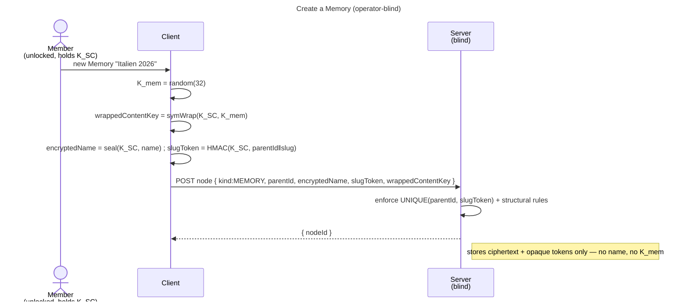

# Enabler: The Memory tree (encrypted folder/Memory nodes)

- **ID:** en.memory.tree
- **Type:** **Enabler** — structural foundation, no standalone end-user goal
  ([features/README → use-case vs enabler vs ADR vs change-request](../../README.md#use-case-vs-enabler-vs-adr-vs-change-request)).
- **Provides:** the **encrypted node tree** inside a scope — **folders** (organization only) and **Memories**
  (the content unit, nested **Chapters**) — with **encrypted names**, **blinded slug tokens** for permalinks,
  and a **per-Memory content key `K_mem`** born on creation. Tree + names + keys only.
- **Serves (use-cases):** [uc.memory.browse](../use-cases/uc.memory.browse.md) (tree navigation + node CRUD),
  [uc.memory.gallery](../use-cases/uc.memory.gallery.md), [uc.memory.chapters](../use-cases/uc.memory.chapters.md).
  Media, the sealed node-meta (date / place), journal and sharing build on it **indirectly**, through
  [en.memory.media](en.memory.media.md) / [en.memory.node-meta](en.memory.node-meta.md). Creating an empty named
  node is not itself a user goal; it is the substrate those carry.
- **Depends on:** [en.spaces.personal-scope](../../spaces/enablers/en.spaces.personal-scope.md) (content lives
  in a scope) → and through it `uc.account.unlock` (the identity + scope key).
- **Preconditions:** An **unlocked** vault (identity → scope key → `K_SC` available for the active scope); a
  scope to write in (e.g. the [personal scope](../../spaces/enablers/en.spaces.personal-scope.md)).
- **Postconditions (success):** The node exists server-side as opaque ciphertext (encrypted name, `parentId`,
  `kind`, ordering, `slugToken`); a **Memory** additionally has a fresh random **`K_mem`** wrapped under
  `K_SC`. The server learned **no name** and holds **no content key**.

## Node model

A **node** has an opaque id, a `parentId` (or the scope root), a `kind`, an **encrypted name**, an
**`orderIndex`**, and a **`slugToken`**:

- **FOLDER** — organization only; **no content key**.
- **MEMORY** — the content unit; **owns a random `K_mem`** (wrapped under `K_SC`). Its media/journal live under
  `K_mem`.
- **CHAPTER** — a section **inside a Memory**, itself a content unit: it **owns its own random `K_mem`**, wrapped
  under its **parent Memory's `K_mem`** (recursive `K_mem`, one level deeper — *not* the parent's key, *not* a
  separate `K_chapter` type).

**Recursive `K_mem` (chapters — [ADR 0012](../../../decisions/0012-content-key-hierarchy.md)).** Every
content-bearing node (MEMORY *and* CHAPTER) carries its own random `K_mem`, wrapped under the **content key of
its parent** — a top-level Memory under `K_SC`, a chapter under its parent Memory's `K_mem` (same `content-key`
wrap context). A media's **`K_blob` is wrapped under the `K_mem` of its *direct* parent node** (chapter media
under the chapter's key). Consequence of this layout: every content node is a **sharing unit**, and a move is a
single **re-wrap, never a data re-encrypt** — the *decision + rationale* (why recursive, not "shares the
parent's key") is ADR 0012.

Names, slugs and dedup key off **`K_SC`** (navigation), so one scope key decrypts the whole tree's structure;
a Memory's *content* needs its `K_mem` ([ADR 0012](../../../decisions/0012-content-key-hierarchy.md)).

## Main flow — create a folder / a Memory

1. The client picks a name; it computes the **slug token** `HMAC/HKDF(K_SC, parentId ‖ slugify(name))` (blind;
   the server can't reverse it) and **encrypts the name** under `K_SC`.
2. **If a Memory:** generate a fresh random **`K_mem`**, wrap it under `K_SC` (`symWrap(K_SC, K_mem)`).
3. POST the node: `{ parentId, kind, encryptedName, slugToken, orderIndex, wrappedContentKey? }` — all
   opaque to the server. The server enforces `UNIQUE(parentId, slugToken)` (slug uniqueness per parent) and
   the structural rules (no cycle; no folder inside a Memory), returns the node id.
4. The client renders the tree by **decrypting names with `K_SC`**; opening a Memory's content (later slices)
   unwraps its `K_mem` with `K_SC`.

## Organize — rename / move / reorder

- **Rename:** re-seal the name + **recompute the slug token** (its parent didn't change) → update the node.
- **Move (within the scope):** set a new `parentId`, **recompute the slug token** for the new parent, with
  cycle / containment checks. **No cross-scope move** — that is a copy + re-encrypt under the target scope's
  `K_SC`/`K_mem` (a separate use-case), never a tree move.
- **Reorder:** update `orderIndex` among siblings.

## Alternate / exception flows

- **E1 — slug collision** (same parent already has that slug): the server rejects on `UNIQUE(parentId,
  slugToken)`; the client disambiguates (append a counter) and retries.
- **E2 — illegal structure:** a folder inside a Memory, or a cycle on move → rejected (structural invariant).
- **E3 — vault locked / no scope key:** without `K_SC` the client can neither name nor key a node → the
  action is unavailable until unlock + the scope is open.
- **E4 — not a member of the scope:** the server has no grant for the caller → the scope (and its tree) is
  not reachable.

## Quality notes

- **Operator-blind.** The server stores ciphertext names + opaque `parentId`/`kind`/`orderIndex`/`slugToken`
  + the `K_mem` wrap; it never sees a name or a content key. It learns only the **shape** of the tree.
- **`K_mem` is the share grain** ([ADR 0012](../../../decisions/0012-content-key-hierarchy.md)): every content
  node — a Memory **or a chapter** — is born with a random `K_mem` so it can later be shared (an extra wrap of
  `K_mem`) without exposing `K_SC`, the parent, or any other node. Folders, being keyless, are never shared —
  you share a Memory or a chapter.
- **Blinded permalinks.** The slug token gives human-readable, unique-per-parent permalinks without the
  operator ever seeing or reversing a name (keyed MAC under `K_SC`).
- **Scope of this slice.** Tree + names + `K_mem` only. **Media (`K_blob` + chunked AEAD), journal, places &
  tracks, sharing, and rich curation** are their own slices on top of this.

> **No end-user section.** As an enabler this has no standalone "what this means for you" story — its
> end-user value surfaces through the use-cases it *serves* (add media / journal / organize / share), whose
> bilingual sections carry the wiki text.

## Related

- Feature: [Memory](../_index.md)
- Concepts: [Security Model](../../../crosscutting/security-model.md) (key hierarchy, blinded tokens),
  [Scopes & Tenancy](../../../crosscutting/scopes-and-tenancy.md) (navigation contract; content in a scope),
  [Account & Key Model](../../account/enablers/en.account.key-model.md)
- Decisions: [ADR 0012](../../../decisions/0012-content-key-hierarchy.md) (`K_SC`/`K_mem`/`K_blob`),
  [ADR 0017](../../../decisions/0017-crypto-primitives-and-post-quantum-strategy.md) (vector-pinned content crypto)
- Related: [en.spaces.personal-scope](../../spaces/enablers/en.spaces.personal-scope.md) (the enabler this
  builds on — where the first tree lives), and the planned add-media / journal / share-a-Memory use-cases
  ([Memory feature](../_index.md)) this serves
