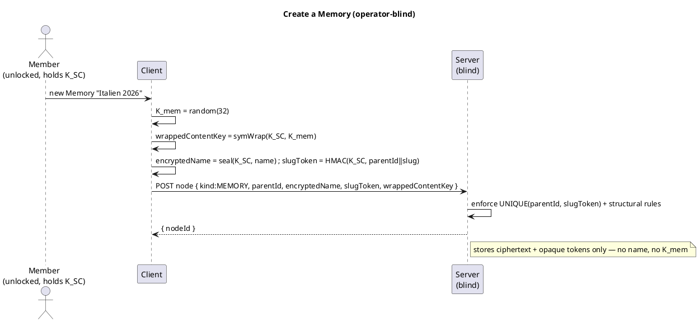

# UC: The Memory tree (create & organize folders and Memories)

- **ID:** uc.memory.tree
- **Primary actor:** Account holder, **authenticated, unlocked, and holding a scope** (a grant → the scope
  key → `K_SC`)
- **Goal:** Create and organize the **encrypted tree** inside a scope — **folders** (organization only) and
  **Memories** (the content unit, nested **Chapters**) — with **encrypted names**, **blinded slug tokens**
  for permalinks, and a **per-Memory content key `K_mem`** born on creation. This first content slice covers
  the **tree + names + keys only**; media (`K_blob`), journal and places are later slices.
- **Preconditions:** An **unlocked** vault (identity → scope key → `K_SC` available for the active scope); a
  scope to write in (e.g. the [personal scope](../../spaces/use-cases/uc.spaces.personal-scope.md)).
- **Postconditions (success):** The node exists server-side as opaque ciphertext (encrypted name, `parentId`,
  `kind`, ordering, `slugToken`); a **Memory** additionally has a fresh random **`K_mem`** wrapped under
  `K_SC`. The server learned **no name** and holds **no content key**.

## Node model

A **node** has an opaque id, a `parentId` (or the scope root), a `kind`, an **encrypted name**, an
**`orderIndex`**, and a **`slugToken`**:

- **FOLDER** — organization only; **no content key**.
- **MEMORY** — the content unit; **owns a random `K_mem`** (wrapped under `K_SC`). Its chapters/media/journal
  (later slices) live under `K_mem`.
- **CHAPTER** — a section **inside a Memory**; shares its Memory's `K_mem`.

Names, slugs and dedup key off **`K_SC`** (navigation), so one scope key decrypts the whole tree's structure;
a Memory's *content* needs its `K_mem` ([ADR 0012](../../../decisions/0012-content-key-hierarchy.md)).

## Main flow — create a folder / a Memory

1. The client picks a name; it computes the **slug token** `HMAC/HKDF(K_SC, parentId ‖ slugify(name))` (blind;
   the server can't reverse it) and **encrypts the name** under `K_SC`.
2. **If a Memory:** generate a fresh random **`K_mem`**, wrap it under `K_SC` (`symWrap(K_SC, K_mem)`).
3. POST the node: `{ parentId, kind, encryptedName, slugToken, orderIndex, wrappedContentKey? }` — all
   opaque to the server. The server enforces `UNIQUE(parentId, slugToken)` (slug uniqueness per parent) and
   the structural rules (no cycle; no folder inside a Memory), returns the node id.
4. The client renders the tree by **decrypting names with `K_SC`**; opening a Memory's content (later slices)
   unwraps its `K_mem` with `K_SC`.

## Organize — rename / move / reorder

- **Rename:** re-seal the name + **recompute the slug token** (its parent didn't change) → update the node.
- **Move (within the scope):** set a new `parentId`, **recompute the slug token** for the new parent, with
  cycle / containment checks. **No cross-scope move** — that is a copy + re-encrypt under the target scope's
  `K_SC`/`K_mem` (a separate use-case), never a tree move.
- **Reorder:** update `orderIndex` among siblings.

## Alternate / exception flows

- **E1 — slug collision** (same parent already has that slug): the server rejects on `UNIQUE(parentId,
  slugToken)`; the client disambiguates (append a counter) and retries.
- **E2 — illegal structure:** a folder inside a Memory, or a cycle on move → rejected (structural invariant).
- **E3 — vault locked / no scope key:** without `K_SC` the client can neither name nor key a node → the
  action is unavailable until unlock + the scope is open.
- **E4 — not a member of the scope:** the server has no grant for the caller → the scope (and its tree) is
  not reachable.

## Quality notes

- **Operator-blind.** The server stores ciphertext names + opaque `parentId`/`kind`/`orderIndex`/`slugToken`
  + the `K_mem` wrap; it never sees a name or a content key. It learns only the **shape** of the tree.
- **`K_mem` is the share grain** ([ADR 0012](../../../decisions/0012-content-key-hierarchy.md)): a Memory is
  born with a random `K_mem` so it can later be shared (an extra wrap of `K_mem`) without exposing `K_SC` or
  any other Memory. Folders, being keyless, are never shared — you share a Memory.
- **Blinded permalinks.** The slug token gives human-readable, unique-per-parent permalinks without the
  operator ever seeing or reversing a name (keyed MAC under `K_SC`).
- **Scope of this slice.** Tree + names + `K_mem` only. **Media (`K_blob` + chunked AEAD), journal, places &
  tracks, sharing, and rich curation** are their own slices on top of this.

## What this means for you / Was das für dich bedeutet

**EN —** You organize your memories in folders and "Memories" (each can have chapters), just like albums and
sub-albums — but the names and contents are encrypted on your device before they ever reach the server. The
server only knows there *is* a tree of some shape; it can't read a single title. Each Memory gets its own key
so that, later, you can share **one** memory with someone without handing over everything else.

**DE —** Du organisierst deine Erinnerungen in Ordnern und „Memories" (jede kann Kapitel haben) — wie Alben
und Unteralben, nur dass Namen und Inhalte schon auf deinem Gerät verschlüsselt werden, bevor sie je den
Server erreichen. Der Server weiß nur, *dass* es einen Baum gibt; keinen einzigen Titel kann er lesen. Jede
Memory bekommt einen eigenen Schlüssel, damit du später **eine** Erinnerung mit jemandem teilen kannst, ohne
alles andere herzugeben.

## Related

- Feature: [Memory](../_index.md)
- Concepts: [Security Model](../../../crosscutting/security-model.md) (key hierarchy, blinded tokens),
  [Scopes & Tenancy](../../../crosscutting/scopes-and-tenancy.md) (navigation contract; content in a scope),
  [Account & Key Model](../../../crosscutting/account-key-model.md)
- Decisions: [ADR 0012](../../../decisions/0012-content-key-hierarchy.md) (`K_SC`/`K_mem`/`K_blob`),
  [ADR 0009](../../../decisions/0009-native-crypto-per-platform-vectors.md) (vector-pinned content crypto)
- Related use-cases: [personal-scope](../../spaces/use-cases/uc.spaces.personal-scope.md) (where the first
  tree lives), and the planned add-media / journal / share-a-Memory slices ([Memory feature](../_index.md))
