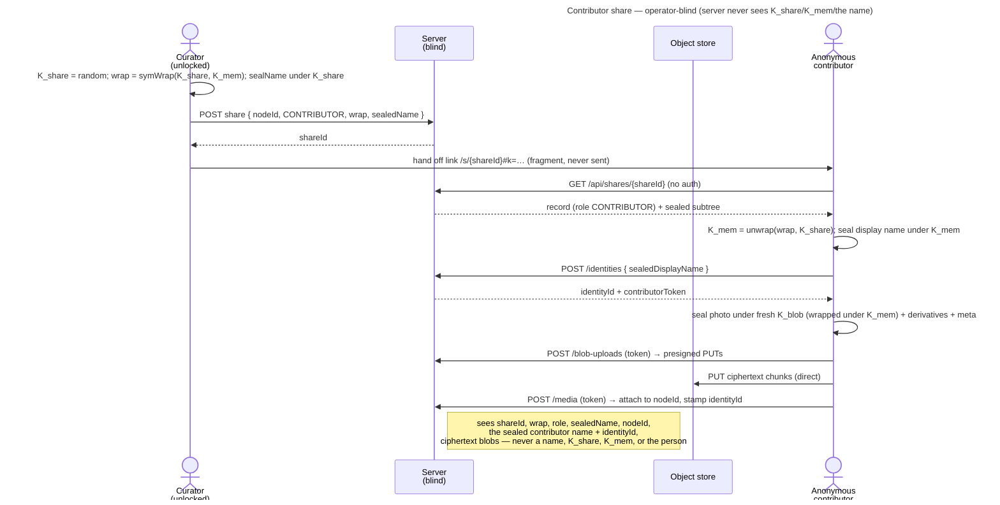

# UC: Share a Memory as a contributor link (anyone with the link can add photos)

- **ID:** uc.sharing.share-contributor
- **Primary actor:** **a curator** — the owner of a **personal-scope** Memory (holds its `K_mem`).
- **Secondary actor:** **an anonymous contributor** — no account, no identity keypair; names themselves once.
- **Goal:** publish **one** of your own Memories as a **contributor link** — anyone with the link can **view it and
  add photos** — while the server stays operator-blind and the rest of your content stays private.
- **Preconditions:** an **authenticated, unlocked** curator; the target Memory is in the caller's **personal scope**
  (v1 restriction); the caller can open it (holds `K_mem`).
- **Postconditions (success):** a share record with **role CONTRIBUTOR** exists (opaque), and a link
  `/s/{shareId}#k=<K_share>` lets any anonymous visitor open the Memory **and contribute photos** — after naming
  themselves — until the curator revokes it or it expires. Contributed photos appear in the Memory immediately
  (direct-append) and are attributed to the contributor's **sealed** name. Operator-blind throughout: the server
  never sees `K_share`, `K_mem`, any name (the Memory's or the contributor's), or the photo bytes.

This is the second sharing slice ([ADR 0030](../../../decisions/0030-contributor-public-share.md)), building on
the public **viewer** share ([uc.sharing.share-public-viewer](uc.sharing.share-public-viewer.md),
[ADR 0029](../../../decisions/0029-public-viewer-share.md)). The crypto is the same per-Memory second-wrap of
[ADR 0012](../../../decisions/0012-content-key-hierarchy.md); a contributor unwraps `K_mem` from the fragment key
exactly as a viewer does, then seals new media under it. **v1 is deliberately narrow: role CONTRIBUTOR only
(view + add), direct-append, personal-scope Memories.**

## Main flow

1. **Create.** The curator opens one of their Memories → **Share** → chooses the **Contributor** role (instead of
   Viewer). The client mints `K_share`, computes `symWrap(K_share, K_mem)`, re-seals the Memory name under
   `K_share`, and `POST`s the share record `{ nodeId, role: CONTRIBUTOR, wrap, sealedName, expiresAt? }`. The
   server mints a **256-bit `shareId`** and stores the record opaquely.
2. **Hand off.** The client shows the link **`/s/{shareId}#k=<base64url(K_share)>`** to copy. `K_share` rides the
   fragment — never sent. The curator passes it out-of-band.
3. **Open + name yourself (anonymous).** A visitor opens the link. The client `GET`s `/api/shares/{shareId}` (**no
   auth**) → the record + the sealed subtree; because the `role` is CONTRIBUTOR, the client shows a **mandatory
   name pre-screen**. The visitor enters a display name; the client **seals it under `K_mem`** and creates an
   **anonymous share identity** (`POST /api/shares/{shareId}/identities { sealedDisplayName }` → `{ identityId,
   contributorToken }`, held on device). The server stores only the ciphertext name + opaque ids.
4. **View + contribute.** The Memory renders read-only (the shared viewer). An **Add photos** affordance lets the
   contributor pick images: the client seals each under a fresh `K_blob` (wrapped under `K_mem`) with its
   derivatives + metadata, uploads the ciphertext chunks **direct-to-store** via the **share-scoped** presign
   (`POST /api/shares/{shareId}/blob-uploads`, presenting the `contributorToken`), then completes + attaches
   (`POST /api/shares/{shareId}/media`) to the shared Memory root — stamped with the contributor's `identityId`.
5. **Appears immediately.** The contributed photo is now part of the shared Memory (direct-append); every viewer
   (and the curator) sees it. The curator can delete it or **revoke** the link.

## Alternate / exception flows

- **A1 — viewer on a contributor share:** a visitor who only wants to look still names themselves (the name is
  mandatory for a CONTRIBUTOR share, ADR 0030); they then view read-only and may add nothing. (A no-name **viewer**
  experience is the separate VIEWER share.)
- **A2 — revoked / expired:** `enabled = false` or a passed `expiresAt` → the resolve **and** the upload
  endpoints `404`/`403`; in-flight and already-uploaded photos remain (no retraction — see Quality notes).
- **A3 — change the grant in place (cr-0119):** the curator edits an existing **VIEWER** share and switches it to
  **CONTRIBUTOR** (or back) from the share-management dialog — the **same link keeps working**, no new `K_share`,
  no re-wrap. `role` is plaintext authorization the server enforces per request, so the new grant bites on the next
  resolve/upload (a promote enables contributions at once; a demote 403s new uploads at once, already-contributed
  photos stay). Restricted to **VIEWER ↔ CONTRIBUTOR** — an **UPLOADER** drop-box is its own separate action and its
  write-only promise is never flipped in place (a `422 invalid_role_change` rejects setting UPLOADER or editing an
  UPLOADER share's role). Owner-gated via `updateShare` ([ADR 0036](../../../decisions/0036-editable-share-note-recoverable-share-key.md)).
- **E1 — blank name:** the pre-screen blocks submission until a non-blank name is entered (mandatory).
- **E2 — over budget / rate-limited:** an oversized upload fails the per-blob byte budget; too many uploads in a
  window are rate-limited (per-share, best-effort) — defense against an abusive link holder.
- **E3 — link without the fragment key:** inert — without `K_share` nothing decrypts and nothing can be sealed
  under `K_mem`, so neither viewing nor contributing is possible (both halves required).

## Quality notes

- **Operator-blind.** The server stores the share record (as in ADR 0029) **plus** an opaque `share_identity`
  (the `K_mem`-sealed contributor name + a token hash) and a `share_identity_id` stamp on each contributed media.
  It never sees `K_share`, `K_mem`, the Memory name, the contributor's name, the photo bytes, or *who* the person
  is — only that an opaque identity contributed opaque ciphertext.
- **Mandatory name = the buckets hook.** The contributor names themselves once; the sealed name → the anonymous
  identity → its `share:{shareIdentityId}` **`owner_key`** → a per-contributor **bucket** grouping their uploads
  under that name — now [uc.memory.buckets](../../memory/use-cases/uc.memory.buckets.md) +
  [en.memory.buckets](../../memory/enablers/en.memory.buckets.md)
  ([ADR 0034](../../../decisions/0034-media-uploader-buckets.md)). This share stores the identity + shows
  contributed media inline; the buckets grouping reads that hook with **no migration** on the contributor half
  ([ADR 0030](../../../decisions/0030-contributor-public-share.md)).
- **Direct-append; moderation is later.** A contributed photo is live immediately — good for a shared album, but
  spam is visible until the curator deletes it or revokes the link. Review-before-publish is a deferred slice.
- **Attribution is self-asserted.** Anyone with the link can name themselves anything; the contributor token binds
  *their* subsequent uploads to *that* identity but does not authenticate the person (accountless, operator-blind).
- **Revocation is soft (L1); already-uploaded is not retractable.** Revoke/expiry stop *new* views + uploads;
  photos already contributed stay in the Memory (the curator deletes them individually if unwanted).
- **Client-integrity trust tier ([ADR 0026](../../../decisions/0026-client-trust-tiers.md)).** Same as the viewer:
  the no-install page is passive-operator-safe, not operator-proof against an active foreign operator; surfaced by
  the **footer link** to the security docs. For the self-hosted case (operator = curator) the gap is moot.
- **Scope rotation ≠ share revocation.** Unchanged from
  [uc.sharing.share-public-viewer](uc.sharing.share-public-viewer.md). cr-0101's personal-scope v1 had no member
  removal; group/tenant contributor shares — where removal soft-revokes the removed member's shares — are now
  [uc.sharing.share-shared-scope](uc.sharing.share-shared-scope.md) (cr-0104).

## What this means for you / Was das für dich bedeutet

**EN —** You can turn one memory into a link where friends and family can **add their own photos** — not just
look. They open it in a browser, type their name once (so you can see who added what), and drop in their pictures
— no account, nothing to install. It shows them **only that one memory**, never the rest of your space, and you
can switch the link off any time. New photos show up right away; if something doesn't belong, you can remove it.
The same honest note as always: on the web this is as private as your trust in whoever runs your veyq server —
if that's you, it's fully private; the "how safe is this?" link explains the details.

**DE —** Du kannst eine Erinnerung in einen Link verwandeln, bei dem Freunde und Familie **eigene Fotos beisteuern**
können — nicht nur anschauen. Sie öffnen ihn im Browser, tippen einmal ihren Namen ein (damit du siehst, wer was
beigetragen hat) und laden ihre Bilder hoch — ohne Konto, ohne Installation. Der Link zeigt **nur diese eine
Erinnerung**, nie den Rest deines Bereichs, und du kannst ihn jederzeit abschalten. Neue Fotos erscheinen sofort;
was nicht passt, kannst du entfernen. Dieselbe ehrliche Anmerkung wie immer: im Browser ist das so privat wie dein
Vertrauen in den, der deinen veyq-Server betreibt — bist das du selbst, ist es voll privat; der „Wie sicher ist
das?"-Link erklärt die Details.

## Related

- Feature: [Sharing](../_index.md)
- Decisions: [ADR 0030](../../../decisions/0030-contributor-public-share.md) (this contributor share — the sealed
  anonymous identity + the share-scoped upload path), [ADR 0029](../../../decisions/0029-public-viewer-share.md)
  (the share resource + anonymous access path it extends),
  [ADR 0012](../../../decisions/0012-content-key-hierarchy.md) (the `K_mem` second-wrap keying),
  [ADR 0013](../../../decisions/0013-blob-storage-presigned-direct-to-store.md) (the direct-to-store upload path
  the share-scoped presign mirrors), [ADR 0015](../../../decisions/0015-operator-blind-readable-urls.md) (fragment
  key), [ADR 0026](../../../decisions/0026-client-trust-tiers.md) (client-integrity trust tier).
- Cross-cutting: [Security Model](../../../crosscutting/security-model.md),
  [Scopes & Tenancy](../../../crosscutting/scopes-and-tenancy.md).
- Related: [uc.sharing.share-public-viewer](uc.sharing.share-public-viewer.md) (the read-only viewer share this
  builds on), [Memory](../../memory/_index.md) (what a Memory is — the thing being shared + contributed to).
