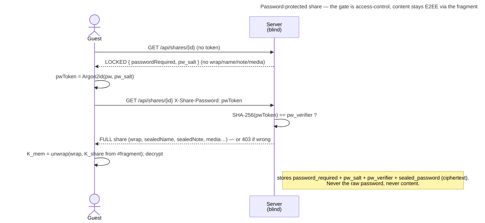

# UC: Password-protect a share (a leaked link alone isn't enough)

- **ID:** uc.sharing.share-password
- **Primary actor:** the **curator** (owns/shares the Memory; holds `K_mem`).
- **Secondary actor:** an **anonymous guest** who opens the link and must know the password.
- **Goal:** put an **optional password** on a share so that whoever opens the link must **also know the password**
  before the server serves anything. Set / change / remove / reveal it in place, without minting a new link;
  operator-blind.
- **Preconditions:** an authenticated, unlocked curator with a share they own (any role). The curator holds
  `K_mem` (so recovers `K_share` for the reveal, [ADR 0036](../../../decisions/0036-editable-share-note-recoverable-share-key.md)).
- **Postconditions (success):** the share carries `password_required` + `pw_salt` + `pw_verifier`
  (`SHA-256(Argon2id(pw, salt))`) + `sealed_password` (the plaintext sealed under `K_share`). A guest reaches the
  content only by presenting a valid **password token**; without it the server serves **nothing** — not even the
  Memory name or note.

This is the access-control-gate design ([ADR 0037](../../../decisions/0037-password-protected-shares.md)): the
content stays E2EE under the unchanged `K_share` fragment, and the password gates **what the server serves** — the
same shape as the [contributor token](uc.sharing.share-contributor.md). It is **not** a cryptographic gate: it
protects against a **leaked link + an honest operator**, not a malicious operator (who could ignore the check and
serve the ciphertext to a colluder holding the fragment) — the same posture the no-install web viewer already has
([ADR 0026](../../../decisions/0026-client-trust-tiers.md)). Stated plainly here and in the security model.

## Main flow

1. **Set at create (or add later).** In the Share dialog the curator optionally types a password. The client
   derives `pwToken = Argon2id(password, pw_salt)` (fresh 16-B salt), `pw_verifier = SHA-256(pwToken)`, and seals
   the plaintext `sealed_password = symWrap(K_share, password)`. It sends `password_required: true` + `pw_salt` +
   `pw_verifier` + `sealed_password` — **never the raw password**. (Adding a password to an existing share is the
   same, via `updateShare`; the link is untouched.)
2. **Guest opens the link → locked.** `GET /api/shares/{shareId}` with **no** token returns a **locked**
   `PublicShare` — only `passwordRequired: true` + `pw_salt`; `wrap` / `sealedName` / `sealedNote` / media are
   **omitted**. The share page shows a **password prompt**.
3. **Guest enters the password → unlock.** The client derives `pwToken = Argon2id(password, pw_salt)` and re-calls
   the resolve with `X-Share-Password: base64(pwToken)`. The server checks `SHA-256(pwToken) == pw_verifier` →
   serves the **full** share; the client decrypts with the fragment `K_share` as usual. A wrong password →
   `403 share_password_incorrect` (re-prompt). Every subsequent guest call (blob GET, contribute/upload) carries
   the token too.
4. **Reveal / change / remove (curator).** In the manage list a 👁 reveals the password (the curator recovers
   `K_share` via `K_mem` and opens `sealed_password`). Editing the share can **change** the password (fresh
   salt/verifier/sealed copy) or **remove** it (`password_required: false`, fields cleared) — the same link keeps
   working throughout.

## Alternate / exception flows

- **A1 — no password:** unchanged from today; the resolve returns the full share directly (`passwordRequired: false`).
- **A2 — wrong password:** `403 share_password_incorrect`; the guest re-prompts. Online guessing is bounded by a
  **per-share limit on wrong attempts** ([cc.security.rate-limit](../../../crosscutting/cc.security.rate-limit.md),
  cr-0165) — over the cap the guest gets `429` instead; a correct password is never blocked (it is admitted before
  the counter is touched) and the tokenless challenge-fetch never counts. The verifier is never served.
- **A3 — revoked / expired:** `404` as ever — the password gate sits **after** the enabled/expiry check; a revoked
  share is non-enumerable regardless of the password.
- **A4 — curator forgets the password:** they **reveal** it from the manage list (recovering `K_share` via `K_mem`),
  or **change** it — they are never locked out of their own share.

## Quality notes

- **Operator-blind (honest limit stated).** The server stores a **verifier + salt** (opaque, like the contributor
  token hash) + `sealed_password` (ciphertext); it never sees the raw password (the client sends `Argon2id(pw)`)
  and never content. It **is** an access-control gate — a malicious operator could bypass the check, so this
  defends a leaked link against an **honest** operator (the realistic self-hosted / trusted case), not an active
  one. The crypto-gate upgrade (fold `Argon2id` into the key) is a documented future option, not built here.
- **All roles.** The gate fronts every guest endpoint, so a VIEWER, CONTRIBUTOR or UPLOADER share is protected
  alike; the password field is in the one shared create/edit dialog.
- **In place, same link.** `K_share` (the fragment) is never touched, so set / change / remove / add-later all
  keep the link valid — the password is a separable server-side gate plus a sealed copy.
- **Not a substitute for revoke.** A weak password is weak; already-fetched content isn't retractable. Revoke stays
  the hard stop.

## What this means for you / Was das für dich bedeutet

**EN —** You can put a password on a share, so that even if the link ends up with the wrong person, they can't open
it without the password. You can change it, remove it, or look it up later — all on the same link. Honest note: this
works as long as you trust whoever runs the server (if that's you, it's airtight); it's a lock on the door, and your
photos themselves stay encrypted either way.

**DE —** Du kannst eine Freigabe mit einem Passwort schützen — selbst wenn der Link bei der falschen Person landet,
kommt sie ohne Passwort nicht hinein. Du kannst es ändern, entfernen oder später nachschauen — alles am selben Link.
Ehrliche Anmerkung: Das wirkt, solange du der Person vertraust, die den Server betreibt (bist das du selbst, ist es
dicht); es ist ein Schloss an der Tür, und deine Fotos selbst sind ohnehin verschlüsselt.

## Related

- **Feature:** [sharing](../_index.md)
- **Decisions:** [ADR 0037](../../../decisions/0037-password-protected-shares.md) (this gate + the honest
  access-control vs crypto tradeoff), [ADR 0030](../../../decisions/0030-contributor-public-share.md) (the
  contributor token this reuses), [ADR 0036](../../../decisions/0036-editable-share-note-recoverable-share-key.md)
  (owner-gated `updateShare` + the `K_mem`-recoverable `K_share` the reveal uses),
  [ADR 0026](../../../decisions/0026-client-trust-tiers.md) (the trust tiers that bound it).
- **Cross-cutting:** [security-model](../../../crosscutting/security-model.md),
  [cc.security.rate-limit](../../../crosscutting/cc.security.rate-limit.md).
