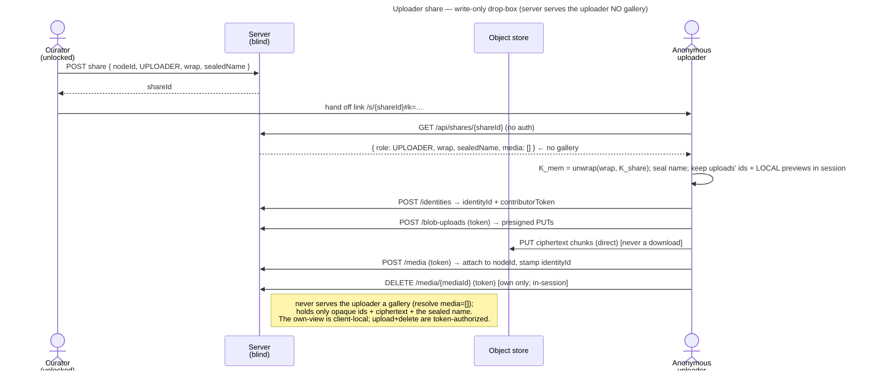

# UC: Share a Memory as an uploader link (a write-only drop-box)

- **ID:** uc.sharing.share-uploader
- **Primary actor:** **a curator** — the owner of a **personal-scope** Memory (holds its `K_mem`).
- **Secondary actor:** **an anonymous uploader** — no account, no identity keypair; names themselves once.
- **Goal:** publish **one** of your own Memories as a **write-only drop-box** link — anyone with the link can **add
  photos** but **cannot see** the Memory's existing content (nor other contributors'), while the server stays
  operator-blind.
- **Preconditions:** an **authenticated, unlocked** curator; the target Memory is in the caller's **personal scope**
  (v1 restriction); the caller can open it (holds `K_mem`).
- **Postconditions (success):** a share record with **role UPLOADER** exists (opaque), and a link
  `/s/{shareId}#k=<K_share>` lets any anonymous visitor **add photos** (after naming themselves) that append to the
  Memory — visible to the curator in *their* gallery. The uploader sees **only the photos they add this session**
  (from local previews, never a download) and can delete them **in that session**; a reload shows nothing.

This is the third sharing slice ([ADR 0031](../../../decisions/0031-uploader-public-share.md)), building on the
CONTRIBUTOR share ([uc.sharing.share-contributor](uc.sharing.share-contributor.md),
[ADR 0030](../../../decisions/0030-contributor-public-share.md)). The upload crypto/path is identical; the
difference is the **`canView` gate** (the resolve returns no media to an uploader) and the **session-only,
client-local** own-view. **v1: role UPLOADER, personal scope, direct-append.**

## Main flow

1. **Create.** The curator opens one of their Memories → **Share** → chooses the **Uploader** role. The client
   mints `K_share`, wraps `K_mem`, re-seals the name, and `POST`s `{ nodeId, role: UPLOADER, wrap, sealedName }`.
2. **Hand off.** The client shows the link `/s/{shareId}#k=<base64url(K_share)>` to copy.
3. **Open + name yourself (anonymous).** The visitor opens the link; the client `GET`s `/api/shares/{shareId}`
   (**no auth**) → `{ role: UPLOADER, wrap, sealedName, media: [] }` (**no gallery** — the uploader is never handed
   others' media). Because the role is UPLOADER, the client shows a **mandatory name pre-screen** with a **clear
   note that uploads are visible only in this browser tab**; the visitor names themselves → the name is sealed
   under `K_mem` and an anonymous **share identity** + a `contributorToken` are created.
4. **Add photos.** The uploader picks images; each is sealed under `K_mem` and uploaded via the **share-scoped**
   endpoints (as CONTRIBUTOR). The client keeps the returned `{ mediaId }` + the **local preview** in session
   memory and renders it with the **same gallery mechanic** (grid + optimistic tile) — **from the local preview,
   never a download**. The photo appends to the Memory (the curator sees it).
5. **Delete / leave.** The uploader can **delete a photo they added this session** (`DELETE
   /api/shares/{shareId}/media/{mediaId}` with the token → deleted + blobs reclaimed **iff** it is their own).
   On **reload / new tab** the own-view is empty (session-only) — surfaced by a dedicated empty-state, not a blank
   gallery.

## Alternate / exception flows

- **A1 — reload:** the own-view is session-only; a reload / new tab shows a **dedicated empty-state** (“your earlier
  uploads aren’t shown here, they arrived safely, you can add more”), never a blank/broken gallery.
- **A2 — revoked / expired:** `enabled = false` / a passed `expiresAt` → resolve + upload + delete `404`/`403`.
- **E1 — blank name:** the pre-screen blocks submission until a non-blank name is entered.
- **E2 — delete after reload:** not possible — the client no longer holds the id (session-only); the photo remains
  (the curator can still delete it from their own gallery).
- **E3 — over budget / rate-limited:** oversized uploads fail the byte budget; too many in a window are
  rate-limited (per share).

## Quality notes

- **Write-only, a real server capability (not just id-secrecy).** The `canView` gate (`{VIEWER,CONTRIBUTOR}`) is
  enforced at **both** guest read paths: the resolve returns `media: []` / `nodes: []` for an UPLOADER share (only
  `wrap` + `sealedName`), **and** the blob endpoint (`GET /shares/{id}/blobs/{blobId}`) `404`s for an uploader —
  so even a *leaked* in-subtree id downloads nothing. On top of that it stays structural (an uploader is never
  handed anyone else's ids; ids are unguessable **identifiers**, not authorizers). The own-view is **client-local**
  (this session's uploads); upload + delete are **token-authorized** (the `contributorToken`).
- **Session-only own-view; ephemeral by design.** The uploader’s own gallery lives only in the browser tab
  (local previews + an in-memory id list) — **never downloaded, never persisted**. A reload shows nothing. This is
  a deliberate privacy stance and a **sharp UX edge**, so it is **warned prominently** on the name pre-screen, as a
  persistent header badge, via a dedicated reload empty-state, and on delete (ADR 0031 §5).
- **Delete-your-own.** In-session, token-gated, ownership-checked (`share_identity_id == the token’s identity`) —
  the correct authorization for a destructive op, not gallery filtering.
- **Most operator-blind surface yet.** The server serves the uploader no gallery and no bytes at all (resolve
  `media: []` / `nodes: []`; the blob endpoint role-gated to `404`); it holds only the opaque identity +
  `share_identity_id` stamp (for the curator’s view + the delete check) + ciphertext.
- **Inherited from the contributor share.** Mandatory sealed name → anonymous identity; the share-scoped upload
  path; direct-append (the curator sees the contributions); byte budget + rate limit; the footer-link trust tier;
  scope-rotation ≠ share-revoke. cr-0102's personal-scope-only restriction is lifted for group/tenant by
  [uc.sharing.share-shared-scope](uc.sharing.share-shared-scope.md) (cr-0104).

## What this means for you / Was das für dich bedeutet

**EN —** You can turn one memory into a "drop-box" link: friends can **add their photos** to it, but they **can’t
see** what’s already in it or what anyone else added — perfect for collecting event photos privately. They open it,
type their name once, and drop in pictures — no account, nothing installed. **Important, and we say it clearly on
the page:** an uploader sees the photos they just added **only in that browser tab** — if they reload or come back
later, those won’t be shown again (they’re safely delivered to you, and they can still add more). So it’s for
*handing photos in*, not for managing a gallery. You, the curator, see every contribution in your own memory and
can remove anything.

**DE —** Du kannst eine Erinnerung in einen „Briefkasten"-Link verwandeln: Freunde können **ihre Fotos beisteuern**,
aber **nicht sehen**, was schon drin ist oder was andere hinzugefügt haben — ideal, um Event-Fotos privat
einzusammeln. Sie öffnen ihn, tippen einmal ihren Namen ein und laden Bilder hoch — ohne Konto, ohne Installation.
**Wichtig, und wir sagen es deutlich auf der Seite:** wer hochlädt, sieht die gerade hinzugefügten Fotos **nur in
diesem Browser-Tab** — nach einem Neuladen oder späteren Besuch werden sie hier nicht mehr angezeigt (bei dir kommen
sie sicher an, und man kann weiter hinzufügen). Es geht also ums *Abgeben* von Fotos, nicht ums Verwalten einer
Galerie. Du als Kurator:in siehst jeden Beitrag in deiner eigenen Erinnerung und kannst alles entfernen.

## Related

- Feature: [Sharing](../_index.md)
- Decisions: [ADR 0031](../../../decisions/0031-uploader-public-share.md) (this write-only drop-box — the
  client-local, session-only own-view + delete-own), [ADR 0030](../../../decisions/0030-contributor-public-share.md)
  (the sealed identity + share-scoped upload path it reuses), [ADR 0029](../../../decisions/0029-public-viewer-share.md)
  (the share resource + anonymous access path), [ADR 0012](../../../decisions/0012-content-key-hierarchy.md) (the
  `K_mem` keying), [ADR 0013](../../../decisions/0013-blob-storage-presigned-direct-to-store.md) (the direct-to-store
  upload), [ADR 0026](../../../decisions/0026-client-trust-tiers.md) (client-integrity trust tier).
- Cross-cutting: [Security Model](../../../crosscutting/security-model.md),
  [Scopes & Tenancy](../../../crosscutting/scopes-and-tenancy.md).
- Related: [uc.sharing.share-contributor](uc.sharing.share-contributor.md) (view + add — the sibling upload role),
  [Memory](../../memory/_index.md) (what a Memory is — the thing being contributed to).
