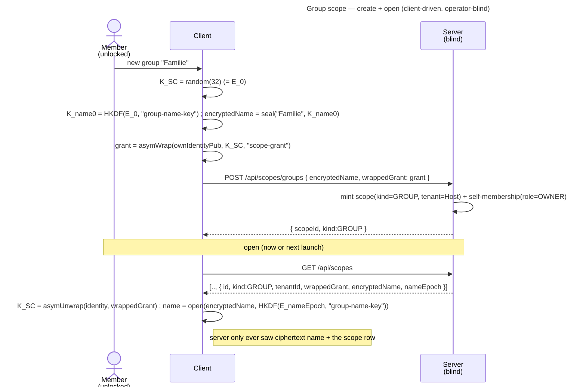

# Enabler: Group scope (a shared, named space)

- **ID:** en.spaces.group-scope
- **Type:** **Enabler** — structural foundation, no standalone end-user goal
  ([features/README → use-case vs enabler vs ADR vs change-request](../../README.md#use-case-vs-enabler-vs-adr-vs-change-request)).
  An empty, solo group is the *substrate*; "share with a group" only delivers value once a second member holds a
  grant (the member-add slice) and content lives in it.
- **Provides:** a **`kind=GROUP` scope** that **exists, has a member-readable name, and can be opened on this
  device** — a keyed container designed to be held by **many** members (one grant each), confidential **even
  from the tenant owner** ([ADR 0014](../../../decisions/0014-group-scopes-and-governance.md)). This enabler is
  the scope itself born by its owner; **adding other members** is the next slice.
- **Serves (use-cases/enablers):** [uc.spaces.switch-spaces](../use-cases/uc.spaces.switch-spaces.md) (groups
  appear in the switcher), [uc.spaces.add-group-member](../use-cases/uc.spaces.add-group-member.md) (bring a
  fellow tenant member in) and [uc.spaces.manage-group-members](../use-cases/uc.spaces.manage-group-members.md)
  (promote/demote/remove — removal drives [en.spaces.scope-key-rotation](en.spaces.scope-key-rotation.md)) — plus
  the *planned* share-with-a-group flows. A group holds a
  [Memory](../../memory/_index.md) tree like any scope; that tree is scope-agnostic — it depends on
  *personal-scope* as its first home, not on this enabler.
- **Depends on:** [en.spaces.personal-scope](en.spaces.personal-scope.md) (generalised scope identity +
  client-driven birth/open), `uc.account.unlock` (the identity that seals/opens the grant),
  [uc.admin.create-tenant](../../admin/use-cases/uc.admin.create-tenant.md) (the tenant it lives within).
- **Preconditions:** An **authenticated, unlocked** member of the active tenant (the identity **private**
  bundle is in the vault, so the client can seal/open a grant).
- **Postconditions (success):** A `kind=GROUP` scope exists in the tenant with the creator's **self-grant**
  (the scope key sealed to their own identity public key, `role=OWNER`) and its **name sealed under a derived
  name-key `K_name_0`** (from the birth epoch, cr-0096/[ADR 0027](../../../decisions/0027-group-invite-name-shared-key.md)),
  at name-epoch 0; the client holds the opened scope key in memory and can browse the (initially empty) tree. The
  server never saw the scope key or the name.

## What's new vs. the personal scope

A group reuses the personal scope's machinery — client-driven birth, the hybrid-KEM self-grant, open-by-unwrap
— and adds exactly three things:

1. **A name, sealed under a derived name-key.** A personal scope is anonymous (one per `(user, tenant)`); a group
   needs a human name so members can tell groups apart in the switcher. The name is **ciphertext under `K_name`** —
   a key derived from the name's content-epoch key (`K_name = HKDF(E_e, "group-name-key")`), sealed with the same
   node-name primitive ([ADR 0012](../../../decisions/0012-content-key-hierarchy.md)) — so only members (and a
   pending invitee handed `K_name`) read it and the server sees an **unnamed** group
   ([ADR 0014](../../../decisions/0014-group-scopes-and-governance.md)). The derived key (vs sealing directly under
   `K_SC`) makes the name **forward-secret** like node names and lets a consent-invitee read the *canonical* name
   ([ADR 0027](../../../decisions/0027-group-invite-name-shared-key.md)). Born at name-epoch 0.
2. **Multi-member by design.** A personal scope has exactly one grant (its owner). A group is *built* to carry
   many — but **this enabler only mints the owner's self-grant**; other members' grants are the member-add slice
   ([uc.spaces.add-group-member](../use-cases/uc.spaces.add-group-member.md)), which reuses the shared
   grant-distribution primitive ([ADR 0020](../../../decisions/0020-grant-distribution-invite-wrap.md) — wrap
   `K_SC` to an existing tenant member's identity, picked by username; the GroupOwner admits per
   [ADR 0014](../../../decisions/0014-group-scopes-and-governance.md), any group member delivers).
3. **Explicit creation (not auto-birth).** A personal scope auto-births after unlock; a group is created on a
   deliberate user action ("new group" + a name).

`GET /api/scopes` already lists a member's scopes with their `wrappedGrant`; for groups it must also carry the
**`encryptedName`** so the client can decrypt the group's name for the switcher (null for tenant/personal).

## Main flow — create + open a group

1. The unlocked member chooses **new group** and names it (plaintext, on device).
2. The client **generates** a random scope key `K_SC` (= the birth epoch `E_0`), derives `K_name_0 = HKDF(E_0,
   "group-name-key")`, **seals the name** under `K_name_0` (`encryptedName`), and `asymWrap`s `K_SC` to its **own**
   identity public key (context `scope-grant`).
3. `POST /api/scopes/groups { encryptedName, wrappedGrant }` → the server mints a `kind=GROUP` scope in the
   Host's tenant + the caller's self-membership (`role=OWNER`), returns `{ scopeId, kind:GROUP }`.
4. To **open** (now or a later launch): from `GET /api/scopes` take the group's `wrappedGrant`, `asymUnwrap` it
   with the vaulted identity → `K_SC`; decrypt `encryptedName` → the group's name (for the switcher); browse its
   tree like any scope.

## Alternate / exception flows

- **E1 — not unlocked:** without the identity private bundle the client can neither seal the name/grant nor
  open it → creation is unavailable until after unlock. No partial state.
- **E2 — grant unwrap fails** (corrupt/foreign grant, identity rotated without re-wrap): the group can't be
  opened → surfaced as an error; the scope is **not** self-deleted (a blind operator must not force a wipe).
- **E3 — no tenant context** (no Host / unknown tenant): `404` — every scope lives within a tenant
  ([ADR 0002](../../../decisions/0002-personal-scope-per-tenant.md)).
- **E4 — duplicate group name:** allowed. Names are not unique; the `@group` URL fragment resolves
  client-side against the member's decrypted group list (first match wins) — there is **no** server-side group
  slug ([ADR 0014](../../../decisions/0014-group-scopes-and-governance.md)).

## Quality notes

- **Operator-blind.** The server stores the opaque scope row (`id` / `kind` / `tenant`), the **ciphertext name**,
  the **ciphertext grant(s)**, and membership — never the scope key or the name.
- **Confidential even from the tenant owner.** Because the name is sealed under a key derived from `K_SC` and the
  tenant owner holds no grant, they see only that a group exists + who is in it, never its name or content
  ([ADR 0014](../../../decisions/0014-group-scopes-and-governance.md)).
- **No new crypto primitive.** The self-grant is the same hybrid KEM (`asymWrap`, X25519 + ML-KEM-768,
  [ADR 0017](../../../decisions/0017-crypto-primitives-and-post-quantum-strategy.md)) as the tenant/personal grant; the
  name uses the same node-name seal ([ADR 0012](../../../decisions/0012-content-key-hierarchy.md)), just keyed by
  the derived `K_name` rather than `K_SC` directly ([ADR 0027](../../../decisions/0027-group-invite-name-shared-key.md)).
- **Owner ≠ admin.** The creator is the group's `OWNER`; that is a per-scope role, independent of any tenant
  role ([ADR 0007](../../../decisions/0007-membership-role-grant-relation.md)).

> **No end-user section.** As an enabler this has no standalone "what this means for you" story — the value
> reaches the user through the group use-cases it serves (their bilingual sections carry the wiki text).

## Related

- Feature: [Spaces (scopes)](../_index.md)
- Concepts: [Scopes & Tenancy](../../../crosscutting/scopes-and-tenancy.md),
  [Account & Key Model](../../account/enablers/en.account.key-model.md),
  [Security Model](../../../crosscutting/security-model.md)
- Decisions: [ADR 0014](../../../decisions/0014-group-scopes-and-governance.md) (group governance),
  [ADR 0002](../../../decisions/0002-personal-scope-per-tenant.md) (scopes are tenant-bound),
  [ADR 0007](../../../decisions/0007-membership-role-grant-relation.md) (membership = role + grant),
  [ADR 0017](../../../decisions/0017-crypto-primitives-and-post-quantum-strategy.md) (the hybrid-KEM grant),
  [ADR 0012](../../../decisions/0012-content-key-hierarchy.md) (`K_SC` name-sealing)
- Sibling: [en.spaces.personal-scope](en.spaces.personal-scope.md) (the machinery this reuses)
