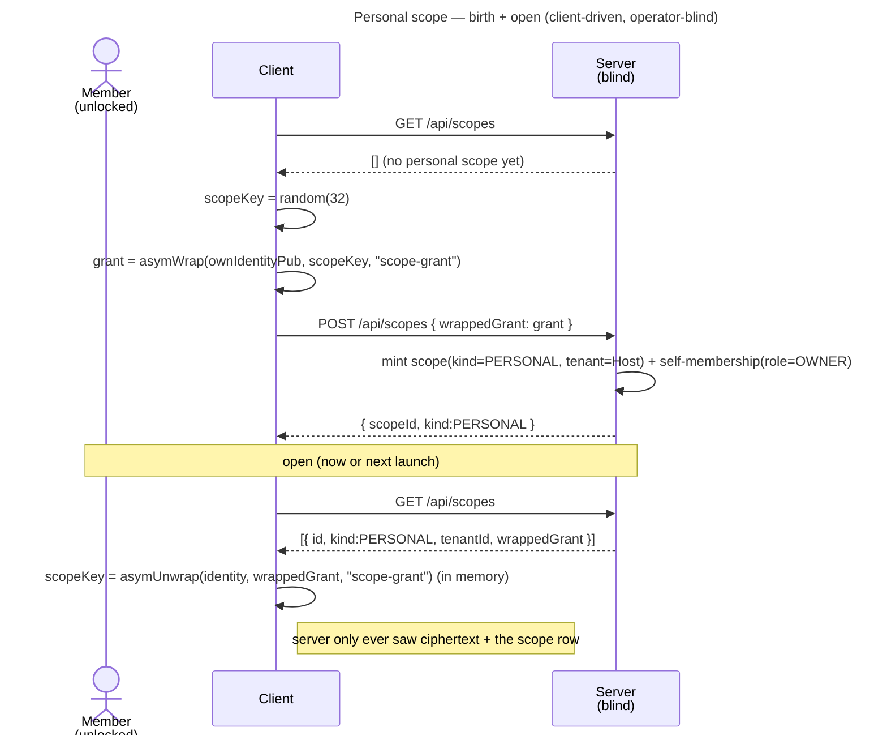

# Enabler: Personal scope (your private space, per tenant)

- **ID:** en.spaces.personal-scope
- **Type:** **Enabler** — structural foundation, no standalone end-user goal
  ([features/README → use-case vs enabler vs ADR vs change-request](../../README.md#use-case-vs-enabler-vs-adr-vs-change-request)). It is
  auto-born and opens silently; "your private space" only delivers value once content lives in it.
- **Provides:** a **per-tenant PERSONAL scope** that **exists and can be opened on this device**, with **no
  other key-holder** ([ADR 0002](../../../decisions/0002-personal-scope-per-tenant.md)) — the keyed container
  the content flows fill. No content (folders / memories) here — only the scope itself.
- **Serves (use-cases/enablers):** [uc.memory.browse](../../memory/use-cases/uc.memory.browse.md) (the tree
  lives in this scope) + [uc.spaces.switch-spaces](../use-cases/uc.spaces.switch-spaces.md) (lists & opens it),
  and the enabler [en.memory.tree](../../memory/enablers/en.memory.tree.md) built on it — all need a scope to
  live in. Generalising scope identity (scopeId + kind) here also unblocks **groups**.
- **Depends on:** `uc.account.unlock` (the identity that seals/opens the grant) +
  [uc.admin.create-tenant](../../admin/use-cases/uc.admin.create-tenant.md) (the tenant it lives within).
- **Preconditions:** An **authenticated, unlocked** session (the identity **private** bundle is in the
  in-memory vault, so the client can seal/open a grant); a tenant resolved from the request `Host`.
- **Postconditions (success):** A `kind=PERSONAL` scope exists for this `(user, tenant)` with the member's
  **self-grant** (the scope key sealed to their own identity public key) stored as ciphertext; the client
  holds the **opened scope key** in memory. The server never saw the scope key.

## Scope identity (what this use-case generalises)

Until now the model collapsed **scope == tenant** (membership keyed by `tenantId`, no scope id/kind). This
introduces a proper **scope identity**: an opaque **`scopeId`** + a **`kind`** (TENANT / GROUP / PERSONAL),
with membership referencing the scope it grants. The tenant's root scope becomes a `kind=TENANT` scope; the
personal scope is a new `kind=PERSONAL` scope in the same tenant. (Realises the
[scopes & tenancy model](../../../crosscutting/scopes-and-tenancy.md).)

## Birth is client-driven (the operator-blind crux)

The server **cannot** create the scope — it has no key, and must stay blind. So the **client** mints it:
generate a random scope key, seal it to the member's **own** identity public key
(`asymWrap(ownIdentityPub, scopeKey, "scope-grant")` — the hybrid KEM), and hand the server
only the **ciphertext grant**.
The server mints the scope row + the self-membership. The client **auto-births** it after unlock if
`GET /api/scopes` shows no personal scope in the active tenant — so it appears "at join"
([ADR 0002](../../../decisions/0002-personal-scope-per-tenant.md)) with no explicit user action, and the
**existing tenant owner** is covered the same way (no server-side grant migration).

## Main flow — birth + open

1. After unlock, the client lists scopes: `GET /api/scopes`.
2. If no `PERSONAL` scope exists for the active tenant: the client **generates** a random scope key and
   `asymWrap`s it to its **own** identity public key (context `scope-grant`).
3. `POST /api/scopes { wrappedGrant }` → the server mints a `kind=PERSONAL` scope in the Host's tenant +
   the caller's self-membership (`role=OWNER`), returns `{ scopeId, kind }`.
4. To **open** (now or on a later launch): from `GET /api/scopes` take the personal scope's `wrappedGrant`,
   `asymUnwrap` it with the vaulted identity (hybrid secret + public derived from the identity private
   bundle) → the **scope key**, held in memory (the `ScopeVault`).

## Alternate / exception flows

- **E1 — personal scope already exists:** `POST /api/scopes` is a no-op / `409` (one personal scope per
  `(user, tenant)`); the client just opens the existing one.
- **E2 — not unlocked:** without the identity private bundle the client can neither seal nor open a grant →
  birth/open is deferred until after unlock. No partial state.
- **E3 — grant unwrap fails** (corrupt/foreign grant, or identity rotated without re-wrap): the scope can't
  be opened → surfaced as an error; the scope row is **not** self-deleted (a blind operator must not be able
  to force a wipe). Identity rotation re-wraps grants (its own use-case).
- **E4 — no tenant context** (no Host / unknown tenant): `404` — every scope lives within a tenant
  ([ADR 0002](../../../decisions/0002-personal-scope-per-tenant.md)); there is no host-less personal scope.

## Quality notes

- **Operator-blind.** The server stores the opaque scope row (`id` / `kind` / `tenant`) + the **ciphertext
  grant** + the membership — never the scope key. Birth is client-side; open is client-side.
- **No other key-holder.** A personal scope has exactly one grant — the member's own. Maximum confidentiality
  until they explicitly share (a separate sharing use-case).
- **One per (user, tenant); host-correct.** Per [ADR 0002](../../../decisions/0002-personal-scope-per-tenant.md)
  the personal scope is tenant-bound, so a later share link lands on the **right** domain.
- **Grant = the hybrid KEM** (`asymWrap`, X25519 + ML-KEM-768) — the same conformance-pinned primitive used
  for the tenant grant.
- **Auth ≠ content.** Holding a session does not open the scope; only the identity-unwrapped grant yields the
  scope key (client-enforced confidentiality, [scopes & tenancy](../../../crosscutting/scopes-and-tenancy.md)).

> **No end-user section.** As an enabler this has no standalone "what this means for you" story — the
> private-space promise reaches the user through the [Memory](../../memory/_index.md) use-cases it serves
> (their bilingual sections carry the wiki text). The plain-language "your data is safe" angle lives in the
> [security wiki](../../../../wiki) safety pages.

## Related

- Feature: [Spaces (scopes)](../_index.md)
- Concepts: [Scopes & Tenancy](../../../crosscutting/scopes-and-tenancy.md) (grants, scope kinds, membership),
  [Account & Key Model](../../account/enablers/en.account.key-model.md) (identity opens grants),
  [Security Model](../../../crosscutting/security-model.md) (operator-blind)
- Decisions: [ADR 0002](../../../decisions/0002-personal-scope-per-tenant.md) (personal scope is tenant-bound),
  [ADR 0007](../../../decisions/0007-membership-role-grant-relation.md) (membership = role + grant),
  [ADR 0017](../../../decisions/0017-crypto-primitives-and-post-quantum-strategy.md) (the hybrid-KEM grant)
- Related use-cases: [unlock](../../account/use-cases/uc.account.unlock.md) (yields the identity that opens the
  grant), [create-tenant](../../admin/use-cases/uc.admin.create-tenant.md) (the TENANT scope this sits beside)
