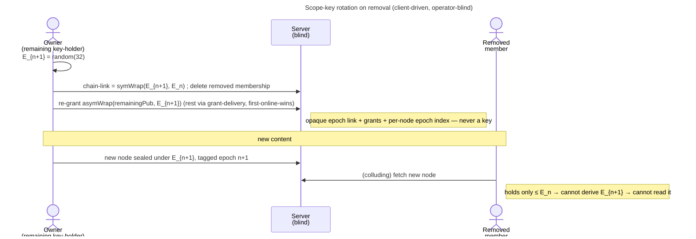

# Enabler: Scope-key rotation (content-key epochs)

- **ID:** en.spaces.scope-key-rotation
- **Type:** **Enabler** — structural foundation, no standalone end-user goal
  ([features/README](../../README.md#use-case-vs-enabler-vs-adr-vs-change-request)). It is the *substrate* that
  makes "remove a member" mean something cryptographically; the end-user goal lives in
  [uc.spaces.manage-group-members](../use-cases/uc.spaces.manage-group-members.md).
- **Provides:** the ability to **rotate a scope's content key forward into a new epoch** — granting the new epoch
  only to the **remaining** members — so a removed member can read pre-removal content but **never** post-removal
  content, **even against a malicious operator**, and **without re-encrypting anything** ([ADR 0024](../../../decisions/0024-scope-key-rotation.md)).
- **Serves (use-cases/enablers):** [uc.spaces.manage-group-members](../use-cases/uc.spaces.manage-group-members.md)
  (member removal triggers a rotation) — and, scope-generically, any future scope that needs forward-confidential
  removal (a tenant scope could rotate the same way; personal scopes never rotate).
- **Depends on:** [en.spaces.group-scope](en.spaces.group-scope.md) (the scope + its grant), the
  **grant-distribution primitive** generalized to re-grant existing members ([ADR 0020](../../../decisions/0020-grant-distribution-invite-wrap.md)),
  **grant-delivery** with a *stale-epoch* trigger ([ADR 0021](../../../decisions/0021-operator-blind-background-tasks.md)),
  the **content-key hierarchy** ([ADR 0012](../../../decisions/0012-content-key-hierarchy.md)). **No new crypto
  primitive** — the epoch chain composes the existing `symWrap` / `asymWrap`.
- **Preconditions:** A group with ≥1 remaining key-holder online to perform the rotation (mint + wrap are
  client-side; the blind server cannot).
- **Postconditions (success):** The scope carries a new **current epoch**; the new epoch is `symWrap`'d over the
  previous (the backward chain) and `asymWrap`'d to each remaining member; new content seals under it; the removed
  member's membership is gone (403). The server saw only opaque epoch-chain links, opaque grants, and per-node
  epoch indices — never a key.

## How rotation works (the epoch chain)

The scope content key is a sequence `E0, E1, …`; each new epoch **wraps its predecessor** (`symWrap(E_{n+1}, E_n)`),
so holding the latest epoch derives every earlier one, but an old epoch can never derive a newer one. A member's
grant wraps the **latest epoch they hold**. Nodes are **tagged with the epoch** they were sealed under. Full model,
guarantees, and the rotating-vs-stable (dedup) split: [ADR 0024](../../../decisions/0024-scope-key-rotation.md).

## Main flow — rotate on removal

1. A remaining owner's device **mints** a fresh `E_{n+1}` and posts the chain-link `symWrap(E_{n+1}, E_n)`.
2. It **re-grants** `E_{n+1}` to the remaining members it can reach (`asymWrap` to each identity); the
   **grant-delivery** reconciler finishes the rest — its trigger widened from *grant-less* to *grant-less or
   stale-epoch*, first-online-wins, idempotent ([ADR 0021](../../../decisions/0021-operator-blind-background-tasks.md)).
3. New content (names, `slug_token`s, `K_mem`-wraps) seals under `E_{n+1}`; each new node carries epoch index `n+1`.
4. The removed member holds ≤ `E_n` → decrypts pre-removal content, never `E_{n+1}` content.

## Alternate / exception flows

- **E1 — no key-holder online:** rotation is *queued* as a `SCOPE_ROTATION` job on the operator-blind task queue
  ([ADR 0021](../../../decisions/0021-operator-blind-background-tasks.md), cr-0092) — the removed membership is
  already deleted → layer-1 403 blocks their fetches meanwhile; the next online key-holder claims it, completes the
  mint + re-grant on-device, and closes the job. One live job per scope coalesces multiple removals; idempotent +
  first-online-wins. This is the async fallback when the remover isn't a key-holder (e.g. a tenant owner cutting a
  co-shared group, [uc.spaces.remove-tenant-member](../use-cases/uc.spaces.remove-tenant-member.md) A4); when the
  remover *is* a key-holder the rotation runs synchronously (cr-0088/0089). Not a hole.
- **E2 — a remaining member's grant can't be re-wrapped** (rotated identity, corrupt pubkey): that member's grant
  stays stale (they hold `E_n` while the scope is at `E_{n+1}`) → they fall to *awaiting access*, but are
  **auto-re-granted** by the grant-delivery **stale-epoch trigger** (cr-0093): the reconciler treats
  `grantedEpoch < currentEpoch` like a grant-less member and queues a delivery, so the next online key-holder
  re-wraps `E_current` to them and records `grantedEpoch = currentEpoch`. The scope is not wiped; no manual
  intervention needed.

## Quality notes

- **Forward-confidential, cheaply.** One random key + one chain-wrap + one `asymWrap` per remaining member — **no
  content re-seal, no media re-encryption** ([ADR 0024](../../../decisions/0024-scope-key-rotation.md)).
- **Operator-blind.** The server stores only the opaque epoch-chain links, the per-member grants, a per-membership
  granted-epoch marker, and a per-node epoch index — no key, no plaintext. The epoch index is operational metadata
  the operator could infer from timing anyway.
- **Honest limit.** Already-read + pre-rotation content is not retractable; rotation protects **future** content.
  Layer-1 (deleted membership → 403) is the instant defense for everything future against an honest server.

> **No end-user section.** As an enabler this has no standalone "what this means for you" story — the value
> reaches the user through [uc.spaces.manage-group-members](../use-cases/uc.spaces.manage-group-members.md).

## Related

- Feature: [Spaces (scopes)](../_index.md)
- Decisions: [ADR 0024](../../../decisions/0024-scope-key-rotation.md) (the epoch model),
  [ADR 0012](../../../decisions/0012-content-key-hierarchy.md) (content-key hierarchy),
  [ADR 0014](../../../decisions/0014-group-scopes-and-governance.md) (§6 removal → rotation),
  [ADR 0020](../../../decisions/0020-grant-distribution-invite-wrap.md) / [ADR 0021](../../../decisions/0021-operator-blind-background-tasks.md)
  (grant re-delivery on rotation)
- Concept: [Security Model → revocation](../../../crosscutting/security-model.md)
