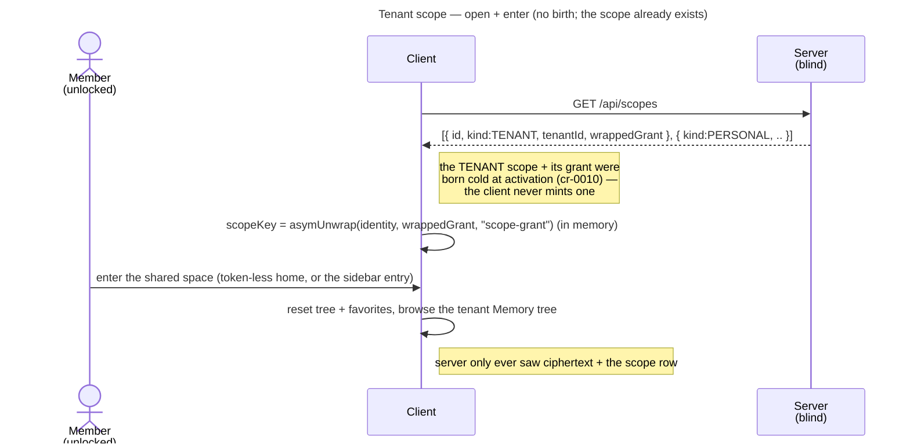

# Enabler: Tenant scope (the shared root space, opened on this device)

- **ID:** en.spaces.tenant-scope
- **Type:** **Enabler** — structural foundation, no standalone end-user goal
  ([features/README → use-case vs enabler vs ADR vs change-request](../../README.md#use-case-vs-enabler-vs-adr-vs-change-request)).
  The `TENANT` scope is already **born** (cold, at activation); this enabler only makes it **openable and
  enterable** as a first-class space. "The shared space" delivers value only once content lives in it.
- **Provides:** the tenant's shared root `kind=TENANT` scope **opened on this device** and selectable as the
  active space — the same keyed container the content flows fill, now reachable from the shell. It reuses the
  personal scope's **open-by-unwrap** machinery verbatim; the **only** difference is that there is **no birth**
  here (below).
- **Serves (use-cases/enablers):** [uc.spaces.switch-spaces](../use-cases/uc.spaces.switch-spaces.md) — the
  tenant space becomes the **token-less default home** ([ADR 0019](../../../decisions/0019-token-less-tenant-home.md))
  and a switchable entry beside Personal — and
  [uc.spaces.set-space-icon](../use-cases/uc.spaces.set-space-icon.md), which gives that space a **sealed face**
  and reads it back for *other* tenants over the widened cross-tenant path below. The
  [Memory](../../memory/_index.md) tree/browse then fills it, but it is
  a **generic scope consumer** (it lives in *any* scope — personal, tenant, or group), not something built on the
  tenant scope specifically, so it is not a `Serves` target here.
- **Depends on:** [en.spaces.personal-scope](en.spaces.personal-scope.md) (the generalised **scope identity**
  `scopeId + kind` and the client-side **open-by-unwrap**), and `uc.account.unlock` (the identity that opens
  the grant).
- **Preconditions:** An **authenticated, unlocked** member of the active tenant (the identity **private**
  bundle is in the vault, so the client can open a grant); the tenant resolved from the request `Host`; a
  `kind=TENANT` scope for which the caller **holds a grant** is returned by `GET /api/scopes`.
- **Postconditions (success):** The client holds the **opened tenant scope key** in memory (the `ScopeVault`)
  and the shell's active space is the tenant; its Memory tree can be browsed like any scope. The server never
  saw the scope key.

## What's different vs. the personal scope — no birth, shared by design

The tenant scope reuses the personal scope's open path (list scopes → take the `wrappedGrant` → `asymUnwrap`
with the vaulted identity → the scope key in memory) with **one deliberate subtraction and one difference**:

1. **No birth — open only.** A personal scope **auto-births** after unlock if absent
   ([en.spaces.personal-scope](en.spaces.personal-scope.md)). The tenant scope must **never** be minted by the
   client: it is **born cold by the invited owner at activation**
   ([ADR 0006](../../../decisions/0006-cold-tenant-scope-birth.md)). So this enabler has **no `POST /api/scopes`
   path**; if no openable tenant scope is present, it does **not** create one — it yields "not available" and
   the shell falls back to Personal (below). This subtraction is the crux: minting a tenant scope client-side
   would fork the single shared root.
2. **Shared, many key-holders.** A personal scope has exactly one grant (its owner). A tenant scope is held by
   **every member** who was granted it — the owner's cold-birth self-grant plus each member's invite-wrapped
   grant. This enabler **opens whichever grant the caller holds**; it neither adds nor distributes grants —
   **distribution is its own built flow** ([uc.spaces.add-member](../use-cases/uc.spaces.add-member.md),
   [ADR 0020](../../../decisions/0020-grant-distribution-invite-wrap.md)), see the Quality notes.
3. **Unnamed — but no longer anonymous.** The tenant scope carries **no sealed name**: its label is the tenant's
   own name, server-visible operational cleartext, not a sealed name like a group's
   ([en.spaces.group-scope](en.spaces.group-scope.md)). That is a **necessity, not a preference** — the Server
   Owner types the name while the tenant is still `PENDING`, and `K_SC` does not exist until the invited owner
   activates ([ADR 0006](../../../decisions/0006-cold-tenant-scope-birth.md),
   [uc.admin.create-tenant](../../admin/use-cases/uc.admin.create-tenant.md)). Anything chosen **after**
   activation has a key to be sealed under, and is therefore sealed
   ([ADR 0023](../../../decisions/0023-per-tenant-member-identity.md): *only the plaintext the mechanism requires
   stays plaintext*). The scope's **icon** is the first such field on the row
   ([uc.spaces.set-space-icon](../use-cases/uc.spaces.set-space-icon.md)) — so this scope is no longer *anonymous
   like personal*: it holds sealed **content**, it simply holds no sealed **name**. The switcher labels it with
   the cleartext name and, where the caller holds the grant, the sealed icon.

Because the scope, the owner grant, and the scope row already exist, this enabler is **thin on purpose**:
generalising "open a scope by kind" so `kind=TENANT` is opened the same way `kind=PERSONAL` already is.

## Main flow — open + enter

1. After unlock, the client lists scopes: `GET /api/scopes` (already fetched for the personal scope).
2. It takes the entry with `kind=TENANT` **for which the caller holds a `wrappedGrant`**.
3. It `asymUnwrap`s that grant with the vaulted identity (hybrid secret + public derived from the identity
   private bundle, context `scope-grant`) → the **tenant scope key**, held in memory.
4. The shell makes the tenant the **active space**: it resets the tree + favorites for the new scope and
   browses the tenant's Memory tree ([uc.spaces.switch-spaces](../use-cases/uc.spaces.switch-spaces.md)).

## Alternate / exception flows

- **E1 — no tenant grant for this member:** the caller is a tenant member but holds **no `TENANT` grant** — the
  **awaiting-access** window between admission and grant-delivery wrapping `K_SC` to them
  ([uc.spaces.add-member](../use-cases/uc.spaces.add-member.md)), so a **transient** state, not a standing one.
  While it lasts the tenant space is **not openable** → the shell **falls back to Personal** as the effective home
  ([ADR 0019](../../../decisions/0019-token-less-tenant-home.md)); the tenant entry is surfaced as unavailable,
  not offered as an empty room.
- **E2 — not unlocked:** without the identity private bundle the client cannot open the grant → entering the
  tenant is deferred until after unlock (the deep-link-through-login restore of
  [ADR 0015](../../../decisions/0015-operator-blind-readable-urls.md) applies unchanged).
- **E3 — grant unwrap fails** (corrupt/foreign grant, identity rotated without re-wrap): the tenant can't be
  opened → surfaced as an error; the scope row is **not** self-deleted (a blind operator must not force a
  wipe). Identity rotation re-wraps grants (its own use-case).
- **E4 — no tenant context** (no Host / unknown tenant): `404` — every scope lives within a tenant
  ([ADR 0002](../../../decisions/0002-personal-scope-per-tenant.md)); there is no host-less tenant scope.

## Quality notes

- **Operator-blind.** The server stores the opaque scope row (`id` / `kind` / `tenant`), the **ciphertext
  grant(s)**, and membership — never the tenant scope key. Open is client-side; there is no birth to be
  client- or server-side here at all.
- **No new crypto.** The grant is the same hybrid KEM (`asymWrap`, X25519 + ML-KEM-768,
  [ADR 0017](../../../decisions/0017-crypto-primitives-and-post-quantum-strategy.md)) used for the tenant grant at
  activation and for the personal/group grants — this enabler only **opens** it.
- **Shared, not private.** Unlike the personal scope's "no other key-holder" promise, the tenant scope is the
  **commons**: every granted member reads it. Confidentiality is still cryptographic (only a grant opens the
  key), but the intended reach is the whole tenant, not one person.
- **Auth ≠ content.** Holding a session does not open the tenant scope; only the identity-unwrapped grant
  yields the key (client-enforced confidentiality, [scopes & tenancy](../../../crosscutting/scopes-and-tenancy.md)).
- **Grant distribution is a separate flow.** This enabler assumes the caller **already holds** a tenant grant
  (the owner does, from cold birth). **Distributing** tenant grants to new members — invite a person, then wrap
  `K_SC` to their identity — is [uc.spaces.add-member](../use-cases/uc.spaces.add-member.md)
  ([ADR 0020](../../../decisions/0020-grant-distribution-invite-wrap.md)), and it is **built**: a new member is
  grant-less only until a key-holder comes online (E1), not indefinitely.
- **Every tenant's grant, in one Host-independent call.** `GET /api/scopes` is **Host-scoped** — it serves the
  scope rows of the tenant resolved from the request `Host`, and nothing of any other tenant.
  `GET /api/scopes/my-tenants` is **account-scoped** (`MembershipEntity.find("userId", …)`, no Host at all) and
  therefore carries, per tenant, the caller's **own** `wrappedGrant` for that tenant's **root** scope plus its
  `sealedIcon` + `iconEpoch` — so a member can render *other* tenants' sealed identity without entering them
  ([uc.spaces.switch-spaces](../use-cases/uc.spaces.switch-spaces.md),
  [uc.spaces.set-space-icon](../use-cases/uc.spaces.set-space-icon.md)). **This discloses nothing to the
  operator**: a grant is ciphertext sealed to the caller's identity key, the server already holds every one at
  rest, and it already computes this exact membership set to answer the call
  ([scopes & tenancy](../../../crosscutting/scopes-and-tenancy.md) — *visibility is cryptographic, not a server
  promise*). Two decisions that look like they forbid it do not:
  [ADR 0002](../../../decisions/0002-personal-scope-per-tenant.md)'s "no host-less scope" reads broader than its
  rationale, which is **share-link host correctness**, and no share link or content moves here; and
  [ADR 0020](../../../decisions/0020-grant-distribution-invite-wrap.md)'s refusal of a global key directory
  governs **other people's** public keys, not the caller's own grants. What it **does** change is booked, not
  waved away: opening the switcher at one tenant's origin hands that origin's client every tenant's `K_SC`, so a
  malicious operator serving that client harvests keys for tenants the user never visits. That falls in the tier
  [ADR 0026](../../../decisions/0026-client-trust-tiers.md) already books as lost (served web + an active
  operator) and not at all on a self-served client. The client opens each foreign grant **transiently** and
  **zeroes** it as soon as the icon is decrypted — the pattern the group-name read already uses.

> **No end-user section.** As an enabler this has no standalone "what this means for you" story — the shared
> space reaches the user through [uc.spaces.switch-spaces](../use-cases/uc.spaces.switch-spaces.md) and the
> [Memory](../../memory/_index.md) use-cases it serves (their bilingual sections carry the wiki text).

## Related

- Feature: [Spaces (scopes)](../_index.md)
- Concepts: [Scopes & Tenancy](../../../crosscutting/scopes-and-tenancy.md) (scope kinds, grants = membership,
  host-based tenant resolution), [Account & Key Model](../../account/enablers/en.account.key-model.md)
  (identity opens grants), [Security Model](../../../crosscutting/security-model.md) (operator-blind)
- Decisions: [ADR 0006](../../../decisions/0006-cold-tenant-scope-birth.md) (the tenant scope is born cold —
  why there is no client birth here), [ADR 0002](../../../decisions/0002-personal-scope-per-tenant.md) (scopes
  are tenant-bound), [ADR 0017](../../../decisions/0017-crypto-primitives-and-post-quantum-strategy.md) (the hybrid-KEM
  grant), [ADR 0019](../../../decisions/0019-token-less-tenant-home.md) (tenant is the token-less default home)
- Sibling enablers: [en.spaces.personal-scope](en.spaces.personal-scope.md) (the open machinery this reuses +
  the auto-birth this deliberately omits), [en.spaces.group-scope](en.spaces.group-scope.md) (the other shared
  kind — named, warm-born)
