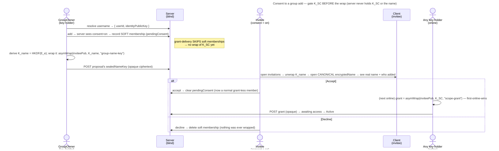

# UC: Consent before being added to a group

- **ID:** uc.spaces.consent-group-add
- **Primary actor:** **the invited member** (accepts or declines) — with the **GroupOwner** as the trigger (adds a
  consent-required member) and **any account holder** as the one who set the preference.
- **Goal:** let a person **opt in to being asked first** — so a GroupOwner cannot silently drop them into a group.
  When the toggle is on, an add becomes a **proposal** the person **accepts or declines**; the group key `K_SC`
  is delivered **only after acceptance**.
- **Preconditions:** The target is **already a tenant member** with a published identity public key
  ([en.spaces.member-identity](../enablers/en.spaces.member-identity.md)). The target has turned **"ask before
  adding me to groups"** on (an **account-global** preference, default **off**). The GroupOwner holds the group
  grant (so their device can derive the group's name-key `K_name` and wrap it to the invitee).
- **Postconditions (success on Accept):** the proposal becomes a normal **grant-less** membership; grant-delivery
  wraps `K_SC` to the newcomer (the usual *awaiting access* window, [uc.spaces.add-group-member](uc.spaces.add-group-member.md)),
  and the group opens for them. On **Decline**: the soft membership is dropped — **nothing was ever wrapped**, no
  trace kept. Operator-blind throughout: the server saw a membership row, identity public keys, and opaque
  ciphertext (the wrapped name-key, the already-stored canonical name it opens, then the grant) — never `K_SC`, and
  never the plaintext name.

This use-case realizes the **optional consent opt-in** of [ADR 0014](../../../decisions/0014-group-scopes-and-governance.md) §5,
with the invitee's name-preview mechanism defined by [ADR 0027](../../../decisions/0027-group-invite-name-shared-key.md).
It is **consent-first, never wrap-then-soft**: `K_SC` is gated **before** the wrap, because a delivered key can't
be un-given. It builds directly on [uc.spaces.add-group-member](uc.spaces.add-group-member.md) (the default
direct-add) — the only additions are the **soft membership**, a **wrapped name-key** that lets the invitee read the
group's **canonical** name (not an owner-typed claim), and the **accept/decline** step.

## Main flow

1. **The preference (account-global).** A person turns on **"ask before adding me to groups"** — one setting on
   their account, applying in **every** tenant they belong to. It is a low-sensitivity server-visible boolean
   (operational metadata, like other account settings): the operator learns *that* someone likes to be asked,
   never any key or content. Default **off** → the direct-add of [uc.spaces.add-group-member](uc.spaces.add-group-member.md).
2. **The owner adds (proposal, not admission).** The GroupOwner resolves the target by **username** exactly as in
   direct-add and picks them. The server sees the preference is **on**, so instead of a grant-less membership it
   records a **soft, grant-less membership** (`pendingConsent`) — *proposed*, not yet a member. **grant-delivery
   skips soft memberships**, so no key-holder ever wraps `K_SC` to a pending invitee.
3. **The wrapped name-key.** The owner's device — a key-holder — derives the group's **name-key**
   `K_name = HKDF(E_e, "group-name-key")` from the key of the epoch the name was sealed under, and wraps **the key
   bytes** (not a name copy) to the invitee's identity: `asymWrap(hybridPublic(invitee), K_name, "group-name-key")`,
   posted as the proposal's `sealedNameKey`. The server returns the scope's **canonical** `encryptedName` in the
   invitation. Handing the *key* — not a name — is the crux of [ADR 0027](../../../decisions/0027-group-invite-name-shared-key.md):
   the invitee opens the **same** ciphertext the members hold, so a modified owner **cannot** privately show a
   divergent name. `K_name` is one-way from `E_e` (HKDF), so it leaks the name and nothing else — not `E_e`, not `K_SC`.
4. **The invitee decides.** In a **group-invitations** view — reached from an **appears-on-demand attention badge**
   in the top bar (beside the upload-queue tray; rendered only while at least one proposal is open) — the invitee
   unwraps `sealedNameKey` with their own identity private key → `K_name`, decrypts the canonical `encryptedName`
   under it, and sees **the group's (group-consistent) name + who added them** (the owner's per-tenant username,
   already visible to them) + the tenant.
   - **Accept** → the server clears `pendingConsent`; the proposal is now a normal grant-less membership, and the
     ordinary directory-driven grant-delivery wraps `K_SC` to them (first-online-wins, *awaiting access* →
     Active). From here it is identical to direct-add step 3+.
   - **Decline** → the server **deletes** the soft membership. Nothing was wrapped; no `declined` state is kept
     (silent drop). The owner may propose again later.
5. **Rescind (owner).** Before acceptance the owner may withdraw the proposal — the same silent delete. After
   acceptance the person is a real member and leaves via the normal remove path
   ([uc.spaces.manage-group-members](uc.spaces.manage-group-members.md)).

## Alternate / exception flows

- **A1 — the target has consent OFF (the default):** there is no proposal step — the add is the immediate
  direct-add of [uc.spaces.add-group-member](uc.spaces.add-group-member.md). This use-case does not apply.
- **A2 — already a member (or already proposed):** picking them is a **no-op** (idempotent) — a live membership
  or an open proposal already exists; no duplicate.
- **A3 — the invitee is offline / never responds:** the proposal simply **stays pending** — not an error, no key
  at risk (nothing is wrapped). The owner may rescind; there is no auto-expiry in v1 (a deferred polish).
- **A4 — re-invite after a decline:** allowed. The decline left no `declined` marker (silent drop), so a fresh
  proposal is just a new soft membership. (The cost, accepted: an owner could re-propose repeatedly — a
  rate-limit/mute is a deferred polish, not a v1 gate.)
- **E1 — the username doesn't resolve in this tenant:** a generic *not-found*, tenant-scoped resolve — identical
  to direct-add E1.
- **E2 — key-substitution by a malicious operator:** the name-key wrap (and later the grant) wraps to the pubkey
  the server returns, consistent with direct-add E2 and the shared primitive. Consent gates the *human's*
  agreement, not key authenticity; that is governed by [ADR 0028](../../../decisions/0028-identity-authenticity-tofu-verification.md)
  (**TOFU-pin** on first use, a **changed** key surfaced/refused, out-of-band **safety-number verification** via
  [uc.spaces.verify-identity](uc.spaces.verify-identity.md), opt-in strict). Until that slice ships the wrap is
  still Plain ([security-model](../../../crosscutting/security-model.md)). Note ADR 0027 closes a **different**
  attack — a *modified-owner* private name-lie — orthogonal to this operator-key seam.

## Quality notes

- **Consent-first, never wrap-then-soft.** The gate is **before** the wrap: grant-delivery skips soft memberships,
  so `K_SC` never reaches someone who hasn't accepted. Deleting an already-delivered wrap would not un-give the
  key — so we never deliver it in the first place ([ADR 0014](../../../decisions/0014-group-scopes-and-governance.md) §5).
- **Operator-blind — no new leak beyond direct-add.** The server stores a membership row (`pendingConsent`) + one
  opaque wrapped name-key, and relays identity public keys + the already-stored canonical `encryptedName` to the
  invitee. It already stores membership rows + sealed names for direct-add; the plaintext name and `K_SC` never
  appear, and the name-key it relays is one it cannot use. The **consent boolean is account-global and
  server-visible** — a deliberate, honest exception: a GroupOwner attempting an add learns *that* the person wants
  to be asked (the add returns "proposal sent" instead of "added"). Low-sensitivity operational metadata, no key
  or content — the standing trade for a one-setting preference over a per-tenant one.
- **Pending is owner-visible only.** A `pendingConsent` invitee shows in the group's member directory as *invited
  — awaiting consent* to **owners** only; ordinary members see them only once they accept. The invitee's own
  invitations view is theirs alone.
- **The invitee's attention badge is a client-derived, self-clearing count — no new server signal, no read-state.**
  The top-bar badge counts the invitee's open proposals from the **same** `listMyGroupInvitations` the view already
  fetches; the blind server holds those `pendingConsent` rows regardless, so surfacing a count adds nothing it does
  not already see. Accept/Decline removes the row, so the count falls on its own — there is **no read/unread state**
  to persist (no per-user engagement metadata, no store beyond what consent already needs). It is deliberately a
  single-signal badge, **not** a persistent notifications hub: a multi-source hub, a server-persisted read-state, and
  folding the terms-acceptance gate ([uc.account.accept-terms](../../account/use-cases/uc.account.accept-terms.md),
  a hard router gate) into it are all out of scope — each would add a store or server-visible metadata this
  presentation surface does not need.
- **Additive, reversible cheaply.** Accept flips one flag → the existing grant-delivery does the rest; Decline /
  Rescind is a single row delete. No rotation, no re-seal, no second standing key.
- **Consent's strength tracks the client tier ([ADR 0026](../../../decisions/0026-client-trust-tiers.md)).** The
  gate is enforced by the key-holders' clients not wrapping `K_SC` to a soft member — so it is a real,
  crypto-grade guarantee wherever the operator cannot alter the client (**self-hosted**, or a trusted/attested
  origin: an active operator can't make it wrap), and **honest-operator-only** on someone else's instance (a
  tampered client could wrap regardless) — the same tier as all veyq E2EE, no consent-specific weakness.

## What this means for you / Was das für dich bedeutet

**EN —** By default, a friend can add you to a shared group and you'll just find yourself in it — quick, but not
everyone wants that. So there's a switch: **"ask before adding me to groups."** Turn it on and an add becomes an
invitation instead. You'll see the group's **real name** — the very same name everyone already in the group sees,
so the person adding you can't quietly show you a nicer-sounding one — and **who added you**, all unreadable to the
server, and you decide: **Accept** and the group's key is handed to you the usual way; **Decline** and it's as if it
never happened — nothing was shared with you, and no record of the "no" is kept. Until you accept, the key to the
group is **never** handed out, so nothing of the group ever reaches you without your say-so.

**DE —** Standardmäßig kann dich ein:e Freund:in zu einer geteilten Gruppe hinzufügen, und du findest dich einfach
darin wieder — schnell, aber nicht jede:r will das. Darum gibt es einen Schalter: **„frag mich, bevor du mich zu
Gruppen hinzufügst."** Ist er an, wird ein Hinzufügen zu einer Einladung. Du siehst den **echten Namen** der Gruppe
— genau den Namen, den alle in der Gruppe schon sehen, sodass die Person, die dich hinzufügt, dir keinen
schöner klingenden vorgaukeln kann — und **wer dich hinzugefügt hat**, für den Server unlesbar, und du
entscheidest: **Annehmen**, und der Schlüssel zur Gruppe wird dir wie üblich übergeben; **Ablehnen**, und es ist,
als wäre es nie passiert — nichts wurde mit dir geteilt, und das „Nein" wird nirgends festgehalten. Bis du annimmst,
wird der Schlüssel zur Gruppe **nie** herausgegeben — nichts aus der Gruppe erreicht dich ohne dein Einverständnis.

## Related

- Feature: [Spaces (scopes)](../_index.md)
- Use-cases: [uc.spaces.add-group-member](uc.spaces.add-group-member.md) (the default direct-add this gates),
  [uc.spaces.manage-group-members](uc.spaces.manage-group-members.md) (how an accepted member later leaves)
- Enablers: [en.spaces.group-scope](../enablers/en.spaces.group-scope.md) (the group + its sealed name),
  [en.spaces.member-identity](../enablers/en.spaces.member-identity.md) (the identity pubkey the name-key is wrapped to)
- Decisions: [ADR 0027](../../../decisions/0027-group-invite-name-shared-key.md) (the derived name-key the invitee
  reads the canonical name with — supersedes the one-off seal), [ADR 0014](../../../decisions/0014-group-scopes-and-governance.md)
  §5 (the consent opt-in — consent-first), [ADR 0020](../../../decisions/0020-grant-distribution-invite-wrap.md) (the grant-wrap +
  Plain-authenticity seam), [ADR 0021](../../../decisions/0021-operator-blind-background-tasks.md) (grant-delivery,
  which skips soft memberships), [ADR 0023](../../../decisions/0023-per-tenant-member-identity.md) (per-tenant username),
  [ADR 0026](../../../decisions/0026-client-trust-tiers.md) (the client trust tier the consent guarantee rides on)
