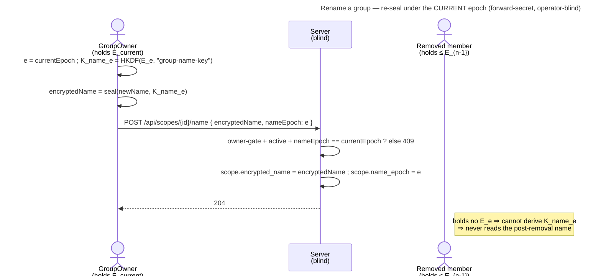

# UC: Rename a group

- **ID:** uc.spaces.rename-group
- **Primary actor:** **GroupOwner** (`OWNER` on the GROUP scope) — the group's **name authority**
  ([ADR 0027](../../../decisions/0027-group-invite-name-shared-key.md)).
- **Goal:** let a GroupOwner **change a group's display name** for everyone, operator-blind, and **forward-secret** —
  a member removed before the rename cannot read the new name.
- **Preconditions:** an **authenticated, unlocked** `OWNER` of the group who holds a grant at the scope's **current
  content-key epoch** (the write key). The scope is a **GROUP** (personal/tenant scopes carry no per-scope name)
  and is **active** (not pending-deletion — a rename is a name-write, blocked during the grace period like any
  content write, [uc.spaces.delete-group](uc.spaces.delete-group.md) A4).
- **Postconditions (success):** the scope's `encryptedName` is **re-sealed** under `K_name` derived from the **current**
  epoch key, and `nameEpoch` is set to that epoch. Every current member sees the new name on their next
  `listMyScopes` (they peel to `nameEpoch` and derive `K_name`); a member removed at an earlier epoch **cannot**
  derive the new `K_name`, so they never read the post-removal name. The server saw new opaque ciphertext + a
  bumped small integer — never the plaintext name and no key.

This use-case realizes the **rename mechanism** [ADR 0027](../../../decisions/0027-group-invite-name-shared-key.md)
defines (the `nameEpoch` index exists precisely to make it forward-secret). It reuses the group's own name-seal
([en.spaces.group-scope](../enablers/en.spaces.group-scope.md)) — a rename is the *write* counterpart of the read
every member already does. It is a **name-only** change: it does **not** rotate `K_SC` and re-grants no one.

## Main flow

1. **The owner edits the name.** In the group settings the `OWNER` types a new name (plaintext, on device). Names
   are **not** unique — a duplicate is allowed ([ADR 0014](../../../decisions/0014-group-scopes-and-governance.md), same as create).
2. **Re-seal under the current epoch.** The client takes the scope's **current epoch** `e = currentEpoch` (its
   write key, peeled from the grant), derives `K_name_e = HKDF(E_e, "group-name-key")`, and seals the new name:
   `encryptedName = symEncrypt(K_name_e, newName)` (the same node-name seal). Sealing under the **current** (not the
   old name) epoch is what makes the new name forward-secret.
3. **POST the rename.** `POST /api/scopes/{scopeId}/name { encryptedName, nameEpoch: e }` — two opaque values.
4. **The server updates the row (blind).** Owner-gated ([ADR 0014](../../../decisions/0014-group-scopes-and-governance.md) §4).
   It rejects a rename whose `nameEpoch != currentEpoch` (`409 stale_epoch` — a concurrent rotation moved the epoch
   under the caller; see A1) and a rename on a pending-deletion group (`409`, A2). Otherwise it overwrites
   `encrypted_name` + `name_epoch` and returns `204`. The server never derives a key or reads the name.
5. **Members see the new name.** On their next `GET /api/scopes` each current member takes `nameEpoch`, peels the
   epoch chain to `E_nameEpoch`, derives `K_name`, and decrypts `encryptedName` → the new name (the read path
   [uc.spaces.consent-group-add](uc.spaces.consent-group-add.md) / the switcher already use).

## Alternate / exception flows

- **A1 — stale epoch (a concurrent rotation):** between the owner's read and their rename POST another owner
  removed a member and rotated, so `currentEpoch` advanced. The POST's `nameEpoch` is now stale → `409 stale_epoch`.
  The client **refetches** the scope (grant-delivery keeps an owner at the current epoch), re-seals under the fresh
  epoch, and retries. Rare — only a multi-owner read-then-write race; a single-owner group never hits it.
- **A2 — the group is pending-deletion:** a rename is a name-write, rejected during the grace period (`409`,
  read-only until restore/purge, [uc.spaces.delete-group](uc.spaces.delete-group.md) A4).
- **A3 — the caller is not an OWNER:** `403 not_scope_owner` (a plain MEMBER is not the name authority).
- **A4 — blank / oversized name:** rejected at the contract boundary (`400` — non-blank, base64, `maxLength`), same
  validation as create.
- **E1 — a rename between a consent-invite and its accept:** a pending invitee was handed `sealedNameKey` for the
  **old** name epoch; after the rename the served `encryptedName` is under the **new** epoch, so their key no longer
  opens it → the preview shows **"unnamed"**. They can still accept and then see the current name. This fail-safe is
  already handled by [uc.spaces.consent-group-add](uc.spaces.consent-group-add.md) (cr-0096) — the rename only
  realizes it; rare and harmless.

## Quality notes

- **Forward-secret, by construction.** The name rides the same "sealed under its epoch, carries an epoch index"
  model as node names ([ADR 0024](../../../decisions/0024-scope-key-rotation.md) §2): re-sealing under
  `currentEpoch` means only holders of that epoch (current members) read the new name. This is the entire reason
  `nameEpoch` exists — a rename is where it earns its keep.
- **Name-only — cheap.** A rename does **not** rotate `K_SC` and re-grants no member (unlike a removal). It
  overwrites two fields on one row. No epoch-chain link, no per-member wrap.
- **Operator-blind — no new surface.** The server overwrites the already-opaque `encrypted_name` (a key change it
  is agnostic to) + bumps the small `name_epoch` integer. It never sees the name or a key
  ([ADR 0027](../../../decisions/0027-group-invite-name-shared-key.md)).
- **Owner is the name authority — visibly, for everyone.** An owner renaming the group **for all members** is the
  intended power (and visible to all on next list); it is **not** the private per-invitee deception ADR 0027 closes
  (that was the one-off name-seal). A strictly weaker, legitimate action.
- **Consent's / rename's strength tracks the client tier ([ADR 0026](../../../decisions/0026-client-trust-tiers.md)).**
  The forward-secrecy holds crypto-grade on a trusted client and honest-operator on served web — the same tier as
  all veyq E2EE, no rename-specific weakness.

## What this means for you / Was das für dich bedeutet

**EN —** Named a group in a hurry, or the trip's dates changed? As an owner you can rename it, and the new name
shows up for everyone in the group. The name is sealed just like everything else — the server only ever stores
scrambled text, never the words. And it's tidy about people who've left: someone you removed **before** the rename
can't read the new name, only the old one they already saw.

**DE —** Eine Gruppe in Eile benannt, oder der Reisezeitraum hat sich geändert? Als Owner kannst du sie umbenennen,
und der neue Name erscheint für alle in der Gruppe. Der Name ist wie alles andere versiegelt — der Server speichert
nur verwürfelten Text, nie die Worte. Und mit Ausgetretenen geht es sauber um: Wen du **vor** dem Umbenennen
entfernt hast, kann den neuen Namen nicht lesen, nur den alten, den er ohnehin schon sah.

## Related

- Feature: [Spaces (scopes)](../_index.md)
- Use-cases: [uc.spaces.consent-group-add](uc.spaces.consent-group-add.md) (the invitee reads the same sealed name;
  the rename-between-invite-and-accept edge), [uc.spaces.delete-group](uc.spaces.delete-group.md) (a rename is
  blocked while pending-deletion), [uc.spaces.manage-group-members](uc.spaces.manage-group-members.md) (removal +
  the rotation that advances the epoch a rename seals under)
- Enablers: [en.spaces.group-scope](../enablers/en.spaces.group-scope.md) (the group's sealed name + `nameEpoch`)
- Decisions: [ADR 0027](../../../decisions/0027-group-invite-name-shared-key.md) (the derived name-key + the
  rename-under-current-epoch mechanism), [ADR 0024](../../../decisions/0024-scope-key-rotation.md) (epochs + the
  per-name epoch index), [ADR 0014](../../../decisions/0014-group-scopes-and-governance.md) §4 (owner-gate)
