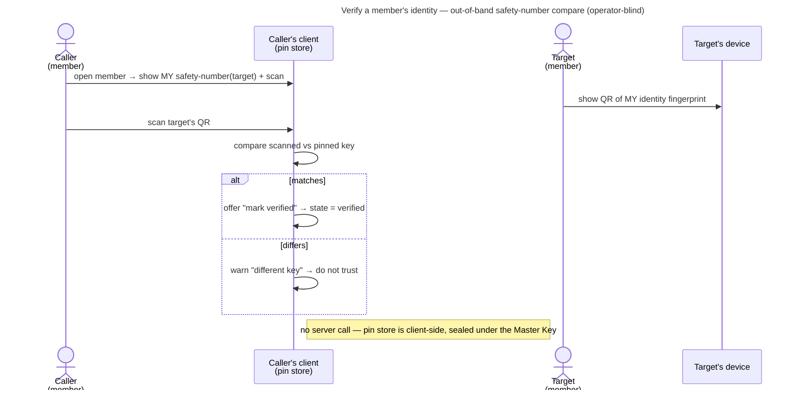

# UC: Verify a member's identity

- **ID:** uc.spaces.verify-identity
- **Primary actor:** **a scope member** (any key-holder who can see a member directory) verifying **another member**.
- **Goal:** confirm out-of-band that a member's identity public key is really theirs — elevate the pin **pinned →
  verified** — and **review a changed key** (accept a legitimate rotation, or refuse a substituted one). Closes the
  operator key-substitution gap for those who verify ([ADR 0028](../../../decisions/0028-identity-authenticity-tofu-verification.md)).
- **Preconditions:** an **authenticated, unlocked** caller; the target appears in a scope **member directory** the
  caller can read; the caller's **pin store** ([en.account.identity-pinning](../../account/enablers/en.account.identity-pinning.md))
  is available. Verification is surfaced per scope, but the pin it writes is **account-global** — verify once,
  trusted everywhere.
- **Postconditions (success):** the target's pin is **verified** (or a **changed** key is reviewed and either
  accepted → re-pinned, or refused → left blocked). Operator-blind throughout: the pin store is sealed under the
  Master Key; the server never learns who verified whom.

This use-case is the **human half** of [ADR 0028](../../../decisions/0028-identity-authenticity-tofu-verification.md);
the pinning mechanism + the change-response is [en.account.identity-pinning](../../account/enablers/en.account.identity-pinning.md).
The building block is the identity **fingerprint / safety-number** (`fingerprint()` — a digest of the full identity
public bundle, [ADR 0017](../../../decisions/0017-crypto-primitives-and-post-quantum-strategy.md)).

## Main flow

1. **Trust badges in the directory.** Each member row carries a **trust state** from the caller's pin store:
   **verified**, **pinned** (trust-on-first-use, unverified), or **changed** (the directory key differs from the
   pin — needs review).
2. **Open "Verify".** The caller opens a member → the app shows **their own** view of that member's **safety
   number** (6×5 digits) + a **scan** affordance.
3. **Compare out-of-band.** The ergonomic path is **QR**: the other person's device shows a QR of *their* identity
   fingerprint; the caller **scans it**, and the app **compares the scanned value against the pinned key** →
   **feedback**: **matches** (→ offer "mark verified" → `state = verified`) or **differs** (→ *this is a different
   key* — do **not** trust; likely a substituted key or an un-accepted rotation). Reading the digit groups aloud is
   the fallback when a camera isn't available.
4. **Review a changed key.** For a **changed** badge the review shows the **expected** (pinned) vs the **current**
   (directory) safety-numbers side by side. The caller verifies out-of-band, then either **accept** (re-pin the new
   key, optionally straight to *verified*) or **refuse** (leave it blocked — the wrap/delivery stays gated).

## Alternate / exception flows

- **A1 — first sight (no pin yet):** a member the caller has never wrapped to shows **pinned** on first
  interaction (trust-on-first-use); the caller may verify immediately from the directory.
- **A2 — no camera / can't scan:** fall back to **reading the digit groups** aloud out-of-band and confirming they
  match — the safety-number is language-neutral decimal digits by design.
- **A3 — strict mode (account-global toggle):** with "require verification before sharing" on, an **unverified**
  member is **skipped by the grant-delivery worker** (they stay *awaiting access*) until verified here; a changed
  key is a **hard block**, not a notice (ADR 0028 §4).
- **E1 — a legitimately rotated key (post-compromise recovery):** the target rotated their identity
  ([en.account.key-model](../../account/enablers/en.account.key-model.md) §Identity rotation), so their key legitimately
  changed → badge **changed**. The caller re-verifies out-of-band and **accepts** — the same review path as an
  attack, decided by the human, not the wire.
- **E2 — a substituted key (active operator MITM):** identical on-wire to E1 — the review surfaces it; the caller
  who compares out-of-band sees the mismatch and **refuses**. This is the whole point.

## Quality notes

- **Operator-blind.** Verification is **client-only** — comparing a scanned/spoken safety-number against the
  sealed pin; **no server call**, so the operator never learns who verified whom (the trust graph stays off the
  server, [en.account.identity-pinning](../../account/enablers/en.account.identity-pinning.md)).
- **The first-use gap (honest).** Verification defends only from the moment two people compare. A key substituted
  **before** first sight — with genuine content also re-wrapped — is invisible until someone verifies out-of-band
  or Key Transparency exists (the end-state).
- **Manual, so it protects those who do it.** In the default flow verification is **optional** trust elevation;
  strict mode (A3) is for those who want it enforced. Stated, not oversold.
- **Tier-consistent ([ADR 0026](../../../decisions/0026-client-trust-tiers.md)).** Crypto-grade on a trusted
  client, honest-operator on operator-served web.

## What this means for you / Was das für dich bedeutet

**EN —** When you share memories with someone, your app quietly remembers their security key the first time. If it
ever changes, you'll be told — because a changed key can mean someone is trying to impersonate them. To be extra
sure it's really them, you can **verify**: hold your phones together and scan a QR code (or read a short number
aloud). Match = a green "verified"; no match = a warning not to trust. You only do it once per person, and it works
in every shared space with them.

**DE —** Wenn du Erinnerungen mit jemandem teilst, merkt sich deine App beim ersten Mal still dessen
Sicherheitsschlüssel. Ändert er sich je, wirst du gewarnt — denn ein geänderter Schlüssel kann heißen, dass sich
jemand als diese Person ausgibt. Um ganz sicher zu sein, kannst du **verifizieren**: Handys aneinanderhalten und
einen QR-Code scannen (oder eine kurze Zahl vorlesen). Passt = ein grünes „verifiziert"; passt nicht = eine Warnung,
nicht zu vertrauen. Du machst es nur einmal pro Person, und es gilt in jedem geteilten Raum mit ihr.

## Related

- Feature: [Spaces (scopes)](../_index.md)
- Enablers: [en.account.identity-pinning](../../account/enablers/en.account.identity-pinning.md) (the sealed pin store + the
  change-response this UI drives), [en.spaces.member-identity](../enablers/en.spaces.member-identity.md) (the
  directory the badges hang on), [en.account.key-model](../../account/enablers/en.account.key-model.md) (identity rotation →
  a legitimate key change)
- Use-cases: [uc.spaces.add-group-member](uc.spaces.add-group-member.md), [uc.spaces.consent-group-add](uc.spaces.consent-group-add.md),
  [uc.spaces.add-member](uc.spaces.add-member.md) (the wrap flows whose E2 key-substitution risk this closes)
- Decisions: [ADR 0028](../../../decisions/0028-identity-authenticity-tofu-verification.md) (the authenticity
  model), [ADR 0017](../../../decisions/0017-crypto-primitives-and-post-quantum-strategy.md) (the fingerprint / safety-number),
  [ADR 0026](../../../decisions/0026-client-trust-tiers.md) (the trust tier this rides on)
