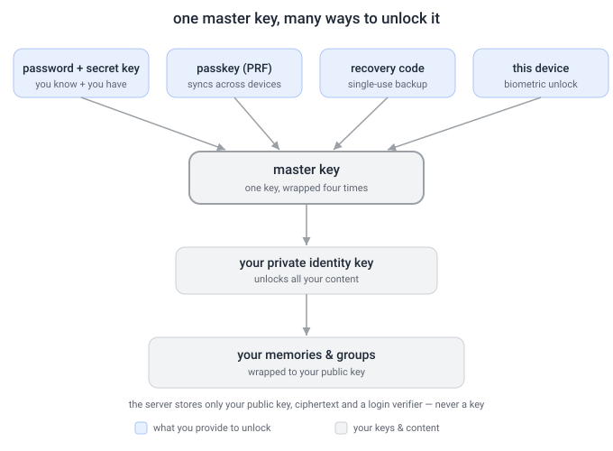
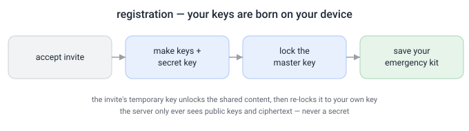
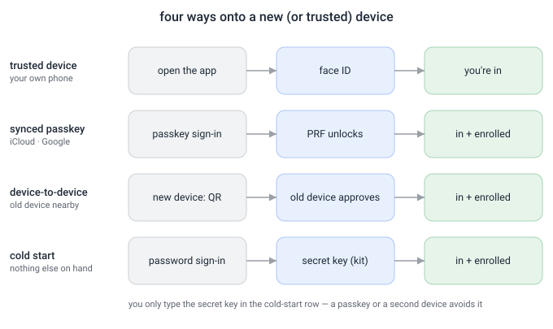
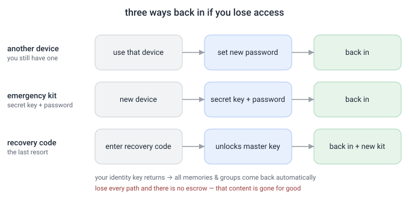

# Account keys, devices & recovery — illustrated

> A plain-language companion to the [Security Model](security-model.md). veyq is **end-to-end
> encrypted**: only your own devices can read your content, and the **server only ever holds
> ciphertext**. That makes one thing genuinely different from a normal app — **your keys, not the
> server, guard your data**. This page explains how that works, with pictures, so anyone can follow it.

**A few words you'll see:**
- **Key** — a secret that locks/unlocks data. **Public key** may be shared; **private key** is yours alone.
- **Master key** — the one key that protects your private key. Everything hangs off it.
- **Wrap** — to lock one key inside another ("the master key is *wrapped* with your password").
- **Secret key** — a high-entropy code in your **emergency kit**, combined with your password. Never sent to the server.
- **Passkey / PRF** — a passwordless credential; with the *PRF* extension it can also unlock your master key.
- **Recovery code** — a single-use backup code that can unlock your master key on its own.

## The big picture — one master key, many keys to it



There is **one master key**. It is *wrapped* (locked) **separately by each method you set up** — your
password + secret key, a passkey, a recovery code, each trusted device. Any one of them opens the
**same** master key, which unlocks your **private identity key**, which unlocks **all** your memories
and groups. Adding or removing a method just adds/removes one lock — your content is never re-encrypted.

## When you register



When you accept an invitation, your **device** creates your keys — the server can't, and never sees a
secret. The invite carries a **temporary key** (in the link, never to the server) that unlocks the
shared content you were invited to; your device immediately **re-locks it to your own key**. You finish
by saving your **emergency kit** (secret key + recovery code).

## Logging in — four situations



- **Trusted device** — your own phone unlocks with Face ID; nothing to type.
- **Synced passkey** — on a new device, a passkey that synced via iCloud/Google unlocks via *PRF*.
- **Device-to-device** — your old device approves the new one (like linking a messenger app).
- **Cold start** — nothing else on hand? Sign in with your password and the **secret key** from your kit.

The **secret key is only needed in the cold-start case**. Why have it at all? Because your password is
sent to the server to log in — if the master key came from the password alone, the server could open it.
The secret key (never sent) closes that gap.

## Where the keys actually live

This is the part that makes it click. The server only ever holds the **wrapped** (locked) copies —
never a key that opens them.

| Thing | Where it lives |
|---|---|
| your wrapped master key (one copy per method) | on the **server** (ciphertext) |
| the **KEK** that opens a copy | **only in your device's memory**, for a moment during unlock |
| the *source* of each KEK | never on the server — your head, your kit, your passkey, your device |

There is **one** master key, but a **separate wrapped copy per method**:

```
master key ─┬─ copy 1  ← opened by password + secret key
            ├─ copy 2  ← opened by your passkey (PRF)
            ├─ copy 3  ← opened by your recovery code
            └─ copy 4  ← opened by this device
```

Logging in just opens **one** of them. Each method's **KEK is derived fresh on your device** (e.g.
`Argon2id(password + secret key)` with a stored salt, so it comes out identical every time), used to
unlock, then **discarded**. It is **never stored** and **never sent to the server** — which is exactly
why the server stays blind. Adding or removing a method is just one copy added/removed; your content is
never re-encrypted.

**Two different public keys — don't mix them up:**
- your **identity public key** — the "mailbox slot" others use to grant you access.
- your **passkey's public key** — only verifies your login signature.

**A passkey does two jobs at once:** its signature **logs you in** (auth), and its **PRF secret
unlocks** your master key (a separate mechanism). One credential, both layers.

## If you lose access — three ways back



- **Another device** — still have one? Just set a new password.
- **Emergency kit** — secret key + password unlock you on a fresh device.
- **Recovery code** — the last resort: it unlocks your master key on its own, then issues a **fresh kit**
  (new secret key + new recovery code). It's **single-use**.

**Why a forgotten password doesn't lose your memories:** everything is locked to your *identity key*,
not your password. Recover the identity key by **any** route and **all** your scopes come back at once.

**The one thing we can't undo:** if you lose **every** route — no device, no kit, no recovery code —
your content is gone. There is **no escrow** and no backdoor; that's the price of the server never
being able to read your data.

## The precise version

This page is the friendly tour. The exact mechanisms (crypto suites, wraps, revocation, post-quantum)
live in the [Security Model](security-model.md); the step-by-step flows are in the account use-cases:
[register](../features/account/use-cases/uc.account.register-via-invitation.md),
[login](../features/account/use-cases/uc.account.login.md),
[recover-keys](../features/account/use-cases/uc.account.recover-keys.md).
