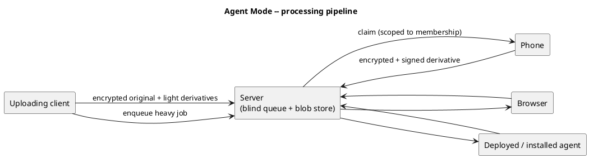

# Agent Mode — Processing Pipeline

> Because the server is **never** able to read content ([Security Model](security-model.md)), it can
> **never** be a processing worker. All media processing (thumbnails, previews, transcoding, ML
> face/semantic embeddings) happens on **clients and trusted agents**. Agent Mode is therefore the **only**
> processing path — core infrastructure, not an optimization.

- **Fast path (synchronous, on the uploading client):** encrypt original; generate the **thumbnail +
  preview** (images) and a **video poster frame**. Upload completes immediately.
- **Slow path (queued):** heavy jobs — **video transcode, ML face/semantic embeddings** — go to a blind
  queue. **Any authorized worker** pulls them: the user's phone, a browser tab, or a deployed/installed
  agent (e.g. on a Mac or home box). Workers decrypt, process, **re-encrypt** and upload the derivative.
  The video transcode is written as **segmented, per-segment-encrypted** renditions (HLS/DASH-style) so
  clients can **stream and seek** without the server seeing plaintext ([AD-28](../decisions/README.md)).
- **A worker is a full-trust device.** It must decrypt to process — there is no
  "process-without-seeing" without enclaves. A deployed agent is simply **another authorized device**
  in the key model (revocable, scopable). The same deployed agent is **multi-role** — it can also take
  journal [snapshots](live-collaboration.md) and (later) perform onboarding key-grants.
- **One model, two worker sets.** Conceptually identical to a non-E2EE pipeline — only the eligible
  worker set differs. With E2EE everywhere, the **server is never eligible**.
- **Edge compute:** keeps the server slim (no transcode/GPU farm) — good for self-hostability **and**
  SaaS margins. Fits the existing capability-discovery (workers advertise `can-h265` / `has-NPU`).

**Job assignment — by participation, not just access.** A worker is offered a job only for memories it
**participates in** — *responsibility ⊆ crypto-access*. In a large tenant you may be able to decrypt a
memory you were never part of, yet you are **not assigned** its jobs; assignment hangs on
[participation](../overview/architecture.md) (People context). Only **user-participants with a
worker-capable device** count (an anonymous / depicted participant runs no worker).

**Scheduling — clients report status; the blind server distributes.** Each client reports its **dynamic
status** (on-power, on-Wi-Fi, idle) and **static capabilities** (`has-NPU`, `can-h265`, `has-LLM`); the
server schedules on this **metadata**, preferring **charging + Wi-Fi + idle** workers so it never drains
a phone or someone's mobile data. Eligibility = participant ∩ has-key ∩ has-capability; preference =
power / Wi-Fi / idle.

**Liveness — tiered, not all-or-nothing.** **Light** derivatives (thumbnail / poster) are produced
**synchronously on the uploading client** — there is *always* something to show. **Heavy** derivatives
(transcode, ML embeddings) are **eventual** via the queue, with a synchronous fallback only on a
*capable* uploader (e.g. a native HW encoder); on a weak client they stay **pending** with clear UX (the
original is already viewable). If no capable, **participating** worker ever appears, the heavy derivative
is simply **not produced** — accepted degradation. ([AD-12](../decisions/README.md).)

**Integrity.** In a shared scope any member-worker can produce a derivative, so derivatives are
**signed with the worker's authorized device key** (Ed25519 → ML-DSA; see [Security Model](security-model.md)),
and the consuming client **verifies** the derivative came from an *authorized participant* — not the
blind server, not an outsider. Moot in an unshared scope.

**Job lifecycle:** enqueue → claim (lease with timeout) → process → upload signed derivative → ack;
re-queue on lease expiry. The server runs this on **metadata only** (it cannot read content). Workers
see only jobs for scopes they can decrypt.
