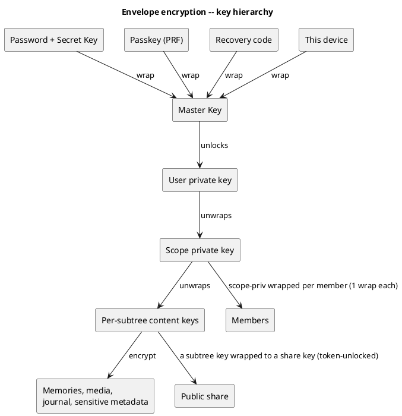
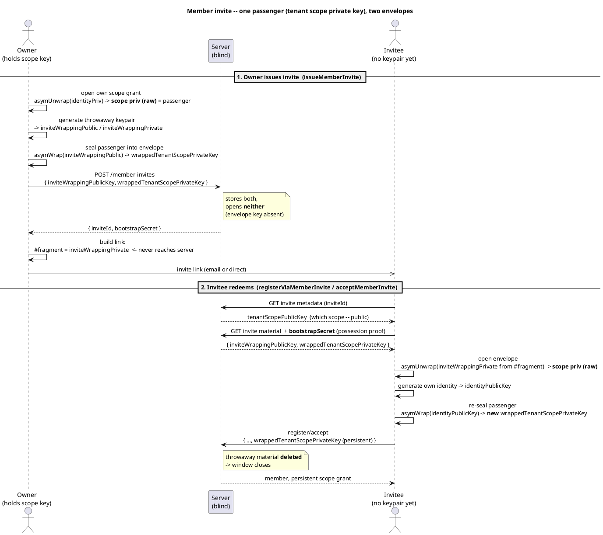

# Security & Encryption Model

> The dominant cross-cutting concept. veyq uses **full end-to-end encryption everywhere** (all
> scopes: personal, group, tenant). The **server is always blind** — it stores ciphertext, metadata
> and an opaque job queue. Every other concept (processing, search, sharing, deletion) is designed
> around this. The paramount invariant lives in [Goals & Quality](../overview/goals-stakeholders-quality.md).
>
> **New to this?** Start with the plain-language companions: [Your privacy, in plain language](privacy-in-plain-language.md)
> (what we can and can't see, sharing, the honest limits) and [Account keys, devices & recovery](account-key-model.md).

> **Implementation status (2026-06) — read this first.** This document is partly target-state. To keep
> intentions from reading as guarantees, claims are tagged **[Built]** (implemented and, for crypto,
> conformance-pinned in [`v1.json`](../../api/crypto-vectors/v1.json)) or **[Roadmap]** (designed, not yet
> built) where it matters.
>
> - **[Built]:** full E2EE / blind store; the envelope key hierarchy; the **post-quantum hybrid KEM
>   (X25519 + ML-KEM-768)**; Argon2id + **Secret Key (2SKD)**; per-scope **blinded dedup & slug tokens**;
>   key recovery (device / Emergency Kit / recovery code); and the **identity fingerprint / safety number**
>   for *manual* out-of-band key verification.
> - **[Roadmap]:** automatic key-pinning / **TOFU**; **Key Transparency**; segmented / streaming media; and
>   the *convergent-encryption* form of shared dedup. Until the first two ship, the **fingerprint is the only
>   active-operator check, and it is manual** — only users who actually compare it are protected. We say so
>   plainly rather than imply automatic protection.

## Threat model & trust boundaries

| We protect against | How |
|---|---|
| Stolen disk / DB dump / subpoena of data at rest | All content E2E-encrypted; server holds no content keys |
| **Passive operator** (reads the DB) | Cannot recover content — every blob/valuable metadata field is encrypted |
| Post-breach offline brute-force → **content** | **Secret Key (2SKD)** — the content KEK folds in the Secret Key, so a cracked password alone unlocks nothing |
| Post-breach offline brute-force → **server login** | Argon2id (m=32768) only — *not* covered by 2SKD; cracking the password yields a server session + operational metadata, **never content** (see *Secret Key (2SKD)*) |
| **Active operator** doing key-substitution during a key-exchange | **Partly.** Today only the **identity fingerprint** (safety number) lets users verify a key out-of-band **[Built]** — *manual*, so it protects only those who compare. Automatic **key-pinning/TOFU** and **Key Transparency** are **[Roadmap]** |

What we do **not** claim: we are not immune to an *actively malicious* operator before Key
Transparency ships — we say so honestly (see [Risks](../overview/risks.md)). In a **self-host**
deployment the operator is the user, so this threat is moot.

## What is encrypted vs. server-visible

The confidentiality boundary, made explicit:

- **Encrypted (server-blind):** media bytes and all derivatives; journal text and embeds; **sensitive
  metadata** — titles, captions, descriptions, places, people/faces, participant-to-Memory
  relationships, tags; track/playlist details.
- **Server-visible (low-sensitivity operational metadata):** existence/IDs of memories, media and
  shares; **scope & membership** (who belongs to which tenant/group); coarse timestamps for ordering
  (`createdAt` / `takenAt`); sizes; MIME type; op-log offsets and update author-ids; presence facts
  (who is online in a room); per-parent **slug tokens** (blinded — see *Names, slugs & E2E permalinks*
  below).

These operational fields are what let the server **sort, paginate, route, authorize and bill** without
decrypting. It is a conscious trade-off; a stricter "encrypt operational metadata too" mode is possible
at the cost of those server-side capabilities. The server **never** sees content — only structure and
operations.

## Names, slugs & E2E permalinks

Folder/Memory/chapter **names are encrypted**, yet the frontend addresses nodes by human-readable
**permalinks** (`/urlaube/italien-2024/tag-1`). Each path segment is a **slug** derived from a node's
name, and because the type isn't visible from the URL, a slug must resolve to exactly **one** child of
its parent — slug uniqueness is a hard functional invariant. The blind server cannot see names to
enforce it.

Resolution: the client submits a **blinded slug token** `HMAC(scopeKey, parentId ‖ slugify(name))`,
and the server enforces `UNIQUE(parentId, slugToken)`. This is:

- **Race-free & hard** — the database rejects a second `ostern` under the same parent, even with two
  clients creating concurrently in a shared scope.
- **Server-blind & brute-force-resistant** — it is a **keyed MAC, not a plain hash**: slugs are
  low-entropy (`ostern`, `italien-2024`) and a plain `SHA(slug)` would be trivially dictionary-reversed
  by the operator. The HMAC key is the `scopeKey`, which the operator lacks, so the token cannot be
  reversed or brute-forced.
- **Zero operator leak** — binding `parentId` into the HMAC makes all sibling tokens distinct by
  construction and incomparable across parents. Within a shared scope members can read the names
  anyway; in the unshared personal scope only the owner can compute tokens.
- **Consistency aid, not a security control** — the token is computed and supplied by the **client**;
  the server cannot recompute it (no key) and does not verify that it matches the displayed name. The
  `UNIQUE` constraint therefore guarantees *consistency*, not authenticity: a malicious member in a
  **shared** scope could submit a token that mismatches its name (a navigation inconsistency) but gains
  nothing — it already has full content access to that scope; in the **unshared** scope only the owner
  computes tokens.

The **permalink path lives client-side** (an SPA routing by ID); the slug never needs to reach the
server. Outbound navigation uses `Referrer-Policy: no-referrer` so a slug never leaks to third parties
via `Referer`. **Rename** recomputes the token and re-checks uniqueness; old permalinks break (a
client-side alias history for 301-style redirects is a later refinement). See [AD-26](../decisions/README.md).

## Key hierarchy (envelope encryption)

- **Two layers, for the right granularity.** Per-subtree **content keys (CK)** encrypt content; a
  per-scope **keypair** sits above them (each CK is wrapped to the scope public key). **Members**
  receive the **scope private key** wrapped to their own public key — *one* wrap per member, granting
  the whole scope. A **share** receives only the *specific* subtree's CK wrapped to a per-share key
  (least privilege), unlocked by the share token.
- **Cheap grants, scoped shares.** Adding a member = **one wrap** (scope-priv) — exactly the "wrap the
  scope key to the new member" of *Key provisioning* below. Sharing = wrap one subtree key to a share.
  **Revoking a member = rotate the scope keypair** (re-wrap to the remaining members; new content under
  rotated keys); already-read content cannot be retroactively revoked (documented limitation).
- The user's private key is protected by the **Master Key**, itself wrapped **separately by each unlock
  method** — **password + Secret Key** (the mandatory floor), an optional **passkey (PRF)**, the
  **recovery code**, and each **trusted device**. Each wrap is a **separate stored blob**; the **KEK**
  that opens it is derived on demand on the client and **never stored server-side**. Adding/removing a
  method changes one wrap, not the content. See *Key recovery* and *Secret Key* below.

## Key inventory and naming

This is the canonical glossary for key names in docs and APIs. Public keys and ciphertext blobs are
server-visible; raw symmetric keys, private keys, Secret Keys, recovery codes and invite fragment
secrets are not. A `wrapped*` field is always ciphertext: the server stores it and returns it, but
cannot open it.

| Name / API field | Kind | Server-visible form | Used for |
|---|---|---|---|
| Account password | Human secret, not a content key | Sent during auth and setup/reset; stored only as `auth_verifier` (`Argon2id` PHC, password-only) | Server session auth. It is also used client-side with the Secret Key to derive the password unlock KEK, but the server-side verifier never unlocks content. |
| Secret Key | High-entropy user-held secret (Emergency Kit / enrolled devices) | Never stored server-side | Combined with the password for two-secret key derivation (2SKD). Protects content unlock after a server DB breach. |
| Master Key | 32-byte symmetric account root key | Only as `MasterKeyWrap.wrappedKey`, one wrap per unlock method (`PASSWORD`, `RECOVERY`, `PASSKEY`, `DEVICE`) | Opens `wrappedIdentityPrivateKey`. Stable across password changes; adding/removing an unlock method replaces only the corresponding wrap. |
| Unlock KEK | Derived in-memory wrapping key | Never stored server-side | Opens one Master Key wrap. Derived from password+Secret Key, recovery code, passkey PRF output or a device key, then discarded. |
| Identity public key (`identityPublicKey`) | Hybrid KEM public bundle plus signing public key | Published in the key directory | Recipient address for scope grants; fingerprint/safety number input; signature verification for key/device changes. |
| Identity private key (`wrappedIdentityPrivateKey`) | Hybrid KEM private bundle plus signing private key | Only wrapped under the Master Key | Opens scope grants wrapped to this user and signs account/key operations. |
| Personal scope keypair (`personalScopePublicKey`, `wrappedPersonalScopePrivateKey`) | `PERSONAL_ROOT` scope keypair | Public key plus private key wrapped to the user's identity | Opens the user's unshared personal scope content key. Usually only self-granted. |
| Tenant scope keypair (`tenantScopePublicKey`, `wrappedTenantScopePrivateKey`) | `TENANT_ROOT` scope keypair | Public key plus one wrapped private-key grant per tenant member | Opens tenant-root content keys and lets owners/members create tenant-scope grants. Tenant-specific registration/owner-claim requests use the `tenant*` prefix so they are not confused with personal keys in the same payload. |
| Group scope keypair (`scopePublicKey`, `wrappedScopePrivateKey` in group APIs) | `GROUP_ROOT` scope keypair | Public key plus one wrapped private-key grant per group member | Opens group content keys. A GroupOwner can add only users who are already active tenant members; group membership does not invite external users into the tenant. |
| Scope content key (`wrappedContentKey`) | Symmetric content key for one scope/subtree | Wrapped to the corresponding scope public key or share key | Encrypts sealed names, Memories, media, journal data and sensitive metadata. Rotated/re-wrapped when access changes require defense in depth. |
| Public share key | Per-share unwrap key derived from the share token/fragment | Server stores only share metadata and wrapped subtree content keys | Grants token-bearer access to the specific shared subtree, not membership in the source scope. |
| Invite wrapping keypair (`inviteWrappingPublicKey`, fragment-only `inviteWrappingPrivateKey`) | One-time onboarding KEM keypair | Only the public half is stored with the pending member invite and returned with invite material | Temporary transport recipient for a member invite. It is not a tenant, group or personal scope key. See *Member invite wrap* below. |
| Tenant scope invite grant (`wrappedTenantScopePrivateKey` in invite material) | `TENANT_ROOT` private-key ciphertext for onboarding | Stored with the pending member invite and returned only after `bootstrapSecret` proof | Temporary ciphertext carrying the tenant scope private key to the invitee. Same field name as the later persistent member grant, but a different recipient. See *Member invite wrap* below. |
| Bootstrap secret (`bootstrapSecret`) | Invite proof secret, not a content key | Server stores/verifies a proof of it | Authorizes reading invite material or claiming/accepting an invite. Possessing an `inviteId` alone is not enough. |
| Recovery master-key tag (`recoveryMasterKeyTag`) | Master-key commitment/tag, not an unlock key | `SHA-256("veyq/v1/recovery-auth" || masterKey)`, base64url | Proves during reset/recovery flows that the client recovered the same Master Key before replacing password auth material. It is not a login token and cannot decrypt anything. |
| Derived blind tokens (`slugToken`, `dedupToken`, upload-capability token) | MAC/proof outputs, not keys | Server-visible tokens or token hashes | Blind uniqueness, deduplication or public-share upload authorization. They are derived client-side from content/share secrets and do not reveal plaintext. |

Naming rules:

- Use `tenantScope*` when a payload can also contain personal-scope material (for example account
  registration and tenant ownership claim).
- Use generic `scopePublicKey` / `wrappedScopePrivateKey` in APIs whose route already fixes the scope
  context, such as group creation, generic scope grants or tenant member grants.
- `wrapped*PrivateKey` means "a private key encrypted to an identity public key or invite wrapping public key";
  `wrappedContentKey` means "a symmetric content key encrypted to a scope/share key".
- `auth_verifier` / `authVerifier` is server credential material only. It is not a key, not a wrap and
  never participates in content unlock.

### Member invite wrap

A member invite has to transfer an existing tenant's scope private key to a person who does not yet
have a veyq identity keypair. That is why it uses a **temporary invite wrapping keypair**. This keypair
is only a transport envelope; it is not the tenant scope keypair.

There are three different keys involved:

| Thing | Where it lives | Purpose |
|---|---|---|
| `tenantScopePublicKey` | Tenant invite metadata; safe to expose | Public half of the existing `TENANT_ROOT` scope keypair. It identifies the tenant scope keypair whose private half is being granted. It does not open the invite wrap. |
| `inviteWrappingPublicKey` | Pending member invite + invite material | Public half of a one-time transport keypair. The owner wraps the tenant scope private key to this key so the blind server can store the ciphertext. |
| `inviteWrappingPrivateKey` | URL fragment only, or encrypted in the fragment in passphrase mode | Private half of the one-time transport keypair. The invitee's browser/app uses it once to open the invite material. It is not an API field because URL fragments are never sent to the server. |

`wrappedTenantScopePrivateKey` always names the **target key**: the tenant scope private key. The field
does not say who can open it; the endpoint context does:

| Flow step | Field | Opened by | Lifetime |
|---|---|---|---|
| Owner issues member invite | `wrappedTenantScopePrivateKey` in `IssueMemberInviteRequest` / `TenantInviteMaterial` | `inviteWrappingPrivateKey` from the invite link fragment | Temporary; consumed with the invite |
| Invitee registers or accepts | `wrappedTenantScopePrivateKey` in registration / accept request | Invitee `identityPrivateKey` | Persistent tenant member grant |

So the member invite flow is:

1. Existing owner locally unwraps the raw tenant scope private key from their own grant.
2. Owner client generates `inviteWrappingPublicKey` / `inviteWrappingPrivateKey`.
3. Owner client posts `inviteWrappingPublicKey` and `wrappedTenantScopePrivateKey` encrypted to that
   invite wrapping public key. The server stores both but can open neither the ciphertext nor the
   fragment-only private key.
4. Invitee opens the link. The server sees only `inviteId` and later `bootstrapSecret`; it never sees
   `inviteWrappingPrivateKey`.
5. Invitee client fetches invite material, opens `wrappedTenantScopePrivateKey` with
   `inviteWrappingPrivateKey`, then immediately re-wraps the same tenant scope private key to the
   invitee's new `identityPublicKey`.
6. Registration / accept posts the new persistent `wrappedTenantScopePrivateKey`; the temporary invite
   material is consumed.

**Mental model: one passenger, two envelopes.** The whole flow delivers exactly **one** secret — the
raw **tenant scope private key** (the *passenger*) — from the owner to someone who has **no identity
keypair yet**. A throwaway *invite wrapping keypair* is the envelope in between. `wrappedTenantScopePrivateKey`
names the **same passenger at two stages**: at issue it is sealed to `inviteWrappingPublicKey`; at the
persistent grant it is sealed to the invitee's `identityPublicKey`. Same field name, different recipient —
the invitee simply opens the throwaway envelope and re-seals into its own. The `bootstrapSecret` is **not a
key**: it only gates the material fetch. The server is blind at both ends — it never holds the
`inviteWrappingPrivateKey` (URL-fragment only).

## Cryptographic primitives, agility & post-quantum

The envelope above uses **standard, well-reviewed primitives** — no home-grown crypto:

| Layer | Primitive |
|---|---|
| **Content** (media, journal, sensitive metadata) | symmetric **AES-256-GCM** (or XChaCha20-Poly1305) — already quantum-resistant |
| **Key wrapping** (content/scope key → members & shares) | **HPKE-style multi-recipient**: the content key is wrapped *per recipient* (N small wraps), with a **hybrid KEM — X25519 + ML-KEM-768** |
| **Password → key** | **Argon2id** KDF over **password + Secret Key (2SKD)** |
| **Signatures** (key transparency, derivative signing, device keys) | **Ed25519** now → **ML-DSA** (hybrid) phased in later |

**Multi-recipient = N wraps** of one content key, not a single ciphertext for many keys — exactly what
`age` / PGP / JWE / HPKE do internally. Exotic broadcast / attribute-based schemes are **not** used
(heavier, less mature, more risk).

**Post-quantum from the start (key wraps). [Built]** Memories are long-lived (decades), so
**harvest-now-decrypt-later** is a real threat. Keys are therefore wrapped with a **hybrid KEM (X25519 +
ML-KEM-768)** from v1 — implemented and conformance-pinned in all three client stacks (web `@noble/post-quantum`,
iOS CryptoKit `MLKEM768`, Android BouncyCastle) — secure if *either* component holds (PQC schemes are young, so we hedge — like
Signal PQXDH / Apple PQ3 / TLS 1.3). Symmetric content needs no change (AES-256). Signatures are less
HNDL-urgent and move to hybrid **ML-DSA** later.

**Crypto-agility (non-negotiable).** Every wrapped key and encrypted artifact carries a **versioned
crypto-suite id**, negotiated via [capability discovery](platform-concepts.md) (`crypto.*`). New
artifacts use the current suite; old artifacts stay readable via their stored suite id. Algorithms roll
forward (stronger PQC, new KDFs) **without breaking the model** — which is exactly why PQC can be adopted
now and upgraded later.

> Cost: ML-KEM keys/ciphertexts are ~1 KB (vs ~32 B for X25519) → N member-wraps are N×~1 KB, fine for
> the small groups veyq targets. Decision: [AD-25](../decisions/README.md).
>
> The exact byte formats (suite `v1`, the KEM combiner, wrap layouts) live in the
> [Crypto Wire-Format Spec](crypto-spec.md) — the contract every client stack implements identically.

## Streaming & segmented media — [Roadmap]

> **Not yet built — slated for the agent pipeline/queue.** Today a video is a single encrypted blob plus
> client-generated derivative blobs (thumbnail/preview); there is no segmented streaming rendition. The design
> below is the target. Note the blind server **cannot** transcode (it holds only ciphertext) —
> segmentation/transcoding happens on the **client** (or a user-side agent) at upload, on plaintext, and each
> segment is encrypted before upload (the original stays one blob).

A large video cannot be served as one AES-GCM blob — seeking would need the whole file and its tag.
Instead the **transcode derivative is segmented** (HLS/DASH-style: short segments, optionally several
bitrates) and **each segment is encrypted independently** (AES-256-GCM, nonce derived from the segment
index; key = the derivative/content key). The manifest is encrypted metadata.

The client requests segments over HTTP **ranges**; the **server serves ciphertext** and holds no keys.
Each segment is **decrypted in memory** and fed to the player — web via **Media Source Extensions**, iOS
via `AVAssetResourceLoaderDelegate`, Android via a local decrypting data source. Because segments are
independent, **seek and adaptive bitrate** need only the targeted segment. This is deliberately **not**
browser EME/DRM (which needs a CDM/license server and would break the blind server and self-hosting).
The **original** stays a single encrypted blob (download-only); only the streamable rendition is
segmented. See [AD-28](../decisions/README.md).

## Central axis: shared vs. unshared (not scope)

The deciding property for risk and deduplication is **whether content is shared**, not which scope
folder it lives in. A personal Memory that is publicly shared becomes "shared" for these purposes.

| State | Meaning |
|---|---|
| **Unshared** | Only the owner's keys. Maximum confidentiality; the paramount invariant applies in full. |
| **Shared** (group, tenant, public view, public uploader) | Content keys wrapped to other parties **by the owner's explicit, informed action**. Confidentiality from the *operator* still holds; from the *recipients* it is intentionally given up. |

## Shares & share-boundary Trust & Safety

- A **public share** wraps the subtree's content keys to a per-share key. The **share token is
  carried in the URL fragment (`#…`)** so it **never reaches the backend**. Anyone with the link can
  decrypt the shared subtree client-side.
- **Trust & Safety operates at the share boundary.** On an abuse report (which includes the full
  share URL, hence the token), the **operator can decrypt that reported share** to verify, quarantine,
  preserve evidence and report. The same **abuse-report intake** serves GDPR takedown requests.
- **CSAM / illegal content is partitioned:** *private (unshared)* content is **unscannable** (the
  server cannot see it — a deliberate posture, see [Risks](../overview/risks.md)); *public shares* are
  decryptable-on-report, so notice-and-takedown works exactly where content is distributed.

## Key recovery

**No escrow** — but a memories product must not turn "forgot password" into permanent loss. There are
three independent ways back in:

1. **Another enrolled device** — it still holds the keys; re-enroll from there.
2. **Emergency Kit (Secret Key) + master password** — sign in on a fresh device.
3. **Recovery code** — a **high-entropy, system-generated** code that **independently unwraps the
   user's private key** (the only path that survives a forgotten password with no device). It is a
   *standalone* bypass of both password and Secret Key, so it must be stored safely and is
   **single-use**: redeeming it **invalidates it and generates a new one** the user must save (a used
   code may have been exposed). After recovery the user sets a **new password and a new Secret Key**
   (a fresh Emergency Kit); the master key itself is unchanged, so all content stays intact.

Only losing **all** paths (no device, no Emergency Kit, no recovery code, no password) is
unrecoverable — the documented, accepted residual loss. A recovery-group/escrow tier is explicitly
**not** offered.

## Key-directory trust (the active-operator problem)

Wrapping a content key to "Bob" requires Bob's public key from the server's key directory. A
malicious server could serve an attacker's key instead (key-substitution / MITM) and gain access to
**future** wraps.

- **Built now — manual only:** the **identity fingerprint / safety number** (a deterministic digest of a
  contact's full identity public key: hybrid KEM + signing, suite v1, conformance-pinned). Two users compare
  it out-of-band (read aloud / QR); a mismatch reveals a substituted key. It is the building block — but it
  is **manual**, so it protects only users who actually compare. See [account-key-model](account-key-model.md).
- **[Roadmap] — automatic key-pinning / TOFU:** clients remember a contact's key and **warn on change**,
  without anyone having to compare a number. This is the automation the fingerprint enables; **it is not yet
  built**, so until it ships there is no automatic warning on a key change.
- **[Roadmap] — Key Transparency (core hardening):** an append-only, verifiable key log so the server cannot
  equivocate undetectably. With E2EE everywhere and pervasive sharing, this is core, not optional.
- **The first-use gap (stated honestly):** even once TOFU ships, it only catches a key that *changes*. If the operator
  substitutes Bob's key **before** Alice ever saw the real one — and then **re-wraps the content to
  Bob's genuine key too** — Bob keeps normal access and *nothing looks wrong*, while the operator
  silently holds a copy. There is **no functional symptom** to notice (a removed user *would* notice;
  this attacker does not remove anyone). Only Key Transparency (or out-of-band **manual verification**)
  makes the substitution itself detectable.
- **Trust anchors live client-side:** a client uses its **own locally-held** identity public key for
  verification/signing (never the server's copy) — the server distributes keys but is never the trust anchor.
  **Manual verification** (Signal-style fingerprints) is **[Built]** (the safety number above); a local
  **pinned-contact-key store** that warns on change is **[Roadmap]** (see [design notes](../design-notes.md)).

## Key provisioning & onboarding

A new member has no keypair yet, so a scope's content key cannot be wrapped to them in advance.
Bootstrapping access is **always an explicit, informed act by the granting owner** (the only way
confidentiality is lowered). Three shapes:

**1. Single-use bootstrap — the default (email invite *and* self-serve link are the same thing).**
The inviter (who holds the tenant scope private key) creates a **single-use invite wrapping keypair**.
The public half is posted as `inviteWrappingPublicKey`; the tenant scope private key is wrapped to it
as `wrappedTenantScopePrivateKey`. The invite wrapping private key lives **only in the link's URL
fragment** (or in equivalent out-of-band client-held material), never server-side → the **operator
stays blind**. A separate `bootstrapSecret` proves possession of the invite before the server returns
the invite-wrapped material, but it is not a content key. On registration the new user generates their
identity and personal scope keys, uses the invite wrapping private key to unwrap the tenant scope
private key, **re-wraps it to their own identity public key** as `wrappedTenantScopePrivateKey` in the
registration payload, and the invite wrapping material is **deleted**
→ the window closes. Bounded: single-use, short **TTL**, revocable. Delivery is just a detail — the
system can **email** the link (owner sets the address) or the owner shares the link and the
**recipient sets their own email** at registration. A **batch** of these is N independent single-use
links (each its own invite wrapping keypair and bootstrap secret), operator-blind, each window closing
on use. See *Member invite wrap* above for the exact key roles.

**2. Shared public link — convenience, riskier, explicit opt-in.**
One token (in the fragment) usable by up to **X registrants**. The secret is **shared**, so anyone with
the link can read the scope key during the window — the X-count limits **registrations/spam, not
confidentiality**. Requires the **TenantOwner to explicitly confirm the risk**. Bounded by **TTL** (the
real confidentiality control), max-uses, revocable, and **scope-key rotation on close** (token-bearers
can read only content from the window; new content is under a fresh key). *Server-allocated per-slot
tokens are not used — they would make the operator non-blind; the secret must stay in the fragment.*

**3. Grant path — the private alternative (later hardening).**
The link carries **no key**: registration creates a **pending** member; an existing member / owner / a
**trusted agent** wraps the scope key to the new public key **on approval**. No key in any channel, and
approval doubles as the identity / anti-key-substitution check. v1 = manual approval; later automated
via a **user-side** agent (an operator-side auto-granter would break E2E). Use for scopes you don't
want exposed via a link.

> **Registration ≠ share.** These admit a person to a scope (membership). If you instead want anyone
> with a link to read specific content without an account, that is a **public share** (token-bearer
> access), not onboarding.

## Revocation (shares & members)

Revoking access is **two-layered**, so it is effective **even if no key-holder is online**:

1. **Server-side token/access invalidation — instant, no keys.** The server stops honouring the revoked
   share token / membership (deletes or disables the record) → it serves **no further blobs** to the
   revoked party. This is *access control*, not crypto — the server is allowed to do it (it reads no
   content). Effective immediately, **no client/agent required**.
2. **Content-key rotation — eventual, by a key-holder.** A client/agent rotates the (sub)content key and
   re-wraps it to the remaining parties — **defense-in-depth** for the case where the revoked party
   cached ciphertext and still holds the old key. May be **queued** until a key-holder is next online;
   not a hole, because layer 1 already blocks fetching new content.

**Inherent limit (honest):** content the revoked party **already downloaded and decrypted** cannot be
retracted — like member removal. Rotation protects only *future* content.

For an **embedded foreign share**, the **source's** server performs layer 1 (token refusal) → the
embedded content becomes inaccessible immediately, independent of crypto rotation.

## Secret Key (2SKD)

A 1Password-style high-entropy **Secret Key** is combined with the master password (two-secret key
derivation) to unlock the account. It is the **"something you have"** factor — present on each enrolled
device and in the Emergency Kit — and it **hardens a weak password against offline brute-force after a
DB breach** (the realistic threat). It is **not** a recovery mechanism by itself: signing in needs
password *and* Secret Key; recovery is the separate mechanism above. It does **not** address active
key-substitution (that is Key Transparency). Decision: [AD-08](../decisions/README.md).

**Scope of the 2SKD guarantee — content, not the server login factor.** The Secret Key folds into the
*content* key-derivation (`KEK = Argon2id(secretKey ‖ password)`), so after a DB dump an attacker who
brute-forces a weak password still cannot derive any content key — they would also need the Secret Key,
which the server never stores. The **server-side login verifier is a separate, password-only Argon2id
proof** (`Argon2Verifier`, m=32768): it gates a *session* and the *server role*, and a DB dump therefore
*does* permit offline brute-force of the **login** password. What that buys the attacker is bounded — a
server session plus the low-sensitivity operational metadata above — and **never content**, which stays
sealed behind the Secret Key. This is a deliberate trade-off: keeping login a plain password proof
preserves a simple, operator-blind sign-in (the server never sees the Secret Key) and means password
*reset* can be email-gated without weakening content secrecy. The Argon2id cost (m=32768, t=3) is what
makes the login-password brute-force expensive; raising it is the lever if the threat model tightens.
Hardening this further (e.g. also binding the Secret Key into the verifier) is a **deliberate non-goal**, not
a deferred item: it would trade usability and cross-stack complexity for a *bounded* exposure — the login
password, which never unlocks content (the Secret Key does) — and in a self-host deployment the operator is
the user, so it is moot. The lever, if the threat model ever tightens, is the Argon2id cost, not a protocol
change.

> **[Built] Public-share upload proof:** public-share *upload* (CONTRIBUTOR/UPLOADER) requires the
> `shareId` plus a blind upload-capability token. The client derives the token from the share unwrap key
> (including the password fold for password-protected shares); the server stores only `SHA-256(token)` and
> verifies the raw token on guest upload/progress/complete/attach requests. Possessing `shareId` alone can
> no longer append sealed junk. Per-share upload rate-limiting + byte quotas remain as abuse controls.

## Deduplication under E2EE

Random-key encryption makes identical files produce different ciphertext, so naive server-side dedup
is impossible. Strategy is **shared-state-based**:

| Content | Dedup strategy |
|---|---|
| **Unshared** | **Client source-dedup** (the client skips re-uploading its own duplicates; the plaintext hash **never leaves the client**). |
| **Shared** | **Convergent encryption + a per-scope secret**: the blob is encrypted with a key derived from `hash(content + scope-secret)`, so identical plaintext among members yields identical ciphertext and the server can dedup on ciphertext equality — **without** computing the key (the secret is client-held, so the operator cannot run a confirmation-of-file attack). |

> **As-built [Built] vs. the table.** Today **both** rows are served by **one** simpler mechanism: a per-scope
> **blinded dedup token** `token = HMAC(HKDF(scopeContentKey,"veyq/v1/media-dedup"), SHA256(content))`
> (`dedupToken`, conformance-pinned). Members share the scope content key, so identical bytes produce an
> identical token and the blind server dedups on the token — never seeing content or the key, and unable to
> compute tokens itself (so no confirmation-of-file attack). This already achieves shared dedup, so the
> **convergent-encryption** construction described in the Shared row is an alternative design kept as
> **[Roadmap]** and is not currently needed.

The classic weakness of convergent encryption (confirming you hold a known file) is **moot in a
shared scope**, because members already see all shared content. Residual leaks are small: the server
learns blob-equality among collaborators; an ex-member who kept the secret can test *existence* of
new files but cannot decrypt them. **Construction (churn-safe):** the convergent key encrypts the
blob; that key is itself wrapped under the rotatable scope key, so membership changes rotate access
**without** re-encrypting the deduped blobs (reconciles with reference-counted blob storage, legacy
ADR 0007).

## Deletion & Erasure

A single mechanism serves data-loss protection **and** GDPR erasure:

- **Soft-delete → trash → retention window → scheduled hard-purge**, propagated to **backups** within
  a documented rotation window.
- A **deletion privilege** (not "everyone with access can delete") — **supersedes the flat permission
  model** of legacy ADR 0005.
- **Blob-level purge** for tenant-wide erasure of a specific item across all references.
- A **deletion audit** for accountability (without retaining the erased personal data).
- **Own-account erasure** is covered by legacy ADR 0017 (anonymize identity, keep scope-owned
  content). A *depicted person's* removal request is a content-level flow routed via the
  share-boundary intake.
