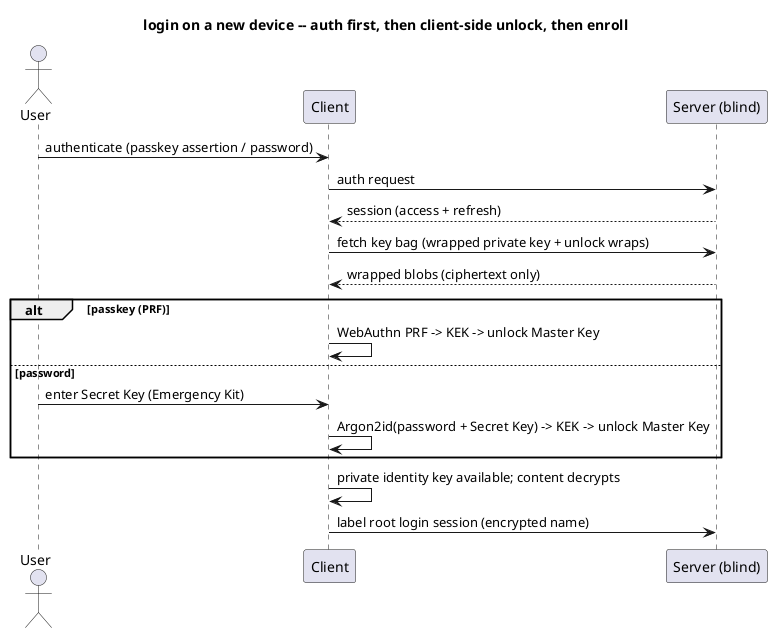

# UC: Log in and unlock

- **ID:** uc.account.login
- **Primary actor:** Memory Curator
- **Goal:** Authenticate to obtain a session **and** unlock the local key material for content access.
- **Preconditions:** Has an account (public key in the directory, wrapped key bag on the server). On a
  new device: holds the Emergency Kit (Secret Key) for the password path, **or** a PRF-capable passkey.
- **Postconditions (success):** A session exists; the **Master Key** is unlocked on the device (private
  identity key available); the login is associated with a named device identifier so the user can later
  invalidate that device's sessions; content is decryptable.

## Diagram

## Main flow
1. The user opens the app and enters email, password and the **Secret Key** from the Emergency Kit.
2. If the browser has a remembered Secret Key, the client pre-fills email + Secret Key; the password is
   still entered by the user.
3. The server verifies the password and issues a **short-lived access session** plus a rotatable
   HttpOnly refresh session.
4. The client unlocks the Master Key locally with `Argon2id(password + Secret Key)`.
5. The client derives a best-effort browser/device label locally, stores it as client-encrypted
   metadata on the root login-session family, then decrypts content with the private identity key.

## Alternate / exception flows
- A1 — **New device, passkey:** after auth, WebAuthn **PRF** derives the KEK → unlocks the Master Key
  (from the fetched key bag); the device is then **enrolled** (a device wrap is added). No Secret Key.
- A2 — **New device, password:** after password auth, the user enters the **Secret Key**
  (Emergency Kit); `Argon2id(password + Secret Key)` → KEK → unlocks the Master Key; the device is
  **enrolled**.
- A3 — **New device, device-to-device:** an existing trusted device approves the new one and wraps the
  Master Key to it (like linking a messenger app) — **no Secret Key or password-unlock needed**.
- A4 — **Logout:** the current access/refresh token family is dropped; remembered email + Secret Key
  stay local only if the user chose that option.
- A4b — **Access refresh:** when the access session expires but the refresh session is still valid, the
  client rotates the refresh cookie and receives a new access `sessionToken`; the server appends a
  child session row under the same root and revokes the previous row as `ROTATED`.
- A4c — **Expired session cleanup:** expired/revoked session rows are retained briefly for audit and
  then swept by the scheduled job; still-valid sessions remain usable.
- A5 — **Revoke login session** (e.g. lost browser/app login): the user removes a login session
  (`uc.account.manage-login-sessions`), revoking all rows in that root session family.
  If that browser also stored email + Secret Key locally, it still cannot silently re-authenticate
  without the password.
- E1 — **Authenticated but locked:** auth succeeds but unlock fails (wrong Secret Key, no PRF) → the UI
  shows a **locked** state and routes to unlock retry or **recovery** (`uc.account.recover-keys`); the
  session alone grants **no** content access.
- E2 — **Auth fails** (bad password/assertion, rate-limited) → rejected; no session.

## Quality notes
- *Auth ≠ unlock:* the **session** proves identity to the server; the **Master Key** unlocks content
  client-side. The server can authenticate a user it can never grant content access to — it holds no keys.
- *New-device requirements:* password ⇒ **password + Secret Key**; passkey ⇒ **PRF**. Authentication
  alone is insufficient without a local unlock path.
- *Remembered login:* remembering login stores email + Secret Key and local unlock material, but never
  the password. Repeat visits can restore the unlocked client state only while the server-side refresh
  session is still valid.
- *Revocation:* removing a login session revokes that root session family. Unlock-wrap removal and key
  rotation are handled by the Keys feature ([AD-24](../../../decisions/README.md)).
- *Operator-blind:* the server stores the auth verifier, the session and the wrapped key bag — never the
  Master Key or the Secret Key.

## Related
- Feature: [Account & Auth](../_index.md) · Actors: [Memory Curator](../../../actors.md)
- Concepts: [Security Model](../../../crosscutting/security-model.md) (key hierarchy, Secret Key,
  recovery, revocation), [Platform Concepts](../../../crosscutting/platform-concepts.md) (auth & sessions)
- Decisions: [AD-02](../../../decisions/README.md) (E2EE), [AD-08](../../../decisions/README.md) (Secret Key), [AD-06](../../../decisions/README.md) (recovery/multi-device), [AD-24](../../../decisions/README.md) (revocation), [AD-23](../../../decisions/README.md) (capability/PRF)
- Related use-cases: `uc.account.register-via-invitation`, `uc.account.recover-keys`, `uc.account.manage-login-sessions`
