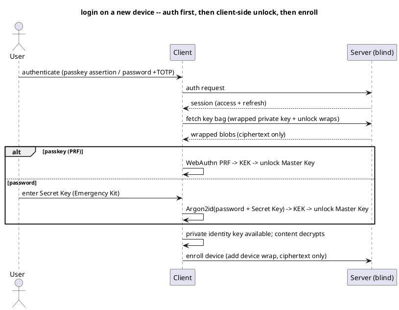

# UC: Log in and unlock

- **ID:** uc.account.login
- **Primary actor:** Memory Curator
- **Goal:** Authenticate to obtain a session **and** unlock the local key material for content access.
- **Preconditions:** Has an account (public key in the directory, wrapped key bag on the server). On a
  new device: holds the Emergency Kit (Secret Key) for the password path, **or** a PRF-capable passkey.
- **Postconditions (success):** A session (access/refresh) exists; the **Master Key** is unlocked on the
  device (private identity key available); a new device is **enrolled** with a device wrap; content is
  decryptable.

## Diagram

## Main flow (trusted device)
1. The user opens the app on a **trusted (enrolled)** device.
2. The user authenticates — passkey assertion, or password (+TOTP if enabled) — and the server issues a
   **session**.
3. The client unlocks the Master Key locally via the **device wrap** (OS keystore, gated by
   biometric/device unlock) — no Secret Key needed.
4. The private identity key is available; content decrypts.

## Alternate / exception flows
- A1 — **New device, passkey:** after auth, WebAuthn **PRF** derives the KEK → unlocks the Master Key
  (from the fetched key bag); the device is then **enrolled** (a device wrap is added). No Secret Key.
- A2 — **New device, password:** after password (+TOTP) auth, the user enters the **Secret Key**
  (Emergency Kit); `Argon2id(password + Secret Key)` → KEK → unlocks the Master Key; the device is
  **enrolled**.
- A3 — **New device, device-to-device:** an existing trusted device approves the new one and wraps the
  Master Key to it (like linking a messenger app) — **no Secret Key or password-unlock needed**.
- A4 — **Logout:** the session is dropped; the device **stays trusted** (the device wrap is retained).
- A5 — **Deauthorize device** (e.g. lost device): the device wrap is removed → the device forgets the
  keys; ties into two-layer revocation ([AD-24](../../../decisions/README.md)).
- E1 — **Authenticated but locked:** auth succeeds but unlock fails (wrong Secret Key, no PRF) → the UI
  shows a **locked** state and routes to unlock retry or **recovery** (`uc.account.recover-keys`); the
  session alone grants **no** content access.
- E2 — **Auth fails** (bad password/assertion, rate-limited) → rejected; no session.

## Quality notes
- *Auth ≠ unlock:* the **session** proves identity to the server; the **Master Key** unlocks content
  client-side. The server can authenticate a user it can never grant content access to — it holds no keys.
- *New-device requirements:* password ⇒ **password + Secret Key**; passkey ⇒ **PRF**. TOTP is a
  password-auth second factor only ([AD-18](../../../decisions/README.md)), independent of the keys.
- *Trusted device:* the device wrap (OS keystore + biometric) makes repeat logins seamless without
  re-entering the Secret Key.
- *Revocation:* deauthorizing a device removes its wrap — instant server-side token invalidation +
  eventual key rotation ([AD-24](../../../decisions/README.md)).
- *Operator-blind:* the server stores the auth verifier, the session and the wrapped key bag — never the
  Master Key or the Secret Key.

## Related
- Feature: [Account & Auth](../_index.md) · Actors: [Memory Curator](../../../actors.md)
- Concepts: [Security Model](../../../crosscutting/security-model.md) (key hierarchy, Secret Key,
  recovery, revocation), [Platform Concepts](../../../crosscutting/platform-concepts.md) (auth & sessions)
- Decisions: [AD-02](../../../decisions/README.md) (E2EE), [AD-08](../../../decisions/README.md) (Secret Key), [AD-06](../../../decisions/README.md) (recovery/multi-device), [AD-24](../../../decisions/README.md) (revocation), [AD-18](../../../decisions/README.md) (TOTP), [AD-23](../../../decisions/README.md) (capability/PRF)
- Related use-cases: `uc.account.register-via-invitation`, `uc.account.recover-keys`
