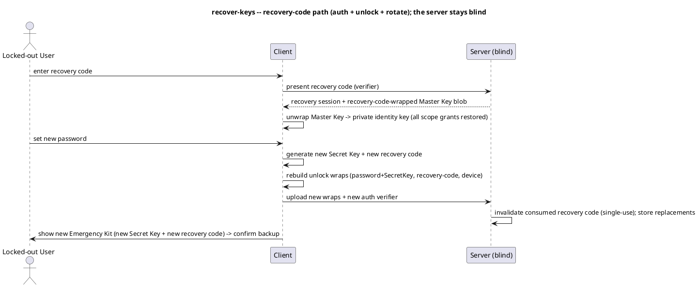

# UC: Recover key access

- **ID:** uc.account.recover-keys
- **Primary actor:** Memory Curator
- **Goal:** Regain access to the Master Key (and thus all content) after losing a device, password or
  Secret Key — without escrow.
- **Preconditions:** Holds at least one surviving path — another trusted device, the Emergency Kit
  (Secret Key + remembered password), or the single-use recovery code.
- **Postconditions (success):** The Master Key / private identity key is recovered → **all scope access
  restored**; on the recovery-code path a **new Secret Key + new recovery code + new password** are set
  (a fresh Emergency Kit) while the Master Key itself is unchanged; the consumed recovery code is
  invalidated.

## Diagram

## Main flow (recovery code — the standalone "lost everything else" path)
1. The locked-out user enters the **recovery code**; the server verifies it, grants a **recovery
   session** and serves the recovery-code-wrapped key blob (it stays blind to the code's secret).
2. The client uses the recovery code to **unwrap the Master Key** → the private identity key is
   recovered → **all scope grants restore automatically** (they are wrapped to the identity public key,
   not the password).
3. The client generates a **new Secret Key** and prompts for a **new password**, recomputing the
   password unlock wrap (`Argon2id(new password + new Secret Key)`), and re-adds passkey/device wraps as
   chosen.
4. The client generates a **new recovery code** and wraps the Master Key under it.
5. The client uploads the new wraps + new auth verifier; the server **invalidates the consumed recovery
   code** (single-use) and stores the replacements.
6. A new **Emergency Kit** (new Secret Key + new recovery code) is shown with **forced backup
   confirmation**; the device is enrolled.

## Alternate / exception flows
- A1 — **Another trusted device:** a surviving enrolled device re-establishes access — it enrolls the
  new device (adds a device wrap) and can reset the password; no secrets re-typed.
- A2 — **Emergency Kit (Secret Key + password):** identical to new-device password login
  ([login](uc.account.login.md) A2) — unlock with password + Secret Key; nothing is rotated unless the
  user chooses to.
- E1 — **Recovery code wrong / already consumed / rate-limited** → rejected; no recovery session.
- E2 — **All paths lost** (no device, no Secret Key + password, no recovery code) → **unrecoverable**:
  content is permanently lost (no escrow, by design).

## Quality notes
- *Identity-key-centric:* recovery restores only the **identity private key**; because every scope key
  is wrapped to the **identity public key**, restoring it restores **all** scope access — there is no
  per-scope recovery, and none is needed.
- *Recovery code = auth + unlock:* it both grants a recovery session and unwraps the Master Key, so a
  fully locked-out user can still get in. It is **single-use** — redeeming it invalidates it and issues
  a new one (must be re-backed-up).
- *Fresh Emergency Kit (recovery-code path):* recovery issues a **new Secret Key + new recovery code**
  and a new password; the **Master Key (and content) is unchanged** — only its unlock wraps are rebuilt.
- *Consequence for the legacy flow:* an email "forgot password" alone is **insufficient** under E2EE —
  it resets only the auth verifier ("authenticated but locked") and cannot unlock keys; the recovery
  code is the canonical forgot-password path.
- *No escrow:* losing every path is total loss — the deliberate trade-off for operator-blindness.

## Related
- Feature: [Account & Auth](../_index.md) · Actors: [Memory Curator](../../../actors.md)
- Concepts: [Security Model](../../../crosscutting/security-model.md) (key recovery, Secret Key, key
  hierarchy), [Platform Concepts](../../../crosscutting/platform-concepts.md) (auth & sessions)
- Decisions: [AD-06](../../../decisions/README.md) (recovery), [AD-08](../../../decisions/README.md) (Secret Key), [AD-02](../../../decisions/README.md) (E2EE), [AD-24](../../../decisions/README.md) (revocation), [AD-25](../../../decisions/README.md) (crypto)
- Related use-cases: `uc.account.login`, `uc.account.register-via-invitation`
