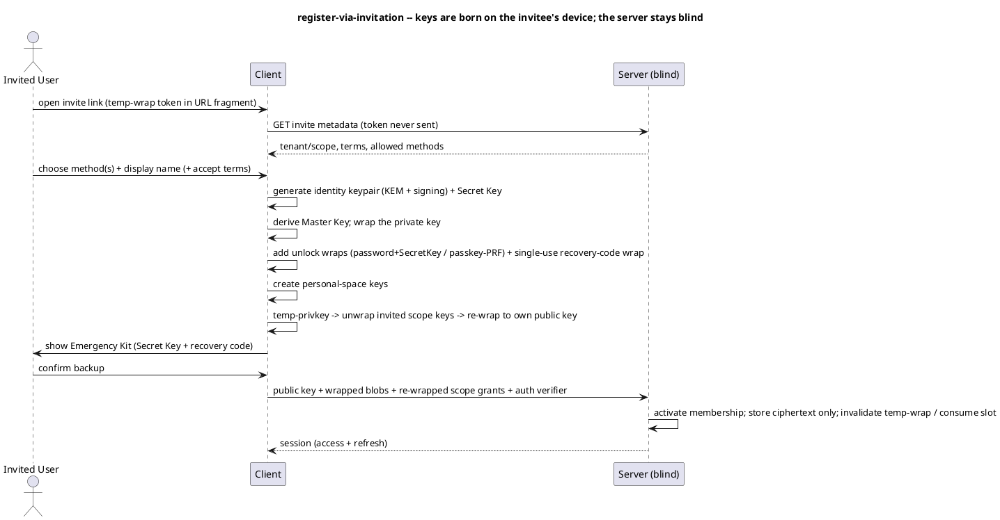

# UC: Register via an invitation

- **ID:** uc.account.register-via-invitation
- **Primary actor:** Invited User
- **Secondary actor:** Tenant Owner
- **Goal:** Accept an invitation, create a **cryptographic** account, and gain E2EE access to the
  invited scope.
- **Preconditions:** Holds a valid invite link (targeted or self-serve) carrying a **temp-wrap token in
  the URL fragment**; the invite is not expired/revoked and has slots left.
- **Postconditions (success):** A new account exists with the user's **public key** in the key
  directory; the **private key** is wrapped under a **Master Key** with at least one unlock method; the
  **personal-space** keys exist; the invited **scope keys** are re-wrapped to the user; the **Emergency
  Kit** (Secret Key + recovery code) was shown and its backup confirmed; a session is established; the
  temp-wrap is invalidated.

## Diagram

## Main flow
1. The invitee opens the invite link; the client reads the **temp-wrap token from the URL fragment**
   (never sent to the server) and fetches **public invite metadata** (tenant/scope name, terms, allowed
   auth methods).
2. The invitee picks auth method(s), a display name and — for a self-serve link — their own email, and
   accepts terms if required.
3. The client **generates the identity keypair** (hybrid KEM X25519 + ML-KEM-768, signing Ed25519 →
   ML-DSA) and a **Secret Key**, derives the **Master Key**, and **wraps the private key** under it.
4. The client adds an **unlock wrap** of the Master Key per chosen method — **password + Secret Key**
   (Argon2id) and/or **passkey (WebAuthn PRF)** — plus a single-use **recovery-code** wrap.
5. The client creates the user's **personal-space** keys (self-owned, no grant needed); then uses the
   **temp private key** to unwrap the invited **scope private key(s)** and **re-wraps** them to the
   user's own public key.
6. The client shows the **Emergency Kit** (Secret Key + recovery code) and requires **explicit backup
   confirmation** before finalizing.
7. The client uploads the **public key**, the wrapped private key + unlock wraps, the **re-wrapped scope
   grants** and the auth verifier/passkey credential. The server **activates membership**, stores only
   ciphertext + public material, and **invalidates the temp-wrap** (consumes the slot).
8. A **session** (access + refresh tokens) is established.

## Alternate / exception flows
- A1: **Self-serve link** → one shared temp key for X slots; success **consumes a slot**; TTL and
  rotate-on-close apply (riskier — see [AD-21](../../../decisions/README.md)).
- A2: **Targeted email invite** → a per-invitee temp key, consumed once.
- A3: **Passkey without PRF** → the authenticator cannot protect the Master Key → the client **requires
  an additional password + Secret Key** (the mandatory Master-Key-capable method).
- E1: Invite **expired/revoked or no slots left** → rejected at the metadata step.
- E2: The invitee **declines to confirm the Emergency Kit backup** → registration is **not finalized**
  (nothing is uploaded; no orphaned half-account).

## Quality notes
- *Operator-blind (paramount):* the temp token and every secret stay **client-side**; the server stores
  only the public key, ciphertext and an auth verifier — never a key.
- *One Master Key, many unlock paths:* adding/removing a method (password, passkey, recovery code,
  another device) adds/removes a **wrap** — **no content re-encryption**.
- *Mandatory capable method:* password + Secret Key is always Master-Key-capable; a passkey only **with
  PRF** ([AD-23](../../../decisions/README.md) capability-driven).
- *Durability / no escrow:* the Emergency Kit backup is **enforced** ([AD-06](../../../decisions/README.md)); losing **all** paths = data loss.
- *Crypto-agility:* a **versioned suite id** governs all primitives ([AD-25](../../../decisions/README.md)).
- *Key-directory trust:* the user's **public key** enters the server's key directory; others wrapping
  scope keys to it rely on **TOFU/pinning now, Key Transparency later** ([AD-07](../../../decisions/README.md)).
- *Consequence:* the legacy "owner pre-creates the user account" pattern does **not** apply — the
  identity is born on the invitee's device; the invite conveys only membership authorization + the
  temp-wrap of scope keys.

## Related
- Feature: [Account & Auth](../_index.md) · Actors: [Invited User](../../../actors.md), [Tenant Owner](../../../actors.md)
- Concepts: [Security Model](../../../crosscutting/security-model.md) (key hierarchy, onboarding,
  recovery, crypto primitives), [Platform Concepts](../../../crosscutting/platform-concepts.md) (auth & sessions)
- Decisions: [AD-02](../../../decisions/README.md) (E2EE), [AD-21](../../../decisions/README.md) (onboarding temp-wrap), [AD-08](../../../decisions/README.md) (Secret Key), [AD-06](../../../decisions/README.md) (recovery), [AD-25](../../../decisions/README.md) (crypto), [AD-23](../../../decisions/README.md) (capability/PRF)
- Related use-cases: `uc.account.login`, `uc.account.recover-keys`, `uc.admin.create-tenant-invite-owner`, `uc.spaces.use-group`
