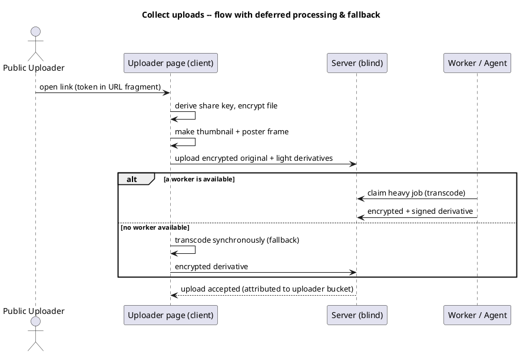

# UC: Collect uploads via an uploader link

- **ID:** uc.sharing.collect-uploads
- **Primary actor:** Memory Curator
- **Secondary actor:** Public Uploader
- **Goal:** Let external people contribute media into a Memory through an upload-only link, without
  exposing the gallery — e.g. a wedding DJ uploads their photos into the wedding Memory.
- **Preconditions:** The curator owns a Memory and holds its content key; sharing is permitted in the
  space.
- **Postconditions (success):** An uploader link exists; uploaders can add encrypted media to the
  Memory; uploaders never see the gallery, metadata or other uploads; each upload's contributor is
  traceable.

## Diagram

## Main flow
1. The curator creates an **uploader link**; the system wraps the Memory subtree's content key to a
   per-share key and embeds the share token in the link's URL fragment.
2. The curator shares the link (optionally with a name/notice requirement).
3. A Public Uploader opens the link and sees only an upload form (no gallery).
4. The uploader provides a display **name** (which names their **bucket**) and selects files.
5. The uploader's client encrypts each file under the shared content key and uploads it; light
   derivatives (thumbnail/poster frame) are produced client-side.
6. Heavy derivatives (e.g. video transcode) are enqueued and completed later by an authorized worker
   ([Agent Mode](../../../crosscutting/agent-mode.md)); the media appears in the curator's gallery,
   attributed to the uploader's bucket.

## Alternate / exception flows
- A1: The curator sets an upload notice/terms → the uploader must accept before uploading.
- A2: The curator revokes the link → the system rotates the content key; the old token can no longer
  encrypt or decrypt new content.
- E1: Disallowed file type or limits exceeded → rejected with a clear, rate-limited error.
- E2: No worker available → the item is marked "processing pending"; if no agent is configured, the
  uploading client transcodes synchronously (fallback — see the diagram).

## Quality notes
- *Privacy:* the uploader gains access only to the shared subtree (per-subtree key), never the wider
  space; no social-graph leakage.
- *Safety:* uploaded content in a public share is decryptable-on-report for Trust & Safety
  (share-boundary model).
- *Integrity:* worker-produced derivatives are signed to prevent a malicious worker substituting a
  misleading file.

## Related
- Feature: [Sharing](../_index.md) · Actors: [Memory Curator](../../../actors.md), [Public Uploader](../../../actors.md)
- Concepts: [Security Model](../../../crosscutting/security-model.md) (share keys, token-in-fragment,
  share-boundary T&S), [Agent Mode](../../../crosscutting/agent-mode.md)
- Decisions: [AD-03](../../../decisions/README.md) (per-subtree keys), [AD-05](../../../decisions/README.md) (T&S), [AD-12](../../../decisions/README.md) (liveness)
- Related use-cases: `uc.sharing.share-public-viewer`, `uc.uploads.add-media`
