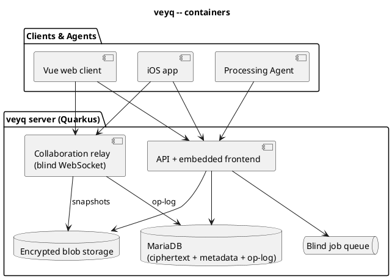
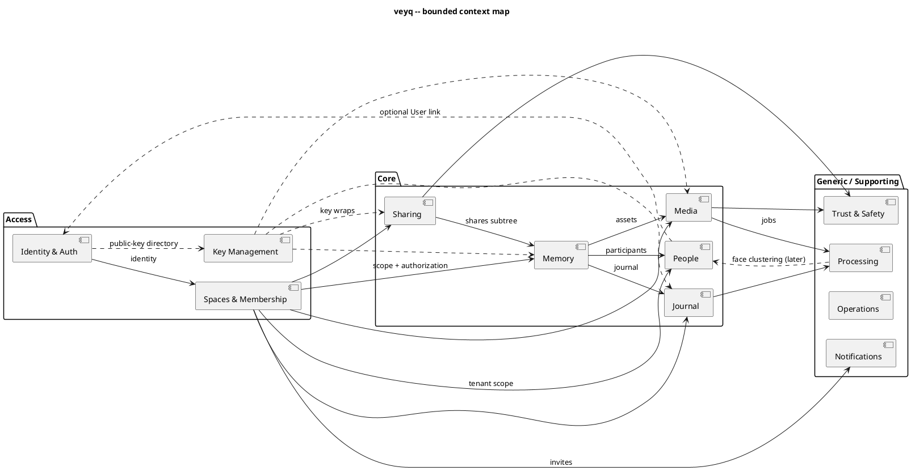

# System Architecture (technical overview)

> The general, technical "how veyq is built" — kept high-level. Concrete per-feature detail lives in
> each [feature](../features/) index; deep shared mechanisms live in [crosscutting](../crosscutting/).
> Class-level detail stays in the code.

## Tech stack

| Part | Technology |
|---|---|
| Backend | Quarkus / Kotlin (Java 21), Hibernate Panache, Flyway, MariaDB |
| Web client | Vue 3 / TypeScript (PrimeVue), generated OpenAPI clients |
| Native client | Swift / SwiftUI (iOS); Android planned |
| Collaboration | Yjs (CRDT) over WebSockets; a thin **blind relay** (not a content-aware server) |
| Processing | clients + trusted agents (see [Agent Mode](../crosscutting/agent-mode.md)) |
| Infra | Docker Compose (self-host) / Helm (k8s); admin reverse proxy in front |

## Topology & runtime mechanics

The defining property: **full E2EE everywhere — the server is always blind to content.** It stores
ciphertext, metadata and an opaque job queue. Clients and trusted agents hold keys and do all crypto
and media processing.

Key mechanics (deep detail in [crosscutting](../crosscutting/)):
- **API-first, internal**: OpenAPI contracts in `docs/api` generate backend interfaces and client
  models. Not a third-party API.
- **Blind server**: no server-side content processing/search/ML/moderation of private data.
- **Capability discovery**: the server advertises features so clients and workers adapt.

## Bounded contexts (modular monolith)

veyq is a **modular monolith** (extract a service only when a quality scenario forces it — see
[Solution Strategy](constraints-and-strategy.md)). Each [feature](../features/) maps onto one or more
of these contexts and links here rather than re-describing them.

**Rule of thumb for the cut:** belongs to **one** Memory and is simple → a *subdomain inside Memory*
(tracks, playlists, weather, maps). Spans **across** Memories and carries its own invariants (especially
privacy) → its **own context** (People).

### Core
| Context | Owns / language |
|---|---|
| **Memory** | Memory tree, chapters, covers, dates, favorites, scope assignment, tree invariants — **plus enrichment subdomains** tracks, playlists, weather, maps (each belongs to one Memory). References Media, Journal and People. |
| **Media** | Assets, **encrypted blobs**, derivatives, deduplication, upload sessions, uploader buckets. |
| **Journal** | Collaborative Markdown (Yjs), the blind relay (op-log + snapshots), embeds. |
| **Sharing** | Shares, roles (Viewer/Contributor/Manager/Uploader), share keys & tokens, uploader links, tenant terms/notices. |
| **People** | **Participant** = a name + *optional* User link + (later) a set of face clusters; **tenant-scoped**; **viewer-scoped, non-enumerable** resolution. Owns the privacy-critical person model. Memory references it as participants. Participation is **self-managed** (add/remove yourself) and drives relevance **and processing responsibility** ([Agent Mode](../crosscutting/agent-mode.md)). |

### Access
| Context | Owns / language |
|---|---|
| **Identity & Auth** | Global users, credentials (password/passkey/TOTP), sessions, devices, invitations, the public-key directory. |
| **Spaces & Membership** | Tenants, groups, personal scope, membership, roles, scope hierarchy — and the **authorization model** (can an identity access a scope), consumed by all other contexts. |
| **Key Management** | The envelope key graph — scope keys, content-key wraps, share keys, recovery & onboarding temp-wraps, key transparency. Central under E2E ([Security Model](../crosscutting/security-model.md)). |

### Generic / Supporting
| Context | Owns / language |
|---|---|
| **Processing (Agent Mode)** | The blind job queue, workers, leases, capability matching — transcode, ML face/semantic embeddings, journal snapshots ([Agent Mode](../crosscutting/agent-mode.md)). The text search index is **not** here — clients build it locally ([Search](../crosscutting/search.md)). |
| **Trust & Safety** | Abuse reports, share-boundary takedown, quarantine, audit. |
| **Operations** | Setup, capability discovery, backup/upgrade, auto-updates, server metadata, licensing. |
| **Notifications** | Email (invites, confirmations, notices); push later. |

### Context map

### Key integration contracts
- **Authorization** is owned by **Spaces & Membership** and *consumed* everywhere — never re-implemented per context.
- **Key Management** provides key wraps; clients/agents do the actual crypto (the server is blind).
- **Processing** is a generic job contract serving Media, Journal and (later) People/Search.

### Deployment
All contexts live in the modular monolith. First **extraction candidates** *if a quality scenario
forces it*: **Processing**, the **Journal relay** (the Redis scale-path), and **Media/blob storage**.
The core domain stays in the monolith.

## Technical context (channels)

| Partner | Channel | Notes |
|---|---|---|
| Web client | HTTPS / JSON (OpenAPI), NDJSON, range requests | httpOnly cookies; holds keys, does crypto |
| Native client | HTTPS / JSON, bearer sessions | strong worker (HW encoders, NPU) |
| Processing agent | HTTPS job queue + encrypted blob I/O | a trusted authorized device |
| Reverse proxy | HTTP(S) | TLS, domains, root path |
| SMTP | mail | invites, confirmations, notices |
| MariaDB | JDBC | ciphertext + metadata + queue |
| Blob storage | filesystem / volume / CIFS | encrypted blobs |
