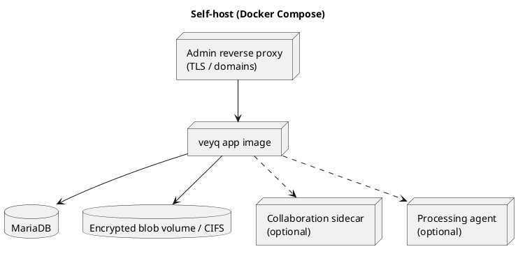

# Deployment

> veyq targets **two deployment shapes from one codebase**. The deployment runbook (install, env,
> backup, upgrade) is *procedural and version-locked* and lives in the repo `docs/`, not here.

## Shape A — Self-host (Docker Compose)

One application image, MariaDB, optional sidecars; behind the admin's own reverse proxy.

Reference artifacts: `infra/docker-compose.yml`, `scripts/veyq-server.sh`.

## Shape B — SaaS / scale (Helm on Kubernetes)

The same modular contexts packaged as Helm charts; horizontal scaling and multi-tenant isolation.
Heavy compute is **not** server-side — it is pushed to clients and trusted agents
([Agent Mode](../crosscutting/agent-mode.md)), keeping the server tier slim.

> Open: which bounded contexts (if any) get extracted into separate deployables — decided **only when
> a concrete quality scenario forces it** (e.g. independent scaling of the blind job queue). Default
> remains a modular-monolith image.

## Cross-cutting deployment notes

- The server stores **ciphertext only**; backups inherit a documented retention/rotation window that
  bounds erasure (see [Security Model → Deletion](../crosscutting/security-model.md)).
- EU hosting preference for the managed offering.
